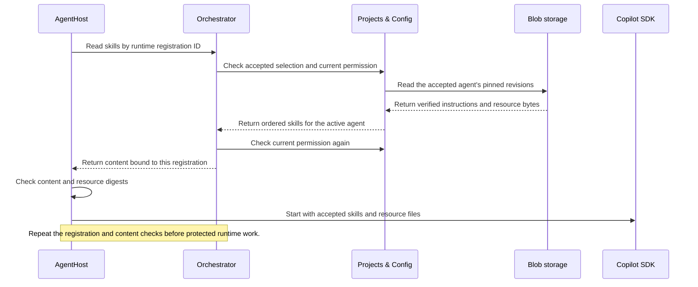
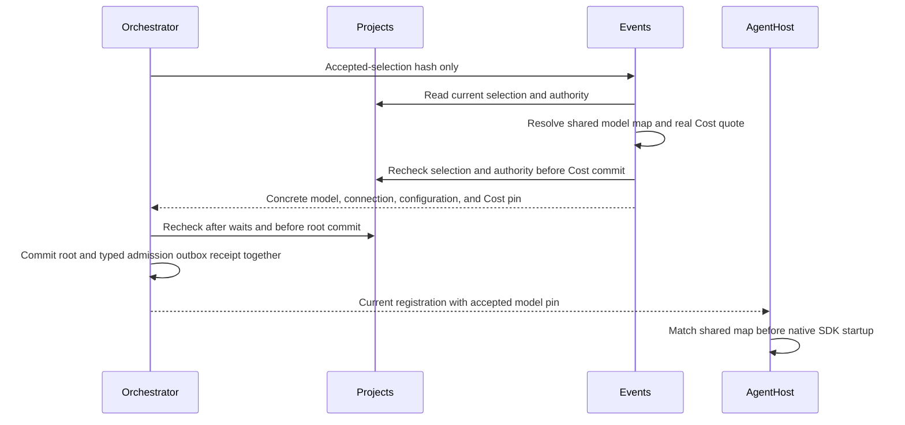
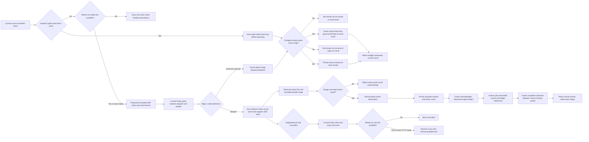
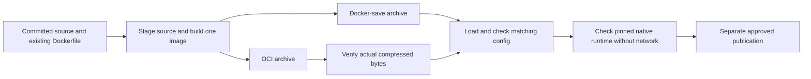

# AgentHost source candidate

The unpublished AgentHost executable runs the sole model harness inside the selected Sandbox.
It uses `GitHub.Copilot.SDK` 1.0.18 and the compatible native runtime 1.0.97.
Microsoft Agent Framework remains an Orchestrator dependency, not an AgentHost runtime.
This source does not provide an automatic scheduler, deployment, live OAuth acceptance, or paid model evidence.

The current native SDK path consumes a real hosted access token or BYOK key inside
the selected Sandbox. This is legacy credential delivery, **not credential-less
guest execution**, even when subprocess environment variables contain no secrets.
The [credential-less sandbox proposal](identity-secrets.md#credential-less-sandbox-proposal)
requires trusted-side request authentication or a supported model-runtime adapter
outside the guest, with the same guards, native results and accounting contracts.
Two containers sharing a Kata guest and private host directories alone do not
prove that separation. This proposal does not change the executable or its current
readiness contract; unsupported modes must not claim compliance.

## Authentication and immutable bindings

AgentHost requires an explicit HTTPS issuer, audience, owner addresses, image identity, and registered model bindings.
OpenIddict validates the bearer before a runtime route reads owner state.
The request host and scheme must match the exact configure audience.
The host never treats a caller-supplied actor, model, credential, or placement as authority.

Orchestrator supplies the current registration and immutable accepted-selection reference.
Environment supplies the exact retained lease, provider resource, image, and runtime profile.
Identity supplies separate configure and observe grants, plus current model-credential proof.
The host compares actor, tenant, project, run, session, purpose, grant revision, execution fence, and placement.
It repeats current authority checks after remote waits and before protected effects.
An authenticated per-session registration read uses
`GET /internal/projects/{projectId}/runs/{runId}/coordination/sessions/{sessionId}/runtime-registrations`.
Orchestrator checks the current session owner before and after finding the exact registration.
Missing, ambiguous, expired, or changed registrations do not produce a current result.
Fixed-work sessions use their retained execution-checkpoint association instead of an open WorkPlan item.
The association must match the parent, child, workflow, plan, agent, model, selection hash, fence, and decision version.
Accepted numeric and credit limits propagate without changing legacy null configuration.
Workflow-bound `MaxModelTurns`, `MaxToolCalls`, and positive Hosted Copilot hard
credit limits use owner-controlled admission. The Orchestrator preserves an
accepted `MaxPromptTokens` value in `RuntimeOwnerContext` and the runtime
binding. AgentHost resolves the effective per-prompt/context capacity against
the concrete model and any narrower server limit, then passes it to the native
SDK. The SDK compacts removable conversation history and fails the turn if
system context, tool definitions, and the latest input still cannot fit; it
does not silently truncate input. This is not a cumulative token budget or a
count of the SDK's internal model API calls.
For a zero Hosted Copilot hard limit, startup remains allowed, but the host
denies model-turn dispatch and never calls the SDK's native Send. Before it
returns the budget error, it reads the native event log and requires a complete
empty range, then the owner stores a guard receipt and linked no-send evidence.
The receipt binds the message hash and current Observe grant, not the prompt
text. An incomplete range or failed owner write fails closed. Orchestrator also
stores a stage-specific receipt before denying a model-turn action at its
authorization or verification boundary.

Before native session creation, AgentHost reads skills through the current runtime
registration. Orchestrator checks the accepted run selection and current read
permission; Projects returns only imported revisions assigned to the active agent.
AgentHost checks the registration binding and content digests, exposes those
instructions through the SDK skill provider, and places the exact resource bytes
in the native session filesystem. The configured working directory maps only to
the virtual `/workspace` root; it is not read from the host filesystem. AgentHost
initializes that root for fresh and restored sessions while other missing virtual
paths remain absent. It repeats the content read during current authority checks.
Missing, changed, revoked, unassigned, or legacy unpinned content denies session
creation or continued use.



| Route | Source contract |
| --- | --- |
| `POST /runtime/v1/configure` | Authenticated delivery of the pending, purpose-bound configure nonce. No model session starts on delivery alone. |
| `POST /runtime/v1/configure/activate` | Contract version 1, exact registration, consume/exchange operation IDs, and the delivered configuration bytes. Exact replay returns the existing session. Changed bytes or bindings deny. |
| `POST /runtime/v1/refresh` | Exact session proof and an operation ID. Rotation rechecks current Identity and owner authority. Exact replay does not rotate again. |
| `GET /runtime/v1/readiness` | Returns the existing noncredential `RuntimeHostReadinessReceipt` after the host revalidates the caller, registration, session, Observe grant, and readiness evidence. Ordinary configuration includes the source-derived recovery mode and its bound cache or journal evidence. It does not configure the SDK or send a turn. |
| `POST /runtime/v1/a2a/message:send` | One `user` message with one `text` part, a GUID message ID, native context ID, exact runtime proof, and `immediate` or `enqueue` delivery. |
| `GET /runtime/v1/readiness` | Authenticated current readiness receipt. Checks the caller, exact HTTPS configure audience, registration, source authority, and current placement. Does not start a turn or rotate a grant. |
| `GET /health/live` | Process liveness only. |
| `GET /health/ready` | Current registration, source authority, lease, isolation, workspace, egress, configuration, and startup budgets. A lost prerequisite returns `503`. |

```mermaid
sequenceDiagram
    participant C as Authenticated caller
    participant H as AgentHost
    participant O as Orchestrator
    participant I as Identity
    participant E as Environment
    Note over H: Permit workflow-bound MaxModelTurns and MaxToolCalls; configure the native SDK MaxPromptTokens compaction threshold
    C->>H: GET /runtime/v1/readiness with Broker bearer
    H->>O: Revalidate current registration
    O-->>H: Current registration or denial
    H->>I: Revalidate current Observe and model grants
    I-->>H: Noncredential grant receipts
    H->>E: Read current placement and readiness evidence
    E-->>H: Current lease and startup observations
    H-->>C: RuntimeHostReadinessReceipt with ordinary recovery evidence (no-store)
    opt Read the current durable run credit guard
        C->>O: POST /internal/runtime/credit-guards/read with Observe proof and exact run intent
        O-->>C: Owner snapshot or unavailable/denied (no-store)
    end
    Note over H: No SDK start or turn send
    Note over C,H: Unbound positive hard-capped Hosted activation is rejected; workflow-bound dispatches use owner admission
```

Runtime responses use `Cache-Control: no-store`.
Authentication rejection returns `401`.
Current-authority rejection returns `403` with the exact `code`.
Invalid input returns `400`; owner, execution, or startup failure returns `503`.
When a zero-credit denial is stored, the `403` response also includes
`fixedCreditGuard` with the typed guard receipt and no-send evidence. If the guard
is stored but evidence writing fails, the `503` response includes the stored guard
receipt with no evidence. An incomplete native event range or failed guard write
does not return stored receipts, and neither path writes turn content or sends a
model request.
The authenticated readiness route does not reuse the configured actor as permission for a different caller.
The health route remains a process probe, not caller authorization.

Hosted Copilot and BYOK remain distinct modes.
Hosted selection names an Identity-owned connection, not a secret version or personal-provider fallback.
Identity returns only the current GitHub user access token and typed proof.
Refresh tokens and OAuth client secrets stay inside Identity and its protected store.
BYOK uses the exact selected `SecretRef` and explicit native SDK Provider configuration without Copilot authentication or catalog lookup.
Neither a cache nor a submitted connection ID grants permission.
The pinned SDK does not prove which A2A send owns a native usage callback.
Workflow-bound Hosted Copilot with a positive hard credit limit uses the
owner-prepared dispatch and begin path, which checks current whole-run priced
usage before each new native send. An unbound positive hard limit still fails
activation with `runtime_usage_affinity_unavailable`; the prepared session is
cleaned up and the host does not become ready. An omitted limit keeps legacy
startup, zero still permits startup but blocks dispatch, and BYOK remains
token-metered.

The immutable Projects selection's `maxModelTurns`, `maxToolCalls`, and optional `maxPromptTokens` values are carried
through `RuntimeOwnerContext` into the registered `RuntimeBinding`. `maxModelTurns` and `maxToolCalls` are
supported only for workflow-bound registrations. Native sends require the prepared-dispatch, action-grant, and
native-begin admission path before SDK send. Each native tool invocation reserves one owner-side slot before
approval; exact retries reuse the reservation and attempts beyond the run limit are denied. An unbound
`maxModelTurns` or `maxToolCalls` fails activation with `runtime_numeric_limits_unsupported`,
before SDK session creation, readiness, or model/tool invocation. A configured `maxPromptTokens` is supported
when its concrete capacity can be resolved; otherwise activation fails with
`runtime_model_prompt_capacity_unavailable`. The resolved value is passed to the
native SDK as its prompt-compaction threshold.
Absent values preserve the legacy path. The RuntimeAction owner also rejects unsupported numeric bindings before issuing
an action grant. Positive workflow-bound Hosted Copilot hard limits use the same prepared
dispatch and begin checks against observed whole-run priced usage. The source
path can record durable hard-limit denial and bounded no-send receipts, but it
does not establish live boundary acceptance. The P1 dispatch check remains
blocked until permitted live owner receipts prove the limit boundary,
soft-warning deduplication, later floor advancement, and no-send result.

AgentHost and the enabled Events native consumer load the same server-owned
`AgentHost:ModelBindings` map and required `AgentHost:ModelBindingsRevision`.
The shared resolver lives in Identity without an SDK dependency.
It resolves the accepted reference to its concrete model ID; a reference is not a model ID.
It snapshots the map and hashes its canonical model, provider, header, and enabled-state values.
An optional accepted `ModelBindingPin` retains that revision, hash, reference, model ID, and source mode.
AgentHost rejects a changed pin before it starts the SDK client.
Disabled bindings and source-mode mismatches deny; BYOK cannot become hosted through a fallback.
The native catalog still checks the actual hosted model policy before session creation.
Legacy unpinned factory callers retain their existing API; they do not provide versioned admission proof.
For configured hosted credit limits, coordination root acceptance and backlog claim
now require a real Events run-admission receipt before their transaction writes the root.
The receipt binds the trusted Projects selection, selected connection, shared model pin, and Cost identity.
Unpriced or unavailable models cannot create a capped root.
The durable admission pin propagates through current owner context into the Host registration.
These source paths still need live PostgreSQL and whole-producer acceptance.



## Turns, tools, and durability

The native SDK supplies the effective model, session ID, runtime version, usage, and idle boundary.
The runtime disables ambient authentication, configuration discovery, native session persistence, and built-in tools.
Only registered guarded tools can run.
Each model turn and protected tool effect requires current AGT authorization and a committed Policy receipt before the effect.

The host serializes turns.
Prompt text preserves line breaks, tabs, and fenced code without trimming or changing its bytes.
Unsupported control characters, such as NUL, deny before dispatch.
`immediate` work takes priority over pending `enqueue` work at the next native idle boundary.
It does not interrupt an active native turn.

Hosted Copilot runs with no hard credit limit retain legacy startup and do not require a price quote.
A zero hard limit permits startup but denies model-turn dispatch. Before returning the budget error, the host must record a complete-empty-range no-send proof; it never calls the SDK's native Send. A positive hard limit requires a priceable source and workflow-bound dispatch admission against observed whole-run usage; an unbound positive hard limit is rejected before readiness.
BYOK remains token-metered and does not use the Copilot nano-AIU price preflight.
An exact message replay shares the original completion; changed content under the same ID denies.
Completed responses remain available for the configured host lifetime, independent of the pending-turn limit.
The configured pending-turn limit rejects excess work explicitly.

### Numeric budget boundaries

For workflow-bound registrations, `MaxModelTurns` bounds owner-admitted native sends across the whole run.
Preparation reserves one slot in the existing immutable MAF dispatch table before a new send.
The root owner lock serializes reservations across child runtimes.
Exact prepared replay uses the same slot.
Completed, failed, or uncertain sends do not refund that slot after restart or fence changes.
A sending or uncertain dispatch cannot be resent.
The model action grant must match the prepared dispatch, current registration, and exact prompt hash.
The SDK exposes no pre-model admission hook; this limit does not count internal model API calls.

`MaxToolCalls` is supported only for workflow-bound registrations. The Orchestrator
reserves a run-wide invocation slot before approving a native tool call, with
replays reusing the original reservation. The next invocation after the configured
limit is denied. Unbound registrations with this limit fail before SDK setup.

When configured, `MaxPromptTokens` is preserved in `RuntimeOwnerContext` and the
runtime binding; it is not silently discarded or reclassified as a Knowledge
retrieval budget. The effective value is the narrowest of the accepted limit, the
actual hosted model capacity, and any lower server limit; BYOK uses its
server-owned capacity. The pinned native SDK uses this value as a prompt-compaction
threshold and compacts removable conversation history. For an irreducible latest
turn, the SDK may send a provider request during compaction and then report a
capacity-attributed `query` error. This is not a hard admission check for every
internal provider request or a no-send guarantee, and input is not silently
truncated. This is not an owner-side raw-request token counter or a cumulative
token budget. Native and hosted deployment evidence is still
required; issue [#1855](https://github.com/sabbour/agentweaver/issues/1855)
remains open.

Each built-in tool approval checks current owner authority and Policy again.
The pre-tool callback checks Policy without reserving a tool slot.
The native call ID binds invocation and secondary permission checks to the current runtime registration and A2A turn.
Repeated callbacks retain their request IDs for reservation deduplication, but never reuse a cached approval.
Cancellation, a changed turn, or revoked authority prevents approval after an earlier successful check.
Secondary permissions also require a fresh Policy check for their exact input.
These checks do not enable the remote MCP tool hook.

Events stores actual user and assistant content as typed `TurnContent` through the existing Object Store.
The journal retains authenticated content references, Policy receipts, tool events, and compatible cache references.
Orchestrator commits native SDK source receipts.
The pinned SDK does not expose a proven usage-event-to-A2A-send binding.
AgentHost leaves usage observations uncorrelated rather than copy the active message ID
or infer ownership from event timestamps. Events therefore withholds cost-turn release
for an unbound callback, including one delivered after a later send begins.
Events fetches each receipt and commits immutable usage accounting before AgentHost acknowledges the turn.
For a bounded cost turn, Events requires the source receipt's A2A ID to equal the
`CostTurnId`; a later send in the same session cannot release an earlier turn's cost slot.
Already-weighted nano-AIU is not multiplied again.
Unknown cost remains `Unpriced`, never zero.
Before readiness, AgentHost asks Events to verify that the current SDK source can
be priced against the run's immutable Cost binding. An unpriced result prevents
readiness and cleans up the prepared session before any model turn.

At a confirmed idle boundary, the runtime captures opaque SDK cache bytes through its custom filesystem.
Recovery compares session scope, accepted selection, model reference, model ID, prompt-capacity pin, SDK version, and runtime version.
A compatible cache uses the actual SDK resume call.
A missing, incompatible, or corrupt cache rebuilds conversation context from authenticated journal content.
The saved source-session replay supplies visibility, including Events-approved parent history.
Each recovered TURN must match its own journal payload, single stored object reference, and authenticated material acknowledgment.
Events rechecks the current reader's authority before it returns material bytes.
The Host checks event identity, position, tenant, byte length, and content digest.
Historical runtime, revision, fence, selection, SDK/runtime, model, and capacity facts belong to each TURN, not the latest cache.
Recovery does not replay model turns, tools, or external effects.
Cancellation waits for the native abort idle event; a failed abort prevents another turn or cache capture.

The private native-receipt bridge records the SDK's durable cursor before sending.
After idle, it reads bounded, persisted events through the SDK event-log API.
It binds the actual native send message ID to the user event, turn start, turn end,
and completion receipt. The receipt's event range must match those native IDs.
The captured assistant bytes must match the returned answer.
An idle event alone cannot produce this proof.

When present, a native usage checkpoint retains its reported nano-AIU and source
sequence watermarks. This observed amount is not proof that all usage has settled.
Missing accounting stays unavailable. Native output evidence alone does not authorize
a protected send or prove financial completeness.

The source bridge now uses a typed `RuntimeNativeTurnObservation`.
It retains the actual root usage-event IDs found inside the native completion range.
Those IDs describe observed membership, not a complete accounting-source set.

Orchestrator exposes authenticated native-turn and denial-evidence routes under the existing observe grant.
Before sending, the MAF source path prepares the immutable dispatch row under the
current registration, root owner, decision, and checkpoint locks.
It pins the platform intent, complete request hash, source hash, model, and execution fence.
Exact prepared retries retain that row. A changed binding or an already-sending row denies.
For configured hosted credit limits, preparation verifies the real Events pricing
snapshot before it commits the dispatch. Unavailable pricing rejects dispatch start.
Begin repeats financial admission before any native work.
`POST /internal/runtime/turns/begin` requires a previously prepared MAF dispatch.
It checks the current registration, SDK source, model, request bytes, pending checkpoint,
and decision version before it changes `prepared` to `sending`. It returns either
an admission or a typed hard-limit denial; the denial leaves the dispatch prepared
at its existing owner revision.
The admission receipt contains the stable platform message ID, not predicted native IDs.
A repeated begin cannot resend a dispatch that has already entered `sending`.
For configured hosted credit limits, begin reads the existing Events pricing snapshot.
It validates the pinned zero-work quote and fully priced observed Copilot totals.
Missing or unpriced pricing cannot authorize capped native work.
The root owner lock serializes admission and its durable observed-credit guard.
When a valid whole-run pricing snapshot first reaches or exceeds the configured
soft-credit limit, the guard queues one durable warning event through the existing
outbox. Replays, concurrent admissions, and later snapshots do not duplicate that
warning; later priced totals still advance the observed-credit floor and ledger-event
count. These admission-time observations are not immediate per-call settlement:
Events can price those costs after they become visible.
At or above the hard limit, it records exhaustion and denies new dispatch.
The currently executing turn can report usage above the limit; the next dispatch cannot start.
Another sending or accounting-pending dispatch blocks hard-capped admission.
These checks do not claim an all-future accounting-source barrier.
`POST /internal/runtime/credit-guards/read` provides a separate read-only Orchestrator
observation of this durable state. Its Observe proof is checked against the current
registration and source grant, and its request must match the current tenant,
project, run, root session, accepted-selection hash, execution fence, and configured
limits. The typed response includes the owner registration hash, cost identity and
unit/scope, observed-credit floor, ledger-event count and digest, guard revision,
warning/exhaustion flags, and update time. The guard row is read under a shared
transaction lock; no row returns `404`, and the response is never cached.
The source owner stores the typed denial receipt in its existing outbox with the
credit-guard update. For a hard-capped Hosted Copilot turn, AgentHost captures
the native cursor before begin. After a denial it accepts only a complete bounded
event-log range with zero events and the same before/after cursor, then stores a
source-owned no-send receipt through `POST /internal/runtime/turns/no-send`.
The Host returns the budget error only after that receipt is stored. An event,
incomplete range, or changed cursor fails closed, and native Send is not called.
The no-send receipt proves only the bounded no-send interval, not later accounting finality.
AgentHost exposes authenticated read routes at
`POST /runtime/v1/turns/fixed-credit-denials/read` and
`POST /runtime/v1/turns/denials/read`. Each request contains the current session
proof and the stable record selector. The Host checks the proof against the
current registration before and after the source read, then returns the
source-owned `receipt`/`evidence` or `receipt`/`noSend` pair directly. A stored
fixed-credit guard can have null evidence while its no-send write is incomplete;
a native read with no stored denial returns a null receipt and null `noSend`.
Source-owner unavailability returns `503`. Both routes use no-store
responses.
`POST /internal/runtime/turns/observations` attaches the actual native range and output hash
to that same dispatch. Exact retries retain the stored observation.
The resulting state is `terminal_pending_accounting`, with a `partial` source report.
It is not a source-completion manifest.
These routes reuse migration 015; they add no financial ledger or migration.

`POST /internal/runtime/turns/accounting` completes the observed dispatch.
It requires the recorded native range and exactly its observed usage-event references.
Events joins every reference to its immutable source receipt and actual ledger row.
The registration, SDK source, platform message, accounting hash, and price must match.
Raw SDK usage can have no platform message ID. Events accepts this only after an
authenticated Core read confirms the persisted turn and its exact observed event set.
A wrong non-null message ID or an event after native completion still fails.
Events repeats the Core read after releasing its Cost transaction.
Core releases its owner locks before requesting the Events snapshot.
Its final owner transaction rechecks the source grant, checkpoint, report, and revision
before storing references and changing the dispatch to `completed`.
Report writes and final completion reject event reuse by another dispatch of the same SDK source.
This join does not call Source GET or create a source-completion manifest.
Accounting remains explicitly `priced` or `unpriced`; unknown cost does not become zero.
The source report stays `partial`, and `hard_cap_serialized` stays false.
Neither source-completion nor strict retirement fields are populated.

The Host uses this path for a registration with an accepted workflow step.
The legacy string-turn method rejects that registration, so it cannot bypass admission.
The Host begins the dispatch before it writes user content or sends native work.
After native completion, it persists the partial observation, assistant content, and cache.
It retains actual Events acknowledgments and completes the durable observed join before returning the answer.
No observed usage means no synthetic usage event is required.
An accounting failure prevents an answer and makes the Host unavailable.
Exact message retries retain the result or failure and do not resend native work.
Unbound legacy sessions retain their existing turn behavior.
MAF prepares through the current source owner before sending.
After the Host responds, MAF rereads the completed dispatch and matches the actual output hash.
Only then can the workflow retain the result.
An explicit unpriced receipt does not block an uncapped answer.
Later usage still enters the ledger and affects the next capped admission.
These source paths do not prove live PostgreSQL or whole-producer acceptance.

The source owner also exposes an authenticated, read-only completion-proof route:
`GET /internal/projects/{projectId}/runs/{runId}/coordination/sessions/{sessionId}/usage-dispatch-completions/{dispatchId}`.
It reads only an owner-persisted hosted-Copilot source-completion manifest with matching dispatch scope and digest.
The retained SDK source supplies the actual meter mode, including for an empty receipt set.
An absent or unproven manifest returns `404` with `Cache-Control: no-store`.
The host exposes no caller-facing manifest writer.
The current native observation path writes only `partial` reports, so it cannot supply this proof.
SDK 1.0.18 and runtime 1.0.97 expose no supported accounting-source finality guarantee.
Their output completion receipt, usage status, idle event, and watermarks do not prove
that every accounting source is final or that no late usage remains.
That missing guarantee does not block ordinary answer acknowledgment.
Observed pricing and accounting-source finality are separate facts.



## Reviewed remote tool result recovery

The source-only Orchestrator reviewed-tool agent checks for a committed result after
native action admission and before serializing or sending a remote call.
A matching saved result returns only after current grant, registration, selection,
and tool snapshot checks.
It must match the complete call proof, event, runtime binding, byte length, and digest.
Only the result content class can come from the recorded result rather than the read template.
Missing material permits a new guarded dispatch; invalid or changed material does not.
New results also require durable Events acknowledgment and a final current-authority check.

The trusted private result client belongs to Orchestrator, not AgentHost.
The ordinary runtime material client remains disabled for remote results.
See the [private result TLS boundary](./events-sessions#private-result-tls-configuration).
These source paths do not enable the native remote-tool hook or prove a real remote call.

## Startup evidence and image

Environment reports actual `scheduled`, `imageReady`, and `started` timestamps from Sandbox observations.
An exact Pod UID and image digest `Pulled` event also proves availability when the image is already cached.
Its timestamp is actual availability evidence; compressed pull bytes describe the pinned image, not new network traffic.
AgentHost records `configured` after authenticated native session creation and `ready` after current prerequisite checks.
The readiness receipt combines all five observations with the exact image and current source grant.
Readiness does not infer completion from a Kubernetes Ready condition.
Ordinary configuration also reports whether the SDK used a fresh session, a restored native cache,
or journal-rebuilt context. Native-cache evidence carries the Events acknowledgment for the source
cache and is bound to the replacement Host instance, registration revision, fence, and returned SDK
session facts. Journal-rebuild evidence carries the last read event position and a digest over the
ordered authenticated journal entries and turn-material digests, bound to the same replacement
instance. A fresh start carries neither source proof; none of these modes alone proves that an
external effect was not repeated. Resume-only receipts remain separate.

The host enforces configured per-phase and total startup-time ceilings.
Exact ceiling values pass; values beyond the ceiling fail.
Missing, future, out-of-order, or differently bound observations fail.
The readiness owner read retains the exact lease during fresh egress and Sandbox observations.
Competing retirement waits for that lease lock.
The read uses the retained selection snapshot, not a recursive accepted-selection lookup.

The Dockerfile pins the build and runtime base digests and verifies the native archive SHA-512.
The final image runs as UID/GID `1654:1654` on `linux/amd64`.
It uses explicit HTTPS certificate configuration and a read-only root filesystem.
Private state and temporary files are separate from the attached workspace.
The image verifies the pinned CLI executable, then runs its non-authenticated
`--version` command during the build to materialize the matching distribution under
image-owned `/app/native`. It includes the launcher, application modules, and native
addon; it does not extract executable packages into private session state at runtime.
The host starts that image-owned executable through the SDK's stdio connection and
sets `COPILOT_CLI_DIST_DIR` to `/app/native`, never a caller-selected path.
Startup checks the Linux x86-64 ELF header, executable checksum, required distribution
files, SDK/runtime versions, and pinned archive digest.
Private state and temporary mounts need no executable permission.
Opaque SDK session caches remain private and use the existing authenticated recovery path.
No registry credential or runtime model credential enters the image.

The selected `agent-sandbox` options can include the typed trusted `AgentHost` launch profile.
It contains only `ConfigurationMapName` and `TlsSecretName`.
Environment binds this optional subsection before it validates the selected Sandbox options.
The provider mounts the named `appsettings.json` read-only and the named TLS Secret read-only.
It supplies fixed private `/state` and `/tmp` volumes, UID/GID/fsGroup 1000, HTTPS 8443, and health probes.
The explicit Pod identity matches the admitted Azure Files workspace owner and its `0755` directories and `0644` files.
The image default remains UID/GID 1654 for standalone use.
This profile does not change Storage mount options or use a privileged initializer.
The SDK working directory is the exact negotiated workspace mount.
The executable process keeps `/app` as its working directory.
The provider validates this profile on template readback and on the actual Pod.
An absent profile preserves the legacy template and does not configure the new executable.

`deploy/k8s/profiles/agenthost/runtime-config.example.yaml` describes the required ConfigMap shape.
Its `.invalid` addresses, required image digest, zero byte count, and model markers deliberately fail startup until a trusted composition supplies real values.
The operator supplies the matching existing TLS Secret with `tls.crt` and `tls.key`.
The source creates neither TLS material nor cloud permission.
The provider creates the actual fenced template from accepted options; the example is not a disconnected replacement Pod.

The CI image check builds one unpublished amd64 candidate and measures its local OCI archive.
`scripts/release/measure-agenthost-image.mjs` verifies actual manifest, config, and compressed layer bytes against their descriptors.
The receipt records the platform manifest digest, config digest, source SHA/tree, and compressed pull bytes.
The byte total includes the manifest and each unique config/layer blob once.
It is not an uncompressed filesystem estimate or a hard image-size ceiling.

CI then compares the loaded image config digest with the receipt.
It runs `--verify-native-runtime` without network access, writes, credentials, or a model turn.
The native SDK status must report runtime 1.0.97, protocol 3, and the image-owned distribution path.
Both image checks use explicit `noexec,nosuid,nodev` state and temporary mounts.
They reject any extracted native package cache in private state.
CI separately runs the same image as UID/GID 1000 with an owner-writable `0755` workspace and private `0700` mounts.
It checks actual create, write, rename, read, and delete operations without network or a model call.
Fixture configuration and TLS files use mode `0440`.
The check provides simulated POSIX access proof, not a live Azure Files receipt or deployed TLS acceptance.
The receipt and native status remain exact-candidate CI artifacts, not publication or live Sandbox acceptance.

Release preparation now uses this same Dockerfile with only committed inputs.
It retains both a Docker-save archive and an OCI archive in one component record.
Both hashes and sizes are required, with the same measured image-config digest.
The existing measurer verifies the retained OCI bytes, source/tree labels, version, and platform.
Preparation loads the saved image and checks its pinned native runtime without network or model access.
Publication measures the OCI archive again and repeats the loaded-image and runtime checks before registry login.
It tags the verified config digest, not an unchecked mutable local tag.
Missing or changed archives, wrong image identity or labels, and failed size or runtime checks block publication.
The publication receipt records the actual registry digest separately from the prepared OCI measurement.
This source does not apply versions, publish an image, or prove deployed startup.



## BuildTest output collector mode

`--build-test-output-collector-v1` selects the trusted Linux file collector before web configuration or native SDK startup.
The mode accepts exactly one bounded encoded request; it does not create a runtime session or send a model turn.
Environment pins its image, executable, assembly, accepted output paths, and read-only Workspace PVC.
The collector obtains its actual Pod UID from the Kubernetes downward API.
It checks regular files, mount identity, no-follow paths, and accepted byte limits before it emits a receipt.
Unsupported platforms and invalid inputs return explicit nonzero exits.
Command logs cannot substitute for this file receipt.
See [Environment BuildTest](./environment-sandbox#buildtest-command-and-output-collection) for admission, reconciliation, and terminal classification.

`--build-test-workspace-collector-v2` uses the same trusted Linux collector without starting the SDK or a model session.
It prepares the exact accepted repository through the shared Source Control package before the command runs.
After command success, it seals the complete native baseline and declared output bytes through descriptor-safe reads.
Its private state is not mounted by the command container.
The Kubernetes exchange returns full binary output, not container logs.
Sealed bytes survive retries in that Pod until Environment verifies the canonical Events acknowledgment and releases the exact Pods.
This source path and its managed checks are not native Kubernetes execution evidence.

## Native suspend evidence

`POST /runtime/v1/suspend/native-evidence` requires the current signed runtime proof and exact HTTPS audience.
The request carries the owner operation ID, stable manifest ID, and exact phase version.
Before closing turn admission, AgentHost calls Core's `POST /internal/runtime/suspend/require-current` with the unchanged request.
Only the exact request echo permits suspension.
Core must verify current Projects and run authority and its stored suspend intent, reserved manifest ID, execution fence, accepted selection, `fenced` phase, and version.
The completed manifest is stored only after actual evidence is available; it is not a prerequisite for native capture.
AgentHost closes new turn admission and waits for all admitted turns to finish.
It waits for the observed usage accounting worker, without claiming that no later usage can exist.
The authorized session then holds its execution gate, checks current authority, and commits the actual native cache to Events.
The manifest ID is the cache event ID.
The response returns the recorded native completion and the exact Events cache and journal acknowledgment.
AgentHost repeats the Core check before and after cache capture and persistence.
Exact replay reads the stored cache again and repeats that check; it does not send a turn or capture another cache.

An abort or idle acknowledgment is not a native completion receipt.
Missing native completion, failed accounting, changed authority, or a missing cache prevents a successful response.
New turns, content writes, ordinary cache writes, and credential refresh remain blocked after suspension starts.
Only the internal suspend path can capture a cache with the required current-operation check.
Disposal, credential revocation, and Sandbox abandonment do not produce this evidence.
This endpoint supplies native evidence only, not a completed Core suspend or resume manifest.
Core must also resolve its checkpoint and verified Workspace content.
The current Storage provider has no durable flush or content-checkpoint operation.

## Focused source checks

After the Release build, run these commands:

```powershell
dotnet test tests\Agentweaver.Identity.Broker.Tests\Agentweaver.Identity.Broker.Tests.csproj --no-build --no-restore --configuration Release --filter "FullyQualifiedName~RuntimeAgentHostTests|FullyQualifiedName~NativeRuntimeManifestTests|FullyQualifiedName~RuntimeCopilotSessionTests|FullyQualifiedName~RuntimeNativeTurnJournalTests|FullyQualifiedName~RuntimeSessionRecoveryTests|FullyQualifiedName~RuntimeActionHttpClientTests"
dotnet test tests\Agentweaver.Environment.Tests\Agentweaver.Environment.Tests.csproj --no-build --no-restore --configuration Release --filter FullyQualifiedName~EnvironmentRuntimePlacementPostgresTests
node --test scripts\release\tests\measure-agenthost-image.test.mjs
```

The host tests cover authenticated HTTP, exact replay, current-owner rejection, priority at idle boundaries, legacy accounting acknowledgment, and measured startup ceilings.
Workflow-bound tests cover admission denial, changed admission, stale authority, missing native proof, failed receipt persistence, and no acknowledgment or resend.
Native suspend tests hold an admitted turn, verify its exact cache receipt and replay, and reject abort-only evidence.
They also reject changed operation authority, mismatched Core echoes, and unsigned HTTP requests before cache disclosure.
These controlled Host tests do not prove a persisted Core suspend operation or PostgreSQL suspend success.
The combined Broker scenario connects current Projects authority, Identity connection rotation, Orchestrator receipts, native SDK callbacks, and Events/PostgreSQL accounting.
It covers ordinary native cache and accounting, not a completed suspend operation.
It controls external GitHub, Key Vault SDK, placement, and native transport inputs.
These fixtures do not prove live entitlement, Azure permissions, deployed TLS, or paid model execution.

Historical `TurnContent` reads require current `ReadRunSelection` or an actually supplied `ReadProjects` entitlement, exact signed project/run binding, and recorded session membership.
They do not require a dispatchable decision, live runtime lease, or current model credential.
SDK-cache reads remain restricted to the Core `ReadRunSelection`-eligible runtime path.
An eligible UI actor reads actual UTF-8 turn content from owner-recorded references, never an SDK cache.
Projects suppresses run-bound `ReadProjects` in its authorization-context response.
Its separate project-summary reader does not authorize opaque material or privileged Core model/runtime context.
An unbound browser Viewer cannot use these material routes.
Gateway/browser token composition for that Viewer remains separate work, without new grants or elevated proxy credentials.
