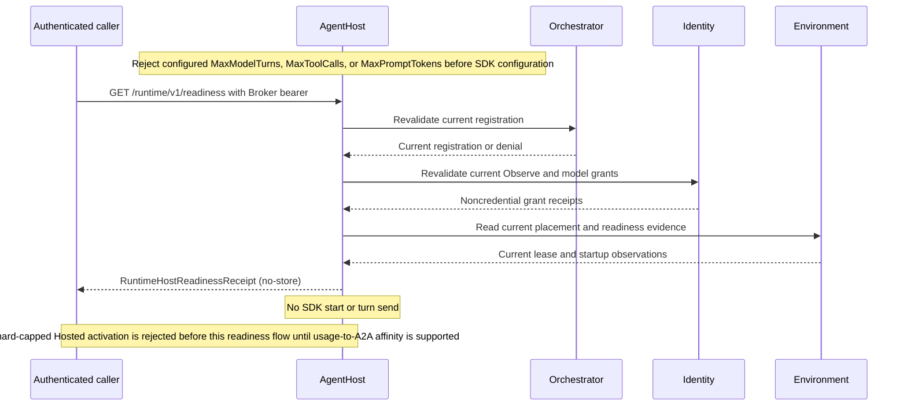

# AgentHost source candidate

The unpublished AgentHost executable runs the sole model harness inside the selected Sandbox.
It uses `GitHub.Copilot.SDK` 1.0.18 and the compatible native runtime 1.0.79.
Microsoft Agent Framework remains an Orchestrator dependency, not an AgentHost runtime.
This source does not provide an automatic scheduler, deployment, live OAuth acceptance, or paid model evidence.

## Authentication and immutable bindings

AgentHost requires an explicit HTTPS issuer, audience, owner addresses, image identity, and registered model bindings.
OpenIddict validates the bearer before a runtime route reads owner state.
The request host and scheme must match the exact configure audience.
The host never treats a caller-supplied actor, model, credential, or placement as authority.

Orchestrator supplies the current registration and immutable accepted-selection reference.
Environment supplies the exact retained lease, provider resource, image, and runtime profile.
Identity supplies separate configure and observe grants, plus current model-credential proof.
The host compares actor, tenant, project, run, session, purpose, grant revision, execution fence, and placement.
It repeats current authority checks after remote waits and before protected effects.

| Route | Source contract |
| --- | --- |
| `POST /runtime/v1/configure` | Authenticated delivery of the pending, purpose-bound configure nonce. No model session starts on delivery alone. |
| `POST /runtime/v1/configure/activate` | Contract version 1, exact registration, consume/exchange operation IDs, and the delivered configuration bytes. Exact replay returns the existing session. Changed bytes or bindings deny. |
| `POST /runtime/v1/refresh` | Exact session proof and an operation ID. Rotation rechecks current Identity and owner authority. Exact replay does not rotate again. |
| `GET /runtime/v1/readiness` | Returns the existing noncredential `RuntimeHostReadinessReceipt` after the host revalidates the caller, registration, session, Observe grant, and readiness evidence. It does not configure the SDK or send a turn. |
| `POST /runtime/v1/a2a/message:send` | One `user` message with one `text` part, a GUID message ID, native context ID, exact runtime proof, and `immediate` or `enqueue` delivery. |
| `GET /health/live` | Process liveness only. |
| `GET /health/ready` | Current registration, source authority, lease, isolation, workspace, egress, configuration, and startup budgets. A lost prerequisite returns `503`. |



Runtime responses use `Cache-Control: no-store`.
Authentication rejection returns `401`.
Current-authority rejection returns `403` with the exact `code`.
Invalid input returns `400`; owner, execution, or startup failure returns `503`.

Hosted Copilot and BYOK remain distinct modes.
Hosted selection names an Identity-owned connection, not a secret version or personal-provider fallback.
Identity returns only the current GitHub user access token and typed proof.
Refresh tokens and OAuth client secrets stay inside Identity and its protected store.
BYOK uses the exact selected `SecretRef` and explicit native SDK Provider configuration without Copilot authentication or catalog lookup.
Neither a cache nor a submitted connection ID grants permission.
The pinned SDK does not prove which A2A send owns a native usage callback.
Until that affinity is supported, Hosted Copilot with a positive hard credit limit fails activation with
`runtime_usage_affinity_unavailable`; the prepared session is cleaned up and the host does not become ready.
An omitted limit keeps legacy startup, zero still permits startup but blocks dispatch, and BYOK remains token-metered.

The immutable Projects selection's `maxModelTurns`, `maxToolCalls`, and `maxPromptTokens` values are carried
through `RuntimeOwnerContext` into the registered `RuntimeBinding`. AgentHost does not yet have exact native
turn/tool accounting or whole-prompt token enforcement, so any non-null value fails activation with
`runtime_numeric_limits_unsupported`, before SDK session creation, readiness, or model/tool invocation.
Absent values preserve the legacy path. The RuntimeAction owner also rejects these bindings before issuing an
action grant. This is a fail-closed admission rule, not numeric enforcement.

## Turns, tools, and durability

The native SDK supplies the effective model, session ID, runtime version, usage, and idle boundary.
The runtime disables ambient authentication, configuration discovery, native session persistence, and built-in tools.
Only registered guarded tools can run.
Each model turn and protected tool effect requires current AGT authorization and a committed Policy receipt before the effect.

The host serializes turns.
Prompt text preserves line breaks, tabs, and fenced code without trimming or changing its bytes.
Unsupported control characters, such as NUL, deny before dispatch.
`immediate` work takes priority over pending `enqueue` work at the next native idle boundary.
It does not interrupt an active native turn.

Hosted Copilot runs with no hard credit limit retain legacy startup and do not require a price quote.
A zero hard limit permits startup but blocks model-turn dispatch; a positive hard limit requires both a priceable source and proven usage-to-A2A affinity before readiness or cost admission.
BYOK remains token-metered and does not use the Copilot nano-AIU price preflight.
An exact message replay shares the original completion; changed content under the same ID denies.
Completed responses remain available for the configured host lifetime, independent of the pending-turn limit.
The configured pending-turn limit rejects excess work explicitly.

Events stores actual user and assistant content as typed `TurnContent` through the existing Object Store.
The journal retains authenticated content references, Policy receipts, tool events, and compatible cache references.
Orchestrator commits native SDK source receipts.
The pinned SDK does not expose a proven usage-event-to-A2A-send binding.
AgentHost leaves usage observations uncorrelated rather than copy the active message ID
or infer ownership from event timestamps. Events therefore withholds cost-turn release
for an unbound callback, including one delivered after a later send begins.
Events fetches each receipt and commits immutable usage accounting before AgentHost acknowledges the turn.
For a bounded cost turn, Events requires the source receipt's A2A ID to equal the
`CostTurnId`; a later send in the same session cannot release an earlier turn's cost slot.
Already-weighted nano-AIU is not multiplied again.
Unknown cost remains `Unpriced`, never zero.
Before readiness, AgentHost asks Events to verify that the current SDK source can
be priced against the run's immutable Cost binding. An unpriced result prevents
readiness and cleans up the prepared session before any model turn.

At a confirmed idle boundary, the runtime captures opaque SDK cache bytes through its custom filesystem.
Recovery compares session scope, accepted selection, model reference, model ID, SDK version, and runtime version.
A compatible cache uses the actual SDK resume call.
A missing, incompatible, or corrupt cache rebuilds conversation context from authenticated journal content.
Recovery does not replay model turns, tools, or external effects.
Cancellation waits for the native abort idle event; a failed abort prevents another turn or cache capture.

## Startup evidence and image

Environment reports actual `scheduled`, `imageReady`, and `started` timestamps from Sandbox observations.
An exact Pod UID and image digest `Pulled` event also proves availability when the image is already cached.
Its timestamp is actual availability evidence; compressed pull bytes describe the pinned image, not new network traffic.
AgentHost records `configured` after authenticated native session creation and `ready` after current prerequisite checks.
The readiness receipt combines all five observations with the exact image and current source grant.
Readiness does not infer completion from a Kubernetes Ready condition.

The host enforces configured per-phase and total startup-time ceilings.
Exact ceiling values pass; values beyond the ceiling fail.
Missing, future, out-of-order, or differently bound observations fail.
The readiness owner read retains the exact lease during fresh egress and Sandbox observations.
Competing retirement waits for that lease lock.
The read uses the retained selection snapshot, not a recursive accepted-selection lookup.

The Dockerfile pins the build and runtime base digests and verifies the native archive SHA-512.
The final image runs as UID/GID `1654:1654` on `linux/amd64`.
It uses explicit HTTPS certificate configuration and a read-only root filesystem.
Private state and temporary files are separate from the attached workspace.
The pinned CLI loads its complete distribution from the image-owned `/app/native` directory.
The host sets `COPILOT_CLI_DIST_DIR` to the verified executable's directory, never a caller-selected path.
Startup rejects a missing distribution index, application module, or native runtime addon.
The CLI does not extract executable packages into private session state.
Private state and temporary mounts need no executable permission.
Opaque SDK session caches remain private and use the existing authenticated recovery path.
No registry credential or runtime model credential enters the image.

The selected `agent-sandbox` options can include the typed trusted `AgentHost` launch profile.
It contains only `ConfigurationMapName` and `TlsSecretName`.
Environment binds this optional subsection before it validates the selected Sandbox options.
The provider mounts the named `appsettings.json` read-only and the named TLS Secret read-only.
It supplies fixed private `/state` and `/tmp` volumes, UID/GID/fsGroup 1000, HTTPS 8443, and health probes.
The explicit Pod identity matches the admitted Azure Files workspace owner and its `0755` directories and `0644` files.
The image default remains UID/GID 1654 for standalone use.
This profile does not change Storage mount options or use a privileged initializer.
The SDK working directory is the exact negotiated workspace mount.
The executable process keeps `/app` as its working directory.
The provider validates this profile on template readback and on the actual Pod.
An absent profile preserves the legacy template and does not configure the new executable.

`deploy/k8s/profiles/agenthost/runtime-config.example.yaml` describes the required ConfigMap shape.
Its `.invalid` addresses, required image digest, zero byte count, and model markers deliberately fail startup until a trusted composition supplies real values.
The operator supplies the matching existing TLS Secret with `tls.crt` and `tls.key`.
The source creates neither TLS material nor cloud permission.
The provider creates the actual fenced template from accepted options; the example is not a disconnected replacement Pod.

The CI image check builds one unpublished amd64 candidate and measures its local OCI archive.
`scripts/release/measure-agenthost-image.mjs` verifies actual manifest, config, and compressed layer bytes against their descriptors.
The receipt records the platform manifest digest, config digest, source SHA/tree, and compressed pull bytes.
The byte total includes the manifest and each unique config/layer blob once.
It is not an uncompressed filesystem estimate or a hard image-size ceiling.

CI then compares the loaded image config digest with the receipt.
It runs `--verify-native-runtime` without network access, writes, credentials, or a model turn.
The native SDK status must report runtime 1.0.79, protocol 3, and the image-owned distribution path.
Both image checks use explicit `noexec,nosuid,nodev` state and temporary mounts.
They reject any extracted native package cache in private state.
CI separately runs the same image as UID/GID 1000 with an owner-writable `0755` workspace and private `0700` mounts.
It checks actual create, write, rename, read, and delete operations without network or a model call.
Fixture configuration and TLS files use mode `0440`.
This is simulated POSIX access proof, not a live Azure Files receipt or deployed TLS acceptance.
The receipt and native status remain exact-candidate CI artifacts, not publication or live Sandbox acceptance.

## Focused source checks

After the Release build, run these commands:

```powershell
dotnet test tests\Agentweaver.Identity.Broker.Tests\Agentweaver.Identity.Broker.Tests.csproj --no-build --no-restore --configuration Release --filter "FullyQualifiedName~RuntimeAgentHostTests|FullyQualifiedName~NativeRuntimeManifestTests|FullyQualifiedName~RuntimeCopilotSessionTests|FullyQualifiedName~RuntimeSessionRecoveryTests|FullyQualifiedName~RuntimeActionHttpClientTests"
dotnet test tests\Agentweaver.Environment.Tests\Agentweaver.Environment.Tests.csproj --no-build --no-restore --configuration Release --filter FullyQualifiedName~EnvironmentRuntimePlacementPostgresTests
node --test scripts\release\tests\measure-agenthost-image.test.mjs
```

The host tests cover authenticated HTTP, exact replay, current-owner rejection, priority at idle boundaries, accounting acknowledgment, and measured startup ceilings.
The combined Broker scenario connects current Projects authority, Identity connection rotation, Orchestrator receipts, native SDK callbacks, and Events/PostgreSQL accounting.
It controls external GitHub, Key Vault SDK, placement, and native transport inputs.
These fixtures do not prove live entitlement, Azure permissions, deployed TLS, or paid model execution.

Historical `TurnContent` reads require current `ReadRunSelection` or an actually supplied `ReadProjects` entitlement, exact signed project/run binding, and recorded session membership.
They do not require a dispatchable decision, live runtime lease, or current model credential.
SDK-cache reads remain restricted to the Core `ReadRunSelection`-eligible runtime path.
An eligible UI actor reads actual UTF-8 turn content from owner-recorded references, never an SDK cache.
Projects suppresses run-bound `ReadProjects` in its authorization-context response.
Its separate project-summary reader does not authorize opaque material or privileged Core model/runtime context.
An unbound browser Viewer cannot use these material routes.
Gateway/browser token composition for that Viewer remains separate work, without new grants or elevated proxy credentials.
