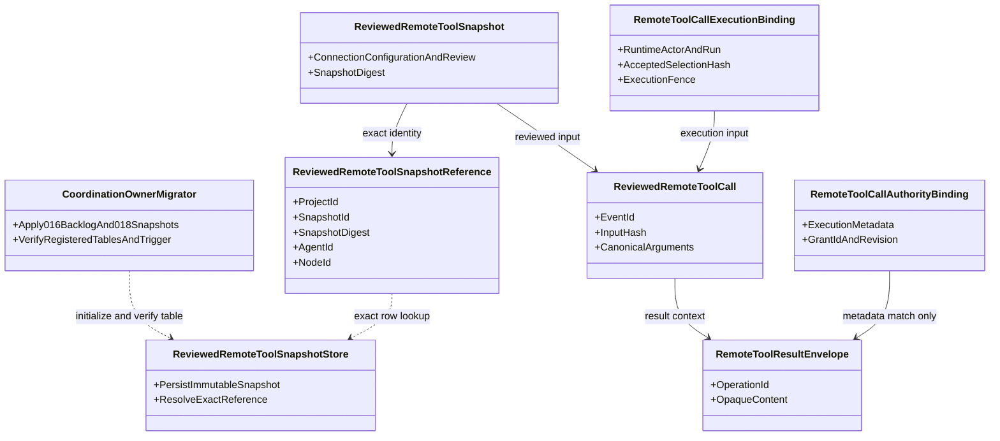

# Orchestration
> Part of [ADR 0001: Agentweaver 1.0 platform architecture](../decisions/0001-platform-architecture.md). **Status:** Proposed.

## Summary

- The Orchestrator owns a thin coordinator over Microsoft Agent Framework (MAF)
  workflows. The model proposes outcomes, workflow choices, and child work; code
  validates decisions and advances durable execution.
- Every workflow has a step catalog. Fixed steps create prescribed work, open steps
  allow bounded model-authored subtasks, and platform steps run gates that the model
  cannot impersonate.
- Every WorkPlan subtask names its workflow step. Required coverage, cardinality,
  roles, ordering, fan-out, policy, and gate ownership are checked before dispatch.
- Typed coordinator tools replace free-text reply parsing. Accepted decisions and the
  executable workflow snapshot are recorded for audit and recovery.
- Confirmation gates protect the outcome before decomposition and dispatch, generated
  workflows before first use, and scope-changing replans. Approval is a workflow
  transition, never an inference from message acknowledgment.
- Agentweaver's run page and surface panel reflect workflow state; they are not a
  second orchestration engine. There is no dynamic JavaScript workflow runtime.

## Today in 0.x

Paths refer to the 0.x code on the `dev` branch. Workflows already combine fixed
nodes (including Prompt, PeerReview, BuildTest, Check, FanOut/FanIn, OpenPullRequest,
and Merge) with `CoordinatorComposed` nodes that the coordinator decomposes at run
time (`apps/Agentweaver.Api/Workflows/WorkflowDefinition.cs`). In child workflows,
static branch nodes become ordered subtasks and a composed node's dynamic sub-plan
joins at its parent boundary
(`apps/Agentweaver.Api/Workflows/WorkflowChildWorkService.cs`).
This is a useful partial form of step snapping, not a blank slate of free-form work.

At the top level the selected workflow reaches the coordinator as guidance in a
prompt, not as an enforceable step catalog. The model returns JSON subtasks with
roles, phases, dependencies, and declared outputs, but no workflow-step identity.
Nothing verifies that the top-level WorkPlan covers the selected workflow's steps or
avoids duplicating them. Assembly still applies selected platform gates
independently (`apps/Agentweaver.Api/Coordinator/CoordinatorOrchestratorExecutor.cs`,
`apps/Agentweaver.Api/Coordinator/CoordinatorDispatchService.cs`).

Prompt instructions also carry procedure for confirmation, previews, tool scope, and
handoffs. Reply parsing strips model reasoning and scans for JSON in some selection
and outcome-spec paths. 1.0 preserves the useful workflow and child-work behavior,
not the reliance on prose to enforce it. The 0.x line continues to ship during the
1.0 rebuild.

## Workflow as an executable contract

A workflow is the selected, versioned MAF execution definition. The project supplies
its available workflows and a deterministic default if selection fails. The
coordinator may choose among them or propose a generated workflow. A generated
workflow must pass the grammar and step-catalog validators and receive human
confirmation before first use ([R11](../decisions/0001-platform-architecture.md#risk-register)).
This is an Orchestrator domain contract, not a provider seam.

Every workflow declares a step catalog; a definition without one is invalid. An
exploratory workflow can declare one open step and retain broad latitude without
losing an enforceable place for its work. The catalog is part of the executable
definition snapshot pinned to a run, so later edits to a project workflow cannot
silently change an active run.

### Step catalog

| Field | Meaning |
| --- | --- |
| `id`, purpose, and order | Stable step identity, the outcome it covers, and deterministic catalog ordering |
| Mode | `fixed`, `open`, or `platform`; determines who creates work and who may propose subtasks |
| Allowed roles and phase | Eligibility for work in the step, including planning versus execution or validation |
| Cardinality | Exactly one, one or more, optional, or any number of matching work items |
| Dependencies and ordering | Required preceding steps, join boundaries, and the step-order constraints on child work |
| Isolation and provider requirements | Allowed isolation choices and capability requirements checked against the run's pinned provider binding |

A **fixed** step carries its prescribed task, role, phase, isolation choice, and
declared outputs; the platform creates that work, as it does for a static branch in
0.x. An **open** step lets the coordinator propose bounded child work that assembles
at the step boundary. A **platform** step names a platform-owned gate; the
coordinator cannot fill it with a normal subtask or claim that its executor ran.
The catalog's version and ordered step definitions are snapshotted together.
Built-in workflows include an open implementation step so the existing flexibility
survives under a declared boundary.

Run validation also binds prescribed fixed work to the selected role's isolation
choice and the run's pinned Sandbox provider, rejecting work whose required
capabilities were not negotiated.

Platform steps can include build/test and preview, responsible AI (RAI),
rubber-ducking, review, opening a pull request, merge, Scribe, and application
publication where the workflow calls for them. They are not interchangeable with
agent-written "review" or "publish" subtasks. The publish gate binds an authorized
owner's approval to an exact revision and its test evidence before promotion to
`published`; the `live` and `preview` stages are described in
[Applications and surfaces](applications-and-surfaces.md).

A workflow may label exploratory work with `allowUnmappedWork`, but the label does
not waive step identity. Otherwise-unclassified work must be assigned to a declared
open step. If no such step exists, the WorkPlan is rejected. An empty optional open
step is valid; a broad exploratory step remains usable while retaining finite
cardinality and run-level item bounds. This is the strictness rule in
[R13](../decisions/0001-platform-architecture.md#risk-register), including for
generated workflows.

The pure `Agentweaver.Orchestrator.Core` domain library validates built-in and
generated catalogs before creating a versioned definition snapshot. It validates
typed outcome, selection, WorkPlan, and revision proposals against those snapshots;
invalid definitions and plans return structured reasons and no snapshot value.
Generated definitions remain marked for first-use confirmation. The Orchestrator
owner persists accepted definitions and decisions, exact-request gate state, workflow
position, and MAF checkpoints in its own PostgreSQL schema. The full dispatch engine
remains a separate slice.

## Authorize child work before registration

The Orchestrator can authorize a child-spawn intent before a child runtime exists.
It binds the authenticated actor and active parent and root sessions to the current
execution fence, accepted selection and context revision, and the confirmed WorkPlan
revision, step, and exact work item. The intent hash includes the full work item and
its stable intent identifier.

Authorization uses the existing executable-action guard for `maf.child.spawn`.
A selected or pinned policy provider is not an allow decision. The owner accepts
only a policy allow recorded by the guard and stores immutable evidence that names
the matching provider, adapter, options revision, and policy receipt. Denials,
evaluation errors, stale authority, or a changed intent fail closed.

The layer that records child associations must check and consume this evidence inside
the same owner-local database transaction as its association, outbox, and checkpoint
writes. The check revalidates current authority and the grant, then records consumption
without committing the caller's transaction. Repeating the same intent hash reports
that it was already consumed; reusing the identifier with different content is a conflict.
This prerequisite does not register a child or perform external child effects.
Authorization for already-registered runtime actions is unchanged.
Migration 037 stores the immutable authorization and consumption evidence.
Readiness accepts the pre-migration schema during rollout, but authorization
and consumption fail closed until both tables and their immutability guards exist.

Migration `021_row_lock_record_updates.sql` rejects every row update to
`coordinator_decisions` and `maf_workflow_checkpoints`.
New decisions and checkpoints use new rows; inserts and row locks remain available.
Startup requires the migration and each enabled, unconditional update trigger.
It rejects missing, disabled, conditional, column-limited, or wrong-function triggers.
The migration does not change foreign-key deletion rules or rewrite earlier migration records.

Migration `029_spend_budget_exposure.sql` adds `spend_budget_reservations` and
`spend_budget_accounting_cursors` for scoped spend budgets. They hold dispatch exposure and
the highest observed Events accounting cursor, not spend amounts. The runtime role needs
`SELECT`, `INSERT`, and `UPDATE` on both tables. See
[Scoped spend budgets and dispatch exposure](./provider-seams.md#scoped-spend-budgets-and-dispatch-exposure).

Accepted WorkPlan revisions increment a persisted attempt count.
The owner enforces the accepted `maxRevisionAttempts` limit before accepting another revision.
A zero limit permits no revisions.
Invalid proposals and rejected transitions do not consume an attempt.
An exact request replay returns its saved decision without another increment.
Gate-answer replay, owner-fence changes, and checkpoint recovery retain the count.
Older decision envelopes without this field restore with a zero count.

The Core models a project-scoped, revisioned backlog dependency graph. It rejects
cross-project, self, missing, duplicate, and cyclic edges; only unclaimed, unarchived,
non-provisional tasks can have their dependencies edited. Effective edge changes
advance the graph revision, while idempotent no-ops preserve it. Readiness evaluation
binds graph and task revisions to owner-projected prerequisite task/execution
revisions. A successful Merge gate uses the `Merged` state; a fully evidenced workflow
without a Merge gate uses `Completed` instead. Both states require current task and
execution evidence. Captured outputs require verified proof; explicit no-output
completion requires a current owner seal and no Merge gate. Incomplete,
archived, cancelled, delegated, failed, indeterminate, or stale prerequisites block
readiness. The evaluator does not make snapshots current; its owner must re-read and
recheck them after waits. Required output proof is accepted only as an owner-supplied
verified reference; Core neither creates nor verifies it.

The Orchestrator owner candidate persists these tasks and dependencies. Project
scoped routes expose graph reads, capture/content edits, queue state, archive,
and dependency edits under `/api/projects/{projectId}/backlog`; project writes
recheck current authority after taking the graph lock and before commit. The
run-scoped route under `/api/projects/{projectId}/runs/{runId}/backlog` claims
eligible work against the accepted run selection and current prerequisite
evidence. Its durable task claim, accepted root, initial decision, and outbox
intent share one Orchestrator transaction. The Gateway publishes the project
backlog operations and claim route through strict versioned contracts.
The owner migrator applies the packaged 016 backlog resource during initialization.
It also adds this resource to existing version-19 and version-20 schemas that lack it.
Backlog transactions take a shared schema-scoped advisory lock before opening their
database transaction. The migrator takes the exclusive form of the same lock, so a
schema change cannot commit between the queue-position capability check and task read.
Graph edits use table permissions, not schema ownership or migration-history writes.
The restricted-role PostgreSQL test creates tasks and adds and removes a dependency.
It rejects task deletion, table truncation, schema changes, and migration-history writes.
Mutations carry the
expected graph revision; task state and archive operations also carry the task
revision, while claims include an idempotency key. A claim locks graph and task rows
before accepted-run and decision state, then commits the task's exact revision with
its accepted root/run, selection hash, fence, decision version, and token-free intent.
The route revalidates current authority immediately before commit; if that check fails,
the claim, accepted root, decision, and outbox intent roll back together.
Prerequisite evidence must join the task to that exact accepted root and the whole
confirmed WorkPlan, including every required output; one merged item cannot satisfy
the task. Missing,
legacy, or unknown plan, capture, merge, or acknowledgment evidence is indeterminate.
Closed-root evidence uses a dedicated read-only checkpoint path; ordinary checkpoint
reads remain active-only. The claim transaction rechecks the closed-root checkpoint,
complete output set, and witness integrity. Migration 015 defines
`owner_evidence_json` as a bounded JSON array. Its SQL is packaged as an embedded
resource and registered with the explicit migrator; this source change does not apply
it to a shared or live database. The MAF dispatch candidate now
appends a completed-plan witness before returning: an explicit empty witness when
there are no output obligations, or typed capture rows and, when selected, a typed
Merge intent for non-empty output sets. The bounded C3/MAF source composition is
admitted. Whole-producer runtime acceptance remains pending. Positive evidence is
accepted only after current owner rereads and exact serializer reconstruction.
Workflow-bound native sends now prepare through the current source owner.
Configured hosted credit limits also require a valid Events admission receipt before root acceptance or backlog claim.
Events resolves the concrete model through the same versioned server-owned map as AgentHost.
The acceptance transaction retains the model, connection, selection hash, and Cost receipt in the existing outbox.
For a hard credit limit, an unpriced quote or unpriced existing usage rejects root acceptance rather than treating unknown cost as zero.
A soft-only limit may retain an explicit `Unpriced` quote; that amount remains visible and is not counted in the priced subtotal.
Fully priced root usage at the exact hard limit can be accepted, but the runtime owner denies the next model dispatch at its boundary.
It rechecks current Projects authority after remote waits and before root or claim commit.
The Host registration carries that immutable model pin and rejects a different local binding before SDK startup.
Configured hosted credit limits require an Events cost snapshot before dispatch start and again at native begin.
When a hard credit limit is active, an unpriced quote or whole-run total holds new dispatch at both boundaries.
The Host completes an observed source-to-ledger receipt join before returning output.
MAF rereads that completed dispatch and verifies the output hash before retaining the result.
Explicit unpriced accounting does not establish a zero cost; it remains visible and outside the priced subtotal.
The partial native report does not assert accounting-source finality.
For each claim, the current owner lock covers enumeration of all admitted captures
for the accepted root and selection, then each typed proof and pin is reread in the
same transaction. A non-empty witness must name the sole admitted capture; a second
or differently named capture blocks it. A no-output witness is rebuilt from the
actual capture inventory, so a late capture with a non-empty manifest invalidates it.
An inventory above the 100-capture bound rejects evaluation with an explicit limit
error; it is not truncated.
The admitted contract requires complete root-scoped 014 capture manifests to match
the whole WorkPlan output obligations exactly by unique path and path/hash/length;
ambiguous paths, extra or missing files, and partial evidence remain indeterminate.
When the accepted workflow selects one Merge platform operation, each output row
binds to that operation's current 012 intent for the same accepted workflow,
WorkPlan, and root. The consumer must recheck the current owner binding, repository
pin, persisted merged state, MergeSha, and current typed approval receipt; approval
alone is not proof. `mergeIntentId` must be present on every output row. Explicit
`null` is valid only with source-owned proof that no Merge operation was selected;
omitted fields, ambiguous or optional/conditional activation without an absence
proof, and missing or stale owner rows remain indeterminate. Empty outputs or an
empty evidence array cannot bypass required platform owner operations. Capture
admission and Merge completion remain separate facts: neither proves that the
captured OutputTreeSha is included in the intent HeadSha or MergeSha.
`NotRequired` requires explicit owner-derived absence evidence, not merely an empty
output contract.
Migration 016 remains unregistered, and whole-producer runtime acceptance remains
pending. The bounded C3/MAF source composition is admitted, but these routes are not
yet deployable. The 015 schema source is packaged and registered. This source change
does not apply it to a shared or live database. This backlog evidence slice does
not itself confirm a WorkPlan, dispatch a child, or imply successful output
verification.

Non-empty or fixed-work plans also require a trusted Sandbox binding. The owner
validates the accepted candidate against the server catalog, asks its registered
resource adapter to resolve an existing resource and return the original
`ResourceNegotiation`, then pins it through `ProviderResolver`. Resolution is
preparatory only: this Orchestrator slice does not provision or release Sandbox
resources. After provider and child-limit waits, the route refreshes Projects
authority and the owner checks the current selection, execution fence, and decision
version before writing. The winning owner transaction commits the accepted
selection hash, revisions, fence, candidate, resource, negotiated capabilities,
decision, gate, grants, and outbox together. A revoked or stale request writes none
of that state, while concurrent idempotent retries share the CAS winner.
Decision-envelope restore reads that row, verifies the current
accepted selection, role context, and catalog, then reconstructs and revalidates
the exact pin without renegotiating. A missing catalog, adapter, candidate, or
valid negotiation returns `503`; no default or caller-supplied resource is
substituted. This source does not register a production Sandbox resource adapter.

The library also contains the source-only `AgtPolicyProvider`, an AGT 4.0.0
platform-singleton adapter backed by YAML policies, and `ExecutableActionGuard`. The
guard requires an injected current grant-owner lookup and matches its validated grant
descriptor to the authenticated caller's HTTPS issuer and subject, project/run/session/step,
action, purpose, and execution fence before applying AGT as an additional restriction.
The caller's subject and project/run claims must share one authenticated identity and issuer.
Missing, duplicate, cross-issuer, or invalid grant state denies; provider or journal errors
prevent the protected callback. For a successful Allow, the guard waits for a durable
PolicyEvaluation journal acknowledgment and rechecks current authority, grant state,
and fence before invoking the protected callback. Events accepts only an immutable
Orchestrator receipt reference, rejects generic PolicyEvaluation appends, and
revalidates current admission inside its transaction before commit. Deny and Error
receipts do not require an active Allow grant, but admission still requires current
Core write authority, accepted selection, and matching actor/tenant. They remain
immutable evidence and do not authorize effects. These source contracts do not claim
that downstream protected-effect call sites are wired. The owner receipt writer
performs the same actor and current `acceptRunSelection`/selection checks immediately
before committing its receipt after the owner grant-row lock; Allow additionally
rechecks its exact active grant, expiry, and fence.

### Outcome, selection, and confirmation

1. The coordinator proposes an outcome specification with a typed tool. The schema
   validates required fields and the workflow holds the specification in a draft
   state. A material ambiguity goes to a question gate instead of being silently
   resolved by a model guess.
2. A human confirms the outcome before decomposition or dispatch. A coordinator may
   then select an eligible project workflow; invalid selection falls back to the
   project default rather than an ungated ad hoc route.
3. The selected definition exposes its step catalog to the planning tool. If a
   workflow was generated for this run, grammar and catalog validation precede its
   first-use human confirmation.
4. The coordinator proposes a WorkPlan against that catalog. Only a validated plan
   can reach dispatch. There is no path from an unconfirmed outcome or a rejected
   workflow definition into an executor.

The model can judge the user's intent, choose a workflow, and suggest appropriate
roles. It cannot bypass the schema, grants, policy, or transition preconditions.
Confirmation is a durable gate with a request id, not a favorable sentence in an
agent reply. The [coordination verbs](sessions-and-coordination.md#coordination-verbs)
route the request and record an explicit answer.

## Schedule and event trigger evaluation

`Agentweaver.Orchestrator.Core` provides pure evaluation contracts for daily,
weekly, and monthly schedules and a curated GitHub event-predicate language.
Schedule `TimeOfDay` values are UTC; evaluation normalizes the caller-supplied
`DateTimeOffset` to UTC. Weekly schedules select a weekday, and monthly schedules
select days 1 through 28. The evaluator reports invalid definitions, not-yet-due
times, and due occurrences separately. Daily and weekly period keys use
`yyyy-MM-dd`; monthly keys use `yyyy-MM`. The workflow ID, stable trigger ID, and
period form the schedule idempotency input. That key is not a backlog task ID, run
ID, claim, or proof that work was started.

Event predicates are ANDed at the top level and support nested `or` and `not`.
The supported leaves cover issue/pull-request labels, pull-request base branch,
review state, pushed-ref equality or prefix, discussion category, and bounded
comment matching. Matching follows the existing 0.x case rules. Comment patterns
use a restricted, nonbacktracking regular-expression subset with a 200 ms match
timeout; comment text is supplied only to the in-memory evaluator and is not a
retained event field.

These Core contracts do not persist trigger definitions, establish an authorized
project/accountable-actor binding, subscribe to events, run a hosted scheduler,
claim backlog work, or dispatch an execution. An occurrence key is only an
idempotency input to the existing Orchestrator owner path. Automatic initiation
remains unavailable until the real source-actor authority and owner claim path
are integrated and revalidated at claim and dispatch.

## Step-snapped WorkPlans

A WorkPlan is the proposed directed acyclic graph (DAG) of child work. Every subtask
includes `workflowStepId`, its assigned role and agent, phase, model and isolation
choice, dependencies, and declared outputs. The identifier generalizes the 0.x
`WorkflowBranchNodeId` from static branch work to all planned subtasks. Fixed steps
remain platform-created; model-authored subtasks belong to open steps. Platform
steps are never normal plannable subtasks.

The typed `propose_work_plan` schema contains the selected catalog version, rather than a
free-text hint. A proposal with no matching step is reassigned to a declared open
step by an explicit revision or rejected; it is never accepted as a step-less
subtask. A project workflow can grant broad exploration through its open step,
without making every workflow an unbounded plan.

### Validation before dispatch

The Orchestrator validates a candidate against the workflow grammar, WorkPlan schema,
and applicable project and platform policy:

1. **Coverage:** every required step is represented or is a platform-created step.
   Optional steps may be absent, but are not silently invented later by the model.
2. **Cardinality:** each step has exactly the permitted number of work items.
   Open-step fan-out remains subject to run limits.
3. **Eligibility:** every proposed role and phase are allowed by the step; model and
   isolation choices satisfy pinned bindings, authorization, and policy.
4. **Ordering:** subtask dependencies form a DAG consistent with catalog order, and
   each open-step join completes before its dependent step proceeds.
5. **Gate ownership:** no proposed subtask masquerades as a platform build/test,
   review, publish, merge, or other platform-owned gate.
6. **Resource and output bounds:** child count and declared-output count and path
   length stay within domain limits. Paths must be canonical repository-relative
   files; rooted paths and traversal are rejected.
7. **Run selections:** the model-selection reference and agent must be eligible for
   the assigned role in the immutable run-selection context. The selected isolation
   provider must match the run's pinned Sandbox binding, and required capabilities
   must be in its negotiated capability set. Model references are opaque;
   Orchestrator does not introduce a Model provider seam.
8. **Output conflicts:** exact, case-insensitive path, path-suffix, and bare-filename
   overlaps are conservatively serialized with deterministic dependency edges.
   Existing reverse dependencies are preserved rather than turned into cycles.
   Invalid output paths reject the plan; they never degrade into an empty output
   declaration.

A rejection returns structured reasons and the coordinator may revise a bounded
number of times. Exhausting that budget holds work for human guidance; it does not
turn an invalid plan into a dispatchable plan. Accepted plans and the reasons for
subsequent revisions are journaled. The grammar validator also applies to built-in
and generated workflow definitions.

This flowchart shows typed proposals passing deterministic validation into the
owner-side execution frontier. The catalog binder resolves every accepted step
snapshot to a registered executor by step mode; platform steps also resolve by
gate. Unknown modes and missing registrations fail binding before dispatch. Fixed
work remains prescribed and platform gates remain platform-owned; a model task
cannot replace either. Fixed-work child dispatch is currently refused because its
authorization receipt variant is not available yet. Open child work is authorized
as `maf.child.spawn` by the pinned Policy provider. The resulting durable receipt
is bound to the exact plan item, dispatch intent, accepted selection and execution
fence; a provider binding by itself is not an allow decision. The dispatch owner
re-reads and consumes that receipt in the Orchestrator transaction that commits
the child association, spawn outbox, pending intent and Running checkpoint.
Ready child work is checkpointed with its spawn outbox request. The dispatch owner
reads the current root registration and Environment
readiness, checks its lifecycle, lease, provider fence, accepted selection and
observed network generation, then asks Environment to verify the exact
`EnvironmentGenerationFence`, policy generation and `ContextRevision`. A typed
root receipt is pinned to each pending child intent; a changed root lifecycle,
policy, selection or egress intent cannot be adopted by a retry. A child may
have a different Environment: once registered, its own current placement,
generation and verified egress are checked before native preparation and again
before Host send and terminal join. Native admission persists the child's
exact registration binding. The owner rechecks the root receipt around remote
waits and native sends; a failed verification leaves the
pending intent visible, not dispatched under a guessed generation. The owner
recomputes ready dependencies, including normalized output-conflict edges, under
its root lock before committing child association, spawn outbox and the append-only
Running checkpoint in one Orchestrator transaction. A duplicate returns the same
intent; a failed callback rolls all three writes back. Results are immutable and
terminal child status is joined in the owner transaction.

The binder recognizes fixed/open child routes and the executable BuildTest gate.
A workflow requiring another platform executor fails binding before child
dispatch; this slice does not substitute a model task or fabricate a gate result.
Fixed-work child actions fail closed before session creation until the Policy
receipt contract can bind their fixed specification and selected role. Native
runtime action admission still evaluates the selected Policy provider and
Guardrails before Host effects.

The configured wall-time limit is measured from the persisted root-session
creation time. After a wall-time or hard-cap limit is reached, the dispatcher holds
pending intents and reports the limit; already-running child turns can settle, but
no new or replayed Host message is sent. Every protected Host send, capped or
uncapped, also requires real Phase B admission bound to the actual current child
registration, SDK source/native-turn identity, execution fence, pending intent and
checkpoint, and applicable counters. Phase A and registration/readiness checks are
not native turn admission.

```mermaid
flowchart TD
    A["Propose outcome specification"] --> B["Validate schema and confirm outcome"]
    B --> C["Select project workflow"]
    C --> D["Step catalog: fixed / open / platform"]
    C --> E["Optional generated workflow"]
    E --> F["Validate grammar and catalog"]
    F --> D
    D --> G["Propose step-snapped WorkPlan"]
    G -->     V{"Step identity, coverage, joins, eligibility, pins, bounds, and outputs valid?"}
    V -->|"No: structured reasons"| R["Correct invalid proposal"]
    R --> G
    V -->|"Yes; conflicts serialized"| H["Confirm generated workflow or scope change"]
    H --> N["Save decision and revision count"]
    N --> S["Snapshot executable definition"]
    S --> BindExecutors{"Registered executor for every step?"}
    BindExecutors -->|"No"| BindError["Reject binding with a step-scoped error"]
    BindExecutors -->|"Yes"| DispatchWorkflow["Explicit typed dispatch"]
    DispatchWorkflow --> FixedWork{"Open plan item?"}
    FixedWork -->|"No: fixed-work authorization unavailable"| BlockPolicy["Refuse fixed-work child before side effects"]
    FixedWork -->|"Yes"| AuthorizeSpawn{"Pinned Policy allows exact child-spawn intent?"}
    AuthorizeSpawn -->|"No"| BlockPolicy
    AuthorizeSpawn -->|"Yes"| VerifyEgress{"Environment owner verifies exact fence, policy generation and selection revision?"}
    VerifyEgress -->|"No"| BlockEgress["Reject stale or unavailable egress; no spawn"]
    VerifyEgress -->|"Yes"| RecheckRun["Recheck plan and selection; lock owner root"]
    RecheckRun --> O["Recompute ready frontier and serialized output conflicts from latest checkpoint"]
    O --> X["Phase A: consume spawn receipt and atomically commit child association, outbox, intent and Running checkpoint"]
    X --> VerifyAgain{"Current Environment receipt still matches pending intent?"}
    VerifyAgain -->|"No"| BlockRetry["Keep original intent; reject obsolete-generation retry"]
    VerifyAgain -->|"Yes"| ChildRegistration["Read actual current child registration and verify its own Environment egress"]
    ChildRegistration --> W{"Real Phase B admission bound to child registration, native source/turn, fence, pending checkpoint, and applicable counters?"}
    W -->|"Yes"| M["Deliver admitted intents to authenticated ready Hosts"]
    W -->|"No"| L["Keep pending intent; report unavailable step or reached limit"]
    M --> J{"Join state matches checkpoint?"}
    J -->|"Pending exact intent"| K["Atomically checkpoint joined result and Succeeded status"]
    K --> CompleteFrontier{"Complete dependency frontier?"}
    CompleteFrontier -->|"No: continue ready work or return incomplete"| DispatchWorkflow
    CompleteFrontier -->|"Yes"| AppendOutputWitness["Revalidate decision, fence, and checkpoint; append output witness"]
    AppendOutputWitness --> CompleteResponse["Return complete result"]
    J -->|"Exact completed replay with checkpointed result"| DispatchWorkflow
    J -->|"Changed or missing intent/result"| Rj["Reject replay; retain checkpoint"]
    RecheckRun --> T["Platform executor unavailable"]
    T --> ReportBlocker["Report blocker; do not fall back to model work"]
    J --> Y["Replan with diff and gate"]
    Y --> RevisionLimit{"Accepted revision limit reached?"}
    RevisionLimit -->|"Yes"| Z["Hold for human guidance"]
    RevisionLimit -->|"No"| G
```

The accepted definition is snapshotted for the run, then bound to real MAF executors.
An executable BuildTest platform step can include a typed `buildTestCommand`.
It specifies the immutable execution-profile reference, absolute executable,
ordered arguments, workspace-root working directory (`.`), and bounded output obligations.
The coordinator cannot submit image options, credentials, shell text, or a success verdict.
The trusted executor must resolve the profile and current Sandbox binding separately.
Command, argument-order, profile, path, or output-bound changes require scope confirmation.
The validated WorkPlan requires a pinned Sandbox with the BuildTest command capability,
even when it contains no model work.
A legacy BuildTest step without a typed command remains valid but cannot execute.

An optional platform step with no executor can be skipped when its dependencies are satisfied.
The frontier does not save a successful result or manufacture a BuildTest receipt for that skip.
An available optional executor still runs.
A required step without an executor keeps the workflow incomplete and blocks its dependents.

Fixed-work runtime reads resolve the retained checkpoint association for the exact child session.
They compare its workflow, plan, task, outputs, agent, model, provider, selection hash, fence, and decision version.
They recheck the current owner, decision, association, and accepted selection after remote reads.
This path does not relax the existing model or provider checks for open work.

Before dispatch, the checkpoint stores the operation ID, exact command, accepted
execution and collector options, and expected Environment binding.
Later checkpoints retain that intent without changes.
Recovery reuses the same operation and original checkpoint reference.
The owner-authorized Core getter returns only the persisted command after it
rechecks the current decision, selection hash, execution fence, and provider pin.
Its route is
`/api/projects/{projectId}/runs/{runId}/coordination/sessions/{sessionId}/build-test/commands/{checkpointId}/{stepId}`.
The query also carries the exact WorkPlan, checkpoint revision, decision version,
execution fence, and accepted selection hash.
The getter does not reserve or execute a command.

The optional dispatch field `buildTestEnvironmentId` selects the Environment
owner scope, not a different provider or execution profile.
The optional `buildTestWorkspaces` map supplies an existing owned workspace locator for each BuildTest step.
Each locator contains `workspaceId`, `workspaceIncarnationId`, `baseSha`, and `branchName`; it grants no repository access.
The existing authenticated Source Control owner creates and verifies the bounded repository seed.
MAF keeps the confirmed command unchanged and stores verified source metadata as a separate execution input.
The original checkpoint transaction stores that input and exact seed bytes before Environment reservation.
The effective version 2 command hash binds the source input.
Retry reuses the saved input without recapturing the checkout; conflicting locators and changed source owners are errors.
Completed BuildTest input retains its original decision version while dispatch checks the current source owner and decision.
Running input still requires its original decision version.
Unavailable or changed workspaces return the existing Source Control error, not an unhandled server error.
An explicit source in a confirmed command remains exact.
Version 2 prepares the repository in the exact native command Pod before execution.
After success, its separate collector retains the full baseline and declared output bytes from that prepared path.
Environment stores exact references while Source Control retains the full pending document.
Core uses the existing Events produced-output admission and verifies the acknowledged capture again in its final owner transaction.
The terminal receipt retains preparation, full output, and journal references.
A missing acknowledgment cannot complete the step.
Retained pending or admitted bytes support retry without another native export or command execution.
Environment verifies the canonical acknowledgment through Core before deleting the exact native Pods.
These source paths do not establish native Kubernetes or complete workflow acceptance.
Preparation must match the WorkPlan's existing Sandbox pin.
The Environment owner address uses the existing
`Orchestrator:RuntimeRegistration:EnvironmentOwnerAddress` configuration.
Without that configuration or an Environment scope, the executor remains unavailable.
The preparation GET ends in `/sandbox/build-test/binding-preparation`.
It binds `sessionId` and `executionProfileReference` to current owner state.
The command POST sends only the checkpoint reference and unchanged expected binding.
Environment resolves the command through Core and rejects changed bindings or options.

Normal dispatch and recovery use the same executor check.
Recovery reads the original operation before it starts or reconciles that operation.
Only a validated terminal result and required collector outputs can advance the step.
Checkpoints retain compact terminal receipts and output digests, not raw command logs.
Dependent model work receives a bounded typed result summary.
Final output witnesses must match the collector's file digests and byte counts.
Required command outputs cannot use a no-output seal.

```mermaid
flowchart LR
    P["Confirmed typed command and provider pin"] --> E["Owner-authorized Environment preparation"]
    E --> C["Immutable MAF checkpoint intent"]
    E --> S["Optional owned workspace: Source Control verifies repository input"]
    S --> C
    C --> G["Owner-authorized Core getter"]
    G --> V["Recheck decision, selection, fence, command, and source pin"]
    V --> A["Return exact accepted command"]
    A --> O["Environment rechecks binding and executes the same operation"]
    O --> T["Terminal and required output join"]
    T --> D["Checkpoint receipt and dependent model frontier"]
    C --> R["Reuse original operation, reference, and saved input"]
    R --> G
```

Child work within an open step fans out only within validated limits and joins at
that step's boundary. Checkpoints preserve the current step, pending children, and
gates. The journal preserves what was proposed, accepted, dispatched, and observed.
The [Sessions seam](provider-seams.md#sessions) supplies the authoritative journal;
its opaque Copilot conversation cache is only a resume aid
([Sessions and coordination](sessions-and-coordination.md#durable-history-and-resume-aids)).

## Typed coordinator actions

The coordinator prompt states its role, goal, selected schema and catalog, and
available verbs. It does not encode the operating procedure that the workflow must
enforce. Its grant contains decision and coordination tools only. Core Policy checks
the grant on every invocation; the Agent Governance Toolkit (AGT) denies an attempt
to act outside it. A coordinator cannot write code, run a build, conduct a review,
merge, or publish by declaring in prose that a step is done.

| Tool | Accepted effect or structured rejection |
| --- | --- |
| `propose_outcome_spec` | Validate fields; create a confirmable draft without dispatching |
| `select_workflow` | Choose an eligible project definition or return the default and validation reasons |
| `propose_work_plan` | Validate a catalog-bound DAG; return errors or a candidate for confirmation |
| `revise_work_plan` | Validate changes, compute a scope diff, and require confirmation when its gate applies |
| `dispatch` | Recheck the confirmed plan, selection, fence, and child limits; persist ready child intents; send only with real Phase B admission; join valid replies; retain pending intents and report unavailable steps otherwise |
| `steer` | Address and fence a typed message; the receiving turn admits it at its boundary |
| `request_assembly` | Ask platform executors to collect completed work and gate evidence; do not perform a gate in the coordinator |

The coordinator also uses the typed spawn, status, question, approval, and messaging
verbs in [Sessions and coordination](sessions-and-coordination.md#coordination-verbs).
Each accepted action and its validation result is journaled. Structured tool calls
replace scanning free-text model replies for braces or reasoning blocks. A free-text
explanation can inform a human; it cannot mutate workflow state.

## Source Control merge gate

Accepted Source Control settings can use exact SecretRefs or an Identity GitHub App
connection and exact repository. The short-lived selection code is submitted only in
the initial run-scoped `/pin` request; it is never accepted configuration. In App mode,
Identity owns user authorization, installation callbacks, refresh, and run-bound token
minting. Orchestrator consumes the selection code while pinning the negotiated
repository, then requests a temporary token from Identity for each API or checkout
operation using the durable selection hash. Each request is bound to the current actor,
project, run, connection revision, installation, and exact repository; Identity
rechecks current grants and provider permissions before minting. Discovery completes
pagination before synchronizing installation revocation state, and Orchestrator
preserves allow-listed refresh states such as `refresh_in_progress` and
`rotation_uncertain`. Identity's owner-cookie routes also provide redacted local
connection status and revision-guarded local disconnect; status reports persisted
state and token-expiry metadata without probing GitHub, and disconnect does not alter
the remote App installation. The App private key is redeemed and used for JWT signing
only inside Identity, and neither it nor an installation token is persisted. Webhook
credentials remain separate SecretRefs.

The Orchestrator's unpublished Source Control owner path begins with a server-derived
merge request, not model-supplied repository, branch, SHA, or grant data. It binds the
request to the accepted `ProjectConfiguration`, exclusive Source Control provider pin,
run selection hash and revisions, session, and execution fence, then persists those
facts before it requests typed approval. The approval receipt must name that exact
intent and the current accepted PLATFORM Merge step. Only the approved source intent
can produce the narrow `source_control.merge` executable grant; a general assembly
grant, check result, or text response cannot authorize a merge.

Execution uses the existing action guard and current owner lookup. It rechecks
Projects authority, accepted selection, actor, grant, intent, and fence around awaits,
then retains a PostgreSQL advisory lock scoped to the repository. Under that lock it
reads current PR state, effective branch rules, required check runs and commit
statuses for the exact expected head, and the expected base as a fresh preflight.
Unknown requirements and non-success states block the merge. The GitHub merge API
receives the exact expected head SHA; base equality is not an atomic GitHub
compare-and-swap. A successful response is persisted as merged, a proven rejection as
conflict, and an ambiguous response or interrupted in-flight request as
`outcome_uncertain`. If current authority, the source-specific grant, or secret
redemption is revoked before the merge request is sent, the owner persists a terminal
conflict and does not call the merge endpoint; the same applies when the post-marker
authority check fails. Once GitHub accepts a merge, Orchestrator persists its merge
SHA even if the following authority check detects revocation. A retry after restart
reads that durable outcome and never repeats the merge request.

The run-bound webhook relay is separate from the merge grant: it verifies exact
GitHub raw bytes with the pinned webhook SecretRef and durably deduplicates deliveries
after fresh Projects/Core checks. It does not approve a merge or trigger an
unauthorized effect. Direct unauthenticated GitHub delivery is denied until a
trusted relay identity is separately deployed.

## Reviewed remote tool data

The Core contracts bind a reviewed remote tool to one project, agent, and node.
The immutable snapshot retains connection, configuration, catalog, tool, schema,
and permission values with their revisions and digests. It contains no credentials.
Its snapshot digest covers these values, including the endpoint, resource URI,
authentication mode, Identity reference, and transport profile.

`ReviewedRemoteToolCall.Create` requires the exact reviewed agent, node, and tool.
It combines the snapshot with the supplied runtime registration, actor, tenant,
run, session, step, accepted-selection hash, and execution fence.
It sorts JSON object properties and rejects duplicate property names.
The event ID is stable for one project, run, session, step, and native call ID.
The input hash also covers the full snapshot, execution binding, and arguments.
Changing the input preserves the event ID but changes its input hash.

The internal snapshot store persists and resolves exact snapshot references.
It rejects conflicting reuse of a snapshot ID and checks the stored digest and
identity fields on every read. The embedded 018 SQL resource rejects row updates
and deletes. The normal owner migration path applies this resource and the 016 backlog resource.
It accepts existing version-19 and version-20 schemas without those resources and preserves their original migration history.
Verification requires both migration records, their tables, and the enabled snapshot update/delete trigger.
Column checks use PostgreSQL catalogs, so read-only verification does not require permissions on unrelated owner tables.
Version 17 remains unregistered and is rejected.
PostgreSQL tests use the normal migration path and check persistence, conflicts, corruption, and rejected row changes.
The restricted snapshot role can select and insert snapshots and read migration history.
It cannot update, delete, truncate, disable the trigger, create tables, or write migration history.
These permissions support exact snapshot replay without schema ownership.

`ReviewedRemoteToolResultVerifier` rebuilds the call from the current runtime
registration, accepted Projects selection, selected immutable snapshot, and exact
arguments. It verifies the reserved native action grant and receipt before it
returns proof verification. The HTTP verifier route currently fails closed before
reading a proof body: authenticated HTTP requests receive
`runtime_remote_tool_result_https_required`, and authenticated HTTPS requests
receive `runtime_remote_tool_result_route_unavailable`. An approved direct
mutual-TLS profile and certificate pins are not configured. Events result-byte write/read routes and the dedicated
runtime client also return unavailable; no result bytes are durably acknowledged
or read. Native remote-tool dispatch remains disabled. A matching proof object is
not permission to send a request or disclose a result.

## Rules in code

The 0.x coordinator charter and runtime prompts mix enforceable procedure with
judgment. This audit assigns the procedural rules to validators, workflow transitions,
tool grants, message routing, and executor contracts. Representative 0.x sources are
`packages/Agentweaver.Squad/Catalog/Resources/agents/coordinator.agent.md`,
`apps/Agentweaver.Api/Coordinator/CoordinatorOrchestratorExecutor.cs`,
`apps/Agentweaver.Api/Coordinator/CopilotCoordinatorSpecDrafter.cs`, and
`apps/Agentweaver.Api/Coordinator/CoordinatorDispatchService.cs`.
The exact wording of a new prompt is not a substitute for a tested guard.

| Rule carried by 0.x prompt or executor | 1.0 enforcement point | Testable boundary or remaining judgment |
| --- | --- | --- |
| Ground planning in team memory and decisions | Knowledge context projection from the session tree and records | Projection is present; relevance remains model judgment |
| Produce a confirmable outcome specification | Typed schema validator and `draft → confirmed` transition | Missing fields or confirmation block progression |
| Ask rather than guess about material scope | Question gate and pending request id | Gate blocks when invoked; recognizing ambiguity remains judgment |
| Do not decompose or dispatch before confirmation | Hard workflow transition and dispatch precondition | Rejected before the confirmed state |
| Preserve the goal's breadth; invent no deliverables | Outcome schema check against the confirmed specification | Structural consistency is checked; intent fidelity remains judgment |
| Use capabilities only for feasibility and eligible roles | Allowed-role validator on each catalog step | Ineligible assignment is rejected |
| Declare role, model, isolation, dependencies, planning phase, and repo-relative outputs | Typed WorkPlan schema and DAG validator | Missing, malformed, or conflicting fields are rejected |
| Never propose platform-owned RAI, build/test, review, merge, or Scribe work | Platform catalog steps are not proposable | Gate-shaped subtasks cannot substitute for platform executors |
| Dispatch ready work in parallel subject to dependencies and file conflicts; advance only after terminal outcomes | Ready-frontier workflow transitions | Premature dispatch or advancement is rejected |
| Relay steering, questions, and approvals to the accountable human | Fenced message primitive with question and approval gates | Receipt alone cannot unblock a decision |
| Treat an approval wait as blocked work, not a stall; bound retries | Gate state machine and run limits | Pending approval stays pending; excess retries stop |
| Preview runnable artifacts first and include preview details in the handoff | Build/test and preview gate contract; assembly handoff schema | Missing required preview evidence blocks the handoff |
| Coordinator writes no code, tests, or docs and performs no RAI, review, merge, or Scribe pass | Meta-tool grant, AGT check, and workflow transitions | An ungranted operation is denied |
| For software run one build/test then human review; content-only work may omit build/test | Workflow classification and gate validator | Required gate count and order are checked |
| Include RAI, rubber-duck, and human review when warranted; never pick an ungated workflow | Workflow selection and gate validator | Ungated selection is rejected; applicability remains judgment |
| Use only Agentweaver meta tools, not shell or file tools | Coordinator tool grant | Shell and file access are absent from grant |
| Respect prompt, model, child, concurrency, cost, and wall-time bounds | Workflow-enforced run limits | Excess use blocks or stops the run at its limit |

The acceptance rule is that every procedural **must** or **never** has a code
enforcement point and a test. Judgments about scope, meaning, and whether a review
is warranted stay in the coordinator's reasoning, but they cannot bypass gates.
The coordinator's fresh prompt describes role, goal, catalog-backed proposal schema,
and available verbs instead of duplicating state-machine rules.

## Execution, gates, and replanning

The workflow grammar and step validator accept a definition before the catalog
binder resolves its accepted snapshot to registered executors. It resolves fixed,
open, and platform steps by mode, and platform steps by gate. Unknown modes or
missing executor registrations return clear binding errors before dispatch.
Platform executors own build/test and preview, RAI, rubber-duck, independent
review, opening a PR, merge, Scribe, and the publish gate where included. A fixed
step remains prescribed work; a platform gate cannot be represented as ordinary
model work. This binding layer does not dispatch work, apply limits, join child
work, or recover checkpoints. Later execution stages handle those responsibilities.
A conservative fan-out policy limits child work. MAF checkpoints and recovery
continue the workflow without asking the coordinator to reconstruct procedural
state from a conversational transcript.

The selected gates remain visible in the executable snapshot and journal. For
software work, classification requires one build/test gate followed by human review;
content-only work can omit build/test where the workflow permits. Publication is a
platform step: an owner authorizes the exact, verified revision before the
application is promoted from `preview` to `published`. The [application lifecycle](applications-and-surfaces.md)
and its surface panel share these state transitions rather than creating a UI-only
publish path.

A running workflow may need to change its plan. The coordinator calls
`revise_work_plan`; the Orchestrator validates the candidate, computes a structured
diff against the previous immutable snapshot, and records the accepted version.
Changes to steps, eligibility, required capabilities, cardinality, fixed work, or
planned child items carry an explicit confirmation requirement. A catalog-version
change alone does not widen scope. Revising subtasks inside an existing open step
is still subject to catalog limits and run policy. Widening the agreed scope or
adding or removing steps changes the workflow contract and requires confirmation
before the changed work can dispatch
([R12](../decisions/0001-platform-architecture.md#risk-register)).
The coordinator cannot loop in its prompt to silently authorize a new stage. An
exhausted budget or invalid revision leaves a visible blocker for the operator.
The wall-time limit uses the persisted root-session creation time and is checked
before every Host send. In-flight child turns can settle after the deadline, but
the dispatch response reports `wallTimeLimitReached` and dependent work cannot
start after the limit.

Determinism here is about executable boundaries: given the pinned definition and
accepted decisions, code applies the same validators, transitions, and gates.
Model-generated subtasks and later tool results remain dynamic. Recorded playback
is exact; fork and re-execution need not reproduce those outcomes. The journal makes
the distinction inspectable rather than claiming identical model responses.

### Mapping to Agentweaver's UI

Agentweaver keeps its own run page, topology, approvals, chat, and surface panel.
The web application reads workflow state rather than implementing independent
scheduling rules:

| User-visible capability | Workflow source of truth |
| --- | --- |
| Topology and child sessions | Child work and session-tree parent, root, and detach links |
| Run status and blockers | Executor and WorkPlan stage, pending gate, interrupted state, and recovery effects |
| Confirming a plan | Outcome or WorkPlan confirmation gate with a request id |
| Answering a question | Durable question gate and an addressed answer by request id |
| Notify on idle | Subscription to terminal or idle workflow events |
| Chat and steering | Fenced addressed messages admitted at turn boundaries |
| Publish action and surface panel | Platform publish gate and typed surface action; no second publication state machine |

The [status snapshot](sessions-and-coordination.md#session-tree-and-status) carries the
run-state and recovery-effects acceptance for session status.
The [message primitive](sessions-and-coordination.md#one-coordination-message) retains
tracked acknowledgment and correlated replies, but only gate transitions
approve work. User surface actions arrive as typed messages; the application and
surface model is specified in [Applications and surfaces](applications-and-surfaces.md).

Copilot SDK features such as modes, skills, custom agents, compaction, and ephemeral
research subagents can help inside a turn. They do not replace a durable child work
item when isolation, approval, independent gate execution, or merge is required.
Ephemeral harness subagents do not become nodes in the session tree.

## Alternatives considered

| Option | Why not |
| --- | --- |
| Free-form WorkPlans with only a workflow hint in the prompt | Required stages and platform-gate ownership cannot be checked at plan time |
| Make every workflow entirely fixed | The coordinator cannot adapt implementation subtasks to the confirmed outcome |
| Let the coordinator create its own gate subtasks | A model declaration cannot supply independent build, review, publish, or approval evidence |
| Enforce procedure solely through a larger coordinator prompt | Reply parsing, compliance, and recovery remain ambiguous without typed transitions |
| Run model-authored JavaScript workflows | Arbitrary script orchestration bypasses the MAF grammar, run limits, gates, and durable checkpoint contract |

## Phasing

- **P0 — Foundation:** versioned service contracts, Postgres state and outbox, Object
  Store, policy binding, and provider pinning supply durable execution primitives.
- **P1 — Core:** implement MAF step catalogs, grammar and WorkPlan validators,
  typed coordinator tools, thin prompt, executable snapshots, executor binding,
  checkpoints, run limits, child-work joins, journal, gates, and the session tree.
  Start persona harnesses against exact-SHA AKS deployments at the end of P1 and continue them through cutover.
- **P2 — Parity and cutover:** close the
  0.x behavior-guarantee list, complete application `live`/`preview`/`published` stages and the publish
  gate, enforce budgets and all required surface actions through the separate Canvas
  boundary, and pass API, UI, and MCP
  harnesses on an exact-SHA AKS deployment.
  A2UI and GitHub Canvas-compatible renderers do not replace MAF, validate plans,
  or approve workflow actions.
- **P3 — After cutover:** optional provider adapters can change backing systems,
  not the step catalog, confirmation gates, or coordinator's tool authority.

## Related risks

- [R9](../decisions/0001-platform-architecture.md#risk-register): typed decisions and
  cross-service messages use at-least-once outbox delivery with deduplication.
- [R11](../decisions/0001-platform-architecture.md#risk-register): per-run generated
  workflows require grammar, catalog validation, and human confirmation.
- [R12](../decisions/0001-platform-architecture.md#risk-register): bounded mid-run
  replanning cannot widen scope or change steps without confirmation.
- [R13](../decisions/0001-platform-architecture.md#risk-register): unmapped work needs
  a declared open step; built-in workflows provide one for implementation.
- [R23](../decisions/0001-platform-architecture.md#risk-register): exact-SHA AKS persona
  harnesses start at the end of P1 and must be green before cutover.
