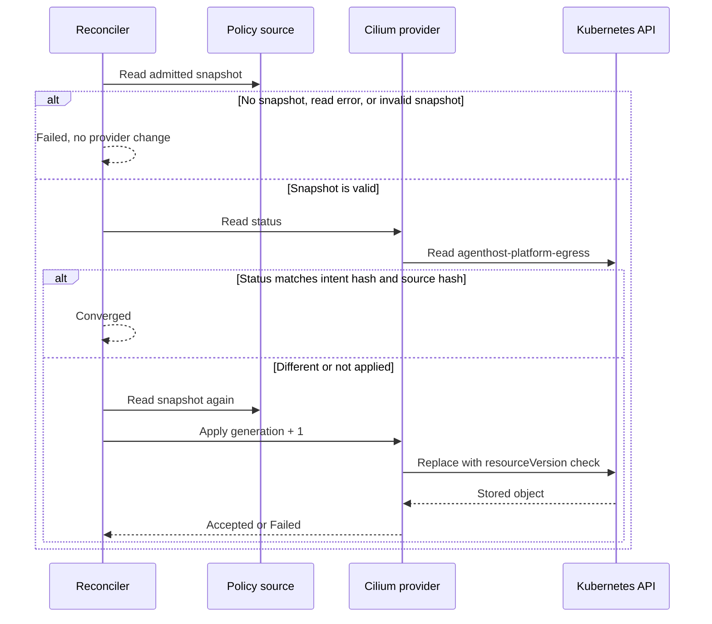

# Environment egress policies

Network permission is the intersection of platform policy, project narrowing
and admitted run needs. Environment compiles that intent into Cilium policy
and verifies the saved generation. A matching policy object is necessary
evidence for readiness, not proof that packets were filtered.

This page explains the egress mechanism, not a live network test. Cilium
provides the Kubernetes policy API. Pod placement and runtime registration
are separate from compiling egress.

The same Environment owner manages workspace-volume lifecycle routes and
registers the Azure Files CSI Storage provider. This article covers only
egress; the [foundation overview](./overview.md#workspace-volume-lifecycle)
summarizes volume lifecycle, pinned provider bindings, and Replace cleanup.
See the [Environment deep dive](../deep-dive/environment-sandbox.md) for the
combined placement path.

The same owner schema contains the Sandbox lease state.
The placement read verifies its active lifecycle, full owner tuple, provider reference,
lease revision, expiry, and separate provider/current fences. It rereads the lease
after the final awaited authorization check. Profile lookup matches that exact
provider reference against server configuration; it does not deliver a configure nonce.
Public placement/profile reads keep the existing `WriteProjects` gate. The separate
run-bound read-only lookup is integration work, not an egress mutation permission.

## Ownership and operation

For provider selection and Environment settings, see the
[provider configuration guide](../guide/configure-providers.md) and
[runtime configuration reference](../reference/runtime-configuration.md).

`EnvironmentEgressManager` is the operation entry point. Each apply, verify, revoke, or reconciliation reads the current caller from Projects & Config at
`GET /api/authorization/context`; authorization and run-selection responses
must be `Cache-Control: no-store`. The caller token is sent only to Projects &
Config, whose resource-server authentication validates the token audience and
purpose; it is not stored in the policy or provider pin. An optional tenant
selector is forwarded for Projects & Config to validate. Any token-bound tenant
must match the environment owner, and any bound project/run must match the
requested owner. An unbound project-level grant is still intersected with the
exact Environment tenant/project/run and immutable admitted selection.

The consumer uses current `WriteProjects` on the target project for
Apply/Verify/Revoke/Reconcile. It does not use `ReadProjects` as mutation authority;
`ReadProjects` remains metadata inspect/describe authority only. Apply and
Verify/Reconcile also require the separate positive `ReadRunSelection` grant to retrieve
the admitted run selection. That grant is not implied by `WriteProjects`; the
Projects selection endpoint independently enforces its existing Orchestrator
scope/role. If the caller has project write authority but lacks run-selection
access, the operation fails explicitly before Kubernetes access. Revoke needs
only `WriteProjects` and the Environment owner identity; it does not need to
read or compile the run selection.

`ProjectsConfig:BaseAddress` must be an absolute HTTPS URI without user info,
query, or fragment. The authenticated Projects and Kubernetes clients disable
automatic redirects and reject every 3xx response, so credentials are not
forwarded to a redirect target.

Every operation fetches fresh context before effects. Apply/Verify/Reconcile
recheck it after selection retrieval and after Kubernetes readback, before
pinning or recording reconciliation; Revoke rechecks after the tombstone
readback. A changed membership, binding, or effective grant rejects the
callback and cannot mark the Environment ready.

`EnvironmentOwnerIdentity` carries the tenant, project, run, and environment
IDs needed to bind policy operations to the current Projects context and
selection. `EnvironmentGenerationFence` carries that owner identity and its
`LifecycleGeneration`. The Cilium API separately receives `PolicyGeneration`
and `ExpectedPreviousPolicyGeneration`; these fence the policy resource and
must not be conflated with the Environment lifecycle generation. Policy
generations are positive, owner-CAS-checked values and need not be contiguous.

The Environment host, lifecycle store, and `environment` schema are owned by
`Agentweaver.Environment`. `EnvironmentGenerationFence.LifecycleGeneration` is
the owner-controlled CAS fence; it is distinct from every Cilium policy
generation and Storage resource/data generation. Registration and lifecycle
advancement use an explicit expected generation and idempotency key. Network
effects reserve before provider work, then complete only against the current
owner fence. A stale callback remains unresolved and blocks further effects
until the active owner verifies the exact current provider object and records
that observation through `/api/network-egress/reconcile`. Reconciliation
requires current target-project write authority, the separately admitted run
selection, an active owner fence, matching operation/resource identity, and
exact generation/hash/revocation readback. It cannot revive an unknown,
released, stale, or foreign owner.

Verify also requires the owner's latest verified policy generation to match
the requested generation, with no reserved or unresolved network effect. A
provider readback alone cannot make an untracked generation ready. Failed or
stale operations that never started a provider call do not block release;
operations with possible provider-state changes remain unresolved until exact
reconciliation.

The read-only `POST /api/network-egress/verify` owner contract lets Orchestrator
ask Environment to verify current egress using the caller's existing bearer.
The request carries the complete lifecycle fence, policy generation, and
expected authorized run-selection `ContextRevision`. Environment compares that
revision with the selection it freshly compiles, verifies the exact
owner-recorded generation and Cilium object, and refreshes authorization and
selection after provider readback. A receipt returns the same complete fence,
generation, `ContextRevision`, and policy `IntentHash`; Orchestrator rejects a
receipt that differs from any requested binding. Missing owners, stale fences,
unverified generations, changed authorization or selection, and unavailable
dependencies are distinct fail-closed outcomes. This request is read-only:
it does not apply, revoke, reconcile, or otherwise mutate egress, and the
receipt is not a live-action or dispatch authorization. Dispatch wiring remains
a separate Orchestrator integration.

The owner producer is registered in the host, but the existing run/environment
registration producer is not yet bound to it. No public lifecycle-registration
endpoint exists: Apply and Bind cannot create or default
an Environment owner, so unknown Environments remain denied until the producer
integration is supplied.

The compiler checks **platform baseline ∩ project narrowing ∩ admitted run
needs**. Rules carry purpose, destination kind, FQDN pattern or CIDR/Kubernetes
service, port, and protocol. Wildcards and network ranges are normalized, and a
project or run cannot widen its parent set. Malformed and unrepresentable rules
fail closed. FQDN rules require both admitted TCP/53 and UDP/53 rules to the
configured `kube-system/kube-dns` service. Direct FQDN egress to Azure Key Vault
or Entra endpoints—and wildcard ancestors broad enough to include those
destinations—is rejected; agent credentials must not be sent directly to those
services.

Previously persisted egress rules with only `host`, `port`, and `protocol` are
read as `PublicHttps` FQDN rules. Their old effective allow list is retained as
the baseline, narrowing, and run needs, so this compatibility path cannot widen
access. `PublicHttps` requires L7 mediation; this Cilium-only slice therefore
fails closed for those legacy selections instead of treating unclassified
destinations as ordinary L3/L4 egress.

The selected layered Network Policy binding must include exactly one L3/L4
provider. Cilium options are accepted only when provider ID, adapter version,
schema version, and options revision match the immutable selection. The
provider must advertise all capabilities required by the compiled intent
before any Kubernetes mutation. Cilium
supports the compiled L3/L4/FQDN constraints here; it does not supply L7
mediation for `PublicHttps` or `RemoteMcp`, so those requirements fail rather
than becoming a blanket HTTPS rule. This slice contains no L7 adapter; if the
immutable selection contains an L7 candidate, the operation also fails
explicitly rather than silently ignoring or pinning an unapplied layer.
The Environment connection and parser source boundary is described in
[Remote MCP connections](remote-mcp-connections.md). It does not add L7
mediation or prove a remote MCP request.

The Cilium adapter assigns a hashed environment/owner selector and derives its
resource name from the full owner tuple. It applies a positive policy generation
against the explicit expected predecessor and observed Kubernetes resource
version, then verifies the
exact policy object, selector, spec, intent hash, and generation on readback.
It pins through the existing `ProviderResolver.PinNetworkPolicy` only after
that verification. Revoke advances the generation to a verified empty-egress
`egressDeny: [{}]` tombstone instead of deleting the policy, so a delayed apply cannot
recreate a revoked generation—even when revoke is the first observed operation.
The operation's current request trace records the selected layer/provider/adapter
version and observed intent/resource generations, verification, and revoke state.
It does not tag the owner tuple, bearer token, destination rules, or raw provider options.
`ReadyForDispatch` reports policy-object verification and L3/L4 pinning only;
it is not permission to start a model run. Any automated/model-run execution
must separately validate its existing Orchestrator action grant. `DatapathEnforcementVerified`
remains false because an API readback is not datapath evidence.

BuildTest uses separate Cilium policies for command and output-collector Pods.
Each policy binds the stable operation ID, role, owner, and current Sandbox/Workspace fences; neither policy permits egress.
Environment persists the policy binding and checks its UID and specification before it releases the corresponding Pod scheduling gate.
The policy-object readback is evidence, not proof that a deployed Cilium datapath enforced the policy.

The [credential-less sandbox proposal](identity-secrets.md#network-tls-and-hostile-input)
extends this layered design with a required trusted L7 gateway for that mode,
not a new credential-sourcing provider. L3/L4 enforcement must force protected
traffic through it and deny guest credential acquisition and direct bypass.
The gateway independently validates current action/resource authority before
trusted-side credential injection. Proxy environment variables and static
allow lists are insufficient. The current Cilium-only candidate has no L7
adapter and cannot report credential-less readiness; existing generation,
owner fences, and explicit unsupported behavior remain unchanged.

```mermaid
sequenceDiagram
    participant O as Orchestrator
    participant E as Environment manager
    participant P as Projects & Config
    participant C as Egress compiler
    participant K as Kubernetes Cilium API
    participant R as ProviderResolver
    opt Orchestrator requests current egress evidence
        O->>E: POST /api/network-egress/verify with caller authorization, fence, generation, ContextRevision
        E->>P: Read fresh authorization and immutable project/run selection
        P-->>E: Current grants and selection revision
        E->>E: Compare requested ContextRevision and exact owner fence
        E->>C: Compile current admitted selection
        C-->>E: Purpose-grouped intent or explicit failure
        E->>E: Require latest owner-recorded policy generation
        E->>K: Read and verify the exact policy object
        K-->>E: Verified policy object or explicit failure
        E->>P: Recheck current authorization and selection
        P-->>E: Same grants and selection revision or changed outcome
        E-->>O: No-store receipt bound to fence, generation, revision, and intent hash
    end
    E->>P: GET authorization context (fresh validated caller, optional tenant)
    P-->>E: Current grouped permission and revisions (no-store)
    E->>E: Require target-project WriteProjects and owner intersection
    opt Apply, verify, or reconcile
        E->>E: Require separate ReadRunSelection grant
    E->>P: GET immutable project/run selection (no-store)
    P-->>E: Baseline, narrowing, admitted needs, layered providers
    E->>C: Compile baseline ∩ narrowing ∩ run needs
    C-->>E: Purpose-grouped intent or explicit failure
    E->>P: Recheck fresh context before Kubernetes effect
    P-->>E: Same current membership and effective grants
    end
    alt Apply or verify
        E->>K: Apply generation with resourceVersion fence
        K-->>E: Applied policy object
        E->>K: Read and verify exact selector, spec, hash, and generation
        K-->>E: Verified Kubernetes object; datapath remains unproven
        E->>P: Recheck fresh context after async Kubernetes work
        P-->>E: Same current membership and effective grants
        E->>R: Pin L3/L4 resource and applied intent generation
        R-->>E: Pinned binding or explicit failure
        E-->>E: Report policy readiness only after verified pin
    else Revoke
        E->>K: Replace with next-generation deny-all tombstone
        K-->>E: Tombstone object
        E->>K: Read and verify owner, empty egress, hash, and generation
        K-->>E: Verified revocation fence or explicit failure
        E->>P: Recheck fresh WriteProjects authority
        P-->>E: Same current membership and effective grants
    else Reconcile
        E->>K: Read and verify the operation's exact current policy/tombstone
        K-->>E: Verified generation, hash, owner selector, and effect
        E->>P: Recheck WriteProjects and ReadRunSelection
        P-->>E: Same current membership and effective grants
        E->>E: Record reconciliation under the current owner fence
    end
```

## Integration and evidence boundary

### Runtime bootstrap profiles

The separate runtime bootstrap profile registry belongs to Environment. A
static profile identifies HTTPS configure and observation endpoints for an exact
tenant, project, run, Environment, and Sandbox resource UID/generation.
The optional global `Environment:RuntimeBootstrap:DefaultSourceProfileId`
also permits a source derived from the authorized lease and observed receiver
configure URL, with the Orchestrator owner `/internal/runtime/observations`.
Static source lookup takes precedence. Both paths require the existing immutable
replacement and its actor, selection, hash, endpoint, and lease checks.
Unknown profiles or a different placement fail explicitly.

The runtime profile route uses the canonical `EnvironmentSandboxManager` placement reader.
Its callback retains the actual lease transaction while it reads the current
Orchestrator work item and resolves the registered profile.
It does not request the full runtime registration recursively or dispatch provider effects.
The internal route requires current `ReadRunSelection` for the exact signed run.
The public placement route still requires `WriteProjects`.
Run-bound tokens do not gain public write permission.

A profile match does not create a lease, prove current owner authority, or
authorize an SDK session. Delivery must verify the Identity pending nonce and
fresh Projects, Orchestrator, and lease state before and after transport.
The local integration harness covers nonce delivery and native SDK source accounting.
It does not prove cloud deployment. See the
[separate runtime credential contract](../reference/contracts#runtime-credential-source-candidate).

The Environment-owned Sandbox composition propagates these selector labels
into the owner-specific Sandbox template and checks them on the actual Pod. The
Network provider remains responsible only for Cilium policy; it does not create
or own Sandbox resources. See the
[Environment Sandbox architecture](environment-sandbox.md) for that separate
composition. Kubernetes RBAC, workload identity and run/environment registration
are separate prerequisites, not results of applying a Cilium policy.
Policy verification proves only that the
expected Kubernetes object was persisted and observed. Real datapath probes and
live cluster evidence are reserved for the separate network-acceptance work;
no probe or deployment is performed by these tests.

The focused compiler and fake-Kubernetes tests cover FQDN wildcard and CIDR
intersection, ports/protocols, widening rejection, exact selector isolation,
generation races, and apply/readback failures. They cover positive and negative
`WriteProjects` and `ReadRunSelection` checks, unbound project authority
narrowing, stale authorization callbacks, Cilium option and capability
negotiation, absent-policy revocation fences, and the explicit L7 limitation. The
[testing guide](../guide/testing.md) lists the command and what the tests cannot
prove.

## Platform egress provider and reconciler

Issue #2634 adds the provider side of the shared AgentHost egress baseline. It
does not add a way to edit the policy. The canonical policy source and its
management routes are planned in #2655 and #2659.

The parts are:

- `IPlatformEgressPolicySource` returns the admitted snapshot: the source ID,
  the source revision, the source hash, the compiler version, the checkpoint,
  the mode (`PublicHttps` or `Allowlist`), and the exact hosts. If no admitted
  snapshot exists, it returns `null`.
- `PlatformEgressReconciler` reads the snapshot and applies it to the
  selected `IPlatformEgressProvider`. It fails closed. If the source is
  absent, cannot be read, or is invalid, or if the provider cannot apply the
  mode, the reconciler does not apply or remove provider rules. It returns
  `Failed` with `policy_source_unavailable`, `policy_source_invalid`, or
  `capability_unavailable`. It never uses a table, the configuration, or a
  default mode in place of the source.
- The reconciler reads the source again immediately before an apply. If the
  snapshot changed, it uses the new snapshot. A change to the source hash
  alone creates a new generation, even when the mode and the hosts are the
  same.
- The provider object stores the generation, the intent hash, and the source
  hash. The reconciler therefore keeps no local state. Two replicas are
  fenced by the Kubernetes `resourceVersion` check.
- `CiliumPlatformEgressProvider` owns one object:
  `CiliumNetworkPolicy/agenthost-platform-egress` in the AgentHost namespace,
  with the selector `agentweaver.io/workload: agenthost`. The deploy creates
  the object with a DNS-only spec. The provider only reads and replaces it.
  If the object is missing, the apply fails with `policy_object_missing`.
- `PublicHttps` renders one `toCIDRSet` rule for `0.0.0.0/0` and `::/0` on
  TCP 443, with the excluded ranges in `except`. `Allowlist` renders DNS
  `matchName` rules and `toFQDNs` `matchName` rules for each exact host on
  TCP 443. Both modes add an `egressDeny` rule for the excluded ranges. An
  empty `Allowlist` renders no allow rule.
- Cilium allow rules from different policies add together. Deny rules take
  precedence over allow rules in every policy. The deploy-managed AgentHost
  egress policies stay in place, so `Allowlist` does not narrow egress until
  the deploy removes those policies (#2640). The `egressDeny` rule for the
  excluded ranges applies to the selected AgentHost pods even when another
  policy allows those ranges.
- `GetStatusAsync` reads the object back, renders it again, and compares the
  spec and the hashes. A match gives `Accepted`. `Accepted` proves only the
  Kubernetes object. It does not prove enforcement in the datapath.
- The provider advertises `egress.exact-host` only when
  `ExactHostVerifiedForKata` is true. That value stays false until the Kata
  spike (#2633) and the install probe prove exact-host rules. While it is
  false, the reconciler refuses an `Allowlist` snapshot.



Environment does not run the reconciler yet. #2659 connects it to the
canonical policy source. Until then, no platform egress policy is applied and
the deploy-managed AgentHost egress policies stay in effect.

The focused tests use a fake policy source and a fake Kubernetes store. They
include a conformance kit that every `IPlatformEgressProvider` must pass. They
do not prove datapath enforcement.

## Trade-offs and limits

Intersecting intent prevents project settings from widening platform egress,
but cannot express or prove application-layer mediation through the Cilium-only
adapter. A policy generation is a control-plane observation, not an observed
network flow. Keep L7 requirements and native datapath verification explicit.

Use the [Environment runtime view](../deep-dive/environment-sandbox.md) to
connect egress to placement and the [deployment view](../deep-dive/infra-deployment.md)
to locate controller, network and identity prerequisites.
