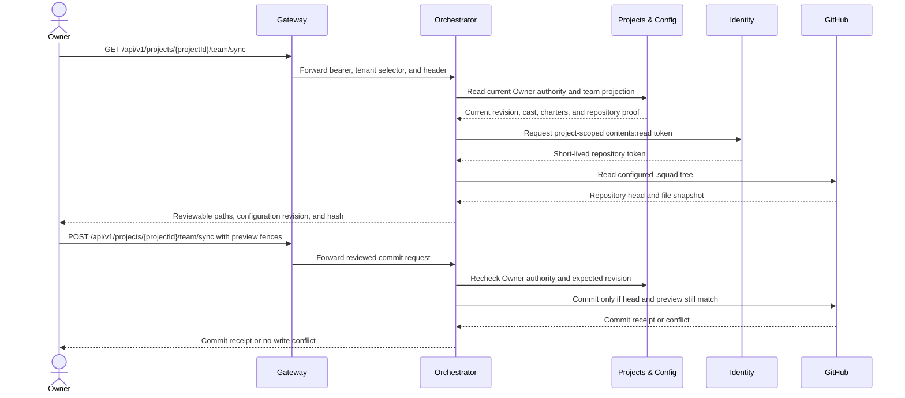
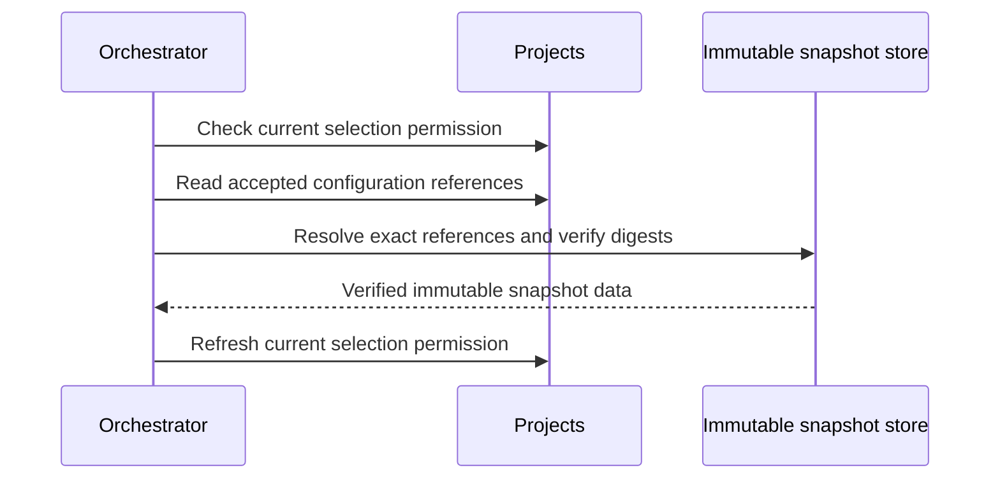
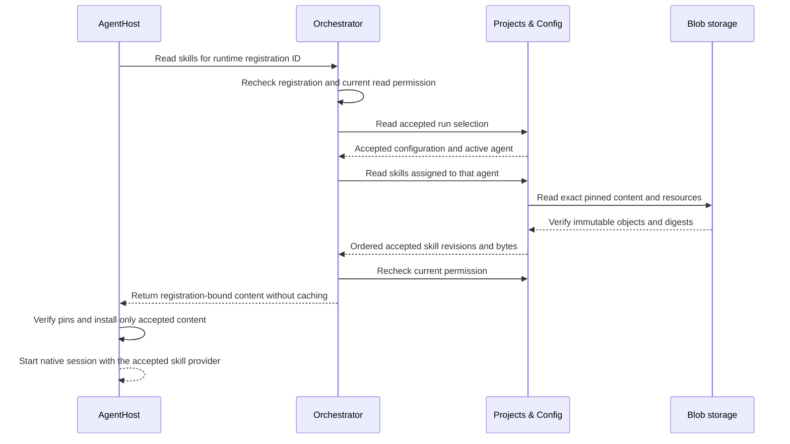

# Projects & Config service

Use this reference to understand how the unpublished .NET 10
`Agentweaver.Projects.Config` source owns project lifecycle, versioned
configuration, platform runtime defaults, and immutable run selections in the
`projects_config` PostgreSQL schema. A run selection is the accepted snapshot
of settings and provider candidates for one project run; it is not proof that a
provider resource exists. Source presence is not evidence of deployment or
release.

```mermaid
sequenceDiagram
    autonumber
    participant O as Orchestrator
    participant C as Projects & Config
    participant P as Provider catalog
    participant DB as PostgreSQL
    Note over C,P: Startup requires an existing, source-reviewed catalog snapshot. Profile rendering does not verify or create it.
    O->>C: Accept run ID, expected revisions, immutable context
    C->>DB: Recheck active membership and Orchestrator role; lock run ID and project/platform heads
    DB-->>C: Project configuration and platform defaults at expected revisions
    C->>C: Resolve task, role, and agent model routes; fail closed if unavailable
    C->>P: Resolve allowed provider candidates and capabilities
    P-->>C: Candidate metadata or explicit resolution failure
    C->>C: Check egress subset and run-limit narrowing
    C->>DB: Append fingerprinted immutable run-selection snapshot
    DB-->>C: Commit snapshot with exact revision inputs
    C-->>O: Effective run-selection context (not a resource pin)
    Note over O,P: After provisioning, the consumer negotiates a real resource and pins its identity, generation, and capabilities.
```

## Selected runtime profile

For runtime settings, see the planned
[runtime configuration reference](../reference/runtime-configuration.md).

The separate source renderer under `deploy/k8s/profiles/projects-config/`
targets only the existing 1.x environment. The ordinary Broker and Probe
compositions do not include it. Missing operator inputs stop rendering.
The profile requires the Projects runtime identity, passwordless PostgreSQL
with `VerifyFull`, explicit authentication authority and audience, an immutable
product image, reviewed image user/group, and an existing Projects-only TLS Secret.
It exposes private HTTPS and leaves system certificate trust unchanged.

When configured, `ProjectsConfig:Authentication:BrokerRunBindingAudience` maps only
the private Broker proof route. This route requires
`ProjectsConfig:Tls:CertificatePath`, `ProjectsConfig:Tls:KeyPath`, and
`ProjectsConfig:Tls:ServerCertificateSha256`. The absolute certificate/key paths
must identify a current non-CA server certificate with the server
authentication purpose, and the digest must match its exact leaf certificate.
The private route also requires a native TLS 1.2 or TLS 1.3 handshake; proxy
headers cannot stand in for TLS. The deployed TLS Secret and Kestrel default
certificate must use the same leaf certificate.

The provider catalog owner must supply an existing immutable, nonempty ConfigMap
in the same namespace and its reviewed source commit.
The ConfigMap uses relative catalog keys, such as `Registrations__0__Id`.
The profile prefixes them with `ProjectsConfig__ProviderCatalog__`, so they
cannot replace database, authentication, or HTTPS listener settings.
The existing .NET loader still validates the catalog; no second resolver or
empty catalog is generated.
Object existence, contents, immutability, source binding, and suitability for
the accepted owner flows remain deployment prerequisites.
Rendering a structurally valid reference does not prove those facts.

This profile does not create roles, grant rights, apply migrations, or add
Blob credentials or provider selections. It does not publish or deploy an image.
Applied migrations, runtime authorization, trusted TLS, and healthy owner flows
still require separate approval and evidence.

## API surface

Public routes require a validated bearer token with exactly one `sub`, the
required OAuth scopes, and the service's public audience. The private Broker
proof route uses a separately configured audience and a short-lived signed
request token. Projects & Config is the sole live owner of issuer-and-subject
memberships and resource-role assignments. It resolves the current caller to
one active tenant membership and current resource-role assignments in its own
database. A tenant selector can choose among existing memberships but cannot
create authority. Any signed tenant assertion must agree with the selected
membership. Project reads require an assigned Owner, Contributor, or Viewer
role (or tenant administrator). Project writes require Owner or tenant
administrator. Project creation requires an existing tenant administrator and
does not auto-assign an Owner. Platform defaults require an assigned platform
administrator. Run-selection reads and accepts require an assigned project
Orchestrator role and matching signed project/run bindings when present. Every
privileged request rechecks current membership and role state. Revocation takes
effect without refreshing the broker token.

Knowledge project-wide search requires direct project `ReadRunSelection`
authority with an unbound Broker token. Knowledge uses it to verify existing
run selections and provider pins; it does not create a run selection.

The Identity broker validates upstream identity but does not forward upstream tenant or role claims or assign application roles. OAuth scopes remain necessary route permissions, but they are not authority by themselves. Role claims and request headers never create authority; missing, ambiguous, stale, or foreign memberships fail closed.

| Route | Operation |
| --- | --- |
| `POST /api/p1/invocations/{invocationId}/setup` | Create or exactly replay the P1 invocation's immutable Projects setup receipt using the authenticated approved TenantAdmin. Accepts no body or query and cannot select a project ID or perform cleanup. |
| `POST /api/projects` | Create an active project and its initial configuration revision. |
| `GET /api/projects` | List projects visible through current project roles; a tenant administrator sees all projects in that tenant. |
| `GET /api/projects/{projectId}` | Read an authorized project summary. |
| `GET /api/projects/{projectId}?runId={runId}` | Read the project summary for an exact bound run after rechecking the caller's current project read role. |
| `PATCH /api/projects/{projectId}` | Change project name or lifecycle state with an expected project revision. Archive rather than physically delete. |
| `GET /api/projects/{projectId}/configuration?revision={n}` | Read the current or a retained configuration revision. |
| `PUT /api/projects/{projectId}/configuration` | Append a configuration revision with an expected configuration revision. |
| `GET /api/projects/{projectId}/configuration/choices` | Read current model eligibility and platform provider choices for settings. |
| `POST /api/projects/{projectId}/configuration/hosted-model-reasoning-catalog` | Store hosted reasoning levels verified by AgentHost for the caller's current project binding. Requires both the caller's project authority and AgentHost's pinned mTLS identity. |
| `GET /api/projects/{projectId}/casting/universes` | List supported universe names after checking project read access. |
| `GET /api/casting/templates` | List the built-in scenario templates available to seed a reviewed team proposal. |
| `GET /api/catalog/roles` | List the role definitions available to scenario and manual team proposals. |
| `GET /api/blueprints` | List the built-in blueprints with their default workflow and availability. |
| `POST /api/blueprints/validate` | Check a blueprint against the blueprint rules without changing state. |
| `POST /api/projects/{projectId}/casting/proposals` | Create a reviewed proposal from a complete project configuration draft. |
| `POST /api/projects/{projectId}/casting/proposals/scenario` | Create a version-bound proposal from a scenario template. |
| `POST /api/projects/{projectId}/casting/proposals/manual` | Create a version-bound proposal from selected role IDs. |
| `POST /api/projects/{projectId}/casting/proposal-generations` | Create or replay a run-bound generation request and its pending proposal. |
| `POST /api/projects/{projectId}/casting/proposal-generations/{requestId}/complete` | Complete a generation request by updating its proposal draft, if the run and configuration revision are still current. |
| `POST /api/projects/{projectId}/casting/proposal-generations/{requestId}/fail` | Mark a pending generation request failed with a bounded failure code. |
| `POST /api/projects/{projectId}/casting/proposals/blueprint` | Create a version-bound proposal from a built-in blueprint ID or an inline blueprint. |
| `GET /api/projects/{projectId}/casting/proposals` | List casting proposals for an authorized project. |
| `GET /api/projects/{projectId}/casting/proposals/{proposalId}` | Read a proposal and its draft for review. |
| `PATCH /api/projects/{projectId}/casting/proposals/{proposalId}` | Amend a pending proposal against its expected draft revision. |
| `PATCH /api/projects/{projectId}/casting/proposals/{proposalId}/members/{agentId}/role` | Change one member's catalog role and optional display title in a pending proposal draft. |
| `POST /api/projects/{projectId}/casting/proposals/{proposalId}/confirm` | Atomically confirm a current proposal as a new configuration revision. |
| `POST /api/projects/{projectId}/casting/proposals/{proposalId}/reject` | Reject a proposal without changing project configuration or run state. |
| `GET /api/projects/{projectId}/casting/export?revision={n}` | Export charter/casting configuration from the current or a retained revision. |
| `POST /api/projects/{projectId}/casting/import` | Stage an explicit owner-authorized charter/casting import for review. |
| `GET /api/projects/{projectId}/team-sync-projection?expectedConfigurationRevision={n}` | Return the current cast and charters for an authorized repository-sync preview; reject a stale revision. |
| `GET /api/platform/runtime-defaults` | Read the platform administrator's current defaults. |
| `PUT /api/platform/runtime-defaults` | Append platform defaults with an expected revision. |
| `GET /api/platform/components` | Report the active implementation and readiness of every platform component area for a current TenantAdmin or PlatformAdmin. Projects collects owner reports in parallel. See [Platform components](../guide/platform-components.md). |
| `PUT /api/projects/{projectId}/runs/{runId}/selection` | Accept or idempotently replay a run-selection request from the Orchestrator. |
| `GET /api/projects/{projectId}/runs/{runId}/selection` | Read the immutable selection snapshot for the authorized Orchestrator. |
| `POST /internal/projects/{projectId}/runs/{runId}/broker-run-binding` | Private Broker-only proof read, mapped only when `ProjectsConfig:Authentication:BrokerRunBindingAudience` is configured. Requires native TLS 1.2 or TLS 1.3, accepts no query or body, and returns a bounded `Cache-Control: no-store` receipt only for the exact signed project/run binding, active project, current actor membership, active Orchestrator assignment, and matching accepted run-selection snapshot. |
| `GET /api/projects/{projectId}/skills?cursor={token}&pageSize={n}` | List bounded skill revision metadata and current assignments for project administrators; omit `cursor` for the first page. |
| `GET /api/projects/{projectId}/runs/{runId}/agents/{agentId}/skills` | Read exact imported skill revisions assigned to an active agent in the accepted run. |
| `GET /api/authorization/context` | Return the validated caller's current effective permissions through versioned contract 1. |
| `GET /api/projects/{projectId}/skill-marketplaces/definitions` | List suggested marketplaces and the matching active source, if any. |
| `GET, POST /api/projects/{projectId}/skill-marketplaces/sources` | List or add revisioned project skill sources. |
| `PUT, DELETE /api/projects/{projectId}/skill-marketplaces/sources/{sourceId}` | Update or tombstone a source with its expected revision. |
| `GET /api/projects/{projectId}/skill-marketplaces/sources/{sourceId}/browse` | Resolve a source ref to a commit and return a bounded, filtered, paged manifest index. |
| `POST /api/projects/{projectId}/skill-marketplaces/sources/{sourceId}/preview` | Validate selected source bytes from an exact source revision, commit SHA, and path, then return the Skills preview and digest. |
| `POST /api/projects/{projectId}/skill-marketplaces/sources/{sourceId}/import` | Import selected bytes with the expected content digest and idempotency key into the existing Skills content store. |

Revision conflicts and a reused run ID with a different request return conflict responses. Invalid configuration and run-selection context return client errors; missing projects and inaccessible tenant-owned projects do not disclose their existence.

### P1 setup receipt endpoint

`POST /api/p1/invocations/{invocationId}/setup` is a purpose-limited source
endpoint for the upstream P1 fixture producer. It requires the existing
authenticated bearer token, exactly one `X-Agentweaver-Tenant` header, and the
existing `api.read`, `projects.admin`, and `projects.orchestrator` scopes. The
service resolves that principal afresh against the separately configured
Projects authority connection, then pins it to the existing approved issuer,
subject, and tenant. A current TenantAdmin grant is still required.

The route accepts no body or query parameters. It creates or exactly replays
only the existing `ProjectsConfigPrivilegedAuthorityStore` setup operation.
The response is the immutable `ProjectSetupReceipt` itself, not the store's
readback or cleanup result. A replay rechecks current membership and
TenantAdmin authority and returns the receipt only while the project, initial
configuration, Orchestrator assignment, Owner assignment, and both audit
events still match the active receipt. Cleaned, revoked, stale, or mismatched
state is rejected. The route has no cleanup operation and does not authorize
Environment or runtime resource creation. The existing P1 fixture runner is
not wired to this source endpoint by this change.

The endpoint's authority principal needs only the following database access:

| Object | Minimum privilege | Purpose |
| --- | --- | --- |
| `projects_config` schema | `USAGE` | Resolve the service tables and lock function. |
| `tenant_memberships` | `SELECT` | Resolve the authenticated actor's current active membership. |
| `projects`, `project_configuration_revisions` | `SELECT`, `INSERT` | Recheck a replay and atomically create the project and initial configuration. |
| `project_role_assignments` | `SELECT`, `INSERT` | Recheck the active TenantAdmin and receipt assignments; insert the initial Orchestrator and Owner assignments. |
| `authority_audit` | `SELECT`, `INSERT` | Recheck and append the two immutable assignment events. |
| `project_setup_operations` | `SELECT`, `INSERT` | Recheck and persist the immutable invocation receipt. |
| `projects_config.__ef_migrations_history` | `SELECT` | Verify that the configured authority database has no pending migrations. |
| `projects_config.lock_casting_authority(uuid, text, text, text, bigint, text, boolean)` | `EXECUTE` | Use the existing `SECURITY DEFINER` routine to lock current membership and matching active TenantAdmin rows before the exact assignment-ID/revision check. |

No membership writes, table `UPDATE`, `DELETE`, or `TRUNCATE`, sequence
privileges, schema `CREATE`, or broad/default grants are needed. In particular,
the setup route does not need cleanup's project or role-assignment updates.
The direct TenantAdmin read intentionally has no row-lock clause: the existing
security-definer routine already holds the required `FOR SHARE` locks. This
avoids granting column `UPDATE` merely to satisfy PostgreSQL's row-lock
privilege check. Normal startup separately verifies that the Projects runtime
principal has no access to `project_setup_operations`.

The HTTP host also verifies this exact setup-only privilege boundary at
startup, including column-level updates, privileged role attributes or
memberships, and schema/table/function ownership; excess capability prevents
the route from serving. This guard does not change the standalone setup
command. The matching
[P1 setup authority permission inventory](https://github.com/sabbour/agentweaver/blob/v1/scripts/azure/lib/p1-project-setup-authority-plan.mjs)
is a declarative, source-only review artifact. It is not executable SQL, does
not select or assign a principal, and applies no live grants; any later
deployment must separately approve and apply the exact permissions.

The hosted reasoning publication contains only supported effort names and the
binding reference, connection, revision, and verification time. AgentHost does
not send the hosted credential or model ID. Projects & Config returns a
publication only for the same actor, project, connection, and model-binding
revision, and only while it is less than 24 hours old. A delayed older
publication cannot replace a newer value. Settings now reads current hosted
levels from AgentHost's separate live catalog route; this stored publication
remains a non-authoritative hint. AgentHost checks every requested effort
against the live SDK catalog when a run starts.

Marketplace source CRUD, source revisioning, and commit-pinned browse are
documented in the [skill marketplace source contract](./skill-marketplace.md).
Browse reads only current-page `SKILL.md` descriptions. The separate Skills
content and assignment services remain the only content authority. The
Projects source-selected preview/import adapter reads the selected manifest
and bounded resources at the browse result's exact commit. It then passes those
bytes to the Skills validator and importer. The request includes source
provenance, expected digest, idempotency key, and expected skill revision.
Imported content uses the existing immutable object store and assignment
service. Projects does not create another loader or catalog. These
preview/import mappings belong to the Projects producer candidate. They do not
show that Gateway, MCP, retained Web import, or a runtime-loaded status producer
is available.

Skill inventory uses a URL-safe opaque continuation cursor. The default page
size is 25 and the maximum is 50. The cursor binds the project, page size, and
versioned `skillId`-ascending/revision-descending order. New revisions that sort
before a cursor do not shift later pages; restart without a cursor to see them.
Current tenant administrators and project owners can read metadata for active
or archived projects while their authority remains current. Viewers and callers
with revoked or stale authority are denied. Inventory contains no instructions,
resource bytes, or object keys.

### Reviewed casting proposals and explicit transfers

The Gateway exposes these owner routes under `/api/v1`, including templates
and roles. It forwards the bearer and optional tenant selector; Projects remains
the authorization and persistence owner. Import request bodies have the same
1 MiB limit at both entry points. Export requires `WriteProjects`, not just read
authority. See [Gateway casting](../reference/api.md#casting-through-the-gateway).

```mermaid
sequenceDiagram
    participant Client
    participant Gateway
    participant Projects as Projects & Config
    participant DB as PostgreSQL
    Client->>Gateway: Read supported universe names for the project
    Gateway->>Projects: Forward bearer and tenant selector
    Projects->>DB: Check current ReadProjects and project context
    Projects-->>Client: Supported universe names through Gateway
    Client->>Gateway: Create proposal (expectedConfigurationRevision, catalog selection, universe)
    Gateway->>Projects: Forward bearer, tenant selector, and body
    Projects->>DB: Check current WriteProjects; stage revision-bound proposal
    Projects-->>Client: 201 pending proposal through Gateway
    Client->>Gateway: Confirm reviewed proposal (expectedDraftRevision)
    Gateway->>Projects: Forward unchanged
    Projects->>DB: Lock project; recheck authority and both revisions
    alt Revisions are current
        Projects->>DB: Append configuration and confirm proposal atomically
        Projects-->>Client: 200 confirmed proposal through Gateway
    else Revision is stale
        Projects-->>Client: 409 through Gateway; configuration unchanged
    end
```

Casting templates, roles, and supported universe names are server-owned catalog reads. The project-scoped universe route checks the caller's current project read access before returning the supported names. Scenario proposal creation accepts an `expectedConfigurationRevision` and a `templateId`; manual creation accepts the expected revision and a non-empty list of catalog `roleIds`. Both may include a selected `universe`, which Projects validates and stores in the pending draft at that same revision. The draft replaces only the proposed `AgentCharters`, `Casting`, and selected universe while retaining unrelated project settings. Manual inputs reject unknown, repeated, and reserved orchestration roles. The original full-draft proposal route remains available for callers that already compose a complete `ProjectConfiguration`.

The authenticated team-sync projection is called by Orchestrator for an
explicit repository preview. It requires an unbound current project Owner and
the selected GitHub App repository. It returns the current configuration
revision, repository authority proof, project name, cast order, and member
charters. An optional expected revision rejects a stale preview without
changing project state. Orchestrator uses this projection to render
`.squad/team.md` and current charter files; repository content never becomes a
second roster or loader. The commit path re-reads the projection at the
previewed revision immediately before its branch update.



The retained web client uses that full-draft route for team changes that must
preserve the current roster. **Augment** stages the existing members plus the
selected roles; **Recast** uses a scenario or manual proposal to replace the
roster. Removing a member stages a complete draft. A role change updates one member
inside the pending draft using its expected draft revision. The catalog role ID
stays in the role field, while an optional custom title is stored separately on
the member's charter. The title is display metadata and does not change role
permissions. Neither edit changes the configuration until the proposal is
confirmed.

### Blueprints

A blueprint is a team recipe carried over from 0.x: a roster of roles, one or more workflows, a review policy, a sandbox profile, and optional skill bindings. Projects & Config embeds the five 0.x blueprints (AI agent engineering, content authoring, PM and software development, product management, and software development).

- `GET /api/blueprints` lists each blueprint with its default workflow (the first workflow) and an `exportability` result. The status is `exportable` or `unavailable`, with sorted reason codes such as `role_missing` or `workflow_unavailable`. A blueprint stays in the list when it is unavailable, so callers can show why.
- `POST /api/blueprints/validate` checks a blueprint and returns `{ valid, errors }`. It never changes state. The rules match 0.x: id and name are required, the review policy must be `default`, workflows must be known and unique, the sandbox profile must be `default` or `restricted`, roster roles must be catalog or bespoke roles and not reserved, skill bindings must name roster roles, and bespoke roles need a charter of at most 8,192 characters.
- `POST /api/projects/{projectId}/casting/proposals/blueprint` takes `expectedConfigurationRevision` and either `blueprintId` or an inline `blueprint`. It creates a pending proposal; nothing changes until the proposal is confirmed. The draft casts the roster, adds a `blueprintWorkflowReferences` entry for each workflow, sets `defaultWorkflowId` to the first workflow, assigns bound skills that the project already pins to the matching agents, and, for `restricted`, sets an empty `egressNarrowing` so the project has no network egress. A built-in blueprint can be applied only when it is exportable.
- The proposal route returns `{ proposal, unresolvedSkillBindings }`. Applying a blueprint never changes a skill's `enabled` setting. Each skill binding that doesn't take effect is listed with its `role`, `skillId`, and a `code`: `skill_not_installed` (the project has no such skill), `skill_not_pinned` (the skill has no pinned agent list), or `skill_disabled` (the agents are assigned, but the skill stays disabled). The list is sorted by role and then skill.

Workflow availability comes from the workflows the v1 Orchestrator registers. Today that is only `default`, so the built-in blueprints report `workflow_unavailable` until the Orchestrator workflow library adds their workflows.

#### Blueprints as AgentSuite packages

Blueprints ship as native AgentSuite packages, and the AgentSuite import is their only runtime loader. Projects & Config provides the parts that convert and apply them:

- `AgentSuiteBlueprintConverter.Convert` turns a 0.x blueprint into a deterministic AgentSuite content archive at build time. Each roster role becomes an agent whose instructions are the exact 0.x charter text. The caller supplies the build profile, its digest-pinned runtime base and harness images, and the agent model. `ConvertPackage` does the same for a 0.x `blueprint-package-v1` package. It checks the package with the 0.x validator, ported without behavior changes to `Agentweaver.Projects.Config.BlueprintPackages`, and refuses workflow and skill definitions.
- `ProjectBlueprintCatalog.ToAgentSuiteBlueprint` returns the `ProjectAgentSuiteBlueprint` projection: workflows, default workflow, review policy, sandbox profile, and skill bindings.
- `ProjectBlueprintCatalog.ValidateBlueprint` checks a projection against the suite's agent IDs with the 0.x rules. `ApplyBlueprint` applies it to a casting draft with the same effects as the blueprint proposal route, using the effective agent IDs from the import.
- When an AgentSuite import request includes `blueprint`, the import service runs `ValidateBlueprint` before it stores anything and `ApplyBlueprint` on the import draft. The response lists `unresolvedSkillBindings` with the same codes as the proposal route. For details, see [AgentSuite import](../reference/agentsuite-import.md#blueprint-data).

The packaged built-in blueprints ship after the AgentHost image that their build profiles pin is published. Until then, the catalog serves the embedded 0.x JSON. For the decisions and how each 0.x criterion maps to v1, see [Blueprints on AgentSuite](https://github.com/sabbour/agentweaver/blob/v1/docs/architecture/design/agent-application-bundles.md#blueprints-on-agentsuite).

Authorized project readers can list and read proposals. Project writers can
amend a draft with its expected draft revision and explicitly confirm or reject
it. Confirmation rechecks current project authority and the base configuration
revision while holding the project lock. It then appends the configuration
revision and marks the proposal confirmed in the same transaction. A changed
project revision conflicts rather than silently replacing a newer roster.
Rejection records only the proposal transition. It does not write configuration
or run state. Accepted run selections continue to refer to their immutable
configuration revision.

### Formulate and Analyze generation

Formulate and Analyze create a generation request and an ordinary pending
casting proposal bound to the current configuration revision. The request
records its mode, run ID, actor-scoped idempotency key, request digest, proposal
ID, and lifecycle state. It does not store model credentials. The model call
runs in AgentHost with that run's Identity credential; Projects & Config owns
the proposal and never receives the credential.

Generation uses the existing accepted project-run lifecycle rather than a
separate scheduler or model-execution path. The client saves the canonical
prompt as the run's first message, then obtains the run-bound Identity session.
It sends the run-bound bearer to Orchestrator and a separate, unbound
project-writer bearer to Projects & Config through the Gateway. The Gateway
checks that both owner-issued authorization contexts have the same issuer,
actor, and tenant, that the run bearer is bound to the exact project and run,
and that the project bearer is unbound and has current write authority. It
does not forward the project bearer to Orchestrator.

Orchestrator accepts `POST /api/projects/{projectId}/runs/{runId}/coordination/sessions/{sessionId}/casting-generation`
only for the active coordinator root of that accepted run. It checks the
accepted selection, current registration, and host readiness, then sends one
immediate AgentHost turn with the generation request ID as its stable message
ID. Before returning `{ requestId, runId, output }`, it checks that the run
selection and registration are still current. Orchestrator does not persist the
proposal result; the Gateway completes the request through Projects & Config.
The coordinator root uses the accepted model-turn and tool-call limits. Its
model-turn admission is an append-only owner record bound to the generation
request ID, exact prompt digest, accepted selection, execution fence, and
accepted decision version. The AgentHost action must match that record before
the root grant is issued; an arbitrary root event or changed prompt is denied.
The generation message is marked `readOnlyToolsOnly`; AgentHost permits only
the SDK `view` tool for that turn, while every ordinary run keeps its accepted
tool policy. This lets Analyze inspect files without granting it file writes or
shell execution.
Root grants and child-work dispatches share one run-wide model-turn reservation
count and execution lock, so neither path can spend a turn left by the other.
The root action path remains separate; child-work dispatch admission stays
step-bound.
AgentHost obtains the model credential from Identity using the run-bound
registration, so it never passes through Orchestrator or Projects.
Runtime registration may read the active coordinator root using its accepted
selection, current decision, and run admission. This path is limited to the
root; runtime observation and child-work reads retain their child-work guards.
The root uses the model selection accepted for the run and is not treated as a
roster agent with assigned skills.

Casting generation marks its AgentHost turn to continue if the HTTP waiter
disconnects. The admitted turn owns a separate copy of the actor bearer, bounded
by the original expiry and invalidated when the turn completes or is abandoned.
An exact retry waits for or replays the same result; a retry with changed
content conflicts.

Generation completion must match the request's run ID and current configuration
revision. It validates and replaces only the proposal's charters and cast, then
marks the request complete in the same database transaction. Until the user
confirms, neither generation start nor completion appends a live configuration
revision. A rejected proposal cancels unfinished generation. A stale completion
leaves the proposal review state and live configuration unchanged; the owner
reports the request as stale. Confirmation uses the same current-authority and
revision checks as other casting proposals.

```mermaid
sequenceDiagram
    participant Client
    participant Gateway
    participant Orchestrator
    participant AgentHost
    participant Identity
    participant Projects as Projects & Config
    participant DB as PostgreSQL
    Client->>Gateway: Create or replay normal project run
    Gateway-->>Client: Run ID and root session
    AgentHost->>Orchestrator: Read accepted root runtime context
    Orchestrator->>Projects: Validate accepted selection and current authority
    Orchestrator-->>AgentHost: Root binding with accepted model and tool limits
    Client->>Identity: Obtain run-bound session
    Client->>Gateway: Formulate or Analyze (run bearer, project bearer, expected revision)
    Gateway->>Projects: Check unbound project write context
    Gateway->>Projects: Check exact run-bound context and matching actor and tenant
    Gateway->>Projects: Read configuration, role catalog, and universe catalog
    Gateway->>Gateway: Rebuild and validate the exact mode-specific prompt
    Gateway->>Projects: Start generation request (run ID, request digest)
    Projects->>DB: Check current write authority and revision; store pending proposal
    Gateway->>Orchestrator: Execute generation (request ID, prompt, run-bound token)
    Orchestrator->>Orchestrator: Accept and start the saved run through the normal path
    Orchestrator->>Orchestrator: Recheck accepted root and current registration
    Orchestrator->>DB: Persist request, prompt digest, selection, fence, and decision-bound root admission
    Orchestrator->>AgentHost: Immediate turn (message ID = request ID)
    AgentHost->>Orchestrator: Request model.turn admission (dispatch ID = message ID)
    Orchestrator->>DB: Match persisted admission; count root grants and workflow dispatches under one run lock
    Orchestrator-->>AgentHost: Root model.turn admission
    AgentHost->>Identity: Redeem the run-bound model credential
    Identity-->>AgentHost: Run-scoped credential
    AgentHost-->>Orchestrator: Proposed charters and cast
    Orchestrator-->>Gateway: Result bound to request ID and run ID
    Gateway->>Projects: Complete request (same run ID, generated roster)
    Projects->>DB: Recheck authority and revision; update proposal only
    Gateway-->>Client: 200 pending proposal with completed generation status
    Client->>Client: Review generated roles and charters; edit or remove members
    alt User confirms
        Client->>Gateway: Confirm proposal (expected draft revision)
        Projects->>DB: Recheck authority and revisions; append live configuration
    else User rejects
        Client->>Gateway: Reject proposal (expected draft revision)
        Projects->>DB: Record rejection; leave live configuration unchanged
    end
```

Charter/casting transfer is a separate explicit owner operation. Export
identifies the source project and configuration revision. It includes a format
version and content digest. Import checks that format and digest. It validates
the proposed configuration through the ordinary owner-authorized configuration
validator. It preserves target settings outside charters/casting and creates a
pending proposal rather than applying it. Incompatible or tampered transfers
return an actionable client error. The service does not mirror Squad files,
reconcile them in pre-commit hooks, or export them after runs.

The authorization-context route requires `api.read` and accepts the optional
`X-Agentweaver-Tenant` selector. It resolves only the authenticated issuer and
subject. It rejects query parameters, including caller-subject and role
selectors, and purpose-bound tokens. It applies the validated service audience,
OAuth scopes, and optional project/run bindings. The response contains grouped
effective permissions with membership and role revisions. It does not return
assignment rows or a transferable credential. Responses use
`Cache-Control: no-store`. Resource services request this context for each
privileged operation. They do not maintain separate membership/role records,
caches, or authorization pins. The contract-1 wire DTOs are shared in
`Agentweaver.Abstractions`. This shares serialization types, not authority data
or database access.

The Broker proof route rejects query parameters, non-empty request bodies,
`Transfer-Encoding`, and `Content-Type`. It resolves the actor only from the
signed token's issuer and subject,
then restricts membership lookup to the target project's tenant; it never picks
among the actor's other tenant memberships. It reads the current assignment and
the existing immutable run-selection snapshot. A stale or mismatched selection
does not produce a receipt.

## Selection and persistence rules

- Platform defaults route planning, review, design, security, creative writing,
  and complex work to `gpt-6.1-sol` at High reasoning effort. Code-writing and
  straightforward work use `gpt-6-luna` at High effort. Platform administrators
  can replace these built-in task defaults.
- A platform configuration that omits `modelTaskDefaults`, including one saved
  before task routes existed, gets the built-in routes. If a project has no
  project-wide `ModelSelection` pin and its available model references don't
  include `gpt-6.1-sol` and `gpt-6-luna`, such as on a single-model or
  BYOK-only platform, replace the task defaults with available references or
  set `modelTaskDefaults` to an empty list. Otherwise, run acceptance fails with
  `model_selection_unavailable`.
- `ProjectConfiguration.ModelSelection` is a project-wide run pin. When set,
  it selects one model and effort for every task, preserving 0.x behavior.
  Otherwise, Projects starts with the platform-wide model, applies platform
  task, role, and agent defaults, then applies project task, role, and agent
  overrides. Within each configuration layer, an agent override takes
  precedence over its role, and a role override takes precedence over its task
  default.
- The accepted run snapshot stores each selected model binding and its reasoning
  effort. It includes global routes and routes for configured role and agent
  overrides that apply to the accepted cast. Orchestrator resolves each WorkPlan
  item to the most-specific accepted route. The model reference and effort stay
  fixed across dispatch and resume.
- Every selected reference must appear in
  `RunSelectionContext.AvailableModelSelectionReferences`. A missing reference
  fails run acceptance with `model_selection_unavailable`; Projects does not
  substitute the platform model or another available reference.
- Omitted reasoning effort resolves to `high`. AgentHost passes that effort to
  the native Copilot SDK and checks the selected model's advertised support
  before session creation or resume. Unsupported effort fails closed; BYOK
  requires explicit server-configured supported-effort evidence.
- Project configuration can name an optional `defaultWorkflowId`. Orchestrator accepts it only when it resolves to a server-registered workflow in the accepted selection's authorized catalog; project workflow references narrow that catalog when present. An unknown or unauthorized default falls back to the validated built-in workflow. The field is an identifier, not a workflow definition or an authority grant.
- `SecretRef` values can be persisted as references. Credential values are not part of configuration or run-selection snapshots.
- Optional `reviewedRemoteToolSnapshots` contains exact project-scoped snapshot references. Null omission preserves older configuration bytes. Duplicate references and references to another project are rejected. The accepted run retains these references, not mutable current project settings.
- `ModelSelectionSettings.SourceMode` selects `hostedCopilot` or `byok` in the platform or project configuration. Runtime owner bindings retain that accepted mode. The runtime has no personal model-provider precedence or fallback.
- Hosted selection requires a stable `ConnectionId` and prohibits `CredentialReference`. Identity owns the current connection revision, GitHub user identity, freshness, revocation, and exact protected secret version. Rotation does not change the accepted selection bytes or hash. A different account, owner, or scope requires a new connection and selection.
- BYOK selection requires an exact `CredentialReference` and prohibits `ConnectionId`. Orchestrator exposes that reference only when the confirmed WorkPlan model matches the accepted selection. The reference is not grant authority and contains no credential value.
- Legacy records retain their original omitted or null fields and hashes. Hosted records with a pinned secret require migration to a connection before runtime use. Missing or incompatible source modes fail closed.
- Optional `ProjectConfiguration.SourceControl` contains one repository identity
  and either exact API/checkout SecretRefs or `authMode: "githubApp"` with an
  Identity connection ID. A short-lived Identity selection code appears only in
  the initial run-scoped Orchestrator `/pin` request. It does not appear in
  accepted project/run configuration or the durable pin. Identity stores only
  its hash. Its first run-bound use binds the hash to one project. Later token
  minting is limited to that project. The durable pin retains the hash and exact
  repository/permission metadata. App mode rejects API/checkout SecretRefs. An
  optional webhook SecretRef remains independent. The run-selection's complete
  `projectConfiguration` snapshot is the only source for these values.
  Consumers never substitute mutable current settings for an older accepted
  run. Null omission preserves legacy configuration shape. Project
  configuration contains no OAuth, selection-code, or installation-token
  values. Identity stores only OAuth SecretRefs and returns installation
  tokens transiently.
- Project-level overrides select model configuration only. Legacy provider-override fields remain loadable in stored configuration but are ignored for new provider resolution; non-model provider selections come from the platform catalog. Exclusive, ordered-composite, platform-singleton, layered and meter-keyed Cost seams use the existing `ProviderResolver`; Application Hosting remains unsupported. Cost requirements name a source explicitly, and multiple distinct meter sources can appear in one selection. The snapshot preserves source keys, adapter/options versions and advertised/required capabilities.
- The service requires project egress rules to be a subset of the platform baseline and checks each run's required destinations. Project run limits can only reduce configured platform limits. A prompt-token limit is optional in new platform defaults and run selections. A project inherits the configured platform cap, can narrow it, or can add a cap when the platform has none. Omission stays absent in new selections. Existing configured values and accepted snapshots remain unchanged.
- `runLimits.spendBudgets` follows the same rule. A project inherits each platform spend budget, can narrow one by reusing its `budgetId`, and can add its own budgets. The run selection snapshot pins run and agent budgets. `GET /api/projects/{projectId}/runs/{runId}/spend-budgets` returns the current project-scope budgets to Orchestrator for each dispatch, so a changed project budget applies to running work. When this route returns `404 Not Found`, Orchestrator treats the project as having no project-scope budgets and enforces only the pinned run and agent budgets. This keeps Orchestrator compatible with a Projects deployment that doesn't serve the route yet.
- The immutable run-selection snapshot carries the typed platform egress
  baseline, optional project narrowing, admitted run needs, and the effective
  allow list. It also carries each layered Network Policy provider's layer,
  options revision, and required/advertised capabilities. The Environment consumer rechecks the current authorization context before reading this snapshot and compiles the final intent.
- Project configuration revisions, platform runtime revisions, and run-selection snapshots are append-only at the database boundary. Project metadata and revision heads remain mutable under optimistic revision checks.
- Memberships and role assignments live in this service's schema. A
  privileged source path provisions or revokes them. A current TenantAdmin
  can also assign and revoke project roles through the public
  role-assignment API; project Owners can list them but can't change them.
  Revocation uses expected revisions and records an immutable audit event. It
  cannot remove the last Owner of an active project. Runtime database
  credentials are read-only on memberships. On assignments and audit they
  have only the approved `INSERT` and column-scoped `UPDATE` grants, and no
  `DELETE`. Casting
  row locks use the fixed security-definer authority function. Startup checks
  its exact EXECUTE grant.
- Operators create the first TenantAdmin with the one-shot
  `--bootstrap-first-tenant-admin` command. It reads only the approved issuer,
  subject, and tenant from `ProjectsConfig:PrivilegedSetup` and uses the
  separate migration/schema-owner connection. It writes the active membership,
  TenantAdmin assignment, and audit rows in one transaction. A rerun for the
  same active identity makes no changes; another active TenantAdmin stops the
  command. Normal host startup never bootstraps authority.
- Operators create the first PlatformAdmin with the one-shot
  `--bootstrap-first-platform-admin` command. It uses the same approved issuer,
  subject, and tenant, then writes the platform-wide assignment and audit rows
  in one transaction. A rerun for the same sole active identity makes no
  changes; any other active PlatformAdmin stops the command. The command does
  not configure runtime defaults. Operators must also write reviewed defaults
  through the public platform runtime-defaults API. Until the platform head has
  a configured revision, run-selection acceptance returns
  `409 platform_runtime_unconfigured`.
- Run-selection acceptance serializes a run ID and rechecks the current Orchestrator assignment before committing. Replays return the originally stored snapshot, but still require current authorization; snapshots never pin membership or roles.
- Provider resolution returns candidates, not resource bindings. Resource identity, generation, negotiated capabilities, and final pins are owned by the consumer after provisioning.

The service does not own provider catalog registrations, Git or workflow
materialization, remote MCP, UI state, run journals, or secret redemption. The
catalog owner supplies its snapshot through the required
`ProjectsConfig:ProviderCatalog` startup configuration section. The section
contains `Registrations`, `Defaults`, `PermittedOverrides`,
`OrderedSelections`, `LayerSelections`, and optional
`MeterSourceSelections` entries (`MeterSource`, `ProviderId`). Provider
registrations include adapter version, options schema/revision, hosting
pattern, enabled state, and advertised capabilities. The service validates the
catalog through `ProviderCatalog.Create`. Startup fails if the catalog is
missing or invalid. The service does not use an empty catalog. The snapshot is
fixed for the service process lifetime. Run requests carry their own immutable
context revision. Database migrations run through the separate `--migrate`
operation. Normal startup verifies that migrations have already been applied.

Projects & Config and Knowledge use the shared loader from `Agentweaver.Providers`.
Both validate the supplied catalog through `ProviderCatalog.Create` and fail startup
if it is missing or invalid rather than substituting an empty catalog. The snapshot is fixed
for each service process lifetime; run requests carry an immutable context revision,
and consumers fail closed if a selected candidate differs from the supplied catalog.
Database migrations run through the separate `--migrate` operation; normal startup
verifies that migrations have already been applied.

### Checked-in provider catalog

For provider selection and catalog configuration, see the planned
[provider configuration guide](../guide/configure-providers.md).

The reviewed snapshot is
[`deploy/k8s/provider-catalogs/projects-config-provider-catalog.snapshot.json`](https://github.com/sabbour/agentweaver/blob/v1/deploy/k8s/provider-catalogs/projects-config-provider-catalog.snapshot.json),
bound to release source `c24d0000fe5fc6163e4f38594c39dff782d3a46d`. Its immutable
ConfigMap rendering is
[`projects-config-provider-catalog.json`](https://github.com/sabbour/agentweaver/blob/v1/deploy/k8s/provider-catalogs/projects-config-provider-catalog.json),
named `projects-config-provider-catalog`. The .NET startup loader consumes the
ConfigMap's flattened `Registrations__...` and `Defaults__...` keys after the
runtime List adds the `ProjectsConfig__ProviderCatalog__` prefix to Knowledge,
Projects & Config, and Orchestrator. The ConfigMap's product-source annotation
identifies the published source used for the snapshot; the runtime List records
the catalog PR merge commit on all three consumer pods.

The catalog registers the P1 Sessions, Memory, Sandbox, Storage, Policy, Source
Control, Cost, and Cilium providers, plus the foundational Messaging provider
whose runtime default is also defined by Events & Sessions. Cilium's
`AdapterVersion` is `1.0.0`. Coordinator decision: adapter code version shipped
in Environment 1.0.0. Its `OptionsRevision` uses the operator-selected
bounded label `p1-v1.0.0` (the selected-label rule). The L3/L4 layer selection
uses the Cilium provider.

The Cilium namespace is `agentweaver`, the namespace used by the P0
deployment policies. The checked-in `environment-agenthost-network.yaml`,
`service-owner-network.yaml`, and `identity-broker/egress.yaml` policies define
the endpoint selectors as the exact pair
`k8s:io.kubernetes.pod.namespace=agentweaver` and
`agentweaver.io/workload=<workload>`. The workload values are the names
selected by those policies: `agenthost`, `environment`, `projects-config`,
`gateway`, `mcp`, `orchestrator`, `knowledge`, `events-and-sessions`, and
`identity-broker`. These selectors are runtime options, not catalog fields.
Environment still requires `Namespace`, `AdapterVersion`, `OptionsRevision`,
and `EndpointSelectors` at startup. The bootstrap List sets the decided
adapter version and matching revision, and mounts the nested selector JSON
from `environment-cilium-config`. Sessions,
Messaging, and Memory use exact release-source revisions:
`native-postgres-v1`,
`native-postgres-messaging-v1`, and `native-postgres-memory-v1`. The Events &
Sessions and Knowledge configuration readers define these defaults; the
published contract table also records the Sessions and Messaging defaults.

The remaining P1 consumers have no source default for `OptionsRevision`. Their
catalog revision is therefore the operator-selected bounded label
`p1-v1.0.0`, not evidence of an image, provider artifact, or deployment. The
release runtime List sets the five consumer revisions as explicit, non-secret
`env` values and sets Cilium adapter version `1.0.0` by coordinator decision.
These take precedence over same-named values from the service runtime ConfigMaps
while preserving their `envFrom` entries for all other settings. The checked-in
runtime settings and their value sources are documented in the
[runtime configuration reference](../reference/runtime-configuration.md).
For apply order, see the
[Kubernetes operator guide](https://github.com/sabbour/agentweaver/blob/v1/deploy/k8s/README.md#render-and-apply-the-bundle).
The Environment, Orchestrator, and Events maps have source-backed runtime
configuration. Live preflight, PostgreSQL migration/role state, and external
resource connectivity remain separate deployment and acceptance gates:

| Registration | Existing input/config path | Required value and List wiring |
| --- | --- | --- |
| `agent-sandbox` | `Environment__Sandbox__AgentSandbox__OptionsRevision` | `p1-v1.0.0`; bootstrap List sets an explicit Environment `env` value, overriding `environment-runtime-config` if present. |
| `agent-sandbox` schema | `Environment__Sandbox__AgentSandbox__OptionsSchemaVersion` | `2`; `environment-runtime-config` remains available through `envFrom`. |
| `azure-files-csi` | `Environment__Storage__AzureFiles__OptionsRevision` | `p1-v1.0.0`; bootstrap List sets an explicit Environment `env` value, overriding `environment-runtime-config` if present. |
| `azure-files-csi` schema | `Environment__Storage__AzureFiles__OptionsSchemaVersion` | `1`; `environment-runtime-config` remains available through `envFrom`. |
| `agt.dotnet-yaml` | `AgentGovernance__Policy__OptionsRevision` | `p1-v1.0.0`; bootstrap List sets an explicit Orchestrator `env` value, overriding `orchestrator-runtime-config` if present. |
| `github` | Accepted run-selection `providers[].candidates[].optionsRevision` | `p1-v1.0.0`; Projects & Config copies the selected catalog candidate into this existing runtime input, and Orchestrator validates it against the catalog. |
| `copilot.usage-cost` | `EventsAndSessions__Cost__Copilot__OptionsRevision` | `p1-v1.0.0`; bootstrap List sets an explicit Events & Sessions `env` value, overriding `events-and-sessions-runtime-config` if present. |
| `copilot.usage-cost` schema | `EventsAndSessions__Cost__Copilot__OptionsSchemaVersion` | `2`; `events-and-sessions-runtime-config` remains available through `envFrom`. Published Copilot token rates are provider-owned, not configured in the catalog. |
| `cilium` | `Environment__NetworkPolicy__Cilium__AdapterVersion` | `1.0.0`; coordinator decision: adapter code version shipped in Environment 1.0.0. The List sets the matching explicit Environment value. |
| `cilium` | `Environment__NetworkPolicy__Cilium__OptionsRevision` | `p1-v1.0.0`; selected-label rule. The List sets the matching explicit Environment value. |

The runtime List wiring is in `scripts/release/runtime-list.mjs`:
`createWorkload` adds the exact provider `OptionsRevision` values and the
decided Cilium `AdapterVersion` to explicit
service `env` entries and preserves the service-named ConfigMap `envFrom`.
`validateRuntimeManifest` permits only those exact revision and adapter-version
names and values. It mounts nested Cilium endpoint selectors from the immutable
`environment-cilium-config` file because their `/` and `:` keys cannot be
represented as Kubernetes environment variable names. The same provider
catalog ConfigMap is supplied to Knowledge, Projects & Config, and Orchestrator
with the `ProjectsConfig__ProviderCatalog__` prefix.

GitHub has no independent adapter-local or project-configuration revision
setting. Its consumer input is nevertheless explicit: `ProjectsConfigService`
copies the resolved catalog candidate's `OptionsRevision` into the accepted
run-selection candidate, and `SourceControlProviderSelectionResolver.Resolve`
requires a stable value and exact equality with the current catalog candidate.
The catalog's `p1-v1.0.0` is therefore propagated through this existing
non-secret runtime input; no separate GitHub runtime ConfigMap key is needed.

The table gives the exact non-secret schema inputs required by Agent Sandbox,
Azure Files, and Copilot Cost; AGT's reader uses schema `1`. Cilium uses options
schema `1`, as defined by `CiliumEgressProviderOptions`. Its Environment
runtime ConfigMap snapshot supplies namespace and endpoint selectors through
the separately mounted Cilium options file. Live Environment and database
readiness are checked separately from these configuration snapshots.

Selections follow the documented defaults: the catalog defaults Sessions,
Messaging, Memory, Sandbox, Storage, Policy, and Source Control; selects Cilium
for the L3/L4 Network Policy layer; and maps the source-defined
`copilot.nano_aiu` meter to `copilot.usage-cost`.
It grants no project overrides, adds no ordered composite, and does not claim
an L7 Network Policy provider. Provider registrations and revision labels do
not establish that consumer configuration, resources, images, or runtime flows
are deployed or ready. Consumers still fail closed when their configured
revision or other required options do not match.

Cost candidates remain selections, not producer authority. An opaque model-selection
reference plus a selected meter key does not prove the effective SDK model/source.
That proof belongs to the canonical model/producer owners. Existing selection GET
still requires current Orchestrator `ReadRunSelection` authority, not project-admin
write permission; adding Cost cardinality does not widen authorization.

Run-selection accept and read responses are `no-store`. The current
authorization-context GET also uses `no-store`; it returns grouped permissions
and membership/role revisions, not assignment rows or transferable credentials.
The run-bound project-summary GET requires exactly one `runId` query parameter,
an exact signed project/run binding, and a current project Owner, Contributor, or
Viewer role (or tenant administrator). It returns `no-store` so consumers can
recheck authorization before forwarding run-scoped data.
See [Environment egress](./environment-egress.md) for how a privileged consumer
uses both current authorization and the immutable selection without a separate
membership or role cache.

Orchestrator resolves each retained remote-tool reference against its immutable snapshot store.
It checks the complete stored digest and exact reference before returning the accepted selection.
It then refreshes Projects authority. A missing, changed, or foreign snapshot fails the read.
The snapshot tables still require their explicit schema resource; normal migration startup does not create them.
This read does not authorize credentials, network access, or a remote tool call.



## Validation

Run the pure validator tests and the PostgreSQL integration test from the repository root:

```powershell
dotnet test tests/Agentweaver.Projects.Config.Tests/Agentweaver.Projects.Config.Tests.csproj --configuration Release
```

The PostgreSQL tests use Testcontainers. They verify tenant-scoped run selection, revision and idempotency behavior,
model fail-closed semantics, and provider candidate metadata. They also verify
the exact runtime authority grant set, CAS revocation and audit retention, the
last-Owner invariant, and database append-only triggers.

## Skill content and assignment

`POST /api/skills/preview` validates a `SKILL.md` document and its text resources
and returns a digest without storing the content. `POST /api/skills/package`
groups uploaded files, one ZIP archive, or draft form fields into candidates.
Each `SKILL.md` marks a skill root, and files under a nested root belong only to
that nested skill. The route checks every path, applies file-count and size
limits while it expands an archive, and validates each candidate with the same
preview rules. It stores nothing. Project import requires current
project write authority, that exact digest, and an idempotency key. Each successful
import creates an immutable revision with source provenance. Reusing the key for a
different request or importing against a stale revision returns a conflict.

`GET /api/projects/{projectId}/skills` returns metadata for stored revisions,
including unassigned and revoked revisions, and exact current assignments with
the project configuration revision. It uses stable pages of 25 revisions by
default and accepts page sizes from 1 through 50. The endpoint requires current
project-admin authority and returns no skill or resource bytes. Revoked metadata
does not grant permission to load or assign that revision.

`PUT /api/projects/{projectId}/skills/{skillId}/assignment` writes an ordinary
configuration revision. An enabled assignment pins an imported content revision
and digest and names one or more active agents in the project casting. Configuration
validation rejects missing, mismatched, revoked, or inactive-agent pins. New or
changed enabled skill entries must have these pins. An unchanged legacy entry
can remain during an unrelated configuration edit, but it is never returned
as accepted runtime content.

`GET /api/projects/{projectId}/runs/{runId}/agents/{agentId}/skills` rechecks
current Orchestrator authority and the accepted project/run binding. It returns
only content pinned by that run's accepted configuration for the requested active
agent. Unassigned, inactive, stale, revoked, missing, or corrupt content fails
closed.

Content objects use immutable keys in a dedicated Azure Blob container. Set
`ProjectsConfig:SkillContent:ContainerUri` to one HTTPS container URI. The Projects
Config workload identity needs **Storage Blob Data Contributor** on that container
only. Preview does not need Blob storage; imports and content reads fail closed
when the container is not configured. The separate `--migrate` command does not
need Blob configuration.

The runtime does not read current mutable project settings for skills. Orchestrator
checks the registration against the accepted run selection, asks Projects for that
agent's pinned revisions, and checks current permission again after the content
read. AgentHost verifies the registration binding and content digests before it
starts a native session.


