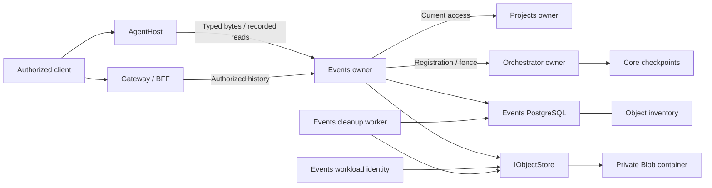

# Events-owned session material and Blob composition

**Status:** Design decision for the existing v1 owner boundary. Most foundations
are implemented in source. Read-time retention enforcement and the additional
composition evidence below remain follow-up work. This decision is not deployment
or implementation acceptance.

## Decision

Keep PostgreSQL authoritative for ordered events, session identity, object
references, and retention. Events & Sessions owns material persistence and reads
through the existing `IObjectStore` contract; Azure Blob stores opaque bytes.
AgentHost produces actual turn content and SDK-supported cache material, while
Orchestrator owns current execution, fences, and MAF checkpoints.

Keep the general material interface limited to `TurnContent` and `SdkCache`.
Clients identify a session, event, and kind, not a Blob key, URL, or container.
Do not add a service, provider seam, producer identity, permission framework,
raw-content API, or alternate session journal. Separately protected Runtime
configuration, remote-tool result, and produced-run capture contracts do not
broaden this interface.

Retain the implemented write-before-reference protocol and durable inventory.
Finish read-time retention enforcement, then prove failure recovery and the
production configuration across their existing boundaries. The implementation
slices below are bounded additions, not a rewrite of accepted foundations.

## Current source and remaining gaps

This assessment uses v1 source commit
`dc17ba27f4cbfbedd9174a1816da88a03bddab88`. Source definitions are not evidence
that a resource, role assignment, route, or runtime is deployed.

| Boundary | Implemented source | Remaining work |
| --- | --- | --- |
| Typed producer and owner | `AuthorizedRuntimeSession` sends actual bytes through `RuntimeSessionMaterialHttpClient`. `SessionMaterialApplicationService` validates current Projects and Orchestrator state. | Preserve the contract and extend combined failure/restart evidence, rather than create another producer interface. |
| Storage and journal | `SessionMaterialStore` generates a deterministic scoped key and verifies stored bytes. `AppendCoreAsync` inventories the key before storage and commits the event, references, retention, and outbox together afterward. | Prove storage response loss, uncertain journal acknowledgment, and cleanup interruption across fresh owner instances. Existing duplicate and deferred-commit-failure tests remain valid. |
| Retention | Migration `010_session_object_inventory.sql` backfills committed keys. `SessionObjectRetentionService` locks inventory and skips keys with live references. Its worker runs at startup and hourly. | `ReadMaterialEventAsync` and `SessionMaterialStore.ReadAsync` do not enforce reference expiry before disclosure. Bytes can remain readable between expiry and cleanup. Add the read-time guard described below. |
| SDK recovery | `RuntimeNativeSessionFiles`, `RuntimeCopilotSessionFactory`, and `RuntimeSessionMaterialHttpClient` support native cache capture, compatible resume, and bounded journal-context rebuilding. | Join owner HTTP/storage failures to replacement-runtime recovery in focused tests; do not treat cache existence or a session ID as recovery proof. |
| Production source composition | The Events host, runtime ConfigMap, Deployment, network policy, private container, and container-scoped workload role are present. | Add a cross-file composition regression test. Database health and a selected Object Store descriptor do not prove Blob access or runtime recovery. |
| Historical orphan discovery | New typed uploads have durable inventory. Existing committed references are backfilled. | Pre-inventory unreferenced objects remain undiscoverable through `IObjectStore`, which has no listing operation. No container sweep is authorized. |

### Source evidence

The symbols above can be inspected at these boundaries:

- [Events host composition](https://github.com/sabbour/agentweaver/blob/v1/services/events-and-sessions/Agentweaver.EventsAndSessions/Program.cs):
  `SessionMaterial:ContainerUri`, `AddSessionMaterialOwner`, and the retention worker registration.
- [Typed routes and authority](https://github.com/sabbour/agentweaver/blob/v1/services/events-and-sessions/Agentweaver.EventsAndSessions/SessionMaterialEndpoints.cs):
  `WriteCoreAsync`, `ReadAsync`, and `RequireMaterialReadAuthority`.
- [Material bytes and integrity](https://github.com/sabbour/agentweaver/blob/v1/services/events-and-sessions/Agentweaver.EventsAndSessions/SessionMaterialStore.cs):
  `WriteAsync`, `ReadAsync`, and `ReadVerifiedBytesAsync`.
- [Journal transactions](https://github.com/sabbour/agentweaver/blob/v1/services/events-and-sessions/Agentweaver.EventsAndSessions/SessionsJournal.cs):
  `AppendCoreAsync`, `TrackSessionObjectForWriteAsync`, and `ReadMaterialEventAsync`.
- [Inventory migration](https://github.com/sabbour/agentweaver/blob/v1/services/events-and-sessions/Agentweaver.EventsAndSessions/Migrations/010_session_object_inventory.sql)
  and [owner cleanup](https://github.com/sabbour/agentweaver/blob/v1/services/events-and-sessions/Agentweaver.EventsAndSessions/SessionObjectRetention.cs):
  `CleanupBatchAsync` and `SessionObjectRetentionWorker`.
- [Object Store contract](https://github.com/sabbour/agentweaver/blob/v1/packages/Agentweaver.Abstractions/ObjectStore.cs)
  and [Azure Blob adapter](https://github.com/sabbour/agentweaver/blob/v1/packages/Agentweaver.ObjectStore.AzureBlob/AzureBlobObjectStore.cs):
  create-only writes and exact-key reads/deletes; no listing or caller authorization.
- [Runtime material client](https://github.com/sabbour/agentweaver/blob/v1/packages/Agentweaver.AgentRuntime/RuntimeSessionMaterialHttpClient.cs),
  [native session files](https://github.com/sabbour/agentweaver/blob/v1/packages/Agentweaver.AgentRuntime/RuntimeNativeSessionFiles.cs),
  and [SDK factory](https://github.com/sabbour/agentweaver/blob/v1/packages/Agentweaver.AgentRuntime/RuntimeCopilotSessionFactory.cs):
  owner-recorded recovery, bounded archive validation, and actual SDK create/resume.
- [Owner PostgreSQL tests](https://github.com/sabbour/agentweaver/blob/v1/tests/Agentweaver.EventsAndSessions.Tests/SessionMaterialPostgresTests.cs),
  [native recovery tests](https://github.com/sabbour/agentweaver/blob/v1/tests/Agentweaver.Identity.Broker.Tests/RuntimeSessionRecoveryTests.cs),
  and [combined owner/runtime tests](https://github.com/sabbour/agentweaver/blob/v1/tests/Agentweaver.Identity.Broker.Tests/RuntimeRegistrationOwnerIntegrationTests.cs)
  distinguish existing proof from the follow-up cases.

## Production composition

This is a 13-node ownership and composition view, not proof of deployment.
The inventory is a table in the Events database, not a new service or ledger
authority. Core checkpoints are separate from the journal. Blob is neither an
event bus nor an agent workspace volume.

| Surface | Required composition |
| --- | --- |
| Events process | `Program.cs` enables typed routes and owner cleanup only when `EventsAndSessions:SessionMaterial:ContainerUri` is present. Invalid container configuration stops startup. Omission leaves the ordinary journal available without material routes; the production runtime profile requires the setting. |
| Runtime identity | The adapter uses the host's `TokenCredential`, also constructed for Events database workload identity. No connection string, SAS, storage key, or Blob credential goes to AgentHost or clients. |
| Kubernetes | `events-and-sessions-deployment.json` uses the Events ServiceAccount, workload identity label, runtime ConfigMap, and HTTPS backend certificate. The ConfigMap supplies the container and fixed Projects/Orchestrator owner addresses. ServiceAccount client IDs are supplied by Kustomize replacements. |
| Data and networking | `modules/storage.bicep` defines a private `session-material` container. The foundation defines Blob private networking. `events-and-sessions-network.yaml` permits the configured Blob host on 443, PostgreSQL on 5432, required DNS, and fixed owner services on 8443. |
| Resource access | `p1-runtime-identities.bicep` and the focused `p1-session-material-access.bicep` use `blob-container-data-contributor.bicep` for the Events identity at the exact container scope, not account-wide access. The role permits deletion for existing owner retention, not caller-directed deletion. |
| Database lifecycle | Explicit Events maintenance applies migration 010 and the reviewed runtime grants before rollout. Ordinary startup verifies the schema; it does not migrate or grant itself access. |

Inspect the [runtime profile](https://github.com/sabbour/agentweaver/tree/v1/deploy/k8s/profiles/events-and-sessions),
[runtime ConfigMap](https://github.com/sabbour/agentweaver/blob/v1/deploy/k8s/runtime-configs/events-and-sessions-runtime-config.json),
[Deployment](https://github.com/sabbour/agentweaver/blob/v1/deploy/k8s/base/workloads/events-and-sessions-deployment.json),
[network policy](https://github.com/sabbour/agentweaver/blob/v1/deploy/k8s/base/events-and-sessions-network.yaml),
[runtime identities](https://github.com/sabbour/agentweaver/blob/v1/infra/bicep/p1-runtime-identities.bicep),
and [focused access template](https://github.com/sabbour/agentweaver/blob/v1/infra/bicep/p1-session-material-access.bicep).
Existing [profile tests](https://github.com/sabbour/agentweaver/blob/v1/scripts/azure/tests/events-runtime-profile.test.mjs)
and [infrastructure tests](https://github.com/sabbour/agentweaver/blob/v1/scripts/azure/tests/infrastructure.test.mjs)
already check inputs and container-scoped roles separately.

The current `/health/ready` verifies the Events schema, not Blob availability.
Do not turn an ordinary health probe into an object write/delete probe. A
production acceptance journey must exercise the typed owner with separately
authorized fixture data and verify exact source/image identity. Configuration
validation alone cannot establish access, private DNS connectivity, or recovery.

## Write, read, and cleanup protocol

1. Authenticate the original bearer and check the exact actor, tenant, project,
   run, session, accepted selection, immutable Sessions binding, current runtime
   registration, recorded SDK source, and execution fence. An observe credential
   alone is insufficient. Bound actual material is at most 1 MiB.
2. Generate the scoped key from owner-controlled scope, event identity, and
   content digest. Commit its inventory row before attempting Blob storage.
   Release that database connection before acquiring the journal connection.
3. Admit the event idempotently, lock the inventory row, and create bytes through
   `IObjectStore`. An identical existing object must pass length and digest checks;
   it is not overwritten. Hold the inventory lock through the reference commit
   so cleanup cannot delete a key while it gains a reference.
4. Recheck current authority after storage and database waits. Commit the ordered
   event, reference, retention deadline, and outbox in the Events transaction.
   Return an acknowledgment only after commit and the final authority check.
   An identical retry returns the original position; changed material conflicts.
5. Resolve reads only from an owner-recorded event and kind. Check current read
   entitlement and exact session/provider binding, integrity, and authority again
   after retrieval. Historical turns do not require an active writer; SDK-cache
   reads retain the stricter current selection entitlement. Return `no-store`.
6. **Required follow-up:** check the requested reference's retention deadline
   using Events database time before storage retrieval and again before disclosure.
   At or after the deadline, deny even if the hourly worker has not deleted bytes.
   A live reference to the same key may retain bytes, but does not revive an
   expired reference. Keep required-turn failure explicit. For the existing
   optional SDK-cache route only, map expired material to the same not-found
   recovery path as missing cache, with a retention-specific error code.
   Authorization failures and corrupt bytes must not become optional-cache misses.
7. Cleanup uses inventory candidates, current reference state, and row locks.
   Preserve any unexpired reference; delete expired bytes or an unreferenced
   upload older than the existing 24-hour grace period. Record the deletion
   only after the adapter returns. Preserve journal history and references.

PostgreSQL and Blob do not share an atomic transaction. A commit whose result
was lost is uncertain, not a proven rollback. Reconcile by the original event
and owner inventory; never delete a candidate merely because its caller saw
an error. Retry must recheck current authority, including after a restart.

### Failure and edge cases

| Case | Required result and evidence |
| --- | --- |
| Blob rejects a write, times out, or loses its response | No success acknowledgment without the journal commit. Bytes may already exist. Retry the same event/key, verify existing bytes, and commit once; do not upload under a new operation identity. |
| Journal fails after Blob succeeds | Report failure. A definite rollback leaves the durable inventory candidate without a committed reference. Cleanup waits for grace and checks current references under lock. |
| Commit succeeds but its response is lost | Reopen the owner against the same database and retry. Return the original acknowledgment and position, without another committed event or object replacement. |
| Same event, different bytes, role, or binding | Conflict or current-authority denial; do not overwrite the first object or return its acknowledgment for changed input. |
| Access, registration, selection, or fence changes during an await | Deny the pending acknowledgment or disclosure. A committed event may still exist; revocation cannot undo a prior commit. No client-supplied identity replaces current owner proof. |
| Missing or damaged turn content | Explicit failure. Do not return empty text or invent conversation history. Reject wrong kind, digest, length, scope, or revision. |
| Missing, expired, unsupported, or incompatible SDK cache | Rebuild only from retained, authorized journal turns through the existing runtime path. If those required turns are unavailable or exceed the existing bound, fail explicitly. Do not execute a model turn or repeat external effects to rebuild. |
| Cache material contains a credential | Reject capture; do not redact or rewrite opaque SDK content to make it appear safe. Existing checks reject known runtime credentials, not all possible secrets. Do not claim universal secret detection. |
| Cleanup loses its database commit after Blob deletion | Retry the exact known key. The adapter reports an already absent blob distinctly; the owner can then persist the tombstone. Do not erase journal rows or recreate expired referenced bytes. |
| Cleanup races a retry or a new reference | Inventory row locks serialize the operations. A live reference preserves bytes; a completed retention deletion prevents a dangling new reference. Test both lock winners and a fresh owner after interruption. |
| Process stops before inventory, after inventory, or after bytes | Before inventory there is no attempted upload in this protocol. An inventory-only row is safe to reconcile after grace. A stored upload remains discoverable after restart. |
| Object predates durable inventory and has no reference | Leave it untouched. Report the missing owner-authorized listing/scan contract, scope, pagination, consistency, and reconciliation semantics. Do not add it to the minimum material interface. |

## Reuse the 0.x approach where compatible

The inspected `dev` source is commit
`fb24c71c4d912354998ccaf775af12be4a049798`, separate from this v1 change.

| 0.x evidence | Reuse in v1 | Do not port |
| --- | --- | --- |
| [`EfRunEventStream.AppendIdentifiedAsync`](https://github.com/sabbour/agentweaver/blob/fb24c71c4d912354998ccaf775af12be4a049798/apps/Agentweaver.Api/Infrastructure/EfRunEventStream.cs) stores ordered events before acknowledgment and polls durable rows across replicas. | Keep server-authoritative order, durable acknowledgment, stable identity, and replay from PostgreSQL. v1's inbox/canonical input comparison and owner transactions implement this boundary. | Monolithic EF context or weaker retry comparisons in place of v1's exact immutable payload checks. |
| [`PostgresJsonCheckpointStore`](https://github.com/sabbour/agentweaver/blob/fb24c71c4d912354998ccaf775af12be4a049798/apps/Agentweaver.Api/Infrastructure/Ef/PostgresJsonCheckpointStore.cs) and [`PostgresCheckpointStoreTests`](https://github.com/sabbour/agentweaver/blob/fb24c71c4d912354998ccaf775af12be4a049798/tests/Agentweaver.Tests/PostgresIntegration/PostgresCheckpointStoreTests.cs) prove independent-writer and cross-replica recovery. | Port the fresh-instance, same-database test pattern for response loss, journal recovery, and owner cleanup. Core continues to own MAF checkpoints. | Shared filesystem locks, process-local registries, or a second Events checkpoint store. |
| [`CopilotAIAgent.SerializeSessionCoreAsync` and `DeserializeSessionCoreAsync`](https://github.com/sabbour/agentweaver/blob/fb24c71c4d912354998ccaf775af12be4a049798/packages/Agentweaver.AgentRuntime/CopilotAIAgent.cs) delegate session state to the SDK-backed inner agent and restore active provider/model configuration. | Preserve SDK ownership of the cache format and current model/credential binding. The pinned v1 SDK uses its actual filesystem callbacks and native resume instead of that older wrapper API. | Guessed serialization, copying private on-disk SDK state, or assuming that the older MAF wrapper API exists in the pinned v1 SDK. |
| [`A2ARoundTripIntegrationTests`](https://github.com/sabbour/agentweaver/blob/fb24c71c4d912354998ccaf775af12be4a049798/tests/Agentweaver.Tests/AgentHost/A2ARoundTripIntegrationTests.cs) exercises controlled Host turns and emitted events. [`EphemeralCopilotAIAgent`](https://github.com/sabbour/agentweaver/blob/fb24c71c4d912354998ccaf775af12be4a049798/packages/Agentweaver.AgentRuntime/EphemeralCopilotAIAgent.cs) deliberately serializes no durable state. | Reuse controlled-turn evidence and distinguish transient roles from durable sessions. | No-op serialization, a session ID, or `EnableSessionStore=false` as proof of durable recovery. |

## Implementation slices and file ownership

Start the first three slices independently after design admission. Merge each
bounded result when ready; the combined acceptance slice consumes all three.
Each slice owns its own tests, architecture note, and uniquely named changeset.
No slice edits this decision or another slice's files during parallel work.
Shared contract changes are not required; report an unexpected cross-owner gap
before widening a slice.

| Slice | Exclusive write ownership | Acceptance |
| --- | --- | --- |
| A: Owner retention and interrupted persistence | Events `SessionMaterialStore.cs`, `SessionsJournal.cs`, `SessionMaterialEndpoints.cs`, `SessionObjectRetention.cs`; Events tests `SessionMaterialPostgresTests.cs` and a new `SessionMaterialFailureRecoveryTests.cs`; new `docs/architecture/design/session-material-owner-retention.md`. | Enforce expiry before and after retrieval, including exact-deadline and delayed-cleanup cases. Preserve independent live references. Prove lost acknowledgments, revocation after waits, cleanup interruption, and both cleanup/write lock orders against disposable PostgreSQL and a controlled Object Store boundary. |
| B: Runtime recovery composition | Runtime `RuntimeSessionMaterialHttpClient.cs`, `RuntimeSessionRecovery.cs`, `RuntimeCopilotSessionFactory.cs`, and `RuntimeNativeSessionFiles.cs` only for attributable recovery fixes; Broker tests `RuntimeRegistrationOwnerIntegrationTests.cs`, `RuntimeSessionRecoveryTests.cs`, and a new `RuntimeMaterialRecoveryIntegrationTests.cs`; new `docs/architecture/design/session-material-runtime-recovery.md`. | Extend existing owner/SDK fixtures to persist actual supported cache bytes, replace the runtime, and consume owner-recorded turns/cache. Prove compatible resume, optional-cache absence, unsupported/unsafe cache failure, missing required turns, integrity failure, and no model/tool replay. Build against existing missing-cache semantics; A supplies expired-cache mapping without a new DTO. |
| C: Deployment composition guard | New `scripts/azure/tests/session-material-composition.test.mjs`; existing Events runtime-profile renderer/tests if the guard exposes an attributable defect; new `docs/architecture/design/session-material-deployment-validation.md`. | Reuse existing Bicep/profile checks and add one cross-file source test for container, Events identity, ServiceAccount replacement, ConfigMap consumption, network targets, and migration 010/runtime grants. Mutate each link to prove failure. Do not provision, widen roles, add a preflight framework, or claim live access from source validation. |
| D: Combined exact-source acceptance | New `scripts/harness-shared/session-material-acceptance.mjs` and its test; existing P1 runner wiring only as needed; new `docs/architecture/design/session-material-acceptance.md`. | After A, B, and C merge, prepare one feature-focused scenario in the existing P1 acceptance flow. The product journey does not require publication or image-source receipts. Verify an authorized turn, compatible restore, missing-cache rebuild, revocation, and explicit missing-artifact failure with owned fixtures and redacted results. Missing permission or native runtime stays blocked. Live execution and cleanup need separately approved scope. |

Slice B extends the existing runtime owner work; it does not reopen accepted
AgentHost foundations or duplicate Orchestrator dispatch. Slice D is part of the
existing integrated P1 acceptance effort, not another whole-program prerequisite.
Historical orphan scanning is an explicit authority gap, not an implementation
slice authorized by this decision.

Use the [testing guide](../guide/testing.md) and
[testing strategy](../deep-dive/testing-strategy.md). A and B need actual
disposable PostgreSQL/native controlled-runtime cases, not compile-only evidence.
C runs local source tests without an Azure login. D separates controlled scenario
tests from separately authorized deployed evidence. Keep failed and blocked results
visible. Update each slice's documentation and component changeset with its behavior.

## Consequences and completion boundary

There is one journal authority and one material owner, with no Blob credentials
in clients. A crash can leave an inventory candidate or uncertain response, but
cannot make an uncommitted reference into acknowledged material. Retention is
both a read authorization boundary and an owner cleanup responsibility; deletion
timing alone must not determine whether content is disclosed.

This design resolves composition and ownership choices. It does not complete the
follow-up implementation, prove live Blob access, authorize historical scans,
change P1 acceptance counts, enable remote-tool dispatch, or approve cloud
provisioning, identity changes, paid model execution, or data deletion.
