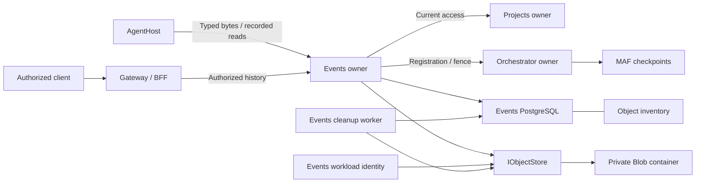

# Events-owned session material and Blob composition

Events & Sessions owns the meaning and lifetime of session material. Blob
stores its opaque bytes. PostgreSQL records the session, ordered event,
reference, integrity metadata and retention deadline. An uploaded object is
not usable history until Events commits its reference.

This page explains source composition and recovery, not an architectural
decision record, deployment receipt or live acceptance result. Orchestrator
retains execution fences and Microsoft Agent Framework (MAF) checkpoints;
AgentHost produces actual turn content and SDK-supported cache material.

## One material owner

The general runtime material interface accepts `TurnContent` and `SdkCache`.
Clients name a session, event and kind, not a Blob key, URL or container.
Separately protected runtime configuration, remote-tool results and produced-run
captures do not broaden that interface. There is no generic raw-content API,
alternate session journal or client-directed Blob proxy.

This is a source ownership/composition view. Inventory is an Events table, not
another service. Blob is neither an event bus nor the agent's workspace volume.
The [persistence sequence](./persistence-objects.md#production-session-material-composition)
shows request order separately.

## Production source composition

| Boundary | Required composition |
| --- | --- |
| Events process | `EventsAndSessions:SessionMaterial:ContainerUri` enables typed routes and owner cleanup. Invalid configuration stops startup; omission leaves the ordinary journal available without material routes. The production profile requires it. |
| Runtime identity | The adapter uses the host `TokenCredential`, also constructed for Events database workload identity. AgentHost and clients receive no Blob connection string, SAS, storage key or credential. |
| Kubernetes | `events-and-sessions-deployment.json` uses the Events ServiceAccount, workload identity label, runtime ConfigMap and HTTPS backend certificate. Kustomize replacements supply ServiceAccount client IDs. The ConfigMap fixes Projects/Orchestrator owner addresses. |
| Data and networking | `modules/storage.bicep` defines private `session-material` storage. Blob uses private networking. `events-and-sessions-network.yaml` permits the configured Blob host on 443, PostgreSQL on 5432, required DNS and fixed owner services on 8443. |
| Resource access | `p1-runtime-identities.bicep` and `p1-session-material-access.bicep` use `blob-container-data-contributor.bicep` for the Events identity at the exact container scope. Deletion supports owner retention, not caller-directed cleanup. |
| Database lifecycle | Explicit maintenance applies migration `010_session_object_inventory.sql` and reviewed runtime grants. Startup verifies the schema; it does not migrate or grant itself access. |

`/health/ready` verifies the Events schema, not Blob availability. Rendering
configuration cannot establish access, private DNS or recovery. A health probe
must not be interpreted as an object write/delete test.

The [runtime profile](https://github.com/sabbour/agentweaver/tree/v1/deploy/k8s/profiles/events-and-sessions),
[runtime ConfigMap](https://github.com/sabbour/agentweaver/blob/v1/deploy/k8s/runtime-configs/events-and-sessions-runtime-config.json),
[Deployment](https://github.com/sabbour/agentweaver/blob/v1/deploy/k8s/base/workloads/events-and-sessions-deployment.json),
[network policy](https://github.com/sabbour/agentweaver/blob/v1/deploy/k8s/base/events-and-sessions-network.yaml)
and [access template](https://github.com/sabbour/agentweaver/blob/v1/infra/bicep/p1-session-material-access.bicep)
define these source relationships.

## Write before committing a reference

1. Authenticate the original bearer. Check actor, tenant, project, run, session,
   accepted selection, immutable Sessions binding, current runtime registration,
   recorded SDK source and execution fence. Observe authority alone is
   insufficient. Actual material is bounded to 1 MiB.
2. Derive a scoped key from owner-controlled scope, event identity and digest.
   Commit inventory before Blob storage, then release that connection before
   acquiring the journal connection.
3. Admit the event idempotently and lock inventory. Create bytes through
   `IObjectStore`, or verify the length and digest of identical existing bytes.
   Do not overwrite them. Keep the inventory lock through reference commit.
4. Recheck current authority after waits. Commit event, reference, retention
   deadline and outbox in the journal transaction. Acknowledge only after
   commit and the final authority check.

An identical retry returns the original position. Changed material conflicts.
PostgreSQL and Blob do not share an atomic transaction: a lost response is
uncertain, not proof of rollback. Reconcile the original event and inventory
instead of choosing a new key or deleting an object because its caller saw
an error.

## Read-time retention and integrity

Reads begin from an owner-recorded event and kind. Events verifies current
read entitlement, exact session/provider binding, length and digest. Historical
turns do not require an active writer; SDK cache reads keep their stricter
current selection entitlement and runtime/model compatibility checks.

`ReadMaterialEventAsync` checks each requested reference's deadline against
Events database time before storage retrieval. `SessionMaterialStore.ReadAsync`
checks it again after reading bytes, then checks current authority last.
Expiry is inclusive: `retain_until <= databaseTime` denies disclosure with
`session_material_retention_expired`, even while bytes remain.

Another live reference may preserve the same key's bytes; it cannot revive the
expired reference. Only the optional SDK-cache route maps
`session_material_object_missing` or `session_material_retention_expired` to
its `404` recovery path. Authorization failures and corrupt bytes do not become
cache misses. Required turn content fails explicitly. Responses are `no-store`.

The [journal](https://github.com/sabbour/agentweaver/blob/v1/services/events-and-sessions/Agentweaver.EventsAndSessions/SessionsJournal.cs),
[material store](https://github.com/sabbour/agentweaver/blob/v1/services/events-and-sessions/Agentweaver.EventsAndSessions/SessionMaterialStore.cs)
and [typed endpoints](https://github.com/sabbour/agentweaver/blob/v1/services/events-and-sessions/Agentweaver.EventsAndSessions/SessionMaterialEndpoints.cs)
implement these checks.

## Cleanup and interrupted effects

The Events cleanup worker runs at startup and hourly. Inventory locks and
current reference checks preserve any unexpired reference. Cleanup deletes
expired bytes or unreferenced uploads older than the 24-hour grace period.
It records deletion after the adapter returns; journal history and reference
metadata remain.

| Failure or race | Recovery contract |
| --- | --- |
| Blob write response is lost | Bytes may exist. Retry the same event/key, verify identical bytes and commit once. |
| Journal definitely rolls back after upload | No success acknowledgment. Inventory remains discoverable; cleanup waits for grace and checks references under lock. |
| Commit succeeds but acknowledgment is lost | A fresh owner retries the original identity and returns the saved position, without replacing the object. |
| Authority or fence changes during a wait | Deny acknowledgment or disclosure. A committed event may still exist; revocation cannot undo it. |
| Same event has changed bytes, role or binding | Conflict or current-authority denial, not another acknowledgment for changed input. |
| Cleanup deletes bytes but loses its commit | Retry the exact key; already-absent bytes allow a durable tombstone. Do not recreate expired bytes or delete journal rows. |
| Cleanup races a write/reference | Inventory locks serialize both. A live reference retains bytes; a deleted key cannot gain a dangling reference. |
| Process stops before inventory, after inventory or after bytes | No upload precedes inventory in this protocol. Inventory-only or stored candidates survive restart for reconciliation. |
| Object predates inventory and has no reference | Leave it untouched. `IObjectStore` has no listing operation, so no historical container sweep is authorized. |

## Recovery is not replay

The native SDK owns its cache format. Capture uses supported filesystem
callbacks; an arbitrary file or session ID is not a portable cache.
Reject known credentials in captured material rather than rewriting opaque
SDK content to make it appear safe. Those checks do not detect every secret.

Missing, expired, unsupported or incompatible optional cache uses retained,
authorized journal turns for bounded context rebuilding. Missing required
turns, integrity failures or an exceeded bound fail explicitly. Rebuilding
does not run another model turn or repeat tools and external effects.

The [runtime material client](https://github.com/sabbour/agentweaver/blob/v1/packages/Agentweaver.AgentRuntime/RuntimeSessionMaterialHttpClient.cs),
[native session files](https://github.com/sabbour/agentweaver/blob/v1/packages/Agentweaver.AgentRuntime/RuntimeNativeSessionFiles.cs)
and [SDK factory](https://github.com/sabbour/agentweaver/blob/v1/packages/Agentweaver.AgentRuntime/RuntimeCopilotSessionFactory.cs)
own that path. The [runtime deep dive](../deep-dive/agent-runtime.md) connects
it to registration, bootstrap and suspend/resume.

## Trade-offs, verification and remaining limits

One journal and one material owner keep access and retention consistent.
Write-before-reference can leave orphan bytes after failure, so durable
inventory and reconciliation are necessary. Read-time expiry prevents cleanup
timing from becoming the access policy.

[Failure-recovery tests](https://github.com/sabbour/agentweaver/blob/v1/tests/Agentweaver.EventsAndSessions.Tests/SessionMaterialFailureRecoveryTests.cs)
exercise response loss, revocation, expired reads and both cleanup/write lock
orders with disposable PostgreSQL and a controlled Object Store.
The [composition guard](https://github.com/sabbour/agentweaver/blob/v1/scripts/azure/tests/session-material-composition.test.mjs)
checks source links among container, identity, configuration, workload,
networking and migration grants. These tests are not live Blob or paid-model
acceptance. The [testing strategy](../deep-dive/testing-strategy.md) explains
the evidence boundaries.

Historical orphan discovery remains a gap requiring a separately approved
owner-scoped scan contract. This explanation authorizes no provisioning,
permission change, broader storage access or data deletion.
