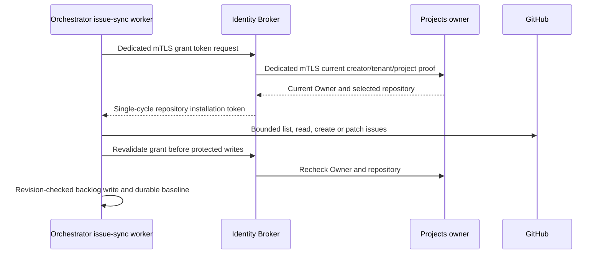

# Orchestration

Use this page to understand how the Orchestrator turns confirmed intent into
controlled execution. The HTTP host owns durable state, including Microsoft
Agent Framework (MAF) checkpoints, and calls other owners. Its Core library
validates domain rules without owning the database or starting an agent.

Keep three questions separate:

1. **What work is authorized?** Typed outcome, workflow, and WorkPlan decisions
   establish confirmed scope.
2. **What work is ready?** The planner combines dependencies, checkpoint
   progress, joined results, and capacity limits.
3. **What execution is current?** Owner fences, runtime registrations,
   placement, and action grants identify the active attempt.

A model can propose a decision. It cannot replace typed approval, create its
own resource pin, or mark a platform gate complete.

## Find the implementation

Project backlog records carry task content, an open/closed lifecycle, a typed
repository issue link, and optimistic task and graph revisions. Content
writes use the existing Orchestrator backlog project lock and do not require
or reserve a run. Atomic execution claims continue to use accepted run
selection and prerequisite evidence. See
[Project backlog content](../reference/api.md#project-backlog-content) for
the authorized routes, bounds, and lifecycle rules.

## Periodic repository issue sync

The optional `IssueSyncWorker` polls due project settings every five seconds.
It runs at most 16 due projects per poll, serially, with a database advisory
lock per project across service instances. Unconfigured and disabled projects
are untouched. Each project cycle has its own persisted interval, item bound
and deadline. It reads one bounded page of repository issues and reconciles
at most `maxItems` backlog tasks; cursor progress survives restarts. A page
includes closed issues for mapping recovery, but only previously unmapped
**open** issues are imported. Pull requests are excluded.

The new `issue-sync` authority is not a run grant. Identity owns a revocable
grant with one creator, tenant, project and selected GitHub App repository.
It rechecks that the grant is active, the creator is still a current project
Owner, and the repository/connection is still selected. The worker validates
this evidence before effects and inside revision-checked backlog writes.
GitHub credentials live only for a single cycle and are invalidated afterward;
no user bearer token is saved. Existing run-token issuance is unchanged.
The creator or a current tenant administrator can revoke the grant. Identity
persists credential-free, append-only `requested` and `minted` audit evidence
with grant ID and owner before returning any minted credential.

Mappings live in the backlog's unique repository issue link and in sync
receipts. Baselines support field-by-field three-way reconciliation: an
unchanged local field follows GitHub; a changed local field wins, including
simultaneous edits. Both sides can close and reopen work. This is a
deterministic policy, not a conflict prompt. Archived tasks retain their
mapping and are not exported or edited.

Before creating an issue the worker persists a pending receipt and includes
a stable HTML comment in the remote body. A lost response is recovered by
finding that marker in subsequent bounded pages, including closed issues.
It never blindly repeats an uncertain create. If a remote issue cannot be
found after an uncertain write, status remains
`issue_sync_create_outcome_pending`; it does not claim successful completion.
Definitive rejections, transient reads and updates are retried on the next
cycle. Partial writes are not rolled back remotely or labelled successful.
Changing a project's connected repository fails closed rather than remapping
existing work to another repository.

The owner routes and exact settings bounds are documented in
[the API reference](../reference/api.md#periodic-issue-sync).
This is code-only capability: migration 027, the Identity grant migration,
runtime grants and dedicated service TLS profiles require separate approval
and have not been applied or deployed.

| Source | Responsibility |
| --- | --- |
| `CoordinationEndpoints.cs` and `CoordinationOwnerStore.cs` | Session, decision, gate, message, turn, roots, fences, and outbox |
| `CoordinatorDecisionOwnerStore.cs` | Atomic decision, gate, grant, and outbox writes |
| `MafExecutionPlanner.cs` | Deterministic associations and ready-frontier calculation |
| `MafExecutionDispatchEndpoints.cs` | Explicit dispatch, durable intents, host sends, and result joining |
| `MafExecutionCheckpointStore.cs` and `PostgresMafCheckpointStore.cs` | MAF checkpoint binding and persistence |
| `SessionSuspendResumeCoordinator.cs` | Ordered suspend and resume phases |
| `RuntimeRegistrationOwner.cs` and `RuntimeUsageSourceOwner.cs` | Current runtime identity and SDK evidence |
| `WorkflowContracts.cs`, `WorkflowDefinitionValidator.cs`, and `WorkPlanValidator.cs` | Workflow and plan types and validation |
| `ExecutableActionGuard.cs` and readiness evaluators | Current grants, durable receipts, prerequisites, and schedules |

The endpoint and store files are under
`services/orchestrator/Agentweaver.Orchestrator/`. Domain contracts and
validation rules are under `services/orchestrator/Agentweaver.Orchestrator.Core/`.

## List stored project issues and pull requests

The Orchestrator serves two project lists from stored data, without a provider
call. `ProjectIssueReadStore` reads backlog tasks that issue sync linked to a
repository issue. `ProjectPullRequestReadStore` reads the pull requests that
the project's runs created or reused. `ProjectSourceControlEndpoints` checks
Projects read authority before and after each read, so a caller that loses
permission during the read gets `403` and no items.

Pull request records come from optional, code-only migration 032. Startup and
the default migrator don't require or apply it. Until a separately approved
step applies it, the pull request list returns
`503 pull_request_records_unavailable`. After that, it lists only pull requests
recorded from that time on. See the [API reference](../reference/api.md#project-issue-and-pull-request-lists).

## Understand workflows, plans, and gates

A workflow is a versioned catalog of steps. Its step mode defines who creates
the work:

| Mode | Meaning |
| --- | --- |
| `Fixed` | The workflow prescribes task, role, phase, isolation, and outputs. |
| `Open` | The coordinator proposes bounded WorkPlan items for the step. |
| `Platform` | A named platform executor owns the gate; ordinary agent work cannot replace it. |

The gate enum describes domain vocabulary, not a promise that an executor is
available. Dispatch reports steps that have no available executor.

Scribe is available when its Knowledge owner is configured. The selected gate
snapshots successful accepted child results into actor- and producer-bound
checkpoint intents before Knowledge I/O. It records compact Memory revision
receipts under the same execution fence and only succeeds after all receipts
are durable. Restart replay rechecks current authority and exact persisted
content; it does not classify results, create Decisions, or auto-approve context.
See [Scribe workflow-output](../architecture/knowledge-memory.md#scribe-workflow-output-source-contract).

`WorkPlanValidator` checks the exact workflow revision, step identity,
cardinality, role, selected agent and model, isolation, capabilities, output
paths, and dependency graph. Model-proposed items belong only to open steps.
Validation returns either a snapshot or structured issues, never a partial
snapshot. For conflicting proposed outputs, the validator adds deterministic
dependency edges so writes do not race.

Nonempty work, fixed work, and command-backed BuildTest steps require the
appropriate accepted isolation context. The owner resolves an existing
resource through a registered Sandbox adapter; it does not invent or provision
a resource at this boundary.

OpenPullRequest is available when the private authenticated Source Control owner
is configured. Dispatch accepts an exact workspace locator for each such step.
It saves the request and source binding before calling the owner. Retries reuse
the saved request and operation identity, and dependent work waits until a
validated pull request receipt is stored. The owner records the operation before
contacting the provider. Recovery reuses the exact pull request across open and
closed states; a missing or ambiguous result never triggers another create.
Managed workspace changes wait while the owner holds the revision lease for
the write. A changed source, workspace, or decision leaves the gate incomplete.
Merge is available through the same authenticated Source Control owner. Dispatch
persists its idempotency key, repository pin, workflow binding, PR number, and
expected head before calling `/merge-intents`. It derives the PR only from one
completed OpenPullRequest ancestor or accepts an explicit number and head pair.
If the owner creates an approval gate, dispatch returns with the Merge checkpoint
still running; dependents remain blocked until an exact approval receipt is
current. A later dispatch reuses the saved intent, calls `/merge-intents/{id}/execute`,
and stores only the owner-verified merge SHA. Changed authority or head,
ambiguous results, and interrupted execution fail closed without repeating a
merge effect.

RubberDuck is available only when the current coordinator-root AgentHost
registration and action-grant owner are available. It is a platform executor,
not an ordinary work-plan child. The dispatcher stores an immutable intent
before sending the exact recorded ancestor results and platform receipts to
that AgentHost in read-only mode. The intent binds the accepted workflow
revision, actor, selection, execution fence, and current runtime registration.
The owner turn uses the checkpointed operation ID, and its completed response
uses a stable journal event ID so a restarted host can return the recorded
answer without running another review. If only part of the turn was recorded,
the host refuses to send it again; the gate stays incomplete.

Only a response whose first nonempty line is `PASS` can release dependent work.
`REQUEST_CHANGES`, a malformed verdict, stale evidence, a changed owner, or
unavailable owner leaves the gate failed or incomplete and keeps dependents
blocked. Recovery reports the operation, evidence hash, verdict, and any stable
failure code. Other platform gates still require their own registered executors.

Candidate and confirmed plans are separate states. Pending gates prevent
decomposition or dispatch according to transition rules. Gate answers bind a
request ID, actor, and fence; exact replay returns the saved result.
Acknowledging a message records receipt. It does not approve an outcome,
confirm a workflow, or complete work.

## Create and confirm a plan

Before proposing work, the run needs an accepted Projects selection and current
authority. The selected workflow and plan must match that run context.

1. **Accept the root.** Orchestrator reads the accepted Projects selection and
   current authority, then records the root session and initial decision state.
   Configured Hosted Copilot credit limits also use Events run admission.
2. **Propose the outcome.** Core validates the typed outcome specification.
   Clarifying questions and outcome confirmation become explicit gate state.
3. **Select a workflow.** Selection uses the authorized workflow catalog.
   Generated definitions require first-use confirmation.
4. **Propose a WorkPlan.** Core validates the full plan against the selected
   workflow and run context. The owner saves the candidate and its confirmation
   gate.
5. **Confirm or revise.** An accepted gate answer makes the plan dispatchable.
   Scope-changing revisions add another confirmation boundary. Accepted
   revisions consume the configured revision-attempt allowance.

`CoordinatorDecisionOwnerStore` serializes transitions against current owner
state. The winning transaction commits the decision version with its gate,
action grants, and decision outbox. The owner rechecks authority around waits
and before protected writes.

Owner routes are rooted at
`/api/projects/{projectId}/runs/{runId}/coordination`; Gateway exposes versioned
public routes. Use [contracts and endpoints](../reference/contracts.md) for
request shapes.

## Dispatch ready work

Before dispatch, provide an explicit `actions/dispatch` request with the
expected decision-state version and WorkPlan ID. The plan must still be
confirmed.

1. Restore the bound MAF checkpoint and validate the plan again.
2. Reconcile child lifecycle records with saved dispatch intents and joined
   results.
3. Compute the ready frontier from step and item dependencies.
4. Apply child, concurrency, wall-time, and runtime admission limits.
5. Commit child records, stable dispatch identities, pending intents, and
   checkpoint progress before sending work.
6. Recheck authority, runtime registration, and host readiness; then send the
   ready batch.
7. Validate each host response against its native context and persist the
   joined result.

Fixed work gets an immutable activation association. Open work uses its
confirmed WorkPlan item. Both resolve to deterministic child-session IDs.
Dispatch messages also have stable IDs, so retry does not create a new logical
send.

Later explicit dispatch requests reconcile saved progress and expose newly
ready dependencies. This is request-driven execution, not an automatic
scheduler. Command-backed BuildTest delegates resource work to Environment
while Orchestrator retains the accepted command and checkpoint. Source Control
output and merge evidence use separate owner paths.

## Promote a plan into backlog tasks

Instead of dispatching a confirmed plan, the run owner can promote it into
project backlog tasks with `POST .../backlog/promotions`. Promotion is allowed
only before the run starts execution: the run must have no registered
children and no MAF dispatch records.

1. Lock the project backlog graph rows.
2. Lock the run's owner binding row and validate the confirmed plan, decision
   version, execution fence, and selection again.
3. Add one task per plan item and one edge per item dependency.
4. Write the promotion record and one origin record per task.
5. Recheck authority and commit.

Dispatch takes the same owner binding lock and rejects a promoted plan, so a
plan is either promoted or dispatched, not both. The decision state is not
changed. A retry with the same idempotency key returns the stored promotion.
Tasks captured directly have no origin record. For request and response
shapes, see [Plan promotion and task origin](../reference/api.md#plan-promotion-and-task-origin).

## Enforce policy and runtime authority

Core's `ExecutableActionGuard` checks a current owner-issued grant before
calling a protected operation. It evaluates policy, stores source evidence,
waits for durable Events acknowledgment, and rechecks current authority before
the effect. A policy result is evidence, not a grant.

Runtime registration is a separate boundary. Orchestrator compares the
accepted selection, active session and work association, execution fence, and
Environment placement before returning current runtime context. An earlier
registration record alone does not authorize a turn.

## Recover from uncertain execution

- A stale decision version or execution fence conflicts instead of applying
  work to a newer attempt.
- Missing Sandbox negotiation or runtime prerequisites block dispatch; they do
  not select a synthetic resource.
- A pending dispatch intent keeps its identity across retries. Missing or
  uncertain result evidence is not success.
- Owner-reported failure or indeterminate execution advances the run fence.
  Explicit recovery checks the expected fence and run version before advancing
  again and restoring eligible logical turns.
- Suspend and resume use a persisted phase machine. Suspend orders fencing,
  draining, checkpointing, journal and workspace flushes, manifest commit, and
  placement release. Resume orders manifest validation, environment readiness,
  egress verification, fence advancement, and dispatch. A retry cannot skip a
  required phase.

A workflow checkpoint and native SDK cache are different recovery inputs.
Restoring conversation context does not replay external effects.

## Understand readiness evaluation

The Core backlog evaluator checks exact graph and task revisions against
owner-projected prerequisite execution and output evidence. A dependency label
alone does not make a task ready.

The schedule evaluator computes daily, weekly, and monthly occurrences in UTC.
It is a pure function, not a hosted scheduling loop.

## Related content

- [Events and sessions](./events-sessions.md) explains journal and message
  ownership.
- [Agent runtime](./agent-runtime.md) explains bootstrap and guarded SDK work.
- [Environment and sandbox](./environment-sandbox.md) and
  [Source Control](./source-control.md) explain resource and repository effects.
- [Contracts and endpoints](../reference/contracts.md) records the API surface.
- [Orchestration design](https://github.com/sabbour/agentweaver/blob/v1/docs/architecture/design/orchestration.md)
  records broader design decisions.
