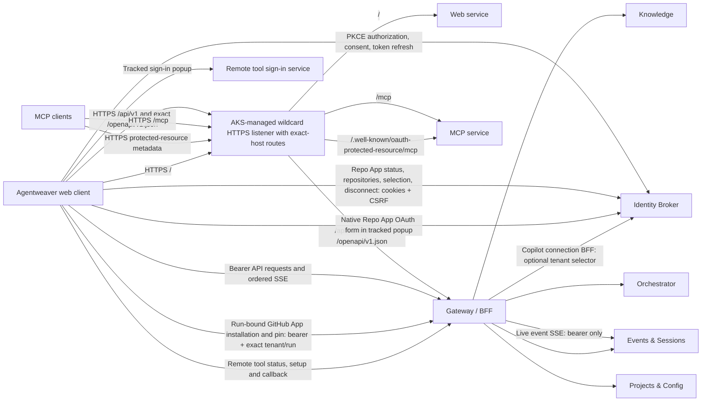

# Use the v1 web client

The v1 Web client is a React application that uses the Identity Broker for
sign-in and the versioned Gateway for product API and event-stream requests.
It keeps access and refresh tokens in memory. GitHub Repo App account
authorization, repository discovery, and disconnect use cookie-authenticated
Identity Broker endpoints directly.

This article describes the checked-in v1 client and its contracts. The source
and route manifests do not prove that the Web image, Gateway, Broker, or owner
services are deployed or available.

## Before you begin

To run or build the client, install Node.js 24 and npm. To test sign-in and
product requests, you also need a deployed Identity Broker and Gateway, a
registered public Web client, its exact HTTPS callback URI, and a Web origin
allowed by the Gateway. Use the runtime configuration reference for the
deployment values.

## Understand how the client connects

The browser sends product API requests to the Gateway. The Gateway validates
the Broker token and forwards the original bearer to the owning service.
Owners check current membership, roles, bindings, and operation permissions.
The browser does not provide project, run, or session identity as a substitute
for authorization.



The client uses these routes:

| Route | Purpose |
| --- | --- |
| `/` | Opens `/overview`. |
| `/overview` | Manage personal Priorities and private conversations alongside projects, recent runs, project metrics and notifications. |
| `/sessions` | Reopen private conversations, list runs across projects, and start a new session. `/projects/:projectId/sessions` opens the same page. |
| `/assistant` | Start a new session: choose a project and send the first message. `/console` opens the same page. |
| `/projects` | Browse project tiles and create a project. Creating a project does not make you its owner. |
| `/projects/:projectId` | Read the project **Dashboard**: setup readiness, metrics, usage, recent runs, team, and quick actions. |
| `/projects/:projectId/orchestrations` | List this project's active and finished runs and open a run. |
| `/projects/:projectId/board` | Read the project **Board**: backlog tasks in **Backlog**, **Ready**, **Active**, and **Done** columns. Capture a task and edit a task's title and description. |
| `/projects/:projectId/team` | Read agents, edit an agent's role and charter, add a member, and export or import the team. |
| `/projects/:projectId/team/cast` | Cast a team from a template or chosen roles, then review and confirm the proposal. |
| `/projects/:projectId/settings?section=<key>` | Edit project settings by section, manage members, read history, and manage connections. |
| `/projects/:projectId/skills` | Manage Skill sources, imported revisions, and agent assignments. |
| `/projects/:projectId/memories` | Search and manage Knowledge records and transfer bundles for a run and an agent. `/knowledge` opens the same page. |
| `/projects/:projectId/flow` | Read project notifications, pending gates, Board counts, and runs grouped as Open, Working and Done. |
| `/projects/:projectId/workflows` | Read the saved default workflow and the workflow for each blueprint. |
| `/projects/:projectId/workspace` | Read the configured repository, pull requests that runs opened, and synced issues. |
| `/projects/:projectId/observability` | Read project metrics, usage, and recent runs. |
| `/projects/:projectId/diagnostics` | Read platform areas that are not ready and failed runs. |
| `/projects/:projectId/heartbeat` | Read seven-day metric tiles and the runs that are working or blocked. |
| `/projects/:projectId/cluster` | Read the platform component report. |
| `/projects/:projectId/runs/:runId` | Use the **Chat**, **Topology**, **Approvals**, **Activity**, **Changes**, **Usage**, and **Run settings** tabs. The `view` query selects a tab, such as `?view=approvals`. |
| `/settings` | Sign out and manage the GitHub Repo App account. |
| `/platform-settings` | Read the platform component report. Only tenant and platform administrators can read it. |

## Navigate the client

The v1 client keeps the 0.x navigation rail, project switcher, floating content
panel, gallery tiles, dialogs, typography, and theme. Its views use v1 service
contracts instead of the 0.x API.

The rail has **Overview**, **Projects**, and **Sessions**. The **Sessions**
group has a **New session** button. **Overview** is the home page. It shows:

- An **Operations** card with active projects, archived projects, recent
  runs, and items that need your input.
- Your most recently updated projects.
- Metrics and usage for one project. Choose another project in the section's
  project picker.
- **Recent runs** across your projects.
- **Needs attention**: your notifications across all projects.
- Personal **Priorities**, **New chat**, and **My conversations**. Priorities
  link authorized runs, conversations, saved captures, synced issues and recorded
  pull requests without changing execution. See [Chief of Staff](./chief-of-staff.md)
  for selection, conflict handling, access loss and conversation recovery.

The notification bell in the shell lists the same notifications. Its badge
shows the number of pending notifications that the service reports. The
client reads the list again every 30 seconds while the tab is visible. There
are two kinds of item:

- A pending question or approval in a run. Select it to open that run's
  **Approvals** tab.
- A backlog promotion, shown as **N subtasks created**. It links to the
  project **Board**.

Each item has **Dismiss**. Dismissing hides the item for you only. It does not
answer or resolve the request.

Choose **Projects** to open the project gallery. Each tile shows the project
state and revision, plus the current role names and exact tenant or project
scopes returned by the Projects owner. These labels are informational and do
not authorize actions. Select
**Create project** to open the creation dialog. Enter a **Project name** and
choose **Start from**: **Blank project** or **GitHub repository**. For a
GitHub repository, enter `owner/name` or a `github.com` address. The client
creates the project and then saves the repository in its configuration with
**GitHub App** sign-in. If you don't have access to the new project yet, the
project is kept, and a note says to add the repository in **Settings >
Repository** later. Creating a project does not make you its owner.

Within a project, use these destinations:

| Destination | Route | What you can do |
| --- | --- | --- |
| Dashboard | `/projects/:projectId` | Read setup readiness from the saved configuration, metric tiles, the **Activity** chart, run totals, model and agent usage, recent runs, and the team. Use quick actions to finish setup or open Orchestrations and Memories. |
| Board | `/projects/:projectId/board` | Read the project backlog in **Backlog**, **Ready**, **Active**, and **Done** columns. Capture a task in **Intake** and edit a task's title and description. Select **Refresh** to reload. |
| Orchestrations | `/projects/:projectId/orchestrations` | List the project's runs in **Active** and **Recent** sections, with a status summary. Select **Refresh** to reload. |
| Agents | `/projects/:projectId/team` | Read the **Total**, **In the team**, and **Not in the team** counts. Filter the agent tiles. Open an agent to read its ID, team position, and skills, or edit its role and charter. Use **Cast team**, **Add member**, and **Sync**. |
| Skills | `/projects/:projectId/skills` | Browse marketplace sources, preview and import Skills, read the inventory, and assign Skills to agents. |
| Memories | `/projects/:projectId/memories` | Choose a run and an agent under **Show memories for**, then work with records and revisions. |

Open **Settings** in the rail to reach **Account settings** or **Project
settings**. In project settings, use **Connections** for the GitHub Repo App,
Copilot, and Remote MCP. Existing `/orchestrations/:runId` links keep their
query parameters when they open the run.

The rail footer shows your name from the sign-in token's `name` claim, or
`preferred_username` when `name` is absent. If the token has neither claim,
the footer shows **Account**.

### Board and Start task

The **Board** shows the project's backlog. It reads the backlog graph and
the repository issues synced to tasks:

- **Backlog** holds captured tasks. **Ready** holds tasks waiting to be
  claimed. **Active** holds claimed tasks. **Done** holds tasks whose issue or
  lifecycle is closed. Archived tasks are not shown.
- A card shows the task title and description, its prerequisites by title,
  and its linked issue as `owner/name#number` with **Open** or **Closed**.
  **Automation running** marks a task that an automation is changing.
- With permission to change the project, use **Intake** to capture a task
  into **Backlog**. Select the edit button on a card to change its title and
  description. Edit is hidden while an automation runs on the task.
- A write sends the revision the Board last read. If another change got there
  first, a capture retries once with the new revision. Edits reload the Board
  and ask you to try again.
- Moving tasks between columns is not available yet. Cards can't be dragged.
- Without read access, the Board says you don't have permission to view it.
  A failed read shows the reason and **Try again**.

**Start task** is the floating button at the top of every project page. It
appears only when you can change the project. It opens **Start a task**, adds
the task to that project's **Backlog**, and then opens the Board with a
confirmation. Unlike 0.x, it doesn't start a run; open **New session** for
that.

### Find a run

You don't type a run ID. The client reads runs from the project run list:

- **Orchestrations** shows one project's runs in two sections. **Active**
  holds runs that are working, open, or waiting for input. **Recent** holds
  finished runs: done, failed, cancelled, or with an unknown outcome. Each
  section loads more rows with **Load more**.
- **Sessions** shows runs across all your projects, newest first, with a
  project column. Select **Load more** to read the next page. If the client
  can't read the runs of some projects, for example because you don't have
  read access, a warning names those projects.
- **Overview** and the project **Dashboard** show the newest runs.

Each row has **Open**, which opens the run page. A row shows the run title. If
the run has no title, the row shows its goal. If it has neither, the row shows
**Run** and the first 8 characters of the run ID.

### Start a session

Select **New session** in the rail or on **Sessions** to open `/assistant`.
Choose a project, write the first message, and send it. The client then:

1. Creates the run with the first message. The run uses the project's current
   configuration revision.
2. Gets a token bound to the new run. This sign-in is silent when the Identity
   Broker allows it. If it needs you, the page shows **Sign in**.
3. Starts the run and opens its **Chat** tab.

The client keeps the created run in session storage. If the sign-in leaves the
page, the client continues when you return. If a step fails, select **Try
again**. Select **Dismiss** to drop the pending run from the page; the run
stays listed in **Sessions**.

### Stop a run

While a run is open, the run page header shows **Stop run**. Select it, then
confirm in the **Stop this run?** dialog. A retry after a failure sends the
same request again, so the service stops the run only once. The button isn't
shown for a finished run or a run whose state the service didn't report.

### Read project metrics and usage

The **Dashboard** and **Overview** show metrics for one project. Choose
**Last 7 days**, **Last 30 days**, or **Last 90 days**. The range covers whole
UTC days, including today so far. The service reports metrics per project
only, so the client doesn't show totals across projects.

- The tiles show active runs, runs that need input, runs in the range, and
  success. **Success** is succeeded runs out of completed runs. With no
  completed runs in the range, it shows a dash instead of 0.
- The **Activity** chart shows created and completed runs per UTC day.
- **Usage by model** and **Usage by agent** show runs, requests, token
  counts, average duration, cost, and unpriced requests.
- Costs appear as reported, one line for each price unit and disposition, for
  example `1.25 USD · Estimate`. The client never adds or converts these
  subtotals.

A measurement that the service didn't record shows a dash, not 0.

### Manage the team

**Agents** has three team controls. Each change becomes a pending team
proposal first. Nothing changes until someone confirms the proposal.

- **Cast team** opens the **Cast a team** page. Pick a built-in template or
  choose roles, then review the proposed agents. You can remove members before
  you confirm. **Cast team** confirms the proposal and saves a new
  configuration revision. **Reject** discards it.
- **Add member** stages a proposal that adds one catalog role to the current
  team, then opens it for review.
- **Sync** has **Export team** and **Import team**. Export downloads the team
  as a checked JSON file. Import accepts a team file from another project, up
  to 1 MiB, and stages it as a proposal. The service checks the file format
  and digest.

**Pending team proposals** lists proposals that are not confirmed yet, with a
link to review each one. If someone saved the configuration meanwhile, the
page reads it again and asks you to retry.

### Read platform components

Tenant and platform administrators can open `/platform-settings`. The page
lists all 16 platform component areas. For each area, it shows the owning
service, its readiness, and the active and available implementations. The
page shows each status exactly as the owner reported it. If an owner didn't
report, the area reads **Status not reported**. Other users get a permission
message.

### Operations pages

Each project lists Flow, Workflows, Workspace, Observability, Diagnostics,
Heartbeat, and Cluster in its navigation. Each page shows the parts that
project reads can drive, and one **Not available in this version** note that
names what is still missing:

- **Flow:** project notifications, **Needs input** including dismissed gates,
  **Task stages** with Board counts, and **Open**, **Working**, and **Done** run groups.
  Failed, cancelled and unknown outcomes retain separate state labels.
- **Workflows:** the default workflow and the workflow for each blueprint,
  from the project configuration.
- **Workspace:** the configured repository, pull requests that runs opened or
  reused, and issues synced into the backlog.
- **Observability:** metric tiles, the **Activity** chart, model and agent
  usage, and recent runs.
- **Diagnostics:** platform areas that are not ready, with the reported
  reason, and failed runs.
- **Heartbeat:** seven-day metric tiles and the runs that are working or
  blocked.
- **Cluster:** the platform component report.

Diagnostics and Cluster read the platform component report, which needs
tenant or platform administrator access. Other users see a permission message
in that section. `/observability` without a project shows **Not available in
this version**, because there is no summary across projects. Unknown
addresses show **Page not found**.

See the [UI parity inventory](../reference/web-ui-parity.md) for the retained
patterns, v1 adaptations, and remaining limits.

The run page polls owner snapshots and replays journal pages before it opens
the live event stream. It merges overlapping replay and live events by event
ID and journal position. A pending action requires the exact request ID and
decision version from the latest owner snapshot. Owner acceptance is not shown
as delivery, completion, or a state transition; the refreshed snapshot shows
the resulting state.

## Configure and verify the client

1. Add or update an explicitly seeded public OAuth client in the approved
   Identity Broker configuration. The Broker does not support dynamic client
   registration. Set the redirect URI to the exact Web origin followed by
   `/auth/callback`, and use the registered scopes and client ID.
2. Set the Broker URL and issuer to the approved HTTPS values. Set the Gateway
   base path to `/api/v1` when the managed portal routes that same-origin path
   to Gateway; use another value only when it matches the reviewed route.
3. Open the client, complete the authorization-code flow with PKCE, and
   confirm that the callback returns to the registered URI.
4. Make a versioned API request through Gateway. Confirm that the owner
   enforces current authorization for the requested operation.

The consent screen lists the scopes requested by the registered client.
See [Identity Broker scopes](./identity-scopes.md) for their meanings and the
authorization checks behind the Agentweaver scopes.

## Restore sign-in after a reload

Access and refresh tokens stay in memory. After a successful sign-in, the
current tab stores a non-secret marker in `sessionStorage`. If that marker is
present after a reload, the client makes one hidden-frame authorization request
with `prompt=none` and PKCE. The Broker returns an authorization code only when
the same registered client already has valid consent for the requested scopes.
The silent request does not show a consent screen or create or extend consent.

If the Broker or identity provider needs user interaction, the client clears
the marker and the pending PKCE transaction, then shows the normal sign-in
screen. It does not retry silently until the user signs in again. Signing out
also clears the marker. The marker does not contain tokens, and the client does
not put access or refresh tokens in browser storage, cookies, or the URL. The
authorization code remains in the standard callback URL for the code exchange.

## Configure browser origins

Gateway and Broker CORS are separate. Set `Gateway:WebOrigin` to the Web
application's exact HTTPS origin. Gateway CORS policies are route-specific;
they do not allow credentials except for the Copilot connection BFF's
callback cookie. Direct Repo App browser requests use a separate credentialed
allow list in the Identity Broker.

The client requests current tenant and authority context from
`GET /api/v1/authorization/context`. It does not infer a tenant from a project,
run, token, or usage data. The client supplies `X-Agentweaver-Tenant` only for
routes included in the Gateway allow list, including project configuration,
run coordination, Knowledge, run selection and usage, and finite journal
replay. Live event SSE, Repo App account calls, PKCE/session calls, and
unrelated APIs do not receive the selector. Owners recheck current authority
for every protected operation. The context response is not a permission grant
or a cached authorization decision.

`ProjectSummary` responses also include `effectiveRoles` for the signed-in
caller. The Web client displays those owner-confirmed role names and their
tenant or project scope on project tiles and headers; it does not use them to
authorize operations.

## Edit project settings and read history

**Project settings** has a section rail: **General**, **Access**,
**Repository**, **Models**, **Platform components**, **Run limits**,
**Connections**, **History**, **Danger zone**, and **Advanced**. The `section`
query selects a section. An unknown value opens **General**. Each rail entry
has the 0.x section icon, and **Danger zone** has a **Risk** badge.

- **General** renames the project.
- **Access** shows your permissions in this project and a **Members** panel.
  A tenant administrator or a project owner can read the member list. Only a
  tenant administrator sees **Add member** (member ID and role: **Owner**,
  **Contributor**, **Viewer**, or **Orchestrator**) and **Remove**. Remove
  sends the member's current revision, so a stale list is rejected and you
  reload it. The service keeps at least one owner. Other users see a
  permission message in the panel.
- **Repository** sets the repository owner, name, and sign-in method.
- **Models** sets model defaults and model overrides by task.
- **Platform components** changes the implementations the project chose for
  each platform component, as one implementation ID or a comma-separated
  priority order. With no project choices, platform defaults apply.
- **Run limits** sets limits for new runs. An empty field uses the platform
  limit.
- **Danger zone** archives or restores the project.
- **Advanced** edits the configuration JSON. Use it only when the other
  sections don't cover the setting.

**Repository**, **Models**, **Platform components**, **Run limits**, and
**Advanced** share one form with **Save changes**, **Reload**, and the current
revision. After you edit JSON in **Advanced**, save or reload before you use
the other sections.

Empty task fields in **Models** inherit their defaults. The supported task
categories are Planning, Review, Design, Security, Creative writing, Complex
work, Code writing, and Straightforward work. The owner accepts Low, Medium,
High, and Extra high reasoning effort. Model support remains subject to owner
validation. A model credential belongs to one model. When you change the
default model, the form clears the saved credential and shows **Choose a
credential for this model.** **Save changes** stays disabled until you enter
a matching credential.

Available model and provider choices are not returned through the current
Gateway catalog. Enter existing references. The client does not substitute a
hardcoded catalog.

Saving adds a configuration revision. Runs that already started keep their
settings. In **History**, enter a revision number and select **View revision**
to read its settings. Historical settings are read-only and don't replace the
current form.

## Manage Skills

The project's **Skills** destination can manage public marketplace sources,
browse pinned source revisions, preview and import Skills, and assign imported
revisions to agents in the current project cast.

The page keeps the 0.x layout. A stat strip shows **Assigned**, **Enabled**,
**Marketplace sources**, and **Agents**. The toolbar has **Add skill**,
**Import skill**, and **Browse marketplaces**; each opens a dialog. The
**Catalog** tab lists the imported skill inventory. The **Assignments** tab
lists project assignments and assigns a skill to agents. After an import, the
page opens **Assignments**.

- **Suggested marketplaces:** **Browse marketplaces** lists the marketplaces
  that the service suggests. **Add** saves one as a marketplace source. You
  don't type its repository.
- **Add skill:** enter a name, description, and instructions. The client
  turns the fields into a skill, previews it, and imports it.
- **Upload:** **Import skill** accepts a skill folder, its files, or one ZIP
  file. Each folder with a `SKILL.md` becomes one skill. The upload limit is
  2 MB of files and 1,024 files, so the encoded request stays under the 3 MB
  request limit. Choose one found skill, check its preview, then import it.
- **Remove skill:** on **Catalog**, **Remove skill** opens a confirmation.
  Confirming revokes the current revision of that skill and reloads the
  inventory. Agents stop receiving the revoked revision.

Project settings links to Skills. Skill assignment uses the current
configuration revision, and the owner rejects stale updates. Skills does not
mount a second configuration editor.

For a marketplace Skill, the client sends source revision, resolved commit,
selected path, and (for import) the preview digest and idempotency key. The
owner reads and validates the selected files; the browser does not upload
those files through the Gateway. For an uploaded or new Skill, the browser
sends the files, ZIP, or fields to be packaged into skill candidates. It then
submits the chosen candidate for preview, and imports only after the owner
returns a matching digest.

Assignment uses the imported revision and digest, the current configuration
revision, and selected agents from the current cast. The client checks the
returned configuration revision before it replaces the assignment's revision.
It disables duplicate assignment requests while a save is pending. The UI reports the
saved assignment; it does not claim that a runtime loaded the Skill.

The read-only Skill inventory displays owner-reported assignments, revision
metadata, source provenance, and revocation state. It uses bounded opaque
cursors and keeps permission errors visible. Inventory metadata does not
prove runtime loading; the current public API does not expose
runtime-loaded status.

## Manage Knowledge records

The **Memories** page searches owner-reported result pages for the project,
run, and agent you choose under **Show memories for**. The **Run** list holds
up to 100 of the project's newest runs from the run list. The **Agent** list holds the agents in
the project configuration. Kind tabs filter by **All**, **Memories**,
**Decisions**, **Proposals**, or **Session context**. It displays immutable revision history and supports the
owner-authorized operations implemented for the record type:

- Correct or archive supported Memory and SessionContext records.
- Restore a historical revision as a new Active+Pending revision.
- Approve an eligible Active Pending or Legacy Decision.
- Supersede an Active Decision with another Active Decision from the same
  project and agent results.

The owner validates the selected current revision, replacement link, and
resulting state. Decision supersession requires an owner that supports the
versioned update contract.

Knowledge transfer exports only the exact project's and agent's Memory and
Decision records with their revision chains. Import targets that same project
and agent, rejects collisions instead of merging records, and creates
Active+Pending records. You must approve a Decision separately. A bundle can
contain at most 25 records and 500 revisions, and its size is limited to
1 MiB.

## Connect GitHub and Copilot accounts

Use project **Settings > Connections**. GitHub and Copilot keep their existing
authorization flows and revision checks.

The Repo App account control uses Identity Broker status and an opaque
`connectionId`. Project configuration selects the connection with
`sourceControl.authMode: "githubApp"` and
`sourceControl.appConnectionId`. Configurations without `authMode` retain
legacy secret mode. Provider tokens, numeric installation and repository IDs,
and permission grants remain owner-held.

Repo App authorization uses a popup, an antiforgery cookie, a native form
post, and a host-only transaction cookie. The callback
`/settings/source-control?repoApp=connected` is only a notification. The
bootstrap captures that exact callback and removes the query before loading
assets. The opener accepts a message only from the tracked popup, the same
origin, and the current request generation, then refreshes connection status
from the Broker. A callback does not prove that the connection succeeded.
Leaving settings or clearing the browser session closes only the panel's
tracked popup and cancels its pending antiforgery request.

Repository discovery and account disconnect call the Broker directly with
cookie credentials. JSON mutations first request an antiforgery token and
send it as `X-CSRF-TOKEN`. User authorization uses a native form post to the
tracked popup; it does not send an OAuth redirect through `fetch`.

Project settings can also connect the signed-in user's GitHub Copilot account
through the Gateway's connection lifecycle BFF. The callback uses the public
Web origin plus `/auth/github/copilot-app/callback` as its `CallbackUri`.
The callback page is not cached, removes callback query values before it loads
assets, and does not store the callback code or state. Configure the ingress
to redact callback query strings from its own access logs. The owner response,
not the popup message, determines connection status.

When the accepted run configuration selects GitHub App mode and the owner
routes are available, the run's **Changes** tab reads safe repository metadata
from the Broker and creates a short-lived selection code. Installation and
repository pinning remain run-bound Gateway operations with the exact project,
run, and tenant. The owner checks the accepted run configuration and current
authority. Status or discovery failures remain visible; the UI does not
present them as an empty repository list or a disconnected account.

## Connect a Remote MCP tool service

In project **Settings > Connections > Remote MCP**, the panel lists the
project's saved connections, with **Load more connections** for the next page.
Removed connections aren't listed. Pick a connection to fill its ID and the
checksum of its saved setup, and to load its status. You can also enter a
connection ID and select **Load connection**. The view shows the state
returned by the service. It rejects responses for another project or
connection.

Use **Connection setup** for registration and authorization metadata. The
checksum comes from the saved connection list. The browser does not
calculate a replacement checksum from its JSON formatting.

Authorize opens the service-provided HTTPS address in a tracked popup. After
sign-in returns, select **Load connection** to read the current result.
A callback is not proof of success. Refresh and disconnect use the exact
connection, credential, and configuration revisions returned by the owner.
The browser does not collect or store provider tokens.

## Configure the client

The Web client reads Vite environment variables. Start with
`apps/web/.env.example`:

| Variable | Default or requirement | Purpose |
| --- | --- | --- |
| `VITE_GATEWAY_URL` | `/api/v1` | Versioned Gateway base URL. |
| `VITE_IDENTITY_BROKER_URL` | Required for sign-in | Identity Broker base URL. |
| `VITE_IDENTITY_BROKER_ISSUER` | Optional when it matches the Broker base URL | Exact HTTPS issuer expected in authorization callbacks. |
| `VITE_OAUTH_CLIENT_ID` | Registered client ID | OAuth client identifier. |
| `VITE_OAUTH_REDIRECT_URI` | Current origin plus `/auth/callback` | Registered OAuth callback URI. |
| `VITE_OAUTH_SCOPES` | Registered scopes | Space-separated OAuth scopes. |

When a callback includes `iss`, the client accepts it only if the value
matches the configured HTTPS issuer. It also checks state, PKCE, popup source,
and callback origin. A callback without `iss` remains supported for the
existing Broker profile. An invalid popup callback is rejected and closed so
the sign-in window can show an error.

## Run and build the client

Run these commands from the repository root:

1. Install the locked Web dependencies:

   ```powershell
   npm --prefix apps/web ci
   ```

2. Start the development server:

   ```powershell
   npm --prefix apps/web run dev
   ```

3. Validate types, tests, coverage, lint, and the production build:

   ```powershell
   npm --prefix apps/web run typecheck
   npm --prefix apps/web test
   npm --prefix apps/web run coverage
   npm --prefix apps/web run lint
   npm --prefix apps/web run build
   ```

The production host provides unauthenticated `/health/live` and
`/health/ready` checks. Readiness returns `503` if the built
`wwwroot/index.html` is missing. These checks report host and page availability;
they do not verify Broker access or live API behavior.

## Understand client limitations

The optional managed portal routes `/` to Web on port 8080, `/api/v1` and the
exact `/openapi/v1.json` path to Gateway, and exact `/mcp` and protected
resource metadata paths to MCP on port 8443. These source manifests describe
the intended route mapping; they do not establish a running portal or backend.

The client lists runs from the project run list, starts new sessions, and
stops runs. You don't type a run ID. It does not expose run-root acceptance,
typed outcome/workflow/work-plan proposals, or child-session
registration/spawn/fork controls, even where owner routes exist. The client
can message existing sessions and request supported detach/archive actions.
The Gateway does not expose journal object-content reads, so the UI displays
opaque references rather than inventing transcript text.

The run's **Changes** tab lists **Produced files**: the file sets that the run
saved from its workspace, newest first. Select **Browse files**, then a file
name, to view its saved contents. Markdown opens in **Preview**; **Source**
shows the text. Files with invalid UTF-8 or NUL bytes show as binary.
**Show changes** shows the text patch with the same diff viewer as the 0.x
client. **Refresh** reloads the list. **Load older file sets** shows earlier
saves without changing the selected file set.

The list is hidden while the run is failed or its outcome is unknown. The
client reads immutable saved files through the Gateway. It does not read a
host file system or browse the live workspace of a run.

The run's **Run settings** tab shows the model reference and the allowed
implementations for each platform component, in order. It doesn't show the
implementation that is running or a runtime SDK model ID, because the run
selection reports allowed choices only. **Platform settings** shows the active
implementations for the deployment. Usage
reports run totals without per-event model-binding details. The UI does not
infer those identities from configuration or usage, and it does not replace
missing measurements with zero.

These 0.x features are not in this version:

- Moving, reordering, or archiving tasks on the **Board**, and editing task
  dependencies. The Board says "Moving tasks between columns is not available
  yet." and cards can't be dragged.
- The **Human Review** and **Problems** columns on the **Board**.
- The **AI Formulate** and **Analyze** casting modes and the **Universe**
  picker on **Cast a team**.
- The count strip on **Memories**.
- Metrics totaled across projects. **Overview** shows one project at a time.
- Deleting, archiving, and retrying runs.
- BYOK providers, the platform Copilot connection, and runs without a project.

The [UI parity inventory](../reference/web-ui-parity.md#endpoint-gaps) lists
each missing endpoint.

## Expected result

The client returns to its exact registered callback after sign-in and sends
product API and event-stream requests through the configured Gateway. The
client keeps tokens in memory; owner services remain responsible for current
authorization. A successful client build alone does not prove live sign-in or
API access.
