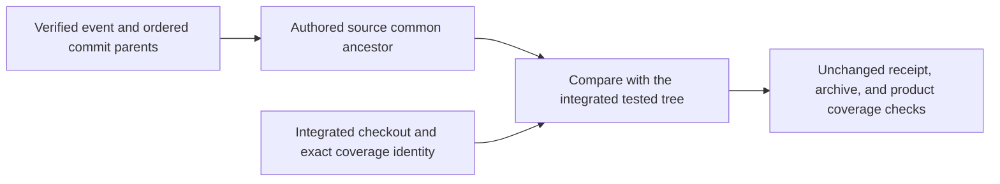
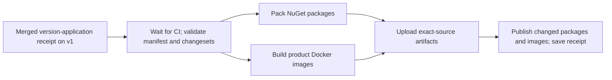

# Component releases

Use this reference to validate the component manifest, prepare source-bound
packages and images, and understand the boundary between publication and
deployment. A **component manifest** records component versions and dependency
compatibility. It does not, by itself, prove that an artifact was published or
that a service was deployed.

For the full release process, see the [release operations guide](https://github.com/sabbour/agentweaver/blob/v1/releases/README.md).
For deployment settings, see [Runtime configuration](./runtime-configuration.md).

## Current manifest status

`releases/foundation.json` is the tracked draft manifest. It contains 24
components: 13 contracts or libraries, 10 product services, and the separate
acceptance-only `Agentweaver.FoundationProbe` service. The manifest has no image
digests or release evidence, so it is not an accepted platform release.

| Component | Kind | Draft version |
| --- | --- | --- |
| `Agentweaver.Abstractions` | Contract | `1.1.1` |
| `Agentweaver.Providers` | Library | `1.0.2` |
| `Agentweaver.SourceControl` | Library | `1.0.2` |
| `Agentweaver.Orchestrator.Core` | Library | `1.1.1` |
| `Agentweaver.Persistence.Postgres` | Library | `1.0.2` |
| `Agentweaver.Secrets.AzureKeyVault` | Library | `1.0.2` |
| `Agentweaver.Identity` | Library | `1.2.0` |
| `Agentweaver.AgentRuntime` | Library | `1.1.1` |
| `Agentweaver.AgentHost` | Service | `1.0.1` |
| `Agentweaver.Telemetry` | Library | `1.0.2` |
| `Agentweaver.Telemetry.AzureMonitor` | Library | `1.0.2` |
| `Agentweaver.ObjectStore.AzureBlob` | Library | `1.0.2` |
| `Agentweaver.Identity.Broker` | Service | `1.1.0` |
| `Agentweaver.EventsAndSessions` | Service | `1.1.0` |
| `Agentweaver.Gateway` | Service | `1.1.0` |
| `Agentweaver.Mcp` | Service | `1.0.1` |
| `Agentweaver.Web` | Service | `1.0.1` |
| `Agentweaver.Orchestrator` | Service | `1.1.0` |
| `Agentweaver.Environment` | Service | `1.1.0` |
| `Agentweaver.Knowledge` | Service | `1.0.1` |
| `Agentweaver.Projects.Config` | Service | `1.1.0` |
| `Agentweaver.FoundationProbe` | Acceptance-only service | `0.0.2` |
| `Agentweaver.Providers.Storage.AzureFiles` | Library | `1.0.2` |
| `Agentweaver.Providers.Sandbox.AgentSandbox` | Library | `1.1.1` |

The manifest pins project-reference compatibility but does not yet pin service
images. Its compatibility table contains 53 direct dependency relationships.
The Foundation Probe is not a product service; `--platform-only` excludes it
from product preparation and publication.

## Validate and apply a version plan

Before you start, make sure the component changes and their `.changeset` records
are committed. A changeset names each affected manifest component and its
semantic-version intent. Documentation-only changes do not require a changeset.

1. Validate the manifest and changeset coverage:

   ```powershell
   npm run release:validate
   npm run release:validate -- --base <full-base-commit-sha>
   ```

   The base-aware command also checks changeset coverage against the selected
   base commit. CI runs validation against its verified source history.

2. Generate the source-bound version plan:

   ```powershell
   npm run release:plan
   ```

   The command writes the plan under the ignored `artifacts/release/` directory.
   It does not change component versions.

3. Review the plan, then apply it:

   ```powershell
   npm run release:apply
   ```

   Application requires a clean working tree and a valid plan for the current
   source. It updates the manifest, project version mirrors, changelog, archived
   changesets, and a source-bound receipt. Review and commit those changes
   before you prepare artifacts.

The current manifest remains a draft after version application. Applying a plan
does not build, publish, deploy, or accept a release.

## Build and publish artifacts

Run `release:pack` from a clean checkout. The command builds the selected
manifest components and writes local package and image artifacts; it does not
publish them.

```powershell
npm run release:pack -- --platform-only
```

This selection prepares product components and excludes the acceptance-only
Foundation Probe. It cannot be combined with `--packages-only` or
`--foundation-probe-only`. The automated workflow prepares packages and images
as separate artifacts, then merges and validates them against the same source
SHA and manifest before publication.

The `v1-release-pack.yml` workflow runs for a qualifying receipt push to `v1` or
a manual dispatch. It requires the v1 CI and documentation checks for the exact
source commit. The publication job uses the configured GitHub Packages and
container registry destinations. It does not deploy to Azure or Kubernetes.
Use the [release operations guide](https://github.com/sabbour/agentweaver/blob/v1/releases/README.md) for publication
and partial-publication procedures. A one-use completion for the `v1.0.0`
publication is recorded as consumed; it is not a general retry path.

The current draft manifest does not include published-artifact digests or
deployment evidence. Use the source-bound publication receipt to verify the
result of a specific publication; do not infer publication status from a
manifest version or a successful local build.





## Deploy and verify a published release

Before deployment, obtain the matching publication receipt and confirm the
Azure subscription, tenant, resource group, cluster, namespace, runtime
settings, and provider-catalog source. The
[Kubernetes input inventory](https://github.com/sabbour/agentweaver/blob/v1/deploy/k8s/README.md) lists operator-supplied
values. Secrets, private keys, certificates, CA data, database grants and
migrations, and Gateway placement remain operator-managed.

Run the deployment command without `--execute` first. The default is a
read-only dry run:

```powershell
npm run release:deploy -- <release-tag> --manifest <release-manifest.json> --publication <publication.json> --subscription-id <subscription-id> --tenant-id <tenant-id> --resource-group <resource-group> --cluster <cluster-name> --namespace <namespace> --node-min <minimum-nodes> --node-max <maximum-nodes> --provider-catalog-configmap <config-map-name> --provider-catalog-source-commit <40-character-sha>
```

Review the verified source, image digests, target, runtime prerequisites, and
rendered Kustomize installation. To apply the installation and run live rollout
and image checks, repeat the command with `--execute` after the target and
changes are approved.

`release:deploy-bootstrap` is a separate pre-acceptance path. It requires the
exact draft manifest and source-bound publication evidence for the requested
version; some partial-publication cases also require their immutable completion
proof. Its dry run does not create release-acceptance evidence. Use
`release:deploy` for the strict release gate. For the exact v1.0.3 source,
receipt artifact, and bootstrap invocation, follow the
[release operations guide](https://github.com/sabbour/agentweaver/blob/v1/releases/README.md#v103-pre-acceptance-bootstrap).
Neither a Kustomize apply nor a successful rollout alone proves external
acceptance.
