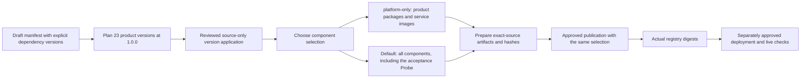

# Component releases

`releases/foundation.json` is a draft component manifest, not a platform release.

| Component | Kind | Manifest version |
| --- | --- | --- |
| `Agentweaver.Abstractions` | Contract | `0.0.0` |
| `Agentweaver.Providers` | Library | `0.0.0` |
| `Agentweaver.SourceControl` | Library | `0.0.0` |
| `Agentweaver.Orchestrator.Core` | Library | `0.0.0` |
| `Agentweaver.Persistence.Postgres` | Library | `0.0.0` |
| `Agentweaver.Secrets.AzureKeyVault` | Library | `0.0.0` |
| `Agentweaver.Identity` | Library | `0.0.0` |
| `Agentweaver.AgentRuntime` | Library | `0.0.0` |
| `Agentweaver.AgentHost` | Service | `0.0.0` |
| `Agentweaver.Telemetry` | Library | `0.0.0` |
| `Agentweaver.Telemetry.AzureMonitor` | Library | `0.0.0` |
| `Agentweaver.ObjectStore.AzureBlob` | Library | `0.0.0` |
| `Agentweaver.Identity.Broker` | Service | `0.0.0` |
| `Agentweaver.EventsAndSessions` | Service | `0.0.0` |
| `Agentweaver.Gateway` | Service | `0.1.0` |
| `Agentweaver.Mcp` | Service | `0.1.0` |
| `Agentweaver.Web` | Service | `0.0.0` |
| `Agentweaver.Orchestrator` | Service | `0.0.0` |
| `Agentweaver.Environment` | Service | `0.0.0` |
| `Agentweaver.Providers.Storage.AzureFiles` | Library | `0.0.0` |
| `Agentweaver.Providers.Sandbox.AgentSandbox` | Library | `0.0.0` |
| `Agentweaver.Knowledge` | Service | `0.0.0` |
| `Agentweaver.Projects.Config` | Service | `0.0.0` |
| `Agentweaver.FoundationProbe` | Acceptance-only service | `0.0.0` |

The manifest pins exact project-reference compatibility but does not pin container
image digests. The existing Identity Broker image `f989` remains separate from
this package baseline. Package components use the 0.0.0 initial baseline. Their
initial release notes come from the archived P0 changesets referenced by the prior
release receipt.
The Gateway is a source-only service candidate at `0.1.0`; its manifest entry and
documentation do not claim deployment or live acceptance.
The first-party MCP host is a source-only service candidate at `0.1.0`; it validates
Broker access tokens and delegates to the Gateway, without claiming deployment or
live acceptance.
Environment uses its existing executable host and SDK container configuration.
Its release artifact is a service image, not a NuGet library.
The Orchestrator Core compatibility entries include both Abstractions and Providers,
matching its direct project references.
The runtime library pins its native SDK dependency and references Abstractions
and Identity. Environment now references Identity for its separate bootstrap
profile contract. The separate AgentHost service entry describes the unpublished executable and pinned image definition.
AgentHost also references Source Control for the trusted version 2 BuildTest repository and full-output helpers.
The manifest records that direct compatibility dependency.
CI builds an exact-source amd64 image, measures its compressed OCI bytes, and checks native SDK startup without model execution.
These components do not publish credentials or prove deployment or paid-model acceptance.

Each product component change needs a fresh `.changeset` record. The record names the manifest component ID and semver intent. Documentation-only changes do not need a changeset.

## Validate and prepare

Run the validator:

```powershell
npm run release:validate
npm run release:validate -- --base <full-base-commit-sha>
```

The base-aware form checks changeset coverage for changed components. CI supplies the pull request base commit.

`npm run release:plan` writes a source-bound plan under ignored `artifacts/release/`. It does not change component versions.

The user-selected P1 plan targets `1.0.0` for all 23 product components:
13 packages and 10 service images.
A fresh major-intent changeset takes precedence over earlier minor and patch records.
The acceptance-only Probe retains its separate pending `0.0.1` version.
The draft accepts `1.0.0` for all 53 direct dependency relationships, including
the Probe's product dependencies. It retains each earlier accepted version.
These declarations retain the reviewed consumer and dependency source.
They change no runtime code, API contract, or external dependency pin.
This compatibility decision does not apply to later source changes.
The checked-in component versions remain unchanged and the manifest remains a draft.
Planning `1.0.0` versions is not a published platform release.

`npm run release:apply` updates manifest versions, project version mirrors, changelog, archive records, and a receipt. It requires a clean tree and a valid source-bound plan.

`npm run release:pack` builds and packs the manifest components. It writes local package and image artifacts. It does not push them to a registry or package feed.

Use `npm run release:pack -- --platform-only` to prepare every product component
without the acceptance-only Foundation Probe.
Use `--platform-only` for the matching publication command.
The full manifest hash remains in the preparation receipt.
The publisher rejects a receipt prepared with another component selection.
This selection cannot combine with `--packages-only` or `--foundation-probe-only`.



## Publication boundary

The manual publication workflow requires an explicit publish choice and environment approval. It publishes the prepared artifacts only.

The `platform_only` workflow input defaults to `false`.
It selects product preparation and matching ordinary publication.
Both frozen Probe jobs reject a conflicting platform selection before downloading artifacts.
The protected `v1-publication` environment remains required for ordinary publication.

The source contains a prepared platform release composition, not an actual deployment or live acceptance gate. Release preparation does not prove Azure acceptance.
