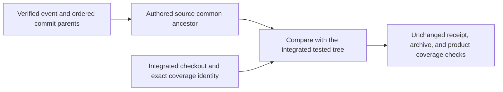
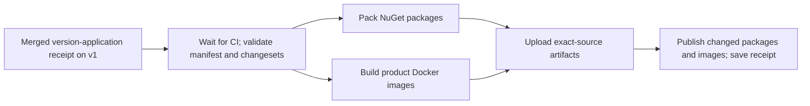

# Component releases

Use this reference to validate the component manifest, prepare source-bound
packages and images, and understand the boundary between publication and
deployment. A **component manifest** records component versions and dependency
compatibility. It does not, by itself, prove that an artifact was published or
that a service was deployed.

For the full release process, see the [release operations guide](https://github.com/sabbour/agentweaver/blob/v1/releases/README.md).
For deployment settings, see [Runtime configuration](./runtime-configuration.md).

## Current manifest status

`releases/foundation.json` is the tracked draft manifest. It contains 25
components: 14 contracts or libraries, 10 product services, and the separate
acceptance-only `Agentweaver.FoundationProbe` service. The manifest has no image
digests or release evidence, so it is not an accepted platform release.

| Component | Kind | Draft version |
| --- | --- | --- |
| `Agentweaver.Abstractions` | Contract | `1.2.0` |
| `Agentweaver.Providers` | Library | `1.1.0` |
| `Agentweaver.SourceControl` | Library | `1.1.0` |
| `Agentweaver.Orchestrator.Core` | Library | `1.2.0` |
| `Agentweaver.Persistence.Postgres` | Library | `1.1.1` |
| `Agentweaver.Secrets.AzureKeyVault` | Library | `1.0.2` |
| `Agentweaver.Identity` | Library | `1.4.0` |
| `Agentweaver.AgentRuntime` | Library | `1.2.0` |
| `Agentweaver.AgentHost` | Service | `1.0.3` |
| `Agentweaver.Telemetry` | Library | `1.0.2` |
| `Agentweaver.Telemetry.AzureMonitor` | Library | `1.0.2` |
| `Agentweaver.ObjectStore.AzureBlob` | Library | `1.0.2` |
| `Agentweaver.Identity.Broker` | Service | `1.2.0` |
| `Agentweaver.EventsAndSessions` | Service | `1.3.0` |
| `Agentweaver.Gateway` | Service | `1.3.0` |
| `Agentweaver.Mcp` | Service | `1.0.4` |
| `Agentweaver.Web` | Service | `1.2.0` |
| `Agentweaver.Orchestrator` | Service | `1.3.0` |
| `Agentweaver.Environment` | Service | `1.2.0` |
| `Agentweaver.Knowledge` | Service | `1.1.0` |
| `Agentweaver.Projects.Config` | Service | `1.3.0` |
| `Agentweaver.FoundationProbe` | Acceptance-only service | `0.0.4` |
| `Agentweaver.Providers.Storage.AzureFiles` | Library | `1.0.4` |
| `Agentweaver.Providers.Sandbox.AgentSandbox` | Library | `1.1.4` |
| `Agentweaver.Providers.Sessions.AgentSessions` | Library | `0.1.0` |

The manifest pins project-reference compatibility but does not yet pin service
images. Its compatibility table contains 59 direct dependency relationships.
The Foundation Probe is not a product service; `--platform-only` excludes it
from product preparation and publication.

Identity Broker `1.2.0` includes the EF migration
`20261021000100_AddIssueSyncGrants`. Publishing the image does not run the
migration or update the database.

## Validate and apply a version plan

Before you start, make sure the component changes and their `.changeset` records
are committed. A changeset names each affected manifest component and its
semantic-version intent. Documentation-only changes do not require a changeset.

1. Validate the manifest and changeset coverage:

   ```powershell
   npm run release:validate
   npm run release:validate -- --base <full-base-commit-sha>
   ```

   The base-aware command also checks changeset coverage against the selected
   base commit. CI runs validation against its verified source history.

2. Generate the source-bound version plan:

   ```powershell
   npm run release:plan
   ```

   The command writes the plan under the ignored `artifacts/release/` directory.
   It does not change component versions.

3. Review the plan, then apply it:

   ```powershell
   npm run release:apply
   ```

   Application requires a clean working tree and a valid plan for the current
   source. It updates the manifest, project version mirrors, changelog, archived
   changesets, and a source-bound receipt. Review and commit those changes
   before you prepare artifacts.

After applying versions, restore the separate PostgreSQL initializer from the
repository root and commit its generated lock file with the release changes:

```powershell
dotnet restore tools/P1PostgresInitializer/P1PostgresInitializer.csproj
```

Use the SDK selected by `global.json`. Restoring the solution does not include
this tool. CI checks its lock file separately with `--locked-mode`; a stale
file fails validation rather than dirtying an operator's checkout at runtime.

The current manifest remains a draft after version application. Applying a plan
does not build, publish, deploy, or accept a release.

## Build and publish artifacts

Run `release:pack` from a clean checkout. The command builds the selected
manifest components and writes local package and image artifacts; it does not
publish them.

```powershell
npm run release:pack -- --platform-only
```

This selection prepares product components and excludes the acceptance-only
Foundation Probe. It cannot be combined with `--packages-only` or
`--foundation-probe-only`. The automated workflow prepares packages and images
as separate artifacts, then merges and validates them against the same source
SHA and manifest before publication. Product container images carry the exact
source commit, Git tree, and component version in their OCI labels for both
release and integration preparation.

The release workflow builds only the service images whose version or build
inputs changed since the last published release. The other images are reused:
the new receipt points to their existing digest and original
`<version>-<buildSha>` tag, and records the commit that built them. Reused
images are never retagged. Deployment verifies them against that original
build commit. A manual dispatch with `rebuild_all_images` rebuilds every image.
See the [release operations guide](https://github.com/sabbour/agentweaver/blob/v1/releases/README.md#incremental-image-reuse)
for the reuse rules and failure modes.

Published images are immutable. An existing image that lacks the source-tree
label cannot be relabeled in place; rebuild and publish a new image before it
can pass the strict P1 source check.

The `v1-release-pack.yml` workflow runs for a qualifying receipt push to `v1` or
a manual dispatch. It requires the v1 CI and documentation checks for the exact
source commit. The publication job uses the configured GitHub Packages and
container registry destinations. It does not deploy to Azure or Kubernetes.
Use the [release operations guide](https://github.com/sabbour/agentweaver/blob/v1/releases/README.md) for publication
and partial-publication procedures. A one-use completion for the `v1.0.0`
publication is recorded as consumed; it is not a general retry path.

The current draft manifest does not include published-artifact digests or
deployment evidence. Use the source-bound publication receipt to verify the
result of a specific publication; do not infer publication status from a
manifest version or a successful local build.





## Deploy and verify a published release

Before deployment, obtain the matching publication receipt and confirm the
Azure subscription, tenant, resource group, cluster, namespace, runtime
settings, and provider-catalog source. The
[Kubernetes input inventory](https://github.com/sabbour/agentweaver/blob/v1/deploy/k8s/README.md) lists operator-supplied
values. Secrets, private keys, certificates, CA data, database grants and
migrations, and Gateway placement remain operator-managed.

### Whole-release rollout

A publication is not deployed when only some images have been published or
rolled out. Patch publications can omit unchanged images, so the rollout
command accepts the previous published receipt for those images. It resolves
one intended digest for every installed service and records the source commit
that built each image.

Use the whole-release command for the P0 installation:

```powershell
npm run release:deploy-whole -- `
  --publication <publication.json> `
  --previous-publication <previous-publication.json> `
  --subscription-id <subscription-id> `
  --resource-group <resource-group> `
  --cluster <cluster-name>
```

The default mode reads every Deployment through the temporary P0 user
kubeconfig. It rejects unknown or missing services, compares intended and live
digests in one table, and checks the recorded database schema against the
schema range accepted by the Orchestrator and Events and Sessions images.
Schema changes still run only through `db:maintenance`; this command does not
run migrations or reset data. It stops if the database-maintenance lock is
held. Wait for maintenance to finish before starting this command, and do not
start maintenance until the whole-release command has finished.

Run the same command with `--execute` only after reviewing the plan. Execute
mode patches only the named application containers, in a fixed safe order. It
waits for each rollout, checks Deployment readiness, checks every Pod image ID,
and waits up to two minutes for terminating or older-ReplicaSet Pods to disappear
before checking the final Pod inventory. It then runs authenticated Gateway
smoke checks for Projects, Priorities, project runs, and project metrics.
Execute mode reads the deployed Gateway settings and the Web `/env-config.js`
file to find the Gateway route, Identity Broker issuer, and audience. If
`AGENTWEAVER_GATEWAY_TOKEN` is not set, it opens a fresh temporary Chrome
profile and uses the P1 sign-in flow with run scopes. The browser may reuse
available SSO; the command does not copy a browser profile or type credentials.
Complete any sign-in or consent prompt in the browser. The command validates
the token, reads the signed-in actor's authorization context to select a tenant,
and chooses an active project from that actor's project list. The existing
Gateway, tenant, token environment variable, issuer, audience, actor, and project
flags are optional overrides.

The token stays in memory and is not written to the receipt. If the live
settings, sign-in, authorization context, or project list cannot be verified,
the command stops before changing Deployments and writes a partial receipt.
The command writes one receipt with status `deployed` only when every check
passes. Any failed service or check writes a `partial` receipt and exits
non-zero.

The Web-only and backend-only commands remain useful for diagnosis and
controlled component work, but their receipts always report the installation
as `partial`. A component receipt never inherits `deployed` status from an
earlier whole-release check.

### Backend service image rollout

`release:deploy-backend-services` updates only these existing Deployments in
the `agentweaver` namespace: `gateway`, `identity-broker`, `mcp`,
`environment`, `knowledge`, and `projects-config`. It reads the matching
service versions from `releases/foundation.json` at the publication source
commit. Each service must have exactly one planned and one published image.
The archive hash, immutable image tag, source commit, source tree, and registry
image metadata must agree before the command reads the cluster.

The default mode is read-only. It verifies the six publication images, reads
the Deployment inventory through the temporary P0 user kubeconfig, and writes
a plan receipt. The inventory accepts Kubernetes `List` and `DeploymentList`
wrappers only when every item is an `apps/v1` Deployment in namespace
`agentweaver`.

```powershell
npm run release:deploy-backend-services -- --publication <publication.json> --subscription-id <subscription-id> --resource-group <resource-group> --cluster <cluster-name>
```

After reviewing the receipt and confirming the Azure target, repeat the
command with `--execute`. The command uses resource-version-guarded JSON
patches to change only the six selected application container images. It waits
for each Deployment rollout, checks that other Deployment settings and images
did not change, and verifies the image ID of every selected Pod against the
registry-verified publication digest. Before verification, it waits up to two
minutes for terminating or older-ReplicaSet Pods to disappear. It writes a receipt with the source,
target, before and after images, readiness, and Pod image IDs. This path does
not install resources or run database migrations, resets, or schema changes.

### Web-only image rollout

`release:deploy-web` reads the tracked `releases/foundation.json` manifest from
the publication source commit. The manifest remains a draft and supplies the
`Agentweaver.Web` version; it does not supply a published image digest. The
publication receipt must contain exactly one planned and one published Web
image for that version, with matching archive hashes. The published entry's
digest-pinned image reference supplies the digest to verify and deploy.

For a reused image, the planned and published entries must carry the same
provenance. The original build commit and source tree determine the immutable
tag and the OCI labels checked in the registry. The deployment tool checkout,
publication source, and original build commit must all be in the current
`origin/v1` history. The command then uses a resource-version-guarded patch on
only the Web container and records readiness and before/after state in its
receipt.
The Deployment inventory accepts Kubernetes `List` and `DeploymentList`
wrappers only when every item is an `apps/v1` Deployment in namespace
`agentweaver`.

Run the deployment command without `--execute` first. The default is a
read-only dry run:

```powershell
npm run release:deploy -- <release-tag> --manifest <release-manifest.json> --publication <publication.json> --subscription-id <subscription-id> --tenant-id <tenant-id> --resource-group <resource-group> --cluster <cluster-name> --namespace <namespace> --node-min <minimum-nodes> --node-max <maximum-nodes> --provider-catalog-configmap <config-map-name> --provider-catalog-source-commit <40-character-sha>
```

Review the verified source, image digests, target, runtime prerequisites, and
rendered Kustomize installation. To apply the installation and run live rollout
and image checks, repeat the command with `--execute` after the target and
changes are approved.

Registry and pinned upstream manifest reads use four attempts with exponential
backoff (1, 2, and 4 seconds) only for network `TypeError` failures and HTTP
429/5xx. Other statuses and digest/content mismatches fail immediately.
Failures report a credential-free URL and the underlying network cause.
After an exhausted post-apply read, preserve the exact checkpoint and inputs;
a separately authorized `--resume --execute` repeats verification without
reapplying the completed stage. See the
[release runbook](https://github.com/sabbour/agentweaver/blob/v1/releases/README.md#local-v1-release-deployment)
for the complete retry and recovery contract.

The deployment preflight inventories the managed Gateway and all HTTPRoutes.
The Azure routing candidate uses one wildcard-domain HTTPS listener, with exact
route hostnames and path/backend boundaries retained. This supports HTTP/2
connection coalescing between the Portal and Broker without matching unknown
hostnames. A successful render or preflight does not prove live route readiness.
The runtime manifest validator also requires read-only `service-backend-ca`
mounts on each static owner-calling service. The Sandbox provider adds the same
mount to generated AgentHost Pods.

`release:deploy-bootstrap` is a separate pre-acceptance path. It requires the
exact draft manifest and source-bound publication evidence for the requested
version; some partial-publication cases also require their immutable completion
proof. For patch upgrades, it can report and replace only changed immutable
`agenthost-runtime-v1` and `projects-config-runtime-config` ConfigMaps after
preflighting the rest of the bundle; unchanged data follows the normal apply
path. It never replaces `environment-cilium-config`,
`projects-config-provider-catalog`, or any other ConfigMap. Its dry run does
not create release-acceptance evidence. The [v1.0.5 GitHub Release and
tag](https://github.com/sabbour/agentweaver/releases/tag/v1.0.5) are already
published. Its bootstrap is bound to source
`edae14b469548b8409b0eef651504691e0216a1e`, tree
`265da7c601e033adc99501735b74ccdb2df94420`, publication SHA-256
`149972c64222f1cf294b3795107f4e0ebf418bc766fbed4b1e2dcdd6e796c51b`, and
provenance SHA-256
`78c1fe655be9321727aa9882cb9bad2cf32d1e7faef86f6736151085adca9d21`.
AgentHost's receipt-measured `linux/amd64` image config digest is
`sha256:2bb01d7d5b90f225d98fde16904f11ef3d090b5f0c358f30f1fa35ec607fe618`;
its compressed pull size is `321483958` bytes. Do not create another release
or tag after the bootstrap-pins pull request merges. Use `release:deploy` for
the strict release gate. For the v1.0.5 image digests and bootstrap invocation,
see the
[v1.0.5 release operations guide](https://github.com/sabbour/agentweaver/blob/v1/releases/README.md#v105-pre-acceptance-bootstrap).
Neither a Kustomize apply nor a successful rollout alone proves external
acceptance. The P1 runner can use a published release receipt without an
integration deployment receipt, but it must verify the exact source tree and
live image digests, then bind its publication hash to fresh namespace
readbacks. The P1 runner requires the exact `releaseTag`; it verifies the
published release and immutable publication-result receipt before reading
deployment resources. For bootstrap, it reads the tracked draft manifest from
the published source commit, derives image-digest pins from that verified
receipt, and labels the result as pre-acceptance evidence. This is separate
evidence from the bootstrap command and does not relabel or repair previously
published images. Release and bootstrap images must be rebuilt and published
with the source-commit and source-tree labels before they can pass the strict
P1 source check; existing immutable images cannot be relabeled.
