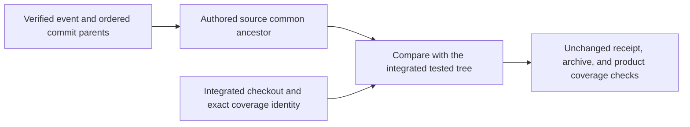
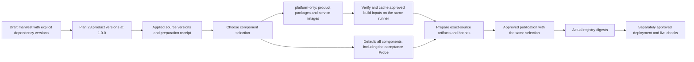

# Component releases

`releases/foundation.json` is a draft component manifest, not a platform release.

| Component | Kind | Manifest version |
| --- | --- | --- |
| `Agentweaver.Abstractions` | Contract | `1.0.0` |
| `Agentweaver.Providers` | Library | `1.0.0` |
| `Agentweaver.SourceControl` | Library | `1.0.0` |
| `Agentweaver.Orchestrator.Core` | Library | `1.0.0` |
| `Agentweaver.Persistence.Postgres` | Library | `1.0.0` |
| `Agentweaver.Secrets.AzureKeyVault` | Library | `1.0.0` |
| `Agentweaver.Identity` | Library | `1.0.0` |
| `Agentweaver.AgentRuntime` | Library | `1.0.0` |
| `Agentweaver.AgentHost` | Service | `1.0.0` |
| `Agentweaver.Telemetry` | Library | `1.0.0` |
| `Agentweaver.Telemetry.AzureMonitor` | Library | `1.0.0` |
| `Agentweaver.ObjectStore.AzureBlob` | Library | `1.0.0` |
| `Agentweaver.Identity.Broker` | Service | `1.0.0` |
| `Agentweaver.EventsAndSessions` | Service | `1.0.0` |
| `Agentweaver.Gateway` | Service | `1.0.0` |
| `Agentweaver.Mcp` | Service | `1.0.0` |
| `Agentweaver.Web` | Service | `1.0.0` |
| `Agentweaver.Orchestrator` | Service | `1.0.0` |
| `Agentweaver.Environment` | Service | `1.0.0` |
| `Agentweaver.Providers.Storage.AzureFiles` | Library | `1.0.0` |
| `Agentweaver.Providers.Sandbox.AgentSandbox` | Library | `1.0.0` |
| `Agentweaver.Knowledge` | Service | `1.0.0` |
| `Agentweaver.Projects.Config` | Service | `1.0.0` |
| `Agentweaver.FoundationProbe` | Acceptance-only service | `0.0.1` |

The manifest pins exact project-reference compatibility but does not pin container
image digests. The existing Identity Broker image `f989` remains separate from
these prepared source versions. The historical P0 package baseline was `0.0.0`.
Its initial notes remain in the archived P0 changesets referenced by the prior receipt.
The Gateway is a source-only service candidate at `1.0.0`; its manifest entry and
documentation do not claim deployment or live acceptance.
The first-party MCP host is a source-only service candidate at `1.0.0`; it validates
Broker access tokens and delegates to the Gateway, without claiming deployment or
live acceptance.
Environment uses its existing executable host and SDK container configuration.
Its release artifact is a service image, not a NuGet library.
The Orchestrator Core compatibility entries include both Abstractions and Providers,
matching its direct project references.
The runtime library pins its native SDK dependency and references Abstractions
and Identity. Environment now references Identity for its separate bootstrap
profile contract. The separate AgentHost service entry describes the unpublished executable and pinned image definition.
AgentHost also references Source Control for the trusted version 2 BuildTest repository and full-output helpers.
The manifest records that direct compatibility dependency.
CI builds an exact-source amd64 image, measures its compressed OCI bytes, and checks native SDK startup without model execution.
These components do not publish credentials or prove deployment or paid-model acceptance.

Each product component change needs a fresh `.changeset` record. The record names the manifest component ID and semver intent. Documentation-only changes do not need a changeset.

## Validate and prepare

Run the validator:

```powershell
npm run release:validate
npm run release:validate -- --base <full-base-commit-sha>
```

The base-aware form checks changeset coverage for changed components.
Both CI workflows use `npm run release:validate -- --ci` on the integrated checkout.
For a pull request, the tested commit's ordered parents must match the event base and authored head.
For an ordinary merge push, those parents must match the previous target and authored head.
Validation compares their common ancestor with the integrated tested tree, not only with the authored tree.
A linear push retains its previous-commit comparison.
Missing or mismatched history fails explicitly.
The comparison base never comes from a receipt's own claim.
Preparation receipts and archive-byte checks remain unchanged.



`npm run release:plan` writes a source-bound plan under ignored `artifacts/release/`. It does not change component versions.

The user-selected P1 plan has applied `1.0.0` source versions for all 23 product components:
13 packages and 10 service images.
The canonical application archived its major-intent changeset and the consumed earlier records.
The acceptance-only Probe has its separate prepared `0.0.1` source version.
The draft accepts `1.0.0` for all 53 direct dependency relationships, including
the Probe's product dependencies. It retains each earlier accepted version.
These declarations retain the reviewed consumer and dependency source.
They change no runtime code, API contract, or external dependency pin.
This compatibility decision does not apply to later source changes.
The manifest, project version fields and Web version mirrors now contain these versions.
The preparation receipt is `releases/receipts/62a0dcf5307dc7ef58c805d4c66b45baecd98e43.json`.
Its source SHA identifies the reviewed plan inputs, not a built or published artifact.
The manifest remains a draft. No package or image was built or published by this application.

`npm run release:apply` updates manifest versions, project version mirrors, changelog, archive records, and a receipt. It requires a clean tree and a valid source-bound plan.

`npm run release:pack` builds and packs the manifest components. It writes local package and image artifacts. It does not push them to a registry or package feed.

Use `npm run release:pack -- --platform-only` to prepare every product component
without the acceptance-only Foundation Probe.
Use `--platform-only` for the matching publication command.
The full manifest hash remains in the preparation receipt.
The publisher rejects a receipt prepared with another component selection.
This selection cannot combine with `--packages-only` or `--foundation-probe-only`.

For a product build, the manual workflow first prepares its approved build inputs.
It pulls only the three source-pinned Microsoft base images.
A standard locked npm install fills the cache for the runner's dependencies from the approved 467-entry Web lockfile.
It retains the committed download destinations and npm's existing integrity checks.
This preparation runs no dependency install scripts and adds no dependency.
For `platform_only: true`, the workflow starts Docker Engine `v29.9.0` with the official `docker/setup-docker-action` `v5.5.0`, pinned to commit `2bf61fb9464cc67f0cbdeabed6aa0380accd1c70`.
The action enables `containerd-snapshotter` in its temporary Docker daemon.
The action exports that daemon's Unix socket through `DOCKER_HOST`, so Docker commands use the temporary engine without changing context metadata.
The default Buildx builder then uses the same local Docker Engine as the image pulls.
Preparation reads the standard `docker buildx inspect default` output and requires exactly one `Driver: docker` and one `Endpoint: default` entry.
It also checks the shared store, image digests, and clean source before packing.
The action stops its daemon at the end of the job and does not change the runner's preinstalled daemon.
The runner still requires Buildx `0.13` or later. The workflow does not install Buildx or fetch a builder image.
The existing offline Web install and image checks remain unchanged.
These inputs are prepared on the build runner, not on a developer's machine.
This preparation does not publish artifacts or deploy services.



## Publication boundary

The manual publication workflow requires an explicit publish choice and environment approval. It publishes the prepared artifacts only.

The `platform_only` workflow input defaults to `false`.
It selects product preparation and matching ordinary publication.
Both frozen Probe jobs reject a conflicting platform selection before downloading artifacts.
The protected `v1-publication` environment remains required for ordinary publication.

P1 NuGet publication uses the existing Actions token only with
`https://nuget.pkg.github.com/sabbour/index.json`.
The ordinary publish job rejects another destination before artifact download.
Only that job gains package-write permission; its existing contents-write permission remains.
It requires manual publication and the protected environment's approval.
No stored NuGet key or external-feed credential fallback is added.
Package access, environment configuration and actual publication require separate confirmation.
The existing registry credential inputs and frozen Probe routes remain unchanged.

The source contains a prepared platform release composition, not an actual deployment or live acceptance gate. Release preparation does not prove Azure acceptance.
