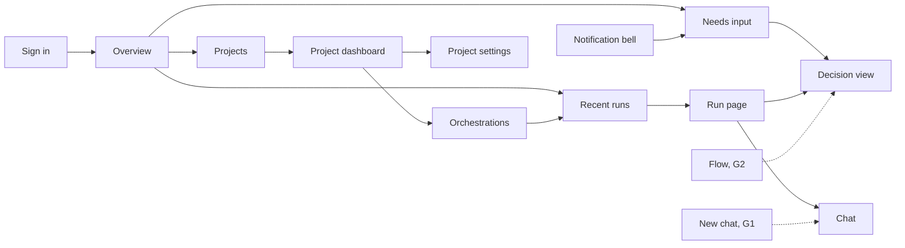

# Web UI parity and v1 adaptations

The v1 Web client reuses the 0.x visual language and supported interactions.
It does not restore the old monolith's API or infer missing service data.
This page lists each 0.x surface, what v1 shows today, and which service API
is still missing.

The visual baseline is `dev` commit
`108d1a067f1b58da870ca98db1c65a0e9b37a35f`.
The pre-adaptation v1 baseline is
`9a28e8868492b41ae799234dc0c25cffd95c52ba`.
Compare mounted routes, not just retained source files: v1 previously
bypassed most incumbent pages with a separate route tree.

## Structure

The 0.x rail stays the same in every phase. A destination stays hidden until a
v1 API backs it. Its route and rail slot are reserved now, so later work fills
them in without a redesign. Shared parts keep one shape when their data source
changes:

| Shared part | Used by today | Used by later |
| --- | --- | --- |
| `RunList` | Overview and Orchestrations, on runs opened in this browser | Sessions and Flow, on the run list API (G2) |
| `DecisionView` | Run Approvals tab | Notification bell, Flow, Chief of Staff Priorities |
| `AttentionList` | Overview and the notification bell, for the run you have open | Chief of Staff attention inbox, across runs |
| `NewChatComposer` | Run Chat tab | Sessions **+** and **Start task**, after G1 |
| `PlatformComponentsTable` | Run settings tab | Platform components page, after G5 |

Run state words are the same everywhere: **Needs input**, **Open**,
**Working**, and **Done**. **Unavailable** means the service did not return a
state. It does not mean the run failed.

The UI says **platform component** for a replaceable platform area and
**implementation** for the provider in use.

Dashed lines need a service API that does not exist yet.

## Surfaces

| 0.x surface | v1 today | Missing API |
| --- | --- | --- |
| Sign-in | Broker sign-in in the 0.x card. The 0.x explanatory checklist and the tab note are removed. | None |
| Consent | Permission explanations in the sign-in card. | None |
| Shell and breadcrumbs | 0.x rail, project switcher, persona menu, and `Projects / project / page` breadcrumbs. | None |
| Notification bell | Items that need input in the run you have open. | G6 |
| Overview | Projects, recent runs in this browser, and items that need input in the run you have open. | G2, G3 |
| Sessions and **Sessions +** | Hidden. The **+** is not shown disabled. Old links explain the gap. | G1, G2 |
| Start task | Not shown. | G1 |
| Projects gallery | 0.x tiles with state and your access: **Can edit**, **Can view**, or **No access**. | None |
| Create blank project | Dialog with a project name. | None |
| Create from GitHub | Dialog creates the project, then saves `sourceControl.repository` with GitHub App sign-in. Without access to the new project, the repository is not saved and a note says so. | Owner grant on create |
| Dashboard status card | Readiness from the saved configuration: repository, model, credential, and team. | Health endpoint for a live status |
| Dashboard metrics and Activity charts | Not shown. No invented numbers. | G3 |
| Dashboard quick actions | Links to Orchestrations, Agents, Skills, Memories, and Settings. | None |
| Orchestrations | Runs opened in this browser, with a state summary and **Refresh**. Empty state: "Runs you open appear here." | G2 |
| Run page | 0.x **Orchestration** two-pane layout: status strip (state, sessions, elapsed time, live update state), **Run tree**, and a session panel with tabs Chat, Topology, Approvals, Activity, Changes, Usage, and Run settings. The run token is requested silently; **Sign in for this project and run** appears only when that fails. | G1 for cancel |
| Run Chat | Journal and a composer that messages the coordinator by default, or the session selected in the run tree. No From/To form. Retries reuse one idempotency key. | Direct user-to-coordinator messages |
| Run Approvals | Shared decision view. It rereads each gate before acting. | None |
| Run Changes | GitHub App repository access for the run. | None |
| Run settings | Model, revisions, and allowed implementations per platform component. | None |
| Agents | 0.x metrics row, filter, tiles, and a drawer with Overview and Charter. Charter edits save a configuration revision. | G4 |
| Cast a team | Old link explains the gap. | G4 |
| Skills | 0.x stat strip, **Import skill** and **Browse marketplaces** dialogs, and **Catalog** and **Assignments** tabs. Marketplace sources, browse, preview, import, inventory, and assignment. | G9 |
| Memories | Run and agent pickers, kind tabs (All, Memories, Decisions, Proposals, Session context), search, revisions, and transfer. The 0.x count strip is not shown: counts for each kind need project knowledge. | G10 |
| Settings rail | 0.x section icons and the **Risk** badge on **Danger zone**. | None |
| Settings > General | Rename with the project revision. | None |
| Settings > Access | Your permissions. **Members** lists role assignments for a tenant administrator or project owner. Only a tenant administrator sees **Add member** and **Remove**. | Role-assignment API |
| Settings > Repository | Repository owner, name, and sign-in method. | None |
| Settings > Models | Default model, reasoning effort, credential, and per-task models. Changing the model clears the credential until you choose one that matches. | Model catalog |
| Settings > Platform components | Implementation choice and order for each platform component. | G5 for the active implementation |
| Settings > Run limits | Saved run limit fields. | None |
| Settings > Connections | GitHub Repo App, Copilot, and remote MCP OAuth. | Remote MCP connection directory |
| Settings > History | Read-only earlier configuration revisions. | None |
| Settings > Danger zone | Archive and restore. | Project delete |
| Settings > Advanced | Full configuration JSON. Fallback only. | None |
| Board | Hidden. | G8 |
| Flow | Hidden. | G2 |
| Workspace | Hidden. Run Changes covers the run's repository. | — |
| Workflows | Hidden. | G8 |
| Apps and Canvas | Hidden. | — |
| Observability, Diagnostics, Heartbeat, Cluster | Hidden. Run Activity and Usage cover one run. | G7 |
| Platform settings | Hidden. | G5, G7 |

## Unavailable destinations

Hidden routes use one shared **Not available in this version** page with a
reason and a link back. They do not appear in navigation. Unknown addresses
show **Page not found**. The hidden routes are `/sessions`,
`/projects/:id/sessions`, `/assistant`, `/console`, `/platform-settings`,
`/observability/*`, `/projects/:id/team/cast`, and the project `board`,
`flow`, `workspace`, `workflows`, `observability/*`, `diagnostics`,
`heartbeat`, and `cluster` paths.

## Service API gaps

These gaps block full 0.x parity. None of them is built in the web client.
Each needs its own approval.

| Gap | Endpoint | Unblocks |
| --- | --- | --- |
| G1. Start a chat or run | `POST /api/v1/projects/{projectId}/runs` with `{ firstMessage, workflowId?, idempotencyKey }`, returning `{ runId, rootSessionId }`. The browser then gets a token bound to the new run through silent Broker authorization, without a second sign-in. Also `POST /api/v1/projects/{projectId}/runs/{runId}/cancel`. | Sessions **+**, Start task, run cancel |
| G2. Run list | `GET /api/v1/projects/{projectId}/runs?state=&cursor=&pageSize=`. Each item has `runId`, `rootSessionId`, `title`, `state`, `needsInputCount`, `createdAt`, `updatedAt`, `completedAt`, and `startedBy`. | Orchestrations, Sessions, Flow, Memories run picker |
| G3. Project metrics | `GET /api/v1/projects/{projectId}/metrics?from=&to=&bucket=day`, from the Events ledger. | Dashboard metrics and Activity charts |
| G4. Casting | Gateway routes for the existing Projects owner `/projects/{projectId}/casting/*` endpoints. | Agents **Cast**, **Add**, and **Sync** |
| G5. Platform components | `GET /api/v1/platform/components`. Each entry returns `{ area, purpose, owner, cardinality, active: [{ implementationId, displayName, version, readiness, observedAt }], available }` from the owning service's readiness check. | Platform components page |
| G6. Notifications | Caller-scoped notifications across runs. | Notification bell across all your runs |
| G7. Operations summary | Read-only diagnostics and health summary for administrators. | Observability, Diagnostics, Heartbeat, Cluster |
| G8. Board and workflows | Work items and a workflow catalog. | Board, Workflows |
| G9. Skill management | Delete, upload, and create skills. | Skills actions beyond import and assign |
| G10. Project knowledge | Project-scoped knowledge search without a run binding. | Memories without a run |

Other gaps:

- **Role-assignment list, add, and remove:**
  `GET`, `POST`, and `DELETE /api/v1/projects/{projectId}/role-assignments`.
  The web client calls these routes. Until the service serves them, Access shows only
  your permissions. A `503 role_assignment_unavailable` shows "Role changes
  aren't available yet."
- **Project delete:** no endpoint. Danger zone offers archive and restore.
- **Project health:** no endpoint for a live status dot. The dashboard shows
  readiness from saved configuration.
- **Owner grant on create:** creating a project does not grant the creator
  access, so create-from-GitHub can't always save the repository.
- **Effective role names:** the authorization context lists permissions, not
  role names. Tiles show access from permissions.
- **Selectable models:** no service returns the models a project can use, so
  **Models** asks for existing model references instead of offering a list.
- **Remote MCP discovery:** no service returns a project's remote MCP
  connections or their setup checksum, so **Connections** asks for the saved
  connection ID and checksum.

## Evidence boundary

Local screenshots use fixture data and isolated source snapshots. They compare
0.x, pre-adaptation v1, and adapted v1 without live sign-in or real credentials.
They do not prove deployed identity, authorization, or live providers. Follow [Use the v1 web client](../guide/web-client.md)
for actual routes, settings, and current limits.
