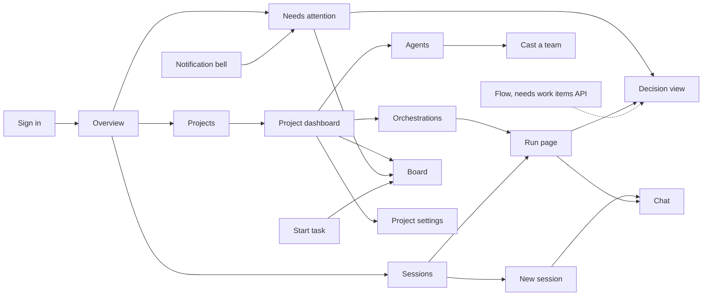

# Web UI parity and v1 adaptations

The v1 Web client reuses the 0.x visual language and the 0.x interactions that
v1 services support. It does not restore the old monolith's API, and it does not
guess data that a service doesn't return. This page lists each 0.x surface, what
v1 shows today, and which service API a hidden or limited surface still needs.

The visual baseline is the 0.x web app on the `dev` branch. The v1 client keeps
that app's shell and shared components and fills them with v1 service data.
When you compare the two, compare the routes that each app mounts, not only the
retained source files.

## Structure

The 0.x rail is the same in every version. A destination stays hidden until a
v1 API supports it. Its route and rail slot are reserved, so the page can be
added later without a redesign. Shared parts keep one shape when their data
source changes:

| Shared part | Used by | Planned use |
| --- | --- | --- |
| `RunList` | Overview, Sessions, Dashboard, and Orchestrations, on the project run list | Flow |
| `DecisionView` | Run Approvals tab | Flow and a priorities view |
| `AttentionList` | Overview and the notification bell, on your notifications across projects | An attention inbox and a priorities view |
| `NewChatComposer` | Run Chat tab and the New session page | — |
| `CaptureTaskForm` | Board Intake and the Start task dialog | — |
| `ProjectMetricsSections` | Dashboard and Overview, on project metrics and usage | — |
| `PlatformComponentsTable` | Run settings tab | — |

Run state words are the same everywhere: **Needs input**, **Open**,
**Working**, and **Done**. **Unavailable** means the service did not return a
state. It does not mean the run failed.

The UI says **platform component** for a replaceable platform area and
**implementation** for the provider in use.

Dashed lines need a service API that does not exist yet.

## Surfaces

The **Missing API** column names the service API that a hidden or limited
surface needs. **None** means no service API is missing. A dash means the
surface is hidden for a reason other than a missing API.
[Service API gaps](#service-api-gaps) describes each API.

| 0.x surface | v1 today | Missing API |
| --- | --- | --- |
| Sign-in | Broker sign-in in the 0.x card. The 0.x explanatory checklist and the tab note are removed. | None |
| Consent | Permission explanations in the sign-in card. | None |
| Shell and breadcrumbs | 0.x rail with **Overview**, **Projects**, and **Sessions**, the **New session** button, project switcher, persona menu, and `Projects / project / page` breadcrumbs. | None |
| Notification bell | Your notifications across projects. The badge shows the pending count from the service. Pending gates open the run's Approvals tab. Backlog promotions show **N subtasks created** and link to the project Board. Each item has **Dismiss**. | None |
| Overview | **Operations** card, recent projects, metrics and usage for one chosen project, recent runs across projects, and **Needs attention**. | Cross-project metrics |
| Sessions | Runs across your projects, newest first, with **Load more**, **Refresh**, and **New session**. | None |
| New session | `/assistant` picks a project, creates the run with the first message, signs in silently for that run, starts it, and opens Chat. | None |
| Start task | 0.x floating **Start task** button on project pages, shown only with permission to change the project. Its dialog captures a task into that project's Backlog and opens the Board. It does not start a run or offer a project picker. | None |
| Projects gallery | 0.x tiles with state and your access: **Can edit**, **Can view**, or **No access**. | None |
| Create blank project | Dialog with a project name. | None |
| Create from GitHub | Dialog creates the project, then saves `sourceControl.repository` with GitHub App sign-in. Without access to the new project, the repository is not saved and a note says so. | Owner grant on create |
| Dashboard status card | Readiness from the saved configuration: repository, model, credential, and team. | Project health |
| Dashboard metrics and Activity charts | Metric tiles, the **Activity** chart, run totals, and model and agent usage over 7, 30, or 90 days. **Success** is succeeded runs out of completed runs. Costs are shown as subtotals for each price unit and disposition, never added together. | None |
| Dashboard quick actions | Links to Orchestrations, Agents, Skills, Memories, and Settings. | None |
| Orchestrations | **Active** and **Recent** sections from the run list, each with **Load more**, plus a state summary and **Refresh**. | None |
| Run page | 0.x **Orchestration** two-pane layout: status strip (state, sessions, elapsed time, live update state), **Run tree**, and a session panel with tabs Chat, Topology, Approvals, Activity, Changes, Usage, and Run settings. The run token is requested silently. **Sign in for this project and run** appears only when that fails. **Stop run** appears while the run is open. | None |
| Run Chat | Journal and a composer that messages the coordinator by default, or the session selected in the run tree. No From/To form. Retries reuse one idempotency key. | Direct user-to-coordinator messages |
| Run Approvals | Shared decision view. It rereads each gate before acting. | None |
| Run Changes | GitHub App repository access for the run. Files that the run produced are not shown. | None |
| Run settings | Model, revisions, and allowed implementations for each platform component. | None |
| Agents | 0.x metrics row, filter, tiles, and a drawer with Overview and Charter. Charter edits save a configuration revision. **Cast team**, **Add member**, and **Sync** (export and import) stage team proposals. **Pending team proposals** lists proposals to review. | None |
| Cast a team | Template or role picks, review with member removal, then confirm or reject. The AI Formulate and Analyze modes and the Universe picker are not shown. | AI casting |
| Skills | 0.x stat strip, **Import skill** and **Browse marketplaces** dialogs, and **Catalog** and **Assignments** tabs. Marketplace sources, browse, preview, import, inventory, and assignment. The suggested marketplaces panel is not shown. | Skill management |
| Memories | Run and agent pickers, kind tabs (All, Memories, Decisions, Proposals, Session context), search, revisions, and transfer. The run picker reads the project run list. The 0.x count strip is not shown, because counts for each kind need project-wide knowledge search. | Project knowledge |
| Settings rail | 0.x section icons and the **Risk** badge on **Danger zone**. | None |
| Settings > General | Rename with the project revision. | None |
| Settings > Access | Your permissions. **Members** lists role assignments for a tenant administrator or project owner. Only a tenant administrator sees **Add member** and **Remove**. | Role assignments |
| Settings > Repository | Repository owner, name, and sign-in method. | None |
| Settings > Models | Default model, reasoning effort, credential, and per-task models. Changing the model clears the credential until you choose one that matches. | Model catalog |
| Settings > Platform components | Implementation choice and order for each platform component. | None |
| Settings > Run limits | Saved run limit fields. | None |
| Settings > Connections | GitHub Repo App, Copilot, and remote MCP OAuth. Remote MCP lists the project's saved connections and fills the ID and setup checksum of the one you pick. | None |
| Settings > History | Read-only earlier configuration revisions. | None |
| Settings > Danger zone | Archive and restore. | Project delete |
| Settings > Advanced | Full configuration JSON, as a fallback. | None |
| Platform settings | All 16 platform component areas with owner, readiness, and active and available implementations. An area whose owner did not report reads **Status not reported**. Only tenant and platform administrators can read it. | Operations summary (for the other administrator pages) |
| Board | 0.x kanban look with **Backlog**, **Ready**, **Active**, and **Done** columns, column counts, summary strip, and zoom. Cards show title, description, prerequisites, linked issue with its state, and **Automation running**. **Intake** captures a task. Cards edit title and description. Moving tasks is disabled with the note "Moving tasks between columns is not available yet." The Human Review and Problems columns are not shown. | Backlog task moves |
| Flow | Hidden. | Board and workflows |
| Workspace | Hidden. Run Changes covers the run's repository. | — |
| Workflows | Hidden. | Board and workflows |
| Apps and Canvas | Hidden. | — |
| Observability, Diagnostics, Heartbeat, Cluster | Hidden. Run Activity and Usage cover one run. | Operations summary |

## Unavailable destinations

Hidden routes use one shared **Not available in this version** page with a
reason and a link back. They do not appear in navigation. Unknown addresses
show **Page not found**. The hidden routes are `/observability/*` and the
project `flow`, `workspace`, `workflows`, `observability/*`,
`diagnostics`, `heartbeat`, and `cluster` paths.

`/console` opens `/assistant`, and `/projects/:projectId/sessions` opens
`/sessions`.

## Service API gaps

The services don't provide these APIs yet. The web client doesn't work around
them. Until an API exists, the pages that need it stay hidden or limited.

| API | Unblocks |
| --- | --- |
| Board and workflows | Flow and Workflows. |
| Backlog task moves | Moving, reordering, and archiving tasks on the Board, editing dependencies, and sending all Backlog tasks to Ready. |
| Cross-project metrics | Metrics totaled across projects on Overview. |
| AI casting | The AI Formulate and Analyze modes and the Universe picker on Cast a team. |
| Skill management | Suggested marketplaces, and deleting, uploading, and creating skills. |
| Project knowledge | Knowledge search across a project without a run binding, and the Memories count strip. |
| Operations summary | Observability, Diagnostics, Heartbeat, and Cluster. |

Other gaps:

- **Role assignments:** the web client calls `GET`, `POST`, and
  `DELETE /api/v1/projects/{projectId}/role-assignments` to list, add, and
  remove members. Until the service serves these routes, Access shows only
  your permissions. A `503 role_assignment_unavailable` response shows "Role
  changes aren't available yet."
- **Project delete:** no endpoint. Danger zone offers archive and restore.
- **Backlog task moves:** the Board reads with
  `GET /api/v1/projects/{projectId}/backlog` and
  `GET /api/v1/projects/{projectId}/source-control/issues`, captures with
  `POST /api/v1/projects/{projectId}/backlog/tasks`, and edits with
  `PUT /api/v1/projects/{projectId}/backlog/tasks/{taskId}/content`. Moving
  a card needs `PUT /api/v1/projects/{projectId}/backlog/tasks/{taskId}/state`
  with `{ state, expectedGraphRevision, expectedTaskRevision }`. Reordering
  needs a position operation. Archiving needs
  `POST /api/v1/projects/{projectId}/backlog/tasks/{taskId}/archive`.
  Dependencies need `PUT` and `DELETE` on
  `/api/v1/projects/{projectId}/backlog/tasks/{taskId}/dependencies/{prerequisiteTaskId}`.
  These operations exist only on run-scoped orchestrator routes today.
- **Project health:** no endpoint for a live status dot. The dashboard shows
  readiness from saved configuration.
- **Owner grant on create:** creating a project does not grant the creator
  access, so create-from-GitHub can't always save the repository.
- **Effective role names:** the authorization context lists permissions, not
  role names. Tiles show access based on permissions.
- **Model catalog:** the Gateway does not return the available models and
  providers. Enter existing model and credential references.

## Evidence boundary

Local screenshots use fixture data and isolated source snapshots. They compare
0.x, v1 before the adaptation, and adapted v1 without live sign-in or real
credentials. They do not prove deployed identity, authorization, or live
providers. For the actual routes, settings, and current limits, see
[Use the v1 web client](../guide/web-client.md).
