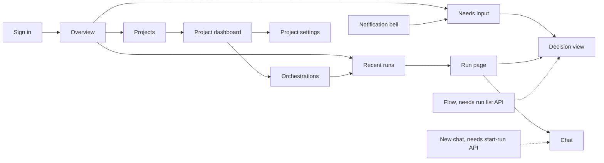

# Web UI parity and v1 adaptations

The v1 Web client reuses the 0.x visual language and the 0.x interactions that
v1 services support. It does not restore the old monolith's API, and it does not
guess data that a service doesn't return. This page lists each 0.x surface, what
v1 shows today, and which service API a hidden or limited surface still needs.

The visual baseline is the 0.x web app on the `dev` branch. The v1 client keeps
that app's shell and shared components and fills them with v1 service data.
When you compare the two, compare the routes that each app mounts, not only the
retained source files. Before the adaptation, v1 used a separate route tree and
skipped most 0.x pages.

## Structure

The 0.x rail is the same in every version. A destination stays hidden until a
v1 API supports it. Its route and rail slot are reserved, so the page can be
added later without a redesign. Shared parts keep one shape when their data
source changes:

| Shared part | Used by today | Planned use when the API exists |
| --- | --- | --- |
| `RunList` | Overview and Orchestrations, on runs opened in this browser | Sessions and Flow, on the run list API |
| `DecisionView` | Run Approvals tab | Notification bell, Flow, and a priorities view |
| `AttentionList` | Overview and the notification bell, for the run you have open | An attention inbox across all your runs |
| `NewChatComposer` | Run Chat tab | Sessions **+** and **Start task**, on the start-run API |
| `PlatformComponentsTable` | Run settings tab | Platform components page, on the platform components API |

Run state words are the same everywhere: **Needs input**, **Open**,
**Working**, and **Done**. **Unavailable** means the service did not return a
state. It does not mean the run failed.

The UI says **platform component** for a replaceable platform area and
**implementation** for the provider in use.

Dashed lines need a service API that does not exist yet.

## Surfaces

The **Missing API** column names the service API that a hidden or limited
surface needs. **None** means no service API is missing. A dash means the
surface is hidden for a reason other than a missing API.
[Service API gaps](#service-api-gaps) describes each API.

| 0.x surface | v1 today | Missing API |
| --- | --- | --- |
| Sign-in | Broker sign-in in the 0.x card. The 0.x explanatory checklist and the tab note are removed. | None |
| Consent | Permission explanations in the sign-in card. | None |
| Shell and breadcrumbs | 0.x rail, project switcher, persona menu, and `Projects / project / page` breadcrumbs. | None |
| Notification bell | Items that need input in the run you have open. | Notifications |
| Overview | Projects, recent runs in this browser, and items that need input in the run you have open. | Run list, project metrics |
| Sessions and **Sessions +** | Hidden. The **+** is not shown disabled. Old links explain why the page is unavailable. | Start a chat or run, run list |
| Start task | Not shown. | Start a chat or run |
| Projects gallery | 0.x tiles with state and your access: **Can edit**, **Can view**, or **No access**. | None |
| Create blank project | Dialog with a project name. | None |
| Create from GitHub | Dialog creates the project, then saves `sourceControl.repository` with GitHub App sign-in. Without access to the new project, the repository is not saved and a note says so. | Owner grant on create |
| Dashboard status card | Readiness from the saved configuration: repository, model, credential, and team. | Project health |
| Dashboard metrics and Activity charts | Not shown. The client does not invent numbers. | Project metrics |
| Dashboard quick actions | Links to Orchestrations, Agents, Skills, Memories, and Settings. | None |
| Orchestrations | Runs opened in this browser, with a state summary and **Refresh**. Empty state: "Runs you open appear here." | Run list |
| Run page | 0.x **Orchestration** two-pane layout: status strip (state, sessions, elapsed time, live update state), **Run tree**, and a session panel with tabs Chat, Topology, Approvals, Activity, Changes, Usage, and Run settings. The run token is requested silently. **Sign in for this project and run** appears only when that fails. Run cancel is not available. | Start a chat or run (for cancel) |
| Run Chat | Journal and a composer that messages the coordinator by default, or the session selected in the run tree. No From/To form. Retries reuse one idempotency key. | Direct user-to-coordinator messages |
| Run Approvals | Shared decision view. It rereads each gate before acting. | None |
| Run Changes | GitHub App repository access for the run. Files that the run produced are not shown. | None |
| Run settings | Model, revisions, and allowed implementations for each platform component. | None |
| Agents | 0.x metrics row, filter, tiles, and a drawer with Overview and Charter. Charter edits save a configuration revision. There are no **Cast**, **Add**, or **Sync** controls. | Casting |
| Cast a team | Old link explains why the page is unavailable. | Casting |
| Skills | 0.x stat strip, **Import skill** and **Browse marketplaces** dialogs, and **Catalog** and **Assignments** tabs. Marketplace sources, browse, preview, import, inventory, and assignment. | Skill management |
| Memories | Run and agent pickers, kind tabs (All, Memories, Decisions, Proposals, Session context), search, revisions, and transfer. The 0.x count strip is not shown, because counts for each kind need project-wide knowledge search. | Project knowledge |
| Settings rail | 0.x section icons and the **Risk** badge on **Danger zone**. | None |
| Settings > General | Rename with the project revision. | None |
| Settings > Access | Your permissions. **Members** lists role assignments for a tenant administrator or project owner. Only a tenant administrator sees **Add member** and **Remove**. | Role assignments |
| Settings > Repository | Repository owner, name, and sign-in method. | None |
| Settings > Models | Default model, reasoning effort, credential, and per-task models. Changing the model clears the credential until you choose one that matches. | Model catalog |
| Settings > Platform components | Implementation choice and order for each platform component. The implementation that is running is not shown. | Platform components |
| Settings > Run limits | Saved run limit fields. | None |
| Settings > Connections | GitHub Repo App, Copilot, and remote MCP OAuth. | Remote MCP discovery |
| Settings > History | Read-only earlier configuration revisions. | None |
| Settings > Danger zone | Archive and restore. | Project delete |
| Settings > Advanced | Full configuration JSON, as a fallback. | None |
| Board | Hidden. | Board and workflows |
| Flow | Hidden. | Run list |
| Workspace | Hidden. Run Changes covers the run's repository. | — |
| Workflows | Hidden. | Board and workflows |
| Apps and Canvas | Hidden. | — |
| Observability, Diagnostics, Heartbeat, Cluster | Hidden. Run Activity and Usage cover one run. | Operations summary |
| Platform settings | Hidden. | Platform components, operations summary |

## Unavailable destinations

Hidden routes use one shared **Not available in this version** page with a
reason and a link back. They do not appear in navigation. Unknown addresses
show **Page not found**. The hidden routes are `/sessions`,
`/projects/:id/sessions`, `/assistant`, `/console`, `/platform-settings`,
`/observability/*`, `/projects/:id/team/cast`, and the project `board`,
`flow`, `workspace`, `workflows`, `observability/*`, `diagnostics`,
`heartbeat`, and `cluster` paths.

## Service API gaps

The services don't provide these APIs yet. The web client doesn't work around
them. Until an API exists, the pages that need it stay hidden or limited.

| API | Proposed endpoint | Unblocks |
| --- | --- | --- |
| Start a chat or run | `POST /api/v1/projects/{projectId}/runs` with `{ firstMessage, workflowId?, idempotencyKey }`, returning `{ runId, rootSessionId }`. The browser then gets a token bound to the new run through silent Broker authorization, without a second sign-in. Also `POST /api/v1/projects/{projectId}/runs/{runId}/cancel`. | Sessions **+**, Start task, run cancel |
| Run list | `GET /api/v1/projects/{projectId}/runs?state=&cursor=&pageSize=`. Each item has `runId`, `rootSessionId`, `title`, `state`, `needsInputCount`, `createdAt`, `updatedAt`, `completedAt`, and `startedBy`. | Orchestrations, Sessions, Flow, Memories run picker |
| Project metrics | `GET /api/v1/projects/{projectId}/metrics?from=&to=&bucket=day`, from the Events ledger. | Dashboard metrics and Activity charts |
| Casting | Gateway routes for the existing Projects owner `/projects/{projectId}/casting/*` endpoints. | Agents **Cast**, **Add**, and **Sync** |
| Platform components | `GET /api/v1/platform/components`. Each entry returns `{ area, purpose, owner, cardinality, active: [{ implementationId, displayName, version, readiness, observedAt }], available }` from the owning service's readiness check. | Platform components page |
| Notifications | Notifications for the signed-in user across runs. | Notification bell across all your runs |
| Operations summary | Read-only diagnostics and health summary for administrators. | Observability, Diagnostics, Heartbeat, Cluster |
| Board and workflows | Work items and a workflow catalog. | Board, Workflows |
| Skill management | Delete, upload, and create skills. | Skills actions beyond import and assign |
| Project knowledge | Knowledge search across a project, without a run binding. | Memories without a run |

Other gaps:

- **Role assignments:** the web client calls `GET`, `POST`, and
  `DELETE /api/v1/projects/{projectId}/role-assignments` to list, add, and
  remove members. Until the service serves these routes, Access shows only
  your permissions. A `503 role_assignment_unavailable` response shows "Role
  changes aren't available yet."
- **Project delete:** no endpoint. Danger zone offers archive and restore.
- **Project health:** no endpoint for a live status dot. The dashboard shows
  readiness from saved configuration.
- **Owner grant on create:** creating a project does not grant the creator
  access, so create-from-GitHub can't always save the repository.
- **Effective role names:** the authorization context lists permissions, not
  role names. Tiles show access based on permissions.
- **Model catalog:** the Gateway does not return the available models and
  providers. Enter existing model and credential references.
- **Remote MCP discovery:** the Gateway does not return a connection directory
  or the connection setup checksum. Enter the connection ID and checksum from
  the saved project connection setup.

## Evidence boundary

Local screenshots use fixture data and isolated source snapshots. They compare
0.x, v1 before the adaptation, and adapted v1 without live sign-in or real
credentials. They do not prove deployed identity, authorization, or live
providers. For the actual routes, settings, and current limits, see
[Use the v1 web client](../guide/web-client.md).
