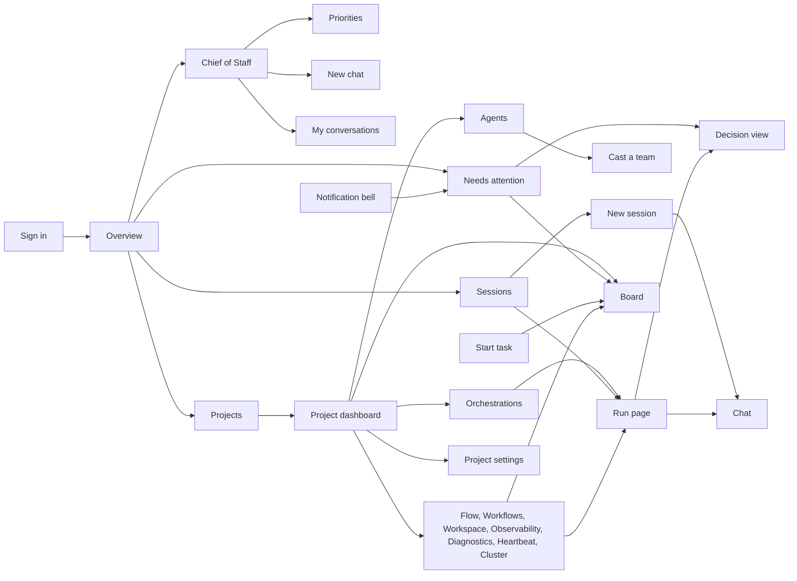
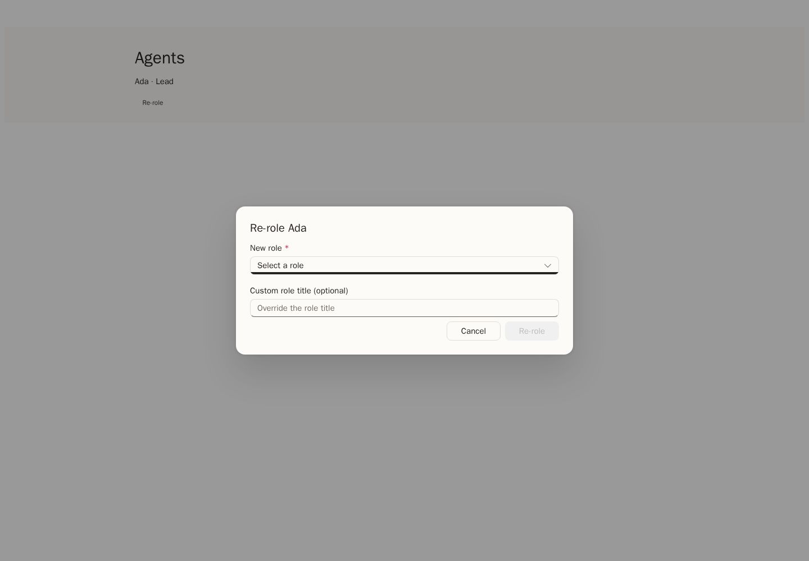
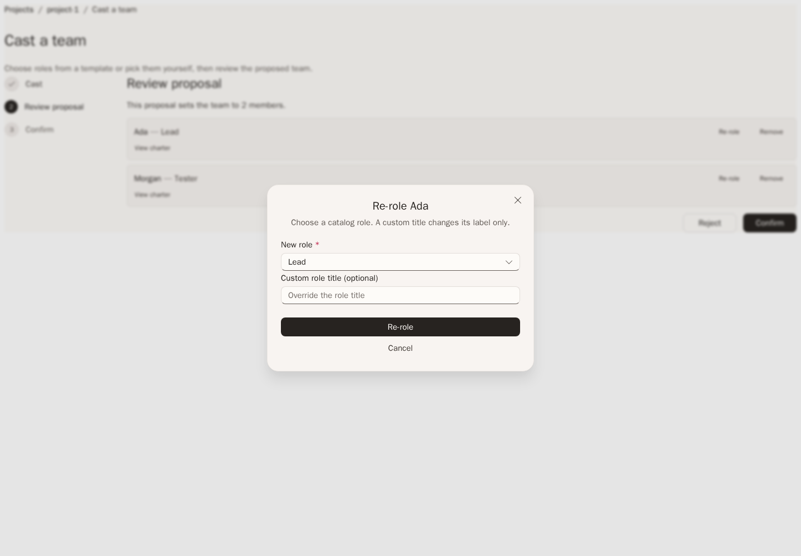

# Web UI parity and v1 adaptations

The v1 Web client reuses the 0.x visual language and the 0.x interactions that
v1 services support. It does not restore the old monolith's API, and it does not
guess data that a service doesn't return. This page lists each 0.x surface,
what v1 shows today, and each 0.x endpoint that still has no v1 route.

The visual baseline is the 0.x web app on the `dev` branch. The v1 client keeps
that app's shell and shared components and fills them with v1 service data.
When you compare the two, compare the routes that each app mounts, not only the
retained source files.

Paths on this page that start with `/api/v1` are public Gateway paths. Paths
that start with `/api` are 0.x paths.

## Structure

The 0.x rail is the same in every version. Shared parts keep one shape when
their data source changes:

| Shared part | Used by |
| --- | --- |
| `RunList` | Overview, Sessions, Dashboard, Orchestrations, Flow, Observability, Diagnostics, and Heartbeat, on the project run list |
| `DecisionView` | Run Approvals tab |
| `AttentionList` | Overview, Flow, and the notification bell, on your notifications |
| `NewChatComposer` | Run Chat tab and the New session page |
| `CaptureTaskForm` | Board Intake and the Start task dialog |
| `ProjectMetricsSections` | Dashboard, Overview, and Observability, on project metrics and usage |
| `PlatformComponentsSection` | Platform settings, Diagnostics, and Cluster, on the platform component report |
| `PlatformComponentsTable` | Run settings tab |

Run state words are the same everywhere: **Needs input**, **Open**,
**Working**, and **Done**. **Unavailable** means the service did not return a
state. It does not mean the run failed.

The UI says **platform component** for a replaceable platform area and
**implementation** for the provider in use.

The Overview groups Priorities, New chat, and My conversations under
**Chief of Staff**. A v1-only rail link opens that section; 0.x navigation is
unchanged. The active Overview and Dashboard load from Gateway project, run,
metric, usage, configuration, and notification reads. The retained 0.x Overview and
Dashboard source files also use only published Gateway reads. They preserve
their panels but are not mounted in the v1 route tree. Overview shows usage and
recent runs for the four most recently updated active projects; Dashboard
shows project metrics, run totals, and model usage for the selected range.
Neither page calls the old global overview or project dashboard endpoint. The
notification bell and project switcher use the same published Gateway routes.
When a read fails, its value is unavailable, not zero or healthy.

## Surfaces

Each row says what works and what is still missing. The missing parts link to
[Endpoint gaps](#endpoint-gaps), which names the exact routes.

| 0.x surface | Works in v1 | Missing |
| --- | --- | --- |
| Sign-in | Broker sign-in in the 0.x card. | Nothing. |
| Consent | Permission explanations in the sign-in card. | Nothing. |
| Shell and breadcrumbs | 0.x rail with **Overview**, the v1-only **Chief of Staff** section link, **Projects**, and **Sessions**, the **New session** button, project switcher, persona menu, and `Projects / project / page` breadcrumbs. Project pages list Flow, Workflows, Workspace, Observability, Diagnostics, Heartbeat, and Cluster. | Nothing. |
| Notification bell | Your notifications across projects, with the pending count, links to the run Approvals tab or the Board, and **Dismiss**. | Nothing. |
| Overview | **Chief of Staff** group with Priorities, New chat, and My conversations; **Operations** card, recent projects, metrics and usage for one chosen project, recent runs across projects, and **Needs attention**. A note in Operations explains that cross-project totals are unavailable. | Totals across all projects (cross-project overview). |
| Sessions | Runs across your projects, newest first, with **Load more**, **Refresh**, and **New session**. | Nothing. |
| New session | `/assistant` picks a project, creates the run with the first message, signs in silently for that run, starts it, and opens Chat. | A run without a project (operator assistant). |
| Start task | Floating **Start task** button. Its dialog captures a task into the Backlog and opens the Board. | Nothing. |
| Projects gallery | 0.x tiles with state and your access. | Nothing. |
| Create blank project | Dialog with a project name. | Nothing. |
| Create from GitHub | Creates the project, then saves the repository with GitHub App sign-in. | Owner grant on create (behavior limit). |
| Dashboard | Readiness from saved configuration, metric tiles, **Activity** chart, run totals, model and agent usage, and quick actions. The status card explains that live project health is unavailable. | Live project health (behavior limit). |
| Orchestrations | **Active** and **Recent** sections with **Load more**, a state summary, and **Refresh**. | Run delete and archive. |
| Run page | Two-pane layout with status strip, **Run tree**, and tabs Chat, Topology, Approvals, Activity, Changes, Usage, and Run settings. **Stop run** while the run is open. | Terminal diagnostic and retry. |
| Run Chat | Journal and a composer for the coordinator or the selected session. | Nothing. |
| Run Approvals | Shared decision view that rereads each gate before acting. | Nothing. |
| Run Changes | GitHub App repository access for the run, and **Produced files**: saved file sets, newest first, with **Browse files**, the 0.x file viewer, **Show changes** with the 0.x diff viewer, **Refresh**, and **Load older file sets**. | Nothing. |
| Run settings | Model, revisions, and implementations for each platform component. | Nothing. |
| Agents | Metrics row, filter, tiles, drawer with Overview, recent caller-visible history with loading, empty, permission, and error states, and Charter, proposal-based **Remove from team** and **Re-role** with optional custom role titles, **Cast team**, **Add member**, explicit JSON **Sync** export/import, and **Pending team proposals**. | Repository-backed team sync. |
| Cast a team | Template or role picks, server-provided universe selection, **Augment** or **Recast** when a team exists, review with role changes, custom titles, and member removal, then confirm or reject. | The AI Formulate and Analyze modes. |
| Skills | Stat strip, **Add skill**, **Import skill** with folder, files, or ZIP upload, **Browse marketplaces** with **Suggested marketplaces**, marketplace sources, browse, preview, import, **Catalog** with **Remove skill**, and **Assignments**. | Nothing. |
| Memories | Run and agent pickers, kind tabs, search, revisions, and transfer. | The project-wide count strip (project memory). |
| Settings > General | Rename with the project revision. | Nothing. |
| Settings > Access | Your permissions and **Members**: list, **Add member**, and **Remove**. | Effective role names (behavior limit). |
| Settings > Repository, Platform components, Run limits, Connections, History, Advanced | Saved configuration fields and revisions. | Nothing. |
| Settings > Models | Default model, reasoning effort, credential, and per-task models. | Model catalog (behavior limit). |
| Settings > Danger zone | Archive and restore. | Project delete. |
| Platform settings | All 16 platform component areas with owner, readiness, and implementations. | BYOK providers, platform-default Copilot status, account AI access. |
| Board | **Backlog**, **Ready**, **Active**, and **Done** columns with counts, summary strip, zoom, Intake, title and description edits, queue state, archive, and prerequisite controls. | Drag and reorder, send all to Ready, task delete, backlog settings, decompose, and the Human Review and Problems columns. |
| Flow | Project task notifications, **Needs input** including dismissed gates, **Task stages**, and **Open**, **Working**, and **Done** run groups. | The live agent graph for the project and current provider-side PR state per run. |
| Workflows | **Saved workflow references**: the default workflow and the workflow for each blueprint, from project configuration. | Workflow catalog, YAML, edit, run, generate, sync, default, and per-task override. |
| Workspace | **Repository** from configuration, **Pull requests** that runs opened or reused, and **Issues** synced into the backlog. | Branches, the file tree, and file content. |
| Observability | Metric tiles, **Activity** chart, run totals, model and agent usage, and **Recent runs**. | Per-run traces and response-duration percentiles. |
| Diagnostics | **Areas that are not ready** from the platform component report, and **Failed runs**. | Service self-checks and project diagnostic reports. |
| Heartbeat | Seven-day metric tiles and **Active and blocked runs**. | Heartbeat records for each service process. |
| Cluster | **Platform components** with owner, readiness, and implementations. | Node and replica topology. |
| Apps and Canvas | Not shown. | Not planned for v1. |

### Re-role comparison

In 0.x, Re-role changes a team member directly. In v1, it updates the member
in a pending proposal; confirm the proposal to apply the change. A custom role
title changes the display name without replacing the catalog role. These
screenshots use example data.

Every page shows a loading state, an empty state, a permission message for
`403`, and the service error for other failures. The Platform components
section on Diagnostics and Cluster needs tenant or platform administrator
access. Other users see a permission message there and the rest of the page.

## Unavailable destinations

`/observability/*` without a project shows **Not available in this version**
with a link back, because there is no summary across projects. Unknown
addresses show **Page not found**. `/console` opens `/assistant`, and
`/projects/:projectId/sessions` opens `/sessions`.

## Endpoint gaps

Each row is one 0.x endpoint group that still has no v1 route. The v1 column is
the route a v1 service would need to serve. These routes are not in the Gateway
catalog, and the web client does not work around them.

| Gap | 0.x endpoint | Missing v1 method and path | Plan |
| --- | --- | --- | --- |
| Board task position | `POST /api/projects/{p}/backlog/reorder` | `PUT /api/v1/projects/{projectId}/backlog/tasks/{taskId}/position` | Add a position operation with the graph revision; enable reorder in a column. |
| Send all to Ready | `POST /api/projects/{p}/backlog/ready-all` | `POST /api/v1/projects/{projectId}/backlog/ready-all` | Add a batch state change with one graph revision; add the Backlog column action. |
| Board columns and stages | `GET /api/projects/{p}/board`, `GET /api/projects/{p}/workflow-stages` | `GET /api/v1/projects/{projectId}/board` | Return Human Review and Problems placement with the backlog; show both columns. |
| Task delete | `DELETE /api/projects/{p}/backlog/tasks/{id}` | `DELETE /api/v1/projects/{projectId}/backlog/tasks/{taskId}` | Add delete with the task revision; add the card menu item. |
| Backlog settings | `GET` and `PUT /api/projects/{p}/backlog/settings` | `GET` and `PUT /api/v1/projects/{projectId}/backlog/settings` | Store intake and automation settings in the project owner. |
| Decompose | `POST /api/projects/{p}/backlog/decompose` | `POST /api/v1/projects/{projectId}/backlog/decompose` | Start a planning run that proposes subtasks; show them as a proposal. |
| Run delete | `DELETE /api/runs/{id}` | `DELETE /api/v1/projects/{projectId}/runs/{runId}` | Add delete for finished runs with an expected revision; add it to the run menu. |
| Run archive | `POST /api/runs/{id}/archive` | `POST /api/v1/projects/{projectId}/runs/{runId}/archive` | Hide finished runs from lists without deleting their records. |
| Run terminal diagnostic | `GET /api/runs/{id}/terminal-diagnostic` | `GET /api/v1/projects/{projectId}/runs/{runId}/terminal-diagnostic` | Return the failure reason of a failed run; show it in the status strip. |
| Run retry | `POST /api/runs/{id}/retry` | `POST /api/v1/projects/{projectId}/runs/{runId}/retry` | Create a new run from the same selection; link it from the failed run. |
| BYOK providers | `GET` and `POST /api/admin/byok-providers`, `PUT` and `DELETE …/{id}`, `POST …/{id}/activate`, `POST …/deactivate` | `GET` and `POST /api/v1/platform/byok-providers`, `PUT` and `DELETE /api/v1/platform/byok-providers/{providerId}`, `POST …/{providerId}/activate`, `POST /api/v1/platform/byok-providers/deactivate` | Store provider endpoints with secret references; add a Platform settings section. |
| Platform-default Copilot | `GET /api/admin/platform-default-copilot/status`, `POST …/begin`, `POST …/disconnect` | `GET /api/v1/platform/copilot-connection`, `POST /api/v1/platform/copilot-connection/begin`, `POST /api/v1/platform/copilot-connection/disconnect` | Platform runtime defaults hold model defaults only. Add a platform credential connection and show its status. |
| Account AI access | `GET /api/account/ai-access` | `GET /api/v1/account/ai-access` | Return which model sources the caller can use; show it in the persona menu. |
| Operator assistant | `POST /api/assistant/runs`, `POST /api/assistant/runs/{id}/messages`, `GET /api/assistant/runs?limit=` | `POST /api/v1/assistant/runs`, `POST /api/v1/assistant/runs/{runId}/messages`, `GET /api/v1/assistant/runs` | Chief of Staff conversations exist but cannot start a run without a project. Add project-less runs, then let New session skip the project picker. |
| Unattended GitHub readiness | `GET /api/projects/{p}/github/unattended-readiness` | `GET /api/v1/projects/{projectId}/source-control/unattended-readiness` | Report whether runs can use the repository without a signed-in user; show it on Settings > Repository. |
| Automation status | `GET /api/projects/{p}/automation/status`, `POST …/activate`, `POST …/deactivate` | `GET /api/v1/projects/{projectId}/automation`, `POST /api/v1/projects/{projectId}/automation/activate`, `POST /api/v1/projects/{projectId}/automation/deactivate` | Report and switch backlog automation; add a Board control. |
| Response-duration percentiles | `GET /api/projects/{p}/metrics` fields `responseDuration` and `timeToFirstToken` (`p50Ms`, `p95Ms`) | Same fields on `GET /api/v1/projects/{projectId}/metrics` | Add p50 and p95 to the metrics response; show two tiles on Observability. |
| Cross-project overview | `GET /api/overview` | `GET /api/v1/overview` | Return totals across the caller's projects; show them on Overview and on `/observability`. |
| Live project health | `GET /api/projects/{p}/dashboard` | `GET /api/v1/projects/{projectId}/health` | Define an owner read for the project's current run health, publish it through the Gateway, then show it in the dashboard status card. Until then, show saved setup readiness instead. |
| Overview activity feed | `GET /api/overview` field `recent_activity` | `GET /api/v1/overview` field `recentActivity` | Collect run, merge, and deployment events from the relevant owners, then provide a caller-scoped event list. Until then, show recent run states only. |
| Dashboard task completions | `GET /api/projects/{p}/dashboard` field `tasks_done_this_week` | `GET /api/v1/projects/{projectId}/task-metrics` | Record task completion timestamps in the backlog owner and return measured counts by range. Until then, keep the completed tasks tile unavailable. |
| Dashboard agent leaderboard | `GET /api/projects/{p}/metrics` field `leaderboard` | `GET /api/v1/projects/{projectId}/agent-metrics` | Add per-agent run outcomes and duration data to the run owner, with its agent identity, before publishing ranked agent results. Until then, show an unavailable leaderboard, not project-wide success as an agent score. |
| Daily success trend | `GET /api/projects/{p}/metrics` daily quality trend | `GET /api/v1/projects/{projectId}/metrics` field `dailySuccess` | Aggregate the run owner's terminal outcomes by day and return the numerator and denominator per bucket. Until then, show the selected-range success rate without a daily trend. |
| Run traces | `GET /api/metrics/runs/{runId}/traces` | `GET /api/v1/projects/{projectId}/runs/{runId}/traces` | Run Activity replays run events today. Add span timing and show a trace view. |
| Diagnostics | `GET /api/diagnostics`, `GET /api/diagnostics/detailed` | `GET /api/v1/platform/diagnostics` | Return service self-checks; add a section on Diagnostics. |
| Project diagnostics | `GET /api/projects/{p}/diagnostics` | `GET /api/v1/projects/{projectId}/diagnostics` | Return configuration and connection checks for one project. |
| Heartbeat | `GET /api/diagnostics/heartbeat` | `GET /api/v1/platform/heartbeat` | Return the last heartbeat of each service process; add a table on Heartbeat. |
| Cluster topology | `GET /api/diagnostics/cluster`, `GET /api/diagnostics/cluster/topology` | `GET /api/v1/platform/cluster` | Return nodes and replicas; add a table on Cluster. |
| System runtime | `GET /api/system/runtime` | `GET /api/v1/platform/runtime` | Return version and host details; show them on Cluster. |
| Workflow catalog | `GET /api/projects/{p}/workflows`, `GET …/workflows/{id}`, `GET …/workflows/{id}/yaml` | `GET /api/v1/projects/{projectId}/workflows`, `GET /api/v1/projects/{projectId}/workflows/{workflowId}` | Return available workflows and their definitions; list them on Workflows. |
| Workflow edit | `PUT /api/projects/{p}/workflows/{id}`, `POST …/workflows/generate` | `PUT /api/v1/projects/{projectId}/workflows/{workflowId}`, `POST /api/v1/projects/{projectId}/workflows/generate` | Save workflow definitions with a revision. |
| Workflow sync | `POST /api/projects/{p}/workflows/sync` | `POST /api/v1/projects/{projectId}/workflows/sync` | Read workflow files from the repository. |
| Workflow run | `POST /api/projects/{p}/workflows/{id}/run` | `POST /api/v1/projects/{projectId}/workflows/{workflowId}/runs` | Start a run with that workflow. |
| Default workflow | `PUT /api/projects/{p}/workflows/default` | None needed: `PUT /api/v1/projects/{projectId}/configuration` saves `defaultWorkflowId` | Add an edit control once the catalog lists choices. |
| Task workflow override | `PUT /api/projects/{p}/backlog/tasks/{id}/workflow-override` | `PUT /api/v1/projects/{projectId}/backlog/tasks/{taskId}/workflow` | Store a workflow choice on a task; add it to the card editor. |
| Workspace refs | `GET /api/projects/{p}/workspace/refs` | `GET /api/v1/projects/{projectId}/source-control/refs` | Return branches and tags; add a branch picker on Workspace. |
| Workspace tree | `GET /api/projects/{p}/workspace?ref=` | `GET /api/v1/projects/{projectId}/source-control/tree?ref=` | Return the file tree at a ref. |
| Workspace file content | `GET /api/projects/{p}/workspace/files/{path}/content` | `GET /api/v1/projects/{projectId}/source-control/files/{path}?ref=` | Return one file; show it in a viewer. |
| Project memory | `GET /api/projects/{p}/memory`, `GET /api/projects/{p}/agents/{a}/memory` | `GET /api/v1/projects/{projectId}/knowledge/records` | Project-wide Knowledge search and revision history are available across existing provider bindings. Project runs link directly to their session tree and Activity journal; a consolidated project history is not available. |
| AI casting modes | `POST /api/projects/{p}/casting/proposals` with mode `formulate` or `analyze` | `POST /api/v1/projects/{projectId}/casting/proposals/formulate` and `/analyze` | Run a model to propose a team; add both modes to Cast a team. |
| Agent history | `GET /api/projects/{p}/team/members/{name}/history` | `GET /api/v1/projects/{projectId}/agents/{agentId}/history` | Return recent history for one project agent; show it in the Agents drawer. |
| Repository-backed team sync | `GET` and `POST /api/projects/{p}/team/sync` | `GET` and `POST /api/v1/projects/{projectId}/team/sync` | v1 does not mirror Squad files automatically. Its explicit JSON export/import uses `GET /api/v1/projects/{projectId}/casting/export` and `POST /api/v1/projects/{projectId}/casting/import`; add repository sync only if a later supported behavior requires it. |
| Project delete | `DELETE /api/projects/{p}?confirm=true` | `DELETE /api/v1/projects/{projectId}` | Delete an archived project with its revision; add it to Danger zone. |

## Behavior limits

These limits are not missing routes:

- **Owner grant on create:** creating a project does not grant the creator
  access, so create-from-GitHub can't always save the repository.
- **Effective role names:** the authorization context lists permissions, not
  role names. Tiles show access based on permissions.
- **Project health:** there is no live status dot. The dashboard shows
  readiness from saved configuration.
- **Model catalog:** the Gateway does not return the available models and
  providers. Enter existing model and credential references.

## Evidence boundary

Personal Priorities and the private conversation list are new Gateway adapters,
not copies of a 0.x page. The new chat and follow-up forms use the retained
`NewChatComposer`; Flow groups use `RunList`, and gates use `DecisionView` and
`AttentionList`. Existing project pages remain available alongside these views.

Priority issue and pull request choices use authorized stored owner lists.
Saved-capture list, detail and Priority selection are also new Gateway adapters.
Their file tree and Source/Preview content reuse `FilesTabPanel` and `FileViewer`.
Compare those components at matching widths, but do not invent a 0.x screenshot
for the new adapters. See [Chief of Staff](../guide/chief-of-staff.md) for behavior
and limits.

Local screenshots use fixture data and isolated source snapshots. They compare
0.x, v1 before the adaptation, and adapted v1 without live sign-in or real
credentials. They do not prove deployed identity, authorization, or live
providers. For the actual routes, settings, and current limits, see
[Use the v1 web client](../guide/web-client.md).
