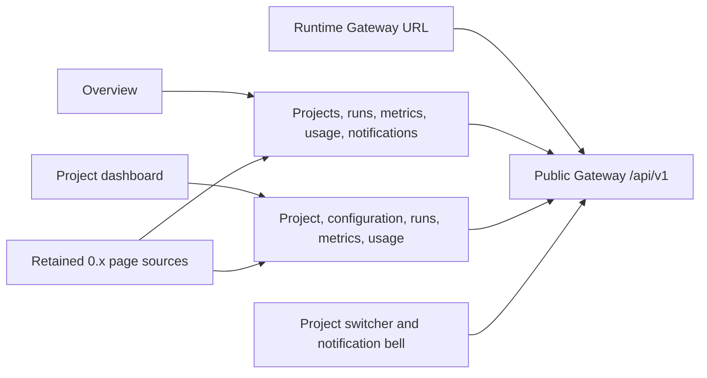

# Web app reference

Use this reference to find the routes, configuration, and source boundaries for
the active v1 Web client. The client is a React and TypeScript single-page
application (SPA) built with Vite. It uses Fluent UI for controls and React Flow
for session topology. A .NET static-file host serves the production build.

For user tasks, see the [experience guide](../experience/README.md). For
development setup and client constraints, see the
[Web client guide](../guide/web-client.md). For deployment-specific settings,
see [Runtime configuration](./runtime-configuration.md).

## Source structure

Paths in this table are relative to `apps/web`.

| Path | Responsibility |
| --- | --- |
| `src/main.tsx` | React mount, Strict Mode, and top-level render error boundary. |
| `src/App.tsx` | Stable entry that exports `src/v1/App.tsx`. |
| `src/v1/App.tsx` | Authentication gates, shell, routes, project/configuration/Knowledge pages, and run tabs. |
| `src/v1/AuthContext.tsx` | In-memory session, exact-run authorization, refresh, and current tenant context. |
| `src/v1/authProtocol.ts` | PKCE, state and callback validation, consent, and Broker token requests. |
| `src/v1/config.ts` | Runtime and build-time configuration. |
| `src/v1/api.ts` | Gateway HTTP client, structured errors, header forwarding, and server-sent events (SSE) parsing. |
| `src/v1/contracts.ts` | Browser DTOs and authority-response validation, including project issue and pull request list pages. The picker UI doesn't use those list pages yet. |
| `src/v1/useRunJournal.ts` | Replay, live reconnect, event deduplication, and scope checks. |
| `src/v1/repoApp.ts` | Direct cookie-authenticated Broker Repo App client and callback messages. |
| `src/v1/CopilotUserConnectionPanel.tsx` | Project Copilot authorization popup and owner status. |
| `src/v1/SkillsMarketplacePanel.tsx` | Suggested marketplaces, marketplace sources, **Add skill**, folder, file, and ZIP upload through the package route, preview, import, inventory with **Remove skill** (revision revoke), and assignment. |
| `src/v1/OperationsPages.tsx` | Flow, Workflows, Workspace, Observability, Diagnostics, Heartbeat, and Cluster pages built from project reads, each with a note for the missing parts. |
| `src/v1/RunOutputCaptures.tsx` | **Produced files** on the run Changes tab: saved file sets and their patches. |
| `src/v1/RemoteMcpOAuthCallbackPage.tsx` | Remote MCP OAuth popup return handling. |
| `src/v1/RemoteMcpConnectionPanel.tsx` | Remote MCP saved connection list, connection status, sign-in, refresh, and disconnect in project settings. |
| `src/v1/RetainedShell.tsx` | 0.x rail, project switcher, breadcrumbs, notification bell, and persona menu filled with Gateway projects and the Broker session. The v1 rail also links to the Chief of Staff section on Overview. |
| `src/v1/OverviewPage.tsx` | Cross-project home: Chief of Staff (Priorities, New chat, and My conversations), operations summary, recent projects, metrics for one selected project, recent runs, and items that need input. |
| `src/v1/SessionsPage.tsx` | Runs across all visible projects, newest first, with **Load more** and **New session**. |
| `src/v1/NewSessionPage.tsx`, `src/v1/pendingRun.ts` | New session: create a run, sign in silently for that run, and start it. The pending run is kept in session storage across the sign-in. |
| `src/v1/StopRunButton.tsx` | **Stop run** with a confirmation dialog and one idempotency key per dialog. |
| `src/v1/ProjectMetricsSections.tsx`, `src/v1/projectMetrics.ts` | Project run metrics and usage over 7, 30, or 90 days. Costs show one subtotal for each price unit and disposition and are never added together. |
| `src/v1/DashboardPage.tsx` | Project dashboard: readiness from configuration, metrics and usage, recent runs, team summary, and quick actions. |
| `src/v1/OrchestrationsPage.tsx` | Project **Active** and **Recent** run lists with a status summary. |
| `src/v1/BoardPage.tsx`, `src/v1/boardData.ts` | Project Board: backlog graph and synced issues in **Backlog**, **Ready**, **Active**, and **Done** columns, task capture, and title and description edits with revision checks. Column moves are disabled because no move operation exists. |
| `src/v1/StartTaskAction.tsx` | Floating **Start task** button and dialog on project pages. It captures a task into the project backlog with the retained `CaptureTaskForm` and opens the Board. Hidden without permission to change the project. |
| `src/v1/RunList.tsx`, `src/v1/runListData.ts` | Shared run list and its data source: the project run list API, with state filters and cursor paging. |
| `src/v1/DecisionView.tsx`, `src/v1/decisionTitles.ts` | Shared decision view that rereads a gate before it approves or rejects. |
| `src/v1/AttentionList.tsx`, `src/v1/runAttention.ts` | Caller notifications across projects, for Overview and the notification bell: pending gates and backlog promotions, each with **Dismiss**. |
| `src/v1/runState.ts` | State words for runs: Needs input, Open, Working, Done, and Unavailable. |
| `src/v1/NewChatComposer.tsx` | Message composer with a stable idempotency key per draft. The run Chat tab uses it. |
| `src/v1/PlatformComponentsTable.tsx` | Table of platform components and their allowed implementations for a run. |
| `src/v1/AgentsView.tsx`, `src/v1/AgentsTeamControls.tsx` | Agents roster, filters, the charter drawer, **Cast team**, **Add member**, pending team proposals, and team export and import. |
| `src/v1/CastTeamPage.tsx`, `src/v1/castingData.ts` | Cast a team from a template or roles, review the proposal, and confirm or reject it. |
| `src/v1/PlatformSettingsPage.tsx` | Read-only status of the 16 platform component areas for tenant and platform administrators. |
| `src/v1/ProjectSettingsSections.tsx`, `src/v1/settingsSections.ts`, `src/v1/projectReadiness.ts` | Project settings rail, General, Access, Repository, Run limits, and Danger zone sections. |
| `src/v1/ProjectMembers.tsx` | Access > Members on the project role-assignment API. Only tenant administrators see add and remove. |
| `src/v1/ConfigurationFields.tsx` | Readable model, reasoning, credential, per-task model, and platform component implementation fields for project configuration. |
| `src/v1/modelCredential.ts` | Save check that requires a new credential after the default model changes. |
| `src/v1/ConfigurationHistory.tsx` | Read-only view of one earlier configuration revision. |
| `host/Program.cs` | Static files, runtime settings, callback headers, SPA fallback, and health routes. |
| `index.html` | Callback query capture and removal before app assets load. |
| `vite.config.ts` | React plugin, build-time runtime-script injection, and dev server on port 5173. |

`src/v1/App.tsx` defines the active route tree. It reuses the 0.x shell, sign-in
card, page sections, gallery tiles, dialogs, and topology nodes through view
components that take data as props. The retained `src/api` client and 0.x page
data hooks are not mounted.

## Routes

| Browser route | Handler |
| --- | --- |
| `/` | Redirect to `/overview`. |
| `/overview` | `OverviewPage`; the **Chief of Staff** rail link opens `/overview#chief-of-staff`. |
| `/projects` | `ProjectsPage`. |
| `/projects/:projectId` | `DashboardPage`. |
| `/projects/:projectId/settings` | `ProjectConfigurationPage`; `section` selects `general`, `access`, `repository`, `models`, `components`, `limits`, `connections`, `history`, `danger`, or `advanced`. Missing or unknown values open `general`. |
| `/projects/:projectId/skills` | `ProjectConfigurationPage` on its Skills section. |
| `/projects/:projectId/team` | `ProjectConfigurationPage` on its Agents section. |
| `/projects/:projectId/orchestrations` | `OrchestrationsPage`. |
| `/projects/:projectId/board` | `BoardPage`. Each navigation reloads the backlog, so backlog promotion links and **Start task** show current tasks. |
| `/projects/:projectId/knowledge`, `/projects/:projectId/memories` | `KnowledgePage`; `runId` and `agentId` query values prefill scope. |
| `/projects/:projectId/team/:agentName/memory` | Redirect to Memories with `agentId` prefilled. |
| `/settings` | Account settings: clear the session and manage the Repo App account. |
| `/sessions` | `SessionsPage`. |
| `/assistant` | `NewSessionPage`; `project` or `projectId` preselects the project. |
| `/platform-settings` | `PlatformSettingsPage`. |
| `/projects/:projectId/team/cast` | `CastTeamPage`. |
| `/projects/:projectId/runs/:runId` | `RunPage`; `view` selects `chat`, `topology`, `approvals`, `activity`, `changes`, `usage`, or `selection` (**Run settings**). Missing or unknown values open `chat`. |
| `/projects/:projectId/orchestrations/:runId` | Redirect to the corresponding run route. |
| `/auth/callback` | Broker callback handling; popup callbacks bypass the main route tree. |
| `/auth/github/copilot-app/callback` | Copilot popup callback, handled before the main route tree. |
| `/settings/source-control` | Repo App callback only when the HTML bootstrap captured `repoApp=connected`. It is not a general settings page. |
| `/auth/remote-mcp/oauth/callback` | Remote MCP OAuth popup callback, handled before the main route tree. |
| `/console` | Redirect to `/assistant`. |
| `/projects/:projectId/sessions` | Redirect to `/sessions`. |
| `/projects/:projectId/flow`, `workflows`, `workspace`, `observability/*`, `diagnostics`, `heartbeat`, and `cluster` | `FlowPage`, `WorkflowsPage`, `WorkspacePage`, `ProjectObservabilityPage`, `DiagnosticsPage`, `HeartbeatPage`, and `ClusterPage` in `OperationsPages.tsx`. |
| `/observability/*` | `UnavailablePage` explains that a summary across projects is not available in this version and links back. |
| Other paths | `UnavailablePage` with **Page not found**. |

The production host serves `index.html` for client routes. Missing `/assets`
files return `404`, not the SPA fallback.

## Configuration

The host can inject public browser settings at runtime; build-time Vite values
provide the fallback. Use the runtime configuration reference for deployment
procedures and setting sources. The table below documents the values the v1
client reads.

`src/v1/config.ts` reads decoded
`window.__AGENTWEAVER_CONFIG_BASE64__` values first, then Vite build-time values.
An empty decoded runtime value is treated as absent. In production, a missing
Gateway URL stops startup with a configuration error instead of sending
requests to localhost. The local development server can use the default below.

| Runtime key | Environment variable | Default or requirement |
| --- | --- | --- |
| `GATEWAY_URL` | `VITE_GATEWAY_URL` | Required in production; `/api/v1` in development. Includes the version prefix. Trailing slashes are removed. |
| `IDENTITY_BROKER_URL` | `VITE_IDENTITY_BROKER_URL` | Required Broker URL. Trailing slashes are removed for request construction. |
| `IDENTITY_BROKER_ISSUER` | `VITE_IDENTITY_BROKER_ISSUER` | Explicit issuer, or the canonical HTTPS Broker URL when valid. |
| `OAUTH_CLIENT_ID` | `VITE_OAUTH_CLIENT_ID` | Required registered OAuth client ID. |
| `OAUTH_REDIRECT_URI` | `VITE_OAUTH_REDIRECT_URI` | Current browser origin plus `/auth/callback`. It must match client registration. |
| `OAUTH_SCOPES` | `VITE_OAUTH_SCOPES` | Required whitespace-separated registered scopes. |

The checked-in runtime snapshot uses the public Broker client
`agentweaver-web` and these scopes:
`openid profile email api.read offline_access projects.admin projects.orchestrator`.
`IdentityBroker__WebOrigin` configures the exact Portal
origin for credentialed OAuth CORS; `Gateway__WebOrigin` is a separate setting.
For project/run-bound requests, Web omits `projects.admin`, which the Broker
does not permit with its run-bound `projects.orchestrator` authority. The
`/auth/callback` redirect is registered on the Identity Broker client. The
upstream Entra application remains the Broker's server-side provider and keeps
its `/signin-oidc` callback; the Web callback is not added to that Entra
application. See the [Identity Broker scope reference](../guide/identity-scopes.md)
for the permission descriptions shown during consent.

The static host serves public settings at `GET /env-config.js` with
`Cache-Control: no-store`. It base64-encodes values as data, not executable text.
`HEAD` returns headers only; other methods return `405`. The build injects this
script before the application bundle. The host's empty Gateway setting becomes
`/api/v1`.

Do not use the 0.x `API_URL`, `VITE_API_URL`, or `VITE_API_KEY` settings for this
client. The retained 0.x client also reads the v1 Gateway base in production;
it does not mount the 0.x Overview or Dashboard pages. Its old localhost
default applies only to local development. Do not put secrets in public settings.

## API client

`AgentweaverGatewayClient` uses the configured versioned base URL for product
requests. Connection lifecycle calls use the Gateway origin/root and their
explicit nonversioned paths.

Requests use a bearer token, `Accept: application/json`, and `cache: no-store`.
JSON writes add `Content-Type: application/json`. Ambient cookies are omitted
unless the connection protocol explicitly needs them. `GatewayError` preserves
HTTP status, problem JSON, and a structured code.

Tenant context comes from `GET /api/v1/authorization/context`. The client sends
`X-Agentweaver-Tenant` only on supported routes. The live journal stream omits
the selector even when replay uses it. The selector does not grant access.
Owners recheck current authority.

Knowledge writes send `Idempotency-Key`. Other operations use the
owner contract's body key where defined. Path segments are encoded separately.

The run page polls owner snapshots and replays the committed journal before
following SSE. `mergeOrderedEvents` deduplicates by `eventId` and orders by
`position`, then event ID. A cleanly closed stream reconnects with backoff and
no error; `useRunJournal` reports an error only after three transient failures
in a row. See [events](./events.md).

## Authentication flow

1. `AuthContext` creates state and a PKCE verifier for the requested binding.
2. The browser opens `/connect/authorize` at the Broker.
3. The Broker authenticates the user and checks current authority.
4. The browser submits explicit consent when requested.
5. A validated callback supplies the code for `/connect/token`.
6. Tokens stay in memory; the PKCE transaction alone survives a redirect in
   session storage.
7. API calls use a matching session. A recoverable `401` triggers one refresh
   attempt.
8. `AuthContext` keeps one session per binding. `ensureSession(binding)`
   activates a held session or requests a run-bound token with `prompt=none`.
   It returns `false` when the Broker needs user input, and the run page then
   shows **Sign in for this project and run**. Leaving the run page calls
   `ensureSession(null)` to switch back to the project session.

Callback handlers check the expected origin, popup, state, and transaction
binding. The HTML bootstrap removes callback query values before assets load.
The explicit Broker and Copilot callback host routes add `no-store` and
`Referrer-Policy: no-referrer`. The host also adds `nosniff` and frame denial.
Ingress logging needs its own callback-query redaction.

Repo App requests use the Broker's local cookie and antiforgery flow directly.
Their repository DTOs include numeric installation and repository metadata.
Copilot calls use the Gateway connection BFF and its exact link cookie.
Project settings > Connections starts Remote MCP sign-in for a configured
connection, then shows its status, refresh, and disconnect controls.

## Host health

| Route | Meaning |
| --- | --- |
| `GET /health/live` | Static host process responds. |
| `GET /health/ready` | Built `wwwroot/index.html` exists; otherwise `503`. |

Host readiness does not check Broker login, Gateway access, or run execution.

## Related source

- [Browser source](https://github.com/sabbour/agentweaver/tree/v1/apps/web/src/v1)
- [Static host](https://github.com/sabbour/agentweaver/blob/v1/apps/web/host/Program.cs)
- [HTTP API](./api.md)
- [Gateway guide](../guide/gateway.md)
