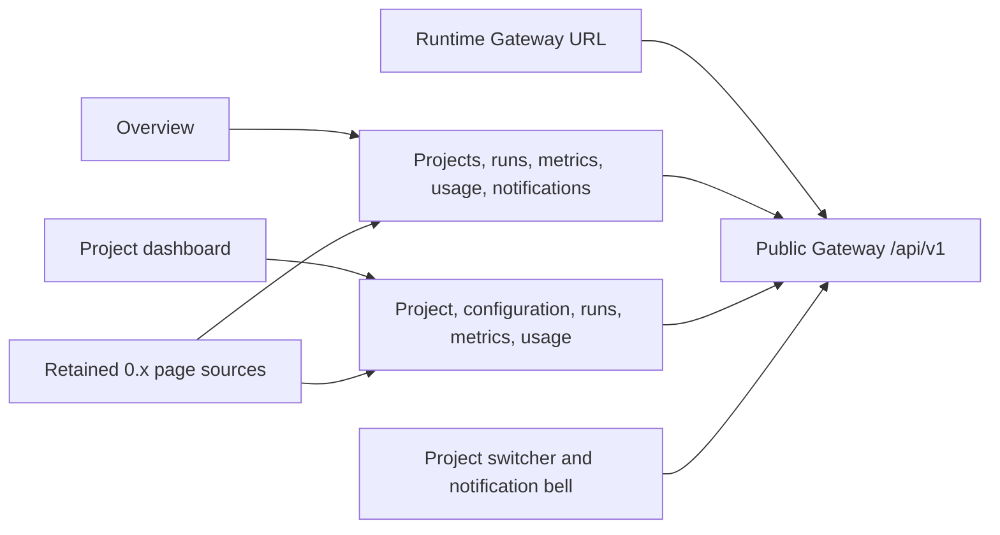

# Web client reference

Use this reference to look up the routes, configuration, and source boundaries
of the checked-in Web client. It describes source behavior; it does not prove
that a Web deployment is available. The client is a React and TypeScript single-page
application (SPA) built with Vite. It uses Fluent UI for controls and React Flow
for session topology. A .NET static-file host serves the production build.

For user tasks, see the [experience guide](../experience/README.md). For
development setup and client constraints, see the
[Web client guide](../guide/web-client.md). For deployment-specific settings,
see [Runtime configuration](./runtime-configuration.md).

## Source structure

Paths in this table are relative to `apps/web`.

| Path | Responsibility |
| --- | --- |
| `src/main.tsx` | React mount, Strict Mode, and top-level render error boundary. |
| `src/App.tsx` | Stable entry that exports `src/v1/App.tsx`. |
| `src/v1/App.tsx` | Authentication gates, shell, routes, project/configuration/Knowledge pages, Platform Policies, and run tabs. |
| `src/v1/AuthContext.tsx` | In-memory sessions, exact project and run authorization, isolated unbound Policy access, refresh, and current tenant context. |
| `src/v1/authProtocol.ts` | PKCE, state and callback validation, consent, project/run selectors, and Broker scope selection. |
| `src/v1/config.ts` | Runtime and build-time configuration. |
| `src/v1/api.ts` | Gateway HTTP client, structured errors, project BYOK Draft operations, explicit-tenant Platform Policy reads with response bounds, header forwarding, and server-sent events (SSE) parsing. |
| `src/v1/contracts.ts` | Browser DTOs and authority-response validation, including project BYOK Draft contracts and the project issue and pull request list pages used by the Priority picker. |
| `src/v1/platformPolicyContracts.ts` | Bounds and validates Policy history, revision metadata, UTF-8 manifest bytes, source files, validation requests, canonical hashes, and local draft comparisons. |
| `src/v1/PlatformPoliciesController.tsx`, `src/v1/PlatformPoliciesPage.tsx` | Shared authorization and request fences for the gated navigation and `/policies` route; read-only Platform history, exact-revision draft comparison, and local Project validation. |
| `src/v1/useRunJournal.ts` | Replay, live reconnect, event deduplication, and scope checks. |
| `src/v1/repoApp.ts` | Direct cookie-authenticated Broker Repo App client, callback messages, and the actionable setup message for `github_repo_app_not_configured`. |
| `src/v1/CopilotUserConnectionPanel.tsx` | Project Copilot authorization popup and owner status. |
| `src/v1/ProjectModelProviderDrafts.tsx` | Project Settings > Connections read-only **Available platform providers** list, project provider Draft list, detail with host-request status and **Refresh status**, and metadata editor. |
| `src/v1/SkillsMarketplacePanel.tsx` | Suggested marketplaces, marketplace sources, **Add skill**, folder, file, and ZIP upload through the package route, preview, import, inventory with **Remove skill** (revision revoke), and assignment. |
| `src/v1/OperationsPages.tsx` | Flow, Workflows, Workspace, Observability, Diagnostics, Heartbeat, and Cluster pages built from project reads, each with a note for the missing parts. |
| `src/v1/RunOutputCaptures.tsx` | **Produced files** on the run Changes tab: saved file sets and their patches. |
| `src/v1/RemoteMcpOAuthCallbackPage.tsx` | Remote MCP OAuth popup return handling. |
| `src/v1/RemoteMcpConnectionPanel.tsx` | Remote MCP saved connection list, connection status, sign-in, refresh, and disconnect in project settings. |
| `src/v1/RetainedShell.tsx` | 0.x rail, project switcher, breadcrumbs, notification bell, and persona menu filled with Gateway projects and the Broker session. The rail links to the Chief of Staff section on Overview and shows Platform Policies after an authorized history read. The shell also provides **Start task** for the most recently updated active project when the user can change it. |
| `src/v1/OverviewPage.tsx` | Cross-project home: operations summary, recent projects, metrics for one selected project, recent runs, and items that need input, followed by Chief of Staff (Priorities, New chat, and My conversations). |
| `src/v1/SessionsPage.tsx` | Runs across all visible projects, newest first, with **Load more** and **New session**. |
| `src/v1/NewSessionPage.tsx`, `src/v1/pendingRun.ts` | New session: create a run, sign in silently for that run, and start it. The pending run is kept in session storage across the sign-in. |
| `src/v1/StopRunButton.tsx` | **Stop run** with a confirmation dialog and one idempotency key per dialog. |
| `src/v1/ProjectMetricsSections.tsx`, `src/v1/projectMetrics.ts` | Project run metrics and usage over 7, 30, or 90 days. Costs show one subtotal for each price unit and disposition and are never added together. |
| `src/v1/DashboardPage.tsx` | Project dashboard: readiness from configuration, metrics and usage, recent runs, team summary, and quick actions. |
| `src/v1/OrchestrationsPage.tsx` | Project **Active** and **Recent** run lists with a status summary. |
| `src/v1/BoardPage.tsx`, `src/v1/boardData.ts` | Project Board: run metrics, **Open runs**, **Human review**, **Problems**, and **Run history** lists above the backlog graph and synced issues in **Backlog**, **Ready**, **Active**, and **Done** columns. Includes task capture, revision-checked edits, refresh of backlog, metrics, and run lists, and preview plus explicit promotion of a confirmed work plan. Automatic pickup settings and file decomposition remain unavailable. Column moves are disabled because no move operation exists. |
| `src/v1/StartTaskAction.tsx` | **Start task** button and dialog on project pages and Overview. It captures a task into the project backlog with the retained `CaptureTaskForm` and opens the Board. On Overview, it uses the most recently updated active project. Hidden without permission to change the project. |
| `src/v1/RunList.tsx`, `src/v1/runListData.ts` | Shared run list and its data source: the project run list API, with state filters and cursor paging. |
| `src/v1/DecisionView.tsx`, `src/v1/decisionTitles.ts` | Shared decision view that rereads a gate before it approves or rejects. |
| `src/v1/AttentionList.tsx`, `src/v1/runAttention.ts` | Caller notifications across projects, for Overview and the notification bell: pending gates and backlog promotions, each with **Dismiss**. |
| `src/v1/runState.ts` | State words for runs: Needs input, Open, Working, Done, and Unavailable. |
| `src/v1/App.tsx` (`ProjectRunHistoryPage`) | Project-authorized Session tree, Activity, and stored Egress history for one run, using the shared tabs and panel layout. |
| `src/v1/RunEgressPanel.tsx` | Exact project-session authorization, confirmed-tenant request fencing, server-ordered egress paging, retries, and access-loss clearing. |
| `src/v1/PlatformProviderHostRequests.tsx` | Read-only platform-wide provider host requests. Uses an unbound platform session and confirmed tenant for access, not to filter rows. |
| `src/v1/NewChatComposer.tsx` | Message composer with a stable idempotency key per draft. The run Chat tab uses it. |
| `src/v1/PlatformComponentsTable.tsx` | Table of platform components and their allowed implementations for a run. |
| `src/v1/AgentsView.tsx`, `src/v1/AgentsTeamControls.tsx` | Agents roster, filters, the charter drawer, **Cast team**, **Add member**, pending team proposals, explicit repository sync preview and commit, and digest-checked AgentSuite export and import. |
| `src/v1/CastTeamPage.tsx`, `src/v1/castingData.ts` | Formulate roles from a project goal, analyze read-only repository signals, or start from a template. Choose a server-supported universe, review and edit the pending proposal, then confirm or reject it. |
| `src/v1/PlatformSettingsPage.tsx` | Read-only status of the 16 platform component areas for tenant and platform administrators. |
| `src/v1/ProjectSettingsSections.tsx`, `src/v1/settingsSections.ts`, `src/v1/projectReadiness.ts` | Project settings rail, General, Access, Repository, Run limits, and Danger zone sections. |
| `src/v1/ProjectMembers.tsx` | Access > Members on the project role-assignment API. Only tenant administrators see add and remove. |
| `src/v1/ConfigurationFields.tsx` | Readable model, reasoning, credential, per-task model, and platform component implementation fields for project configuration. |
| `src/v1/modelCredential.ts` | Save check that requires a new credential after the default model changes. |
| `src/v1/ConfigurationHistory.tsx` | Read-only view of one earlier configuration revision. |
| `host/Program.cs` | Static files, runtime settings, callback headers, SPA fallback, and health routes. |
| `index.html` | Callback query capture and removal before app assets load. |
| `vite.config.ts` | React plugin, build-time runtime-script injection, and dev server on port 5173. |

`src/v1/App.tsx` defines the active route tree. It reuses the 0.x shell, sign-in
card, page sections, gallery tiles, dialogs, and topology nodes through view
components that take data as props. The retained `src/api` client and 0.x page
data hooks are not mounted.

## Routes

| Browser route | Handler |
| --- | --- |
| `/` | Redirect to `/overview`. |
| `/overview` | `OverviewPage`; the **Chief of Staff** rail link opens `/overview#chief-of-staff`. Operations summary, projects, metrics, recent runs, and items needing input come before Chief of Staff. The shell can start a task for the most recently updated active project. |
| `/projects` | `ProjectsPage`. |
| `/projects/:projectId` | `DashboardPage`. |
| `/projects/:projectId/settings` | `ProjectConfigurationPage`; `section` selects `general`, `access`, `repository`, `models`, `components`, `limits`, `connections`, `history`, `danger`, or `advanced`. Missing or unknown values open `general`. |
| `/projects/:projectId/skills` | `ProjectConfigurationPage` on its Skills section. |
| `/projects/:projectId/team` | `ProjectConfigurationPage` on its Agents section. |
| `/projects/:projectId/orchestrations` | `OrchestrationsPage`. |
| `/projects/:projectId/board` | `BoardPage`. Each navigation reloads the backlog, run metrics, and run lists, so **Refresh** updates the full Board view. |
| `/projects/:projectId/knowledge`, `/projects/:projectId/memories` | `KnowledgePage`; project-wide discovery globally pages records across accessible provider resources. Each project run links to its Session tree and Activity journal; `runId` and `agentId` query values prefill scoped record management. |
| `/projects/:projectId/team/:agentName/memory` | Redirect to Memories with `agentId` prefilled. |
| `/settings` | Account settings: clear the session and manage the Repo App account. |
| `/sessions` | `SessionsPage`. |
| `/assistant` | `NewSessionPage`; `project` or `projectId` preselects the project. |
| `/platform-settings` | `PlatformSettingsPage`; includes the platform-wide host request list for platform administrators. |
| `/policies` | `PlatformPoliciesPage`; Platform mode reads saved history and compares an in-memory draft with the exact viewed revision, while Project mode validates an in-memory local artifact for one authorized Project. |
| `/projects/:projectId/team/cast` | `CastTeamPage`. |
| `/projects/:projectId/runs/:runId/history` | Project-authorized Session tree, Activity, or Egress history for the selected run. `view` selects `sessions`, `activity`, or `egress`. Egress uses an exact project credential and a confirmed tenant while Session tree and Activity keep their unbound credential. |
| `/projects/:projectId/runs/:runId` | `RunPage`; `view` selects `chat`, `topology`, `approvals`, `activity`, `changes`, `usage`, or `selection` (**Run settings**). Missing or unknown values open `chat`. |
| `/projects/:projectId/orchestrations/:runId` | Redirect to the corresponding run route. |
| `/auth/callback` | Broker callback handling; popup callbacks bypass the main route tree. |
| `/auth/github/copilot-app/callback` | Copilot popup callback, handled before the main route tree. |
| `/settings/source-control` | Repo App callback only when the HTML bootstrap captured `repoApp=connected`. It is not a general settings page. |
| `/auth/remote-mcp/oauth/callback` | Remote MCP OAuth popup callback, handled before the main route tree. |
| `/console` | Redirect to `/assistant`. |
| `/projects/:projectId/sessions` | Redirect to `/sessions`. |
| `/projects/:projectId/flow`, `workflows`, `workspace`, `observability/*`, `diagnostics`, `heartbeat`, and `cluster` | `FlowPage`, `WorkflowsPage`, `WorkspacePage`, `ProjectObservabilityPage`, `DiagnosticsPage`, `HeartbeatPage`, and `ClusterPage` in `OperationsPages.tsx`. |
| `/observability/*` | `UnavailablePage` explains that a summary across projects is not available in this version and links back. |
| Other paths | `UnavailablePage` with **Page not found**. |

## Cast a team

The Cast a team page offers **Formulate**, **Template**, and **Analyze**.
Formulate uses a project goal and optional preferred roles. Analyze uses
repository signals and does not accept manual role preferences. Both AI modes
run through the accepted project run and create a pending proposal; they do
not change the live team. Choose a team size and, when a team already exists,
choose **Augment** or **Recast**.

The page lists universe names from the Projects & Config owner. Choose a name
or keep **Random (any universe)**. The page sends the choice with the proposal
at the displayed configuration revision. Projects & Config stores the choice
in the pending draft; it becomes project configuration only after
confirmation. During review, use **Re-role** to change one member's catalog
role and optional display title, or remove a proposed member. The title
remains separate from the role ID and is saved only in the proposal until
confirmation.

The production host serves `index.html` for client routes. Missing `/assets`
files return `404`, not the SPA fallback.

## Configuration

The host can inject public browser settings at runtime; build-time Vite values
provide the fallback. Use the runtime configuration reference for deployment
procedures and setting sources. The table below documents the values the
client reads.

`src/v1/config.ts` reads decoded
`window.__AGENTWEAVER_CONFIG_BASE64__` values first, then Vite build-time values.
An empty decoded runtime value is treated as absent. In production, a missing
Gateway URL stops startup with a configuration error instead of sending
requests to localhost. The local development server can use the default below.

| Runtime key | Environment variable | Default or requirement |
| --- | --- | --- |
| `GATEWAY_URL` | `VITE_GATEWAY_URL` | Required in production; `/api/v1` in development. Includes the version prefix. Trailing slashes are removed. |
| `IDENTITY_BROKER_URL` | `VITE_IDENTITY_BROKER_URL` | Required Broker URL. Trailing slashes are removed for request construction. |
| `IDENTITY_BROKER_ISSUER` | `VITE_IDENTITY_BROKER_ISSUER` | Explicit issuer, or the canonical HTTPS Broker URL when valid. |
| `OAUTH_CLIENT_ID` | `VITE_OAUTH_CLIENT_ID` | Required registered OAuth client ID. |
| `OAUTH_REDIRECT_URI` | `VITE_OAUTH_REDIRECT_URI` | Current browser origin plus `/auth/callback`. It must match client registration. |
| `OAUTH_SCOPES` | `VITE_OAUTH_SCOPES` | Required whitespace-separated registered scopes. |

The checked-in runtime snapshot uses the public Broker client
`agentweaver-web` and these scopes:
`openid profile email api.read offline_access projects.admin projects.orchestrator`.
`IdentityBroker__WebOrigin` configures the exact Portal
origin for credentialed OAuth CORS; `Gateway__WebOrigin` is a separate setting.
For run-bound requests, Web omits `projects.admin`, which the Broker does not
permit with `projects.orchestrator`. For project-only BYOK Draft requests, Web
keeps `projects.admin`, omits `projects.orchestrator`, and sends the exact
`project_id` without `run_id`. The
`/auth/callback` redirect is registered on the Identity Broker client. The
upstream Entra application remains the Broker's server-side provider and keeps
its `/signin-oidc` callback; the Web callback is not added to that Entra
application. See the [Identity Broker scope reference](../guide/identity-scopes.md)
for the permission descriptions shown during consent.

The static host serves public settings at `GET /env-config.js` with
`Cache-Control: no-store`. It base64-encodes values as data, not executable text.
`HEAD` returns headers only; other methods return `405`. The build injects this
script before the application bundle. The host's empty Gateway setting becomes
`/api/v1`.

Do not use the 0.x `API_URL`, `VITE_API_URL`, or `VITE_API_KEY` settings for this
client. The retained 0.x client also reads the v1 Gateway base in production;
it does not mount the 0.x Overview or Dashboard pages. Its old localhost
default applies only to local development. Do not put secrets in public settings.

## API client

`AgentweaverGatewayClient` uses the configured versioned base URL for product
requests. Connection lifecycle calls use the Gateway origin/root and their
explicit nonversioned paths.

Requests use a bearer token, `Accept: application/json`, and `cache: no-store`.
JSON writes add `Content-Type: application/json`. Ambient cookies are omitted
unless the connection protocol explicitly needs them. `GatewayError` preserves
HTTP status, problem JSON, and a structured code.

Tenant context comes from `GET /api/v1/authorization/context`. The client sends
`X-Agentweaver-Tenant` only on supported routes. The live journal stream omits
the selector even when replay uses it. The selector does not grant access.
Owners recheck current authority.

Knowledge writes send `Idempotency-Key`. Other operations use the
owner contract's body key where defined. Path segments are encoded separately.
Project-wide search uses `searchProjectKnowledge` with an unbound token; the
owner checks current project authority and existing provider bindings. Scoped
record changes continue to use the selected run and agent.

The run page polls owner snapshots and replays the committed journal before
following SSE. `mergeOrderedEvents` deduplicates by `eventId` and orders by
`position`, then event ID. A cleanly closed stream reconnects with backoff and
no error; `useRunJournal` reports an error only after three transient failures
in a row. See [events](./events.md).

## Authentication flow

1. `AuthContext` creates state and a PKCE verifier for the requested binding.
2. The browser opens `/connect/authorize` at the Broker.
3. The Broker authenticates the user and checks current authority.
4. The browser submits explicit consent when requested.
5. A validated callback supplies the code for `/connect/token`.
6. Tokens stay in memory; the PKCE transaction alone survives a redirect in
   session storage.
7. API calls use a matching session. A recoverable `401` triggers one refresh
   attempt.
8. `AuthContext` keeps one session per binding. `ensureSession(binding)`
   activates a held session or requests a token for that exact binding with
   `prompt=none`. It returns `false` when the Broker needs user input, and the
   caller shows the matching sign-in action. Leaving the run page calls
   `ensureSession(null)` to switch back to the unbound session.

### Project BYOK Drafts

Project Settings > Connections renders **Available platform providers** above
**BYOK provider drafts**. The platform list reads `availablePlatformProviders`
from `GET /api/v1/projects/{projectId}/configuration/choices` through the
existing project-read session, so any project reader sees `Available` platform
providers (without endpoints, credentials, or actor identities) even when
project draft management requires sign-in or returns `403`.

**BYOK provider drafts** lists project provider Drafts and lets you read,
create, and update their metadata. The page asks for a session bound to the
exact project. The Broker request includes `project_id` and `projects.admin`
without `run_id`; a run-bound or unbound session is not used for these calls.
Projects checks current membership and the Owner or PlatformAdmin role for
every Draft request. The binding selects a project and does not grant a role.

The editor uses the returned provider `id` for later reads and updates. You can
change the provider `name`. Create and update requests send provider metadata,
not API keys or credential versions.

On the provider detail view, when `hasCredential` is false and no unresolved
credential operation is active, you can submit the first API key through
`PUT /api/v1/projects/{projectId}/byok-providers/{providerId}/credential`. The
browser clears the input synchronously before dispatch, sends the request once
through `apiCallOnce` with no `401` retry, and tracks unresolved operation IDs
in memory by confirmed `(issuer, actorId, tenantId, projectId, providerId)` for
status checks (`GET .../credential/operations/{operationId}`) and publication
rechecks (`recheckExistingVersion: true`). A full browser reload or tab close
clears in-memory operation state. Key rotation, key removal, and provider
activation remain unavailable in this view.

### Platform BYOK key recovery

On `/platform-settings`, `PlatformModelProviders` sends initial key uploads,
existing-key rechecks, and keyless publication retries once through
`apiCallOnce` with an unbound session (`binding: null`), `credentials: 'omit'`,
`cache: 'no-store'`, and no automatic `401` retry. Unresolved operations are
stored in memory by confirmed `(issuer, actorId, tenantId, 'platform', null, providerId)`
with their original `expectedProviderRevision` and `expectedCredentialRevision`
(`0` for first-key uploads, `>= 1` for rechecks) for status checks
(`GET /api/v1/platform/byok-providers/{providerId}/credential/operations/{operationId}`)
and keyless publication retries (`recheckExistingVersion: true`). While an
operation is unresolved, the Edit form blocks new key entry while keeping
metadata-only edits available. A full browser reload or tab close clears
in-memory operation state.

### Policy validation

Platform Policy reads use a separate unbound session. When the browser has no
unbound session, `AuthContext` starts a hidden PKCE request with `prompt=none`.
This request keeps the active run session and interactive consent flow intact.

The browser compares the active and unbound authorization contexts for the
same issuer, actor, and explicit tenant. It sends the unbound token and
`X-Agentweaver-Tenant` on Policy routes. The Platform history read is the
Platform access check. Project mode lists visible Projects, then requires
Project Owner or TenantAdmin plus `writeProjects` on the exact selected Project.
PlatformAdmin alone does not pass this check.

Project mode imports one local `{artifact}` validation request. The codec
checks the 5 MiB request limit, 1 MiB artifact limit, exact byte arrays, UTF-8,
and SHA-256 hash. The draft stays in browser memory. Project mode does not
request a Policy head, revision, preview, save, or apply route.

Platform mode compares the serialized draft text with an already authorized
revision read. It sends no request and computes no Policy hash. Exact paths
identify changed files; the manifest appears first. Text is rendered as React
text, and the invisible-character view exposes spaces, tabs, line endings,
the byte-order mark, and other non-ASCII characters.

The shared controller keeps scope activation separate from the draft version.
Editing clears stale diagnostics and stops their attempt. A response from an
earlier scope or Project cannot change the current scope. A denial or missing
Project clears the current Project draft.

A `401` triggers one unbound-session refresh and same-scope access check before
one retry of an unchanged draft. An aborted attempt rechecks access without
resending. The controller checks access on route entry, when the tab becomes
visible, and every 60 seconds while the tab stays visible.
During a Platform check, the controller hides saved source and comparison.
For a selected revision, it reopens that exact revision after a successful
same-identity and same-tenant check, even when the snapshot head advances.
The comparison stays closed until the user selects **Compare draft** again.

Callback handlers check the expected origin, popup, state, and transaction
binding. The HTML bootstrap removes callback query values before assets load.
The explicit Broker and Copilot callback host routes add `no-store` and
`Referrer-Policy: no-referrer`. The host also adds `nosniff` and frame denial.
Ingress logging needs its own callback-query redaction.

Repo App requests use the Broker's local cookie and antiforgery flow directly.
Their repository DTOs include numeric installation and repository metadata.
Copilot calls use the Gateway connection BFF and its exact link cookie.
Project settings > Connections starts Remote MCP sign-in for a configured
connection, then shows its status, refresh, and disconnect controls.

## Host health

| Route | Meaning |
| --- | --- |
| `GET /health/live` | Static host process responds. |
| `GET /health/ready` | Built `wwwroot/index.html` exists; otherwise `503`. |

Host readiness does not check Broker login, Gateway access, or run execution.

## Related source

- [Browser source](https://github.com/sabbour/agentweaver/tree/v1/apps/web/src/v1)
- [Static host](https://github.com/sabbour/agentweaver/blob/v1/apps/web/host/Program.cs)
- [HTTP API](./api.md)
- [Gateway guide](../guide/gateway.md)
