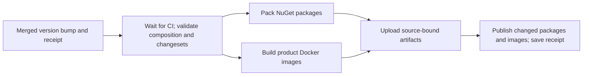
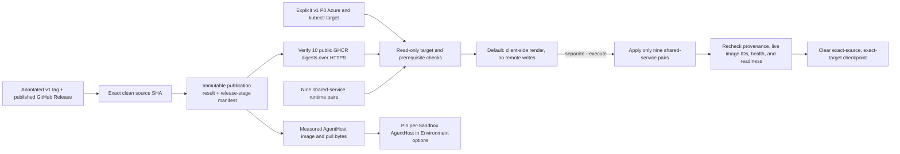

# Foundation release composition (schema version 1)

`foundation.json` is a **draft**, not a release or proof of a deployed service.
It records prepared `1.0.0` source versions for 23 product components:
13 packages and 10 service images. None was built or published by version application.
The eight original .NET foundation NuGet packages were:
`Agentweaver.Abstractions`, `Agentweaver.Providers`,
`Agentweaver.Persistence.Postgres`, `Agentweaver.Secrets.AzureKeyVault`,
`Agentweaver.Identity`, `Agentweaver.Telemetry`,
`Agentweaver.Telemetry.AzureMonitor`, and `Agentweaver.ObjectStore.AzureBlob`.
Their historical P0 package baseline was `0.0.0`; its records remain unchanged.
`Agentweaver.Identity.Broker` now has source version `1.0.0`; it is not one
of the NuGet packages.
`Agentweaver.Orchestrator` is also an unpublished service at source version `1.0.0`;
its `Agentweaver.Orchestrator.Core` dependency remains a separately versioned library.
`Agentweaver.FoundationProbe` has a separate prepared source version at `0.0.1`.
The manifest uses the `service` artifact kind for its executable container.
The Probe remains acceptance-only, not a product service.
Its exact `tools/Agentweaver.FoundationProbe` project path is the sole tools
exception. Other tools paths remain invalid.
This patch separates image provenance from native infrastructure deployment
provenance. The new target and receipt require explicit deployment bindings.
SDK container preparation derives the Probe image SHA, Git tree, and
infrastructure-input hash from the same clean tracked source as its Docker build.
Both build paths embed those values; an `unbound` image cannot satisfy acceptance.
The image repository remains `agentweaver-foundation-probe`, not the component
ID's dotted lowercase form.
`--foundation-probe-only` remains a local selector for historical Probe
maintenance. It is not part of automated product publication.

Use `--platform-only` with both preparation and publication to exclude the
acceptance-only Probe while retaining every product package and service image.
This option cannot combine with `--packages-only` or `--foundation-probe-only`.
Publication requires the same selection as the preparation receipt.
The automated release workflow always uses this product selection.
`Agentweaver.Environment` is an executable service, not a library package.
Preparation uses its existing SDK container configuration.

The automated publisher uses `GITHUB_TOKEN` for the fixed NuGet feed
`https://nuget.pkg.github.com/sabbour/index.json` and GHCR. Only its job has
package-write and contents-write permissions. There is no approval environment,
stored NuGet secret, or credential fallback for another feed. The token must
already have access to the existing packages; this workflow does not change
repository or package permissions.

The user-confirmed initial Probe replacement is one exception to immutable tags.
Only `ghcr.io/sabbour/agentweaver-foundation-probe:0.0.0` can replace its exact
approved old index once. The expected old digest is
`sha256:452be7e284ee6c33814fcedcf1d7c98f98384d09ea7239ad851f9cb316727c9a`.
Publication requires `--foundation-probe-only`, normal publication confirmation,
and `--confirm-foundation-probe-initial-replacement <admitted-source-sha>`.
The clean source must match `origin/v1`. The new image must match its source,
baseline version, numeric user, and execution command.
A separate permanent single-use claim prevents cooperating concurrent writers.
The publisher checks the native old index again immediately before push.
Registry tag updates are not conditional transactions; an unobserved external
write between that check and push cannot be excluded by Docker.
Any observed drift blocks publication. The additive replacement receipt records
the old index, actual new digest, source, and user-confirmed baseline exception.
The original index and platform manifests must remain readable by digest.
Historical claims and receipts are never changed or removed.
Native single-image descriptors can omit `schemaVersion`.
In that case, the publisher reads the exact raw manifest bytes.
Its SHA-256 digest, byte size, media type, and schema must match the descriptor.
The receipt records the actual pushed digest before later verification steps.
A later verification error retains that digest in a partial receipt.
The permanent claim continues to block a second push.
The earlier patch recorded ordinary release intent. The initial replacement
did not apply a release plan or change the Broker and eight NuGet baselines.

The sampler-fixed Probe has a separate, default-off legacy replacement path.
It permits only the current `0.0.0` manifest
`sha256:835d5b8899f2a8956faf24d46a934ec745d91ff83363d77f22f2859c2f743969`.
Use `--foundation-probe-only`, `--confirm-publication`,
`--confirm-foundation-probe-sampler-replacement <admitted-source-sha>`, and
`--expected-foundation-probe-sampler-digest <exact-current-digest>`.
The initial and sampler replacement options cannot combine.
The permanent claim is
`agentweaver-publication/foundation-probe-0.0.0-sampler-replacement/claim`.
It blocks further attempts across source commits, including after partial publication.
The publisher preserves the previous manifest by digest and all historical receipts.
It records the pushed digest before later verification can fail.
This legacy attempt is consumed. The recovery route does not reuse its claims or receipts.

The former release workflow also carried one-off Probe-sampler and
AgentHost-archive diagnostic and recovery jobs pinned to incident artifacts.
Those jobs are retired and are not part of automated product publication.
The helper scripts and permanent claims remain as historical records; they do
not run from the new release pipeline.

The fixed recovery claim namespace is
`agentweaver-publication/foundation-probe-0.0.0-sampler-recovery-attempt-2`.
Attempt one and its helper claims remain consumed after the denied push in run `37415776940`.
Attempt two requires separate fresh user approval. It does not reuse or remove attempt one's claims or partial receipts.
The separate helper claim namespace is
`agentweaver-publication/foundation-probe-0.0.0-sampler-recovery-helper/<admitted-helper-sha>`.
Both namespaces retain their claim and result records permanently.
The fixed namespace blocks another helper after a consumed attempt.
No input can select another recovery namespace.
The workflow and publisher also reject Actions reruns.

Recovery requires fresh user approval for one attempt against the exact current `835d...` digest.
The publisher verifies that digest before claims and immediately before its sole push.
It verifies the loaded image's complete config digest, source labels, numeric user, and execution command.
Successful publication requires the new tag digest and continued access to the previous manifest, initial index, and platform manifests.
The registry update is not a conditional transaction. An unobserved external write between the final check and push remains possible.

The recovery publisher covers claim creation, native operations, and result persistence with its partial-receipt boundary.
An ambiguous claim response stops before push and records attempted versus acknowledged claims.
Each acknowledged claim receives an independent permanent result attempt.
The local receipt uses create-only file creation. It cannot overwrite a prior receipt.
The publisher records the actual new digest before later verification.
It records only operation names, exit values, and error codes on the allow list.
The publisher removes only its newly created temporary Docker credential directory.
Failure consumes acknowledged claims and stops without automatic retry, claim reuse, or claim deletion.
The operator then reads the tag independently and preserves the original and new receipts.

The historical sampler recovery used the ephemeral Actions token for this
fixed route and did not grant persistent package access. The current
go-forward release workflow has no approval environment; the one-use v1.0.0
partial-publication continuation remains documented separately below.

This draft contains applied source versions, not published artifacts or deployed
persona evidence. It cannot be published as an accepted platform release.

The initial package notes are the archived P0 changesets referenced by the
earlier release receipt. The baseline changeset does not create another version
bump. Later published package changes use patch, minor, or major intent based
on public API impact.

### Unreleased v1.0.0 impact

The Abstractions foundation now exposes a provider-neutral, versioned Secrets
reference and purpose/run-bound trusted redemption contract. Credential results
have explicit expiry and invalidation and avoid default diagnostic/JSON value
disclosure. The independent Azure Key Vault adapter uses validated vault
configuration and an injected Azure SDK client or `TokenCredential`, fetches exact
versions, and limits returned credentials to five minutes or the vault expiry.
Account-free SDK transport tests cover failures, cancellation and redaction.
This adds no authorization gate or deployable service; the draft composition's
initial package baseline is `0.0.0`.

#1766 adds explicit AKS workload-identity composition in the existing Key Vault
adapter: trusted hosts provide tenant ID, client ID, and projected token-file path
to Azure Identity, with no developer-identity fallback. Fake-transport tests cover
OAuth exchange and exact-version vault requests. Authentication, authorization and
rotation in a deployed AKS service remain unverified; no new component or version
is added to the draft manifest.
The earlier component changeset recorded minor intent. Its record is now archived
in source preparation, not a published platform release.

Each product change requires a record under `.changeset/` with its component ID
and semver intent. Version application moves consumed records to `.changeset/archive/`.
Tooling-only records use empty frontmatter.
Neither a record nor its archive proves publication or deployed behavior.

`manifest.schema.json` describes the strict wire shape. The dependency-free
validator additionally checks unique component IDs and projects, safe project
paths, each component's explicit `<Version>` in its checked-in `.csproj`, actual
`ProjectReference` edges, and the `compatibility` entries for those edges.
Each compatibility entry names an in-manifest consumer and dependency and lists
the *exact* dependency versions accepted by that consumer. The pinned version
must occur in the list; do not infer compatibility from semver proximity.
Semantic versions have `major.minor.patch` and optional prerelease/build
suffixes; a prerelease numeric identifier cannot have a leading zero.

The user-selected P1 plan has applied `1.0.0` source versions for all 23 product components:
13 packages and 10 service images.
The canonical application archived `p1-product-1-0-0-preparation` and all consumed earlier records.
The acceptance-only Probe has its separate prepared `0.0.1` source version.
Use `--platform-only` for product artifact preparation and matching publication.
The draft accepts `1.0.0` on all 53 direct dependency relationships, including
the Probe's product dependencies. Earlier accepted versions remain unchanged.
These declarations retain the reviewed consumer and dependency source.
They change no runtime code, API contract, external package pin, or artifact selection.
Later source changes need their own compatibility decision.
The manifest, project version fields and Web mirrors now contain these versions.
The canonical receipt is `releases/receipts/62a0dcf5307dc7ef58c805d4c66b45baecd98e43.json`.
It names the reviewed plan source, checksum, applied versions and archived note hashes.
The manifest remains a draft. This is not a published platform release or permission to publish.

Draft service entries can omit `imageDigest` until publication supplies an actual digest.
The #1779 candidate registers `Agentweaver.Identity.Broker` as an unpublished service.
Its current manifest/project source version is `1.0.0`.
The record is release intent, not a registry artifact or deployment receipt.
Do not use a placeholder digest to represent an unpublished service.

Future `release` compositions must contain an actual `service` component with
a SHA-256 image digest and its independently versioned project. They must also
contain `evidence` with a lowercase 40-character `sourceSha` and a matching AKS
`deploymentSha`. Evidence must include exactly one API, UI, and MCP persona run
at that source SHA. Each run must have an HTTPS evidence URL. This validates
evidence *references*, not their authenticity or success. Verify deployment
and test results externally before publication. `draft` forbids `evidence`, so
it cannot claim unearned exact-SHA validation. The automated release workflow publishes the prepared artifacts only; it does
not prove deployment or live acceptance.
Platform release composition, chart wiring, and deployment gates remain future work.

## Historical foundation additions

- Added `Agentweaver.Telemetry` 0.0.0 to the draft foundation composition:
  native OpenTelemetry traces, metrics, and logs with per-service resource identity
  and caller-configured in-process/exporter integration. No exporter is configured
  by this lower layer.
- Added `Agentweaver.Telemetry.AzureMonitor` 0.0.0 to the draft composition:
  opt-in Azure Monitor traces, metrics, and logs via the supported exporter SDK,
  with explicit connection string and optional injected `TokenCredential`.
  Other exporters can be composed through the lower-layer callbacks.
- No version bump or publication is implied by this draft entry. Documentation,
  tests, and CI-only changes do not require a component changeset; product component
  changes require a fresh changeset even when the release prose describes them.
- `Agentweaver.Web` is the React client mirrored by `apps/web/package.json` and
  `apps/web/package-lock.json`. It is a separate service image in the draft
  manifest, served by the ASP.NET Core 10 host under `apps/web/host`. Its
  source-bound preparation runs `npm ci --offline` and the Vite build with
  ambient `VITE_*` values removed, then restores the host with its checked-in
  `packages.lock.json` in locked mode and publishes it as a framework-dependent
  application. It builds a local image from the checked-in digest-pinned ASP.NET
  runtime Dockerfile; the host supplies browser configuration from container
  environment variables without shell interpolation. The resulting local image
  archive and source/build-output hashes are recorded in provenance; preparation
  does not publish or deploy it.

Run `npm run release:validate` to check the draft against checked-in projects
and validate all `.changeset/*.md` records. Run
`npm run release:validate -- --base <full-base-commit-sha>` to additionally require
an added or modified changeset in that diff for every changed product component.
Generated `packages.lock.json` updates by themselves do not require a component
changeset; project and source changes still do.
Both CI workflows use `npm run release:validate -- --ci`.
This form verifies the checkout against `GITHUB_SHA` and the event's source history.
For a PR, the tested merge must have ordered parents `[event base, authored head]`.
For an ordinary merge push, it requires `[previous target, authored head]`.
The authored parents' common ancestor is the comparison base.
The diff still ends at the integrated tested HEAD, so extra integrated product edits need fresh source notes.
Linear pushes retain the previous-commit comparison.
Missing history, mismatched parents, or an ambiguous ancestor is an error, not an exemption.
No receipt chooses the comparison base; genuine preparation and archive guards remain unchanged.
The checkout, native restore/build/test steps, and exact coverage identity remain unchanged.
Run `npm run test:release` for validator tests. Neither command installs
dependencies or contacts the cloud. CI also restores the .NET solution with
checked-in lock files, builds once, and tests all foundation libraries, including
the Azure Blob transport adapter.

## Earlier foundation changes

- #1776 adds the `Agentweaver.Identity` 0.0.0 authorization library. It authorizes
  exact run grants and compares immutable
  pre/post grant identity, revision, expiry and bindings. Abstractions adds a
  metadata-only, thread-safe `SecretCredential.LimitLifetime` on the original
  credential, preserving backend invalidation without reading or copying a
  value. The archived P0 changesets provide its initial release notes. The
  compatibility record pins Identity's Abstractions dependency to 0.0.0.
  No broker/store/service/Azure
  deployment or new-tree approval from historical review receipts is implied.
- #1768 adds consumer-scoped transactional inbox receipts to
  `Agentweaver.Persistence.Postgres` 0.0.0. Migration 2 upgrades existing
  service-owned version-1 schemas without changing their outbox records. This
  remains a draft library, not a consumer service or exactly-once delivery.
- #1750 supplies the platform-singleton Object Store contract for opaque platform
  artifacts. #1744 adds the Azure Blob adapter, with streamed reads, create-only
  writes, and missing-object delete semantics. This draft library composition
  is not a platform release or version bump. Changeset records track intent;
  source-bound version preparation is described here. The original P0 packages
  were published from an earlier source; #1825 tracks their current 0.0.0 baseline.
  This draft does not claim platform deployment.
- #1767 adds ordered, layered provider composition: permitted Guardrails and
  Telemetry providers resolve and pin as ordered sets, pinning resource
  generations and order. Network Policy resolves its required L3/L4 and
  optional L7 layers as platform-selected, platform-owned providers, and
  pinning that layer additionally records a confirmed *applied* egress intent
  generation. Exclusive and singleton provider cardinalities are preserved
  and other cardinalities are explicitly deferred. This change only pins and records
  the provider selections and confirmed applied egress intent generation; it adds
  no runtime enforcement, egress compilation/application,
  deployable service, or version bump, and the draft composition remains at
  `0.0.0`.

## Release planning and package preparation

Dependency-free Node scripts prepare component versions and locked package/image artifacts.
The plan, apply, and pack commands do not publish or deploy artifacts. The
GitHub release workflow automatically publishes the merged version bump's
packages and images.

- `npm run release:plan` reads `releases/foundation.json` and every pending
  `.changeset/*.md` record. It computes the highest-severity semver bump per
  touched component. Major beats minor, which beats patch, when multiple
  changesets touch the same component. The command writes a checksummed,
  HEAD-bound plan to `artifacts/release/plan.json` (gitignored). Planning
  never modifies source files. Notes must match their exact committed HEAD bytes.
  Uncommitted notes, missing source notes, and stale source claims fail.
  The single recorded `baseline` changeset provides initial notes for the eight
  NuGet packages at `0.0.0` and does not create a version bump. Other changesets
  continue to use patch, minor, or major intent.
- `npm run release:apply` consumes that plan and the manifest. It fails
  closed—writing nothing—if the plan is corrupted or hand-edited, or if it was
  computed against a different commit (`stale plan`). It also fails on a dirty
  working tree, a version collision, a partially applied plan, a missing
  changeset, or a colliding archive destination. It checks every precondition
  before it touches a file. On success, it bumps each component's manifest entry and
  checked-in `<Version>` mirror, preserves explicit `compatibility` entries,
  records a changelog entry in `releases/CHANGELOG.md`, and archives the
  consumed changesets under `.changeset/archive/`. Reapplying an
  already-applied plan is a no-op only after exact source-derived receipt verification.
  Unrelated dirty edits and changed preparation bytes fail.
  Apply prepares draft compositions only, without published image or deployment claims.
  A service version bump removes its previous `imageDigest`; the new version is unpublished.

  Every missing dependency version blocks preparation, including patch and minor bumps.
  Before planning, verify consumer compatibility with the target dependency version.
  Record the test evidence in the PR.
  Add that exact version to the source manifest's `compatibility[].versions`.
  Commit that declaration before planning.
  A successful package build alone does not prove compatibility.

  Caught write failures restore prior bytes and remove only newly created empty owned directories.
  Existing empty changelogs and directories survive rollback.
  Cleanup failures include the original error and require manual recovery.
  Process crashes and concurrent external writes are outside this rollback guarantee.
  A byte-preserving checkout is required: Git source bytes are the receipt authority.
  On Windows, use `core.autocrlf=false` before checkout.

  Each successful apply also writes a tracked (not gitignored) receipt to
  `releases/receipts/<sourceSha>.json`, naming the exact components bumped and,
  for every archived changeset, its original path, archived path, and a
  SHA-256 hash of its content. The receipt lets the CI changeset
  coverage guard (`release:validate -- --base <sha>`) recognize a real,
  `release:apply`-produced archival as equivalent to a fresh top-level
  changeset note for exact version-mirror edits only.
  The receipt includes the manifest path and the source-derived plan checksum.
  The guard compares archives with genuine Git source notes, then verifies preparation decisions.
  Extra edits in the same component or another component still require fresh top-level notes.
  A self-reported archive hash or an empty component list cannot grant coverage.
  An empty plan is a no-op only when genuine committed source notes contain no
  version intent or contain only the recorded initial package baseline.
  Recomputing a checksum or removing local notes cannot suppress pending source intent.
- `npm run release:pack` restores and builds each component with locked dependencies.
  By default it packs contracts/libraries and prepares service images in a fresh,
  empty `artifacts/release/pack/` directory. Pass `--packages-only` to prepare
  only the manifest's contracts and libraries; service images are not rebuilt.
  The web service uses its committed npm and ASP.NET host lockfiles and an
  isolated staging context containing the source-bound `apps/web` files, Vite
  assets, and framework-dependent host publish output. Its `FROM` image must be
  an immutable digest reference already available locally; web packing disables
  network access during Docker build and never pulls or pushes an image.
  It writes an atomic `provenance.json` receipt after all artifacts succeed.
  The receipt includes the source commit SHA, manifest hash, each component's ID/kind/version,
  and a SHA-256 hash of every artifact file it actually produced. It refuses
  to run on a dirty tree. It also refuses a non-empty output directory so
  artifacts from different runs are not mixed. It fails if the build step
  leaves the tree dirty afterward or if HEAD moves mid-run. It checks that
  each component produced the exact expected package or image artifact. It
  does not trust a nonempty output directory. `release:pack` never pushes a
  package to a feed.
  .NET components retain their checked-in `packages.lock.json`; `Agentweaver.Web`
  binds its committed npm lockfile and ASP.NET host `packages.lock.json`.
  Other .NET services use native `PublishContainer` with an explicit immutable
  `<ContainerBaseImage>...@sha256:...</ContainerBaseImage>` in their project.
  Exactly one active declaration is required; XML comments do not supply a pin.
  Multiple active declarations, including conditional declarations, block preparation.
  The validated digest is passed explicitly to Release build and container publication.
  A Debug-only project condition cannot select an unpinned SDK default instead.
  The SDK writes a local `<id>.<version>.tar.gz` image archive without a registry push.
  Web packing instead builds from its locked npm and .NET dependencies and committed
  Dockerfile, whose ASP.NET runtime base must be digest-pinned and already available
  locally. It writes a local `<id>.<version>.tar` archive without pulling or pushing.
  Its provenance binds the exact source tree, npm and host lockfiles, Dockerfile,
  Vite and host publish outputs, image ID, base-image digest, source/version labels,
  and `linux/amd64` platform.
  AgentHost uses its existing native-runtime Dockerfile, not an SDK-only image.
  Preparation stages only committed inputs, including every dependency lockfile.
  Its pinned base images must already be available locally.
  A Buildx builder with multiple-output support writes an OCI archive and loads the image.
  The existing Dockerfile still performs its locked restore and checksum-verified native download.
  Preparation retains `<id>.<version>.tar` and `<id>.<version>.oci.tar`.
  One component record requires both archive hashes, sizes, and matching image-config digests.
  The existing OCI measurer checks actual manifest, config, and compressed layer bytes.
  It does not trust a saved byte total or Docker's filesystem size.
  The saved image is loaded and checked against the measured source/tree labels.
  Docker can report the loaded image ID as the measured image-config digest or as the measured OCI manifest digest.
  The manifest digest is allowed only when it equals the measured manifest, which names the measured config.
  Any other ID is refused. The check never pulls an ID.
  The provenance and receipt keep the image-config digest. The verified loaded ID is used only for the local native check and tag.
  Its network-disabled native check must report the pinned SDK, runtime, and protocol.
  Publication repeats these checks before registry login and tags the verified loaded image ID.
  Missing or changed archives, wrong labels, size failures, and runtime failures block publication.
  The receipt keeps the prepared OCI measurement separate from the actual registry digest.
  Docker can encode the pushed manifest differently; the local OCI digest is not a registry claim.
  Gateway and MCP retain SDK container preparation with the existing pinned ASP.NET base.
  Provenance records lock hashes and image archive hashes, not fabricated registry digests.
  A failed preparation produces no completed provenance.
  Partial output must not mix with a later run.

  For an exact-source NuGet-only release, use
  `npm run release:pack -- --packages-only --out artifacts/release/packages-only`,
  then run `node scripts/release/publish.mjs releases/foundation.json artifacts/release/packages-only <full-source-sha> --packages-only --confirm-publication`.
  The publisher validates that provenance contains exactly the manifest's
  non-service components and requires no container registry credentials.

### Source-only integration images

Use the separate integration path to prepare and, when explicitly selected,
publish only the ten product service images for one exact source commit. It
requires a clean checkout at that commit. The image tags use the full source
SHA, and the actual image configs must contain that SHA, the exact Git tree
SHA, and the component version. NuGet packages and the acceptance-only
Foundation Probe are not selected. This path does not create a GitHub Release
or update the draft composition.

```powershell
npm run release:integration-pack -- --integration-source-sha <full-source-sha>
```

The former GitHub integration-image workflow has been removed. This source-SHA
publication path is available only through the local command, with explicit
image-only and confirmation flags:

```powershell
npm run release:integration-publish -- <full-source-sha> --integration-images-only --confirm-integration-publication
```

The local integration deployment consumes the tracked draft manifest, pack
provenance, and integration publication receipt. It checks the immutable
publication result and anonymously verifies that each registry image config
still carries the exact source SHA, source tree, and manifest version.
AgentHost config and platform evidence are checked separately. The default is
read-only; `--execute` is required to apply the nine shared services. It
then verifies the live images and ready pods and creates a local result with
hashes of the resource readbacks.

```powershell
npm run release:deploy-integration -- `
  --source-sha <full-source-sha> `
  --manifest releases/foundation.json `
  --provenance artifacts/release/integration/provenance.json `
  --publication artifacts/release/integration/integration-publication.json `
  --subscription-id <subscription-id> `
  --tenant-id <tenant-id> `
  --resource-group agentweaver `
  --cluster agentweaver-aks `
  --namespace agentweaver `
  --node-min 2 `
  --node-max 3 `
  --provider-catalog-configmap <existing-configmap-name> `
  --provider-catalog-source-commit <40-character-source-sha>
```

This integration mode is not a release or acceptance result. The existing
`release:deploy` path remains the separate final-release gate and requires the
published v1 release composition and its full publication evidence. Add
`--execute` only after the read-only preflight passes and when you intend a rollout.

### Automated GitHub publication

The existing `v1-ci.yml` and `v1-docs-ci.yml` workflows run on pull requests and
pushes to `v1`. They retain the test, build, lint, coverage, release-composition,
changeset, and documentation checks. A product version-application receipt
committed to `v1` triggers `.github/workflows/v1-release-pack.yml`. A manual
`workflow_dispatch` fallback uses the same validation and requires a fresh
receipt, so it must target the version-application commit that added that
receipt. Before building or publishing, the release workflow waits for both CI
workflows to pass on the exact source commit.

The release workflow validates the composition and changeset coverage, then
starts two independent jobs. `packages` creates the NuGet package artifacts.
`images` prepares the source-pinned build inputs and builds the product Docker
images without the acceptance-only Foundation Probe. Each job uploads its
source-bound artifacts. `publish` waits for both jobs, verifies that their
source SHA, manifest hash, selected components, and artifact files agree, then
publishes only NuGet packages whose versions changed in the verified receipt,
plus all ten product service images, to GitHub Packages and `ghcr.io/sabbour`.
The publisher rechecks artifact hashes and image contracts before its first
external write. Each service image uses a tag containing its component version
and the full source SHA, so a later receipt cannot move an existing version tag.
The workflow queues receipt-triggered runs in FIFO order instead of replacing
an earlier pending release.

The release workflow runs automatically. It has no publish toggle and no
environment approval. Only `publish` receives `contents: write` and
`packages: write`; the other jobs remain read-only. It uses `GITHUB_TOKEN` for
the fixed NuGet feed `https://nuget.pkg.github.com/sabbour/index.json` and GHCR.
It writes the publication receipt and immutable claim/result records consumed
by the local deployment tooling. GitHub Actions never deploys to Azure or AKS.
Use the local `release:deploy` command for deployment and live acceptance.



The [saved job graph](./v1-release-pipeline.mmd) contains the same diagram.
See the [release design](../docs/architecture/design/services-and-release.md#fresh-release-tooling)
for the local release and deployment gates.

### One-use v1.0.0 partial publication continuation

The original `1.0.0` publication from source
`c24d0000fe5fc6163e4f38594c39dff782d3a46d` (run `38815873763`) ended
`partial`: twelve components were published and eleven were not. Its claim,
result, and retained Actions receipt stay permanent. The
`v1 partial publication continuation` workflow publishes only the eleven
missing components from the original prepared pack artifact. It never rebuilds,
re-signs, or substitutes artifacts, and it never rewrites the original records.

Admission requires the exact merged helper:

- The workflow runs from a separately reviewed helper commit on `v1`. The
  helper must differ from the original source and equal the `merge_commit_sha`
  of a closed, merged pull request into this repository's `v1` branch. The
  check paginates closed PRs filtered by that base, independently of the
  repository's default `dev` branch. Each page uses `gh api --jq` to return
  only the admission fields before Node.js buffers the output. Full PR pages
  exceed the command runner's default 1 MiB buffer. The projection preserves
  the page length for pagination and is shared with completion verification.
  Dispatch at that exact merged result,
  not a pre-merge head or an arbitrary later `v1` commit.
  It deliberately avoids `GET /repos/{owner}/{repo}/commits/{sha}/pulls`.
  [GitHub's docs](https://docs.github.com/en/rest/commits/commits#list-pull-requests-associated-with-a-commit)
  say that when a commit isn't on the default branch it returns both merged
  and open PRs associated with the commit. That includes PRs where the commit
  is only a head commit, so it can't prove the commit is `v1`'s merged result.
  It must not change the original release manifest or any
  product input; the publisher still compares the manifest, provenance, and
  every artifact hash with the original source.

This recovery job has no GitHub environment dependency and requires no manual
approval. Neither publication nor completion verification reads environment
approval history. Run `38993945815`, attempt 1, stopped before the claim because
the earlier helper still required a recorded `v1-publication` approval.
Removing that check does not permit a rerun: dispatch a new first-attempt run
at the exact merged helper result. Every other recovery check still applies.
The recovery workflow pins the existing GitHub Packages feed URL directly;
it does not depend on the removed environment's `RELEASE_NUGET_SOURCE` variable.

The workflow downloads the original pack and receipt artifacts by ID with
`merge-multiple: true`. Without it, `actions/download-artifact@v4` extracts a
by-ID download into a subdirectory named after the artifact, and the publisher
can't find `provenance.json` or `publication.json`. Run `38958385097` failed
this way before it read any artifact or wrote any record.

Before writing anything, the continuation checks:

- the exact original receipt bytes and provenance hash
- the pack and receipt artifact IDs, sizes, and digests
- the original claim, result, and failed first-attempt run
- an empty continuation namespace
- that the registry credential can push to each of the nine missing image
  repositories
- that each of the twelve published outputs reads back unchanged
- that each of the eleven missing destinations is absent

The push check requests a `pull,push` token for each repository, starts a blob
upload, which must return HTTP 202, and then cancels the upload session. It
commits no blob, manifest, or tag. A failure names the repository and status and
stops the run before the claim, so the recovery stays unused. Grant the
repository's Actions **Write** access on that package, then dispatch again.

GitHub Packages redirects `.nupkg` downloads to signed storage. Package reads
follow at most three `https:` redirects without userinfo and send the feed
credential only to the feed origin. A 404 at any hop means the package is
absent. The read bytes must still match the SHA-256 in the permanent record.
After each push, the run retries absent or failed reads for about five minutes
before it records the output as unknown.

Only an explicit registry "manifest unknown" (or buildx `<reference>: not
found`) answer proves that an image is absent. Authorization, rate-limit,
transport, and other errors stop the run. The workflow uses the same Docker
29.9.0 containerd image store as the original publication, so loaded image IDs
are comparable. Before it creates the claim, the publisher verifies each
archive hash against the pinned original provenance and receipt. The archive
config must use `linux/amd64`, carry the planned component-version label, and
contain non-empty valid `rootfs.diff_ids`. Some .NET SDK images omit
`org.opencontainers.image.revision`; if an archive or its loaded image has
that label, it must equal the original source SHA. The pinned archive hash and
provenance bind images without that label to the original build. Loaded images
must retain the archive's platform, version, any revision label, and layers.

The run then creates the one-use claim at
`refs/tags/agentweaver-publication-continuation/1.0.0/<sourceSha>/claim`.
It checks each destination again immediately before that destination's push.
Packages must read back byte-for-byte. Images must read back with the pushed
manifest digest, the archive config digest, and the archive layer count.
Every run that claims also writes an immutable `.../result` record and a local
`continuation.json`, whatever the outcome. `publication.json` is written only
when all twenty-three outputs read back exactly and the result record exists. A claim-only, partial, or
uncertain run stays consumed: any later attempt finds the claim and stops. Such
a run gives no deployable proof. Recovery after it requires a new reviewed
plan; this tooling has no retry or delete path.

Known limits:

- GHCR and GitHub Packages have no conditional create. An out-of-band writer
  that acts between the final absence check and the push cannot be excluded.
  The shared `v1-product-publication-<repository>` concurrency group serializes
  the repository's own publication jobs.
- Image layer identity relies on the config digest, which pins
  `rootfs.diff_ids`, plus the pushed manifest digest and layer count.

The helper's deployment CLI accepts a continuation receipt only with
`--completion <publication.json>`. The completion must be identical to the
publication receipt and contain the embedded original receipt. Deploy verifies:

- the unchanged original records
- exactly one continuation claim and result, bound to the original source
- the successful first-attempt continuation run at the helper commit
- the exact merged helper pull request

Deploy reads the continuation result ref instead of the ordinary
`agentweaver-publication/<sourceSha>/result` ref.

The original `v1.0.0` checkout predates `--completion`; do **not** run its
`npm run release:deploy` for this recovery. Keep two separate clean checkouts:
the helper at the exact `continuation.helperSha` in the successful receipt,
and the product at `c24d0000fe5fc6163e4f38594c39dff782d3a46d`, the unchanged
annotated `v1.0.0` tag target. Invoke the helper's script by absolute path
with the product checkout as the working directory. The script takes its
source root from `process.cwd()`, not its own file location, so release,
manifest, Git cleanliness, and source validation still use the original
product. All imported helper modules come from the pinned helper checkout.
Keep downloaded receipts and operator inputs outside both source checkouts.

For example, after preparing and independently verifying those two checkouts
and the successful receipt, use these PowerShell commands (replace the example
paths and provider-catalog values with the reviewed inputs):

```powershell
$Helper = 'C:\agentweaver-helper'
$Product = 'C:\agentweaver-v1.0.0'
$Receipt = 'C:\release-inputs\publication.json'
$Completion = Get-Content -Raw $Receipt | ConvertFrom-Json
$HelperHead = git -C $Helper rev-parse HEAD
if ($LASTEXITCODE -ne 0 -or $HelperHead -cne $Completion.continuation.helperSha) {
  throw 'Helper HEAD must equal the successful continuation helper SHA'
}
$HelperStatus = git -C $Helper status --porcelain
if ($LASTEXITCODE -ne 0 -or $HelperStatus) { throw 'Helper checkout must be clean' }
Set-Location $Product
node "$Helper\scripts\release\deploy.mjs" v1.0.0 `
  --manifest 'C:\release-inputs\published-release-manifest.json' `
  --publication $Receipt `
  --completion $Receipt `
  --subscription-id <subscription-id> `
  --tenant-id <tenant-id> `
  --resource-group agentweaver `
  --cluster agentweaver-aks `
  --namespace agentweaver `
  --node-min 2 `
  --node-max 3 `
  --provider-catalog-configmap <existing-configmap-name> `
  --provider-catalog-source-commit <40-character-source-sha>
```

This invocation is a read-only dry-run, not release or deployment evidence.
An actual rollout requires separate authorization and adding `--execute` to
the same invocation. Do not check out the helper in the product directory,
relax the exact-tag check, move a release tag, or rebuild the release.

## Changeset authoring

For each PR that changes a versioned library or service, add a **new or modified**
`.changeset/<descriptive-name>.md` covering every affected component ID from
`foundation.json` (or the current composition manifest). Use quoted IDs and
`patch`, `minor`, or `major`, followed by a blank line and a human summary:

```markdown
---
"Agentweaver.Providers": minor
---

Describe the change and its unreleased impact.
```

Additive capabilities use `minor`; select `patch` or `major` based on actual
compatibility. For tooling-only work, use a version-neutral record with empty
frontmatter (`---`, then `---`, then a blank line and a summary), without
inventing a product package. Documentation, tests, and CI-only edits are exempt;
changing product code, project files, schema, or package configuration is not.
Existing historical records do not satisfy a new diff. The validator checks
records against the actual manifest and changed component paths, not npm
workspaces or a global `agentweaver` package.

## Local v1 release deployment

### v1.0.0 pre-acceptance bootstrap

The first v1.0.0 rollout must happen before API, UI, and MCP persona evidence
exists. Use the separate `release:deploy-bootstrap` path for that rollout. It
accepts only the exact published v1.0.0 receipt, its immutable continuation
completion receipt, and the tracked `releases/foundation.json` draft at the
published source commit. It does not turn the draft into a release manifest or
record release acceptance.

The bootstrap path uses the same checked-in nine-service runtime List,
publication image-digest checks, approved Agentweaver target checks, runtime
prerequisites, readback, and checkpoint/resume behavior as `release:deploy`.
It requires the reviewed provider-catalog ConfigMap name and source commit.
Its default is read-only; `--execute` is still required for a rollout. Its result is labeled
`pre-acceptance` and is not release or persona acceptance evidence.
The source tree also contains non-secret runtime ConfigMap snapshots for the
provider catalog and required service inputs. The service-map values are
source-backed and have no incomplete markers; the live bootstrap still
validates applied configuration and cluster prerequisites. See the
[runtime configuration reference](../docs/reference/runtime-configuration.md)
for value provenance and the
[Kubernetes operator guide](../deploy/k8s/README.md#render-and-apply-the-bundle)
for apply order. Use the catalog PR merge commit for
`--provider-catalog-source-commit`; the snapshot records the published product
source separately.

```powershell
npm run release:deploy-bootstrap -- v1.0.0 `
  --manifest releases/foundation.json `
  --publication <v1.0.0-publication.json> `
  --completion <v1.0.0-continuation.json> `
  --subscription-id <subscription-id> `
  --tenant-id <tenant-id> `
  --resource-group agentweaver `
  --cluster agentweaver-aks `
  --namespace agentweaver `
  --node-min 2 `
  --node-max 3 `
  --provider-catalog-configmap <reviewed-configmap-name> `
  --provider-catalog-source-commit <reviewed-40-character-source-sha>
```

### v1.0.1 pre-acceptance bootstrap

The v1.0.1 bootstrap uses the normal immutable publication result for the exact
tag source `56cf5a8f841dc22f69cd087d45f4e2882702dfb4`. Supply the published
receipt asset; the helper verifies it against
`agentweaver-publication/56cf5a8f841dc22f69cd087d45f4e2882702dfb4/result`.
It verifies the tracked draft and its component project files at that source,
preserves the manifest's mixed component versions, and takes deployed image
digests only from the verified receipt. Continuation receipts and any
`--completion` proof are rejected. No artifact is rebuilt or republished.

The default remains a read-only dry-run. `--execute` is required to apply the
same guarded rollout; its result is still `pre-acceptance`, not release or
persona acceptance evidence. The strict `release:deploy` gate is unchanged;
its v1.0.0 product-version constraints do not accept the mixed-version v1.0.1
composition as release acceptance.

```powershell
npm run release:deploy-bootstrap -- v1.0.1 `
  --manifest releases/foundation.json `
  --publication <v1.0.1-publication.json> `
  --subscription-id <subscription-id> `
  --tenant-id <tenant-id> `
  --resource-group agentweaver `
  --cluster agentweaver-aks `
  --namespace agentweaver `
  --node-min 2 `
  --node-max 3 `
  --provider-catalog-configmap <reviewed-configmap-name> `
  --provider-catalog-source-commit <reviewed-40-character-source-sha>
```

### v1.0.2 pre-acceptance bootstrap

The v1.0.2 bootstrap uses the normal immutable publication result for the exact
tag source `3c834c12cf1e66bf385b3833a7f0a5cdd5782f8a`. The release workflow
artifact `v1-publication-receipt-<source-sha>-<run-attempt>` contains
`publication.json`; after downloading it to `artifacts/release/publish/`, pass
`--publication artifacts/release/publish/publication.json`. The helper verifies
the receipt against
`agentweaver-publication/3c834c12cf1e66bf385b3833a7f0a5cdd5782f8a/result`.
It also verifies the tracked draft and component project files at that source,
preserves the draft's mixed component versions, and takes deployed image
digests only from the verified receipt. Continuation receipts and any
`--completion` proof are rejected. No artifact is rebuilt or republished.
Create the v1.0.2 GitHub Release/tag only after the helper pin update passes its
checks and is merged; the helper's Kustomize image pins and AgentHost runtime
measurement must match this receipt exactly.

The default remains a read-only dry-run. `--execute` is required to apply the
same guarded rollout; its result is still `pre-acceptance`, not release or
persona acceptance evidence. The strict `release:deploy` gate is unchanged and
its v1.0.0 product-version constraints do not accept the mixed-version v1.0.2
composition as release acceptance.

```powershell
npm run release:deploy-bootstrap -- v1.0.2 `
  --manifest releases/foundation.json `
  --publication artifacts/release/publish/publication.json `
  --subscription-id <subscription-id> `
  --tenant-id <tenant-id> `
  --resource-group agentweaver `
  --cluster agentweaver-aks `
  --namespace agentweaver `
  --node-min 2 `
  --node-max 3 `
  --provider-catalog-configmap <reviewed-configmap-name> `
  --provider-catalog-source-commit <reviewed-40-character-source-sha>
```

### v1.0.3 pre-acceptance bootstrap

The v1.0.3 bootstrap uses the normal immutable publication for source
`acfa2732dba0728adfeaf5754c8e9af9118f2482`. Successful release-pack run
`39183904644` produced artifact
`v1-publication-receipt-acfa2732dba0728adfeaf5754c8e9af9118f2482-1`.
Its `publication.json` SHA-256 is
`e486a3154c4a8b0bded4de664f203cf936e24482b64148bc6a38b5f77697f7e5`; the
receipt binds provenance SHA-256
`6d73257065ad1cf4533ae4aa1c3a6c24b4b14538c6571afcdd5a68ad73eac8d8`.
AgentHost's source-bound `linux/amd64` measurement reports compressed pull
bytes `321483310`. The checked-in Kustomize digests and AgentHost profile must
match the publication receipt and measurement; Environment's compressed-pull
setting must use the same measured byte count. The regression test checks all
ten image pins and both runtime measurement surfaces against those values.

Download that artifact's `publication.json` to
`artifacts/release/publish/publication.json` and use it with the exact tag
source. Continuation receipts and `--completion` proofs are rejected; no image
is rebuilt or republished. Create the v1.0.3 GitHub Release/tag only after this
bootstrap-pin change is merged and its checks pass.

```powershell
npm run release:deploy-bootstrap -- v1.0.3 `
  --manifest releases/foundation.json `
  --publication artifacts/release/publish/publication.json `
  --subscription-id <subscription-id> `
  --tenant-id <tenant-id> `
  --resource-group agentweaver `
  --cluster agentweaver-aks `
  --namespace agentweaver `
  --node-min 2 `
  --node-max 3 `
  --provider-catalog-configmap <reviewed-configmap-name> `
  --provider-catalog-source-commit <reviewed-40-character-source-sha>
```

After P1 live acceptance checks complete, build a separate `stage: release`
manifest from the tracked composition, the exact deployed source SHA, and the
actual HTTPS API, UI, and MCP persona evidence URLs. Only then use the strict
`release:deploy` gate. The current gate does not accept the mixed-version
v1.0.1, v1.0.2, or v1.0.3 compositions, and none of the bootstrap modes
relaxes the gate.

`npm run release:deploy` is the operator-hosted, image-only Kubernetes rollout
tool. It consumes an already published `v1.x.y` GitHub Release, the release-stage
composition manifest, the matching immutable publication receipt, and the
generated or operator-supplied runtime `List`. It is deliberately separate
from `release:apply`, `release:pack`, and the existing publication workflow;
it does not build or publish artifacts.

The command requires explicit subscription, tenant, resource group, AKS,
namespace, and node-bound arguments. Use the approved subscription and tenant
IDs, resource group `agentweaver`, cluster `agentweaver-aks`, namespace
`agentweaver`, and node bounds 2–3. It does not select a default Azure
account, change kubectl context, or request credentials.
The local checkout must be clean at the exact annotated release tag commit.
The checked-in runtime List source supplies the nine shared Deployment/Service
pairs from the validated publication receipt. It also requires the existing
Projects provider-catalog ConfigMap name and the exact reviewed source commit.
Use `--runtime-manifest` only when supplying a complete operator-rendered
replacement List.

```powershell
npm run release:deploy -- v1.0.0 `
  --manifest <published-release-manifest.json> `
  --publication <publication.json> `
  --subscription-id <subscription-id> `
  --tenant-id <tenant-id> `
  --resource-group agentweaver `
  --cluster agentweaver-aks `
  --namespace agentweaver `
  --node-min 2 `
  --node-max 3 `
  --provider-catalog-configmap <existing-configmap-name> `
  --provider-catalog-source-commit <40-character-source-sha>
```

The default is a read-only dry-run. It verifies the annotated GitHub tag and
published Release, the source-bound immutable publication result, all 23
product components, and ten GHCR image digests. It checks the exact
Azure/kubectl target, nine generated shared-service runtime pairs, existing
references, required Cilium policy names, and client-rendered Kubernetes
resources. The receipt-measured
AgentHost image, platform, and compressed pull bytes are passed through the
Environment Deployment to the per-Sandbox provider.
Registry checks use GHCR's HTTPS API and require anonymous image access; they do
not call Docker or Podman. A real rollout requires a separate explicit
`--execute`. The execution path applies only the nine named shared-service
Deployments and private ClusterIP Services in the supplied runtime List. It
does not create a shared AgentHost Deployment or Service. It then rechecks
image provenance, target, ready pods, health probes, and live image IDs.
`--resume` skips only an already-applied stage from a checkpoint bound to the
release, source, manifest, publication receipt, runtime List, and exact target. Resume
always repeats live verification. Checkpoint read/write/cleanup errors fail
explicitly.

The runtime List cannot create or change namespaces, ServiceAccounts, Secrets,
ConfigMaps, PVCs, NetworkPolicies, Cilium policies, Jobs, routes, Gateway
resources, or databases. Those references must already exist and be operator
reviewed. The tool does not bootstrap SQL, assign identities or grants, add
private routing/TLS, or bypass missing health/access prerequisites. The current
checkout has no published `stage: release` manifest or successful product
publication receipt; the checked-in composition is still `draft`. The runtime
List source exists but has not been deployed. The source now defines the AgentHost
per-Sandbox private HTTPS Service and identity-client label contract, but that
does not prove production scheduling or a live controller result. Required
Cilium policy names exist in source for Identity Broker, Events & Sessions,
Projects & Config, AgentHost, Environment, Gateway, MCP, Orchestrator, and
Knowledge, and Web. The optional routing overlay lets only the exact selected
Gateway pods and host health probes reach Web on its source-owned HTTP port; it
does not create a Web route. Missing inputs remain hard failures, not
placeholder defaults.


